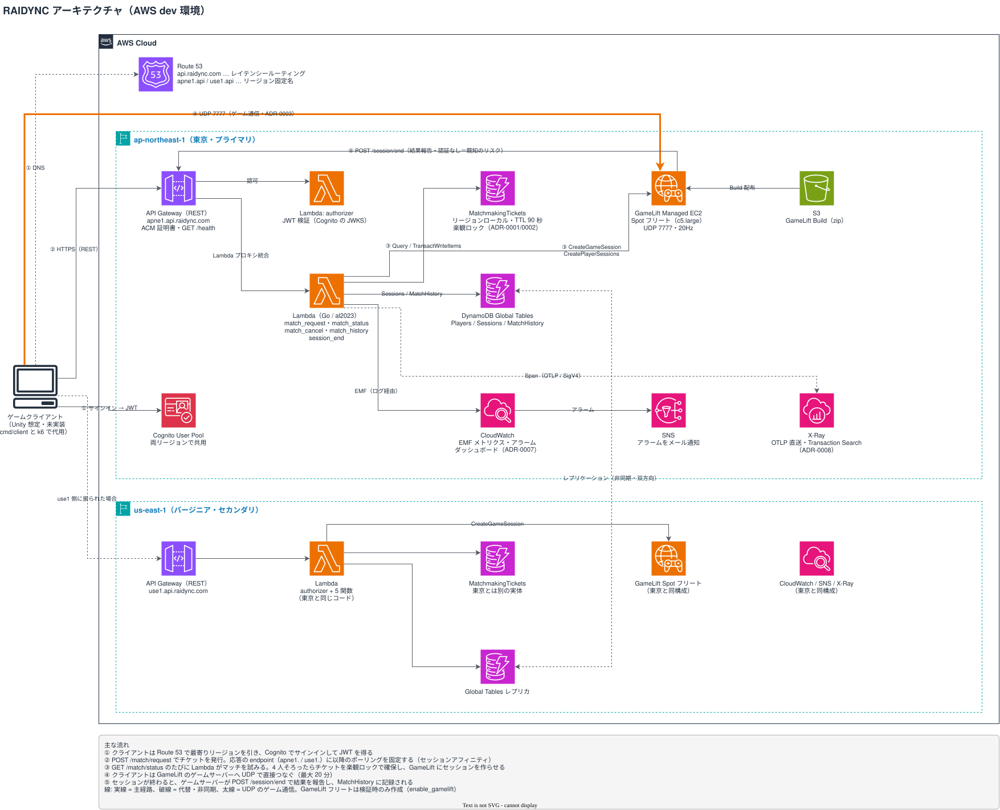
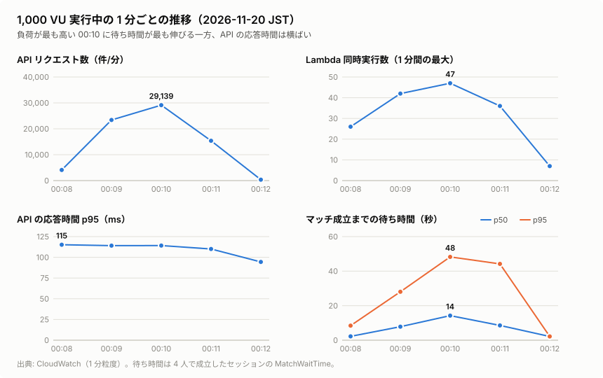

# RAIDYNC

**4 人協力のリアルタイムアクションゲームを想定した、マルチリージョンのゲームバックエンド基盤**です。認証・マッチメイキング・専用ゲームサーバー・監視までを AWS 上に Terraform で構築しています。

焦点はゲームの完成度ではなく、インフラの設計と品質です。クライアント（Unity）は作っておらず、Go 製の CLI クライアントと k6 で代わりに動かしています。

| 指標 | 結果 |
|------|------|
| 負荷テスト | **1,000 VU × 20 回（チケット 20,000 枚・4,968 セッション）で全しきい値に合格**。サーバー側のエラー・スロットリング 0 |
| マルチリージョン | 東京 + バージニア。Route 53 のレイテンシールーティングで、日本からの入口は 0.13 秒（バージニア固定だと 0.57 秒） |
| コスト | dev 環境は待機中ほぼ月 $1。同時 1,000 セッションの本番規模で月 約 $2,000 と試算 |
| IaC | AWS のリソースはすべて Terraform で管理（コンソールでの手動変更なし） |

---

## アーキテクチャ



```
ゲームクライアント
  ├─ HTTPS → Route 53（レイテンシー）→ API Gateway（REST）→ Lambda（Go）→ DynamoDB
  │            認証: Cognito（JWT）／ マッチメイキング: ポーリング + 楽観ロック
  └─ UDP   → GameLift Managed EC2（Spot）上の Go 製ゲームサーバー（最大 20 分）
               セッションが終わると、ゲームサーバーが結果を API に報告
```

1. クライアントは Cognito でサインインし、`POST /match/request` でマッチ待ちのチケットを発行する
2. `GET /match/status` のポーリングのたびに Lambda がマッチを試みる。4 人そろったらチケットを楽観ロックで確保し、GameLift にゲームセッションを作らせる
3. クライアントは GameLift のゲームサーバーへ UDP で直接つなぐ
4. セッションが終わると、ゲームサーバーが `POST /session/end` で結果を報告し、MatchHistory に記録される

| 層 | 使っているもの |
|----|---------------|
| 認証 | Amazon Cognito（メールとパスワード、任意で TOTP） |
| API | API Gateway（REST）+ Lambda（Go・`provided.al2023`・arm64）、Lambda Authorizer で JWT を検証 |
| データ | DynamoDB（Players / Sessions / MatchHistory は Global Tables、MatchmakingTickets はリージョンごと） |
| ゲームサーバー | Amazon GameLift Managed EC2（Spot）、Go 製の UDP サーバー、GameLift Server SDK 5.x |
| ネットワーク | Route 53（レイテンシールーティング・リージョン固定名）、ACM、API Gateway のカスタムドメイン |
| 監視 | CloudWatch（EMF のカスタムメトリクス・アラーム・ダッシュボード）、SNS、OpenTelemetry → X-Ray |
| IaC | Terraform（`aws` provider と、GameLift Build・Transaction Search だけ `awscc`） |
| ローカル | Docker Compose（LocalStack・Cognito のモック・Jaeger） |
| 負荷テスト | k6 |

## 設計のポイント

主な判断は [ADR](docs/adr/README.md) に、背景・検討した選択肢・トレードオフと一緒に記録しています。

| 判断 | 要点 |
|------|------|
| [楽観ロックでマッチを成立させる](docs/adr/0001-optimistic-lock-matchmaking.md) | 常駐のマッチメーカーを置かず、ポーリングを契機に Lambda がマッチを試みる。DynamoDB の条件付きトランザクションで、1 枚のチケットを 1 つのセッションにだけ割り当てる |
| [チケットはリージョンごとに分ける](docs/adr/0002-region-local-tickets.md) | Global Tables は後勝ちのマルチライターで、楽観ロックがリージョンをまたげない。チケットは複製せず、ポーリング先を発行元リージョンに固定する（セッションアフィニティ） |
| [ゲーム通信は UDP](docs/adr/0003-udp-with-seq-gate.md) | 位置同期は新しい値が古い値を上書きするので、再送より最新値を優先する。順序の逆転と重複だけをシーケンス番号で捨てる |
| [GameLift Managed EC2 + Spot](docs/adr/0004-gamelift-managed-ec2-spot.md) | ゲームサーバーのスケールの指標は CPU ではなく空いているセッションの枠。配置とドレインを GameLift に任せる |
| [VPC を作らない](docs/adr/0005-no-vpc.md)・[CloudFront を作らない](docs/adr/0006-no-cloudfront.md) | 使い所が無いものは作らない。NAT Gateway の月 約 $60 の固定費も無くなった |
| [メトリクスは EMF](docs/adr/0007-emf-metrics.md) | 関数を足しても監視の設定を足し忘れない。アラームは関数の一覧から自動で作る |
| [トレースは OpenTelemetry](docs/adr/0008-opentelemetry-tracing.md) | ローカルでは Jaeger、AWS では X-Ray に送る。API Gateway → Lambda → DynamoDB が 1 本のトレースになる |

## 負荷テスト

AWS dev（東京）に対し、k6 で 40 / 400 / 1,000 VU の負荷をかけました。詳細は [負荷テスト結果](docs/load-test-results.md) にあります。



- API の応答時間 p95 は、どの規模でも約 110〜160 ms で横ばい。Lambda の同時実行は最大 47
- **マッチ成立までの待ち時間は人数とともに伸びた**（p95 が 40 VU で 3.0 秒、1,000 VU で 41.9 秒）。全員が同じ数枚のチケットを取り合っていることが原因と考えていて、既知の限界として残している
- 1,000 VU の実測から 4,000 VU を推定すると、**MatchmakingTickets の GSI がホットキーで上限を超える見込み**
- テストの過程で、マッチ確定の書き込みがトランザクションの衝突で止まる不具合を見つけて直した

## コスト

詳細は [コスト試算](docs/cost-estimate.md) にあります。

| | 月額 |
|---|---:|
| dev 環境（待機中） | 約 $1 |
| 本番規模・今の構成（Spot、1 台 1 セッション、台数固定） | 約 $39,700 |
| 本番規模・施策をすべて入れた場合 | 約 $2,000 |

本番規模の費用はほとんどがゲームサーバーで、1 台に複数プロセスを載せることと、第 6 世代以降のインスタンス（転送無料）に変えることの効果が最も大きい。

---

## ローカルで動かす

AWS を使わずに、ログイン → マッチ → UDP でのプレイ → 結果の記録までを通せます。

```
client ─HTTP→ mock-auth（:9229）   … サインアップ・ログイン（JWT の発行）
client ─HTTP→ localapi（:8080）    … Lambda のハンドラーをそのまま HTTP で動かす
client ─UDP → localapi 内のゲームサーバー（:7777）
localapi ─→ LocalStack の DynamoDB（:4566）
```

### 必要なもの

- Docker（Docker Desktop など）
- Go 1.26.3 以上（`server/go.mod`）
- ポート 4566 / 9229 / 8080 / 7777 / 16686 / 4317 が空いていること

### 1. 依存のコンテナを起動する

```bash
docker compose -f docker/docker-compose.yml up -d
```

LocalStack・mock-auth・Jaeger が起動し、DynamoDB のテーブルは LocalStack の起動時に自動で作られます。

```bash
curl http://localhost:9229/health          # {"status":"ok"}
docker exec raidync-localstack awslocal dynamodb list-tables --region ap-northeast-1
```

### 2. ビルドする

```bash
cd server
go build -o ../bin/localapi ./cmd/localapi
go build -o ../bin/client ./cmd/client
cd ..
```

Windows では出力先を `..\bin\localapi.exe` / `..\bin\client.exe` にしてください。

### 3. localapi を起動する（ターミナル A）

Bash:

```bash
export DYNAMODB_ENDPOINT=http://localhost:4566 AWS_REGION=ap-northeast-1 \
       AWS_ACCESS_KEY_ID=test AWS_SECRET_ACCESS_KEY=test \
       AUTH_JWKS_URL=http://localhost:9229/.well-known/jwks.json \
       AUTH_ISSUER=http://localhost:9229 AUTH_CLIENT_ID=raidync-local-client \
       OTEL_EXPORTER_OTLP_INSECURE=true
./bin/localapi
```

PowerShell:

```powershell
$env:DYNAMODB_ENDPOINT = "http://localhost:4566"; $env:AWS_REGION = "ap-northeast-1"
$env:AWS_ACCESS_KEY_ID = "test"; $env:AWS_SECRET_ACCESS_KEY = "test"
$env:AUTH_JWKS_URL = "http://localhost:9229/.well-known/jwks.json"
$env:AUTH_ISSUER = "http://localhost:9229"; $env:AUTH_CLIENT_ID = "raidync-local-client"
$env:OTEL_EXPORTER_OTLP_INSECURE = "true"
.\bin\localapi.exe
```

`listening on :8080` と `gameserver(udp) listening on 127.0.0.1:7777` が出れば起動しています。

### 4. クライアントを動かす（ターミナル B）

```bash
./bin/client          # Windows: .\bin\client.exe
```

既定ではソロで即マッチし、UDP で移動を 10 回送ってから送信をやめます。約 10 秒後にゲームサーバーがセッションの終了を報告し、履歴に記録されます。最後に次の行が出れば成功です。

```
client: history found session=... quest=quest-001 result=ABANDONED duration=11s
client: E2E completed
```

トレースは Jaeger（<http://localhost:16686>）の Service `localapi` で見られます。詳しい手順とトラブルシューティングは [ローカル E2E の手順](docs/phase4-e2e-runbook.md) にあります。

### 5. 後片付け

```bash
docker compose -f docker/docker-compose.yml down
```

## テスト

```bash
cd server
go test ./...     # ユニットテスト（DynamoDB・GameLift はモック、UDP はループバックで実際に送受信）
go vet ./...

# DynamoDB の結合テスト（LocalStack を起動してから）
go test -tags integration ./internal/db/...
```

負荷テストは k6 で行います（`tests/load/load-test-small.js` はローカル、`load-test-large.js` は AWS dev 向け）。手順は [負荷テスト結果 §9](docs/load-test-results.md) にあります。

## AWS にデプロイする

> 費用がかかります。GameLift フリートは置いているだけで時間課金されるので、検証が終わったら必ず消してください。

1. **デプロイ用の IAM ユーザーを作る。** 必要な権限は [`terraform/bootstrap/raidync-cli-deploy-policy.json`](terraform/bootstrap/raidync-cli-deploy-policy.json) にあります。中の `<ACCOUNT_ID>` を自分の AWS アカウント ID に置き換えてから、IAM のポリシーとして作成してください。手順は [IAM ユーザーの作成](docs/aws-iam-user-setup.md) を参照してください
2. **Lambda をビルドする**（arm64 の `bootstrap` を `build/lambda/` に出力）

   ```bash
   ./scripts/build-lambdas.sh
   ```

3. **変数を用意する。** [`terraform/environments/dev/dev.tfvars`](terraform/environments/dev/dev.tfvars) を自分の環境に合わせます。`domain_name` を空にすると、カスタムドメイン・Route 53・証明書は作らず、API Gateway の URL をそのまま使います。アラームの通知先は環境変数で渡します（リポジトリに書かないため）

   ```bash
   export TF_VAR_notification_email=you@example.com
   ```

4. **apply する**

   ```bash
   terraform -chdir=terraform/environments/dev init
   terraform -chdir=terraform/environments/dev apply -var-file=dev.tfvars
   ```

   届いた SNS の確認メールのリンクを踏むまで、アラームのメールは届きません。

5. **（任意）GameLift を含めて E2E をする。** `./scripts/build-gameserver.sh` でゲームサーバーをビルドし、`enable_gamelift=true` で apply すると、両リージョンにフリートができます。終わったら `enable_gamelift=false` で apply して消します
6. **片付ける**

   ```bash
   terraform -chdir=terraform/environments/dev destroy -var-file=dev.tfvars
   ```

---

## ディレクトリ構成

```
.
├── server/                  # Go（Lambda・ゲームサーバー・ローカル用 API・CLI クライアント）
│   ├── cmd/
│   │   ├── lambda/          #   Lambda 6 関数（authorizer, match_request/status/cancel/history, session_end）
│   │   ├── gameserver/      #   GameLift 上で動く UDP ゲームサーバー
│   │   ├── localapi/        #   ローカルで Lambda のハンドラーとゲームサーバーを同居させる
│   │   ├── client/          #   E2E 用の CLI クライアント（Unity クライアントの代わり）
│   │   └── sessions/        #   負荷テスト後にセッションを検証する
│   ├── internal/            #   matchmaking・db・game・gameserver・auth・metrics・telemetry など
│   └── pkg/protocol/        #   API とゲーム通信のメッセージ型
├── terraform/
│   ├── environments/dev/    # AWS dev（本番と同じ構成、2 リージョン）
│   ├── environments/anywhere/ # GameLift Anywhere の検証用（開発専用、state を分離）
│   └── modules/             # cognito, api_gateway, lambda, dynamodb, gamelift_ec2, monitoring など
├── docker/                  # LocalStack・mock-auth（Cognito のモック）・Jaeger
├── tests/load/              # k6 のシナリオと、CloudWatch からグラフを作るスクリプト
├── scripts/                 # ビルド・負荷テストのユーザー作成・コスト試算
└── docs/                    # 設計・ADR・負荷テスト・コスト・手順書
```

## ドキュメント

| 文書 | 内容 |
|------|------|
| [ADR](docs/adr/README.md) | 主要な設計判断（8 本） |
| [負荷テスト結果](docs/load-test-results.md) | 1,000 VU の実測、規模ごとの比較、4,000 VU の推定、既知の限界 |
| [コスト試算](docs/cost-estimate.md) | dev の月額、本番規模の試算、削減施策 |
| [アーキテクチャ仕様](docs/spec-architecture.md)・[ゲーム仕様](docs/spec-game.md) | 計画時の仕様 |
| [ロードマップ](docs/roadmap.md) | 7 フェーズの計画と各フェーズの結果 |
| [Q&A ログ](docs/qa-log.md) | 設計・実装・運用で出た疑問と答え（学習の記録） |
| [ローカル E2E の手順](docs/phase4-e2e-runbook.md)・[GameLift Anywhere の手順](docs/phase4-anywhere-runbook.md) | 手順書 |

## 既知の限界

隠さずに書いておきます。各項目の詳細は、リンク先の文書にあります。

- **MatchmakingTickets の GSI がホットキーになる。** 1 つのクエストの待機者が同じパーティションキーに集まり、4,000 接続では書き込みの上限を超える見込み（[負荷テスト結果 §8](docs/load-test-results.md)）
- **マッチ成立までの待ち時間が人数とともに伸びる**（同上）
- **`/session/end` に認証が無い。** ゲームサーバーからの結果報告を受ける口で、今は誰でも呼べる
- **UDP のパケットの送り主を確かめていない**（[ADR-0003](docs/adr/0003-udp-with-seq-gate.md)）
- **On-Demand へのフォールバックとオートスケールは未実装**（[ADR-0004](docs/adr/0004-gamelift-managed-ec2-spot.md)）
- **ゲームとしての終わり方が無い。** クエスト達成の判定が無いので、結果は常に `ABANDONED` になる
- **Unity クライアントは作っていない。** CLI クライアントと k6 で代用している
