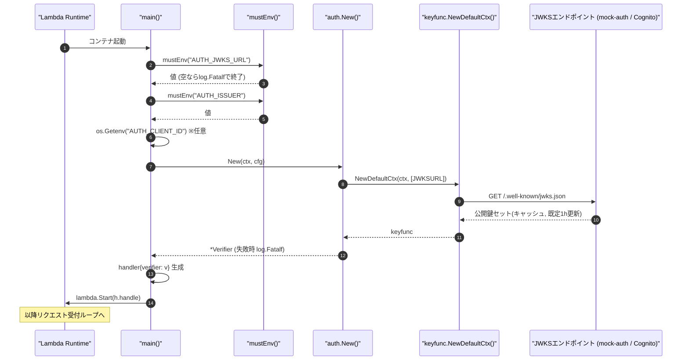
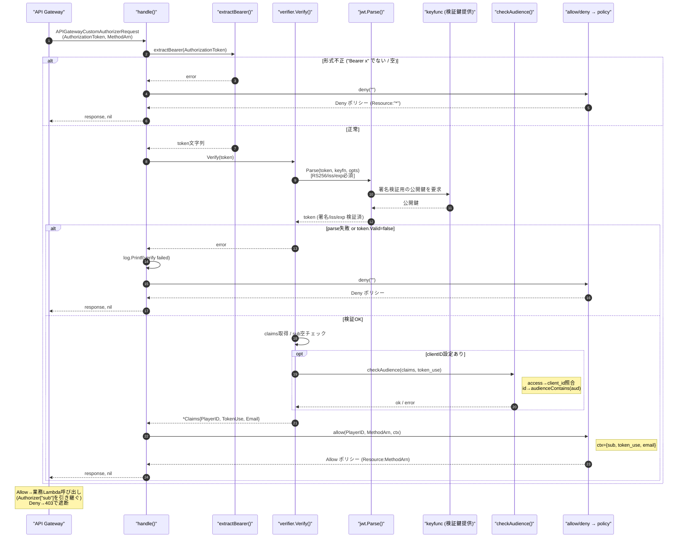

# Authorizer Lambda シーケンス図（関数レベル）

`server/cmd/lambda/authorizer/main.go` をエントリポイントとする
API Gateway TOKEN 型カスタムオーソライザの実行シーケンス。

- 関連パッケージ: `server/internal/auth/verifier.go`
- 役割: `Authorization: Bearer <jwt>` を検証し、Allow/Deny の IAM ポリシーを返す門番 Lambda

---

## ① 起動時（コールドスタート: `main` が一度だけ実行）

---

## ② リクエストごと（`handle` が毎回実行）

---

## 補足ポイント

- **鍵取得は①で1回だけ**。②では `keyfunc` がキャッシュ済みの鍵を返すため、リクエストごとに JWKS を叩かない（コンテナ再利用時）。
- **②はどの分岐でも `error` を返さず `nil`** を返す。拒否は「Deny ポリシー」という正常応答で表現し、API Gateway 側の 500 化を避ける設計。
- `Verify` 内の検証は `jwt.Parse` 呼び出しで **署名・`iss`・`exp` がまとめて** 行われ、その後にコード側で `sub` 必須チェックと（任意の）`checkAudience` が追加で走る。
