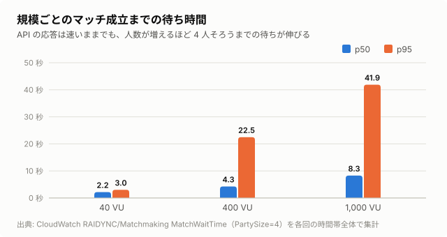
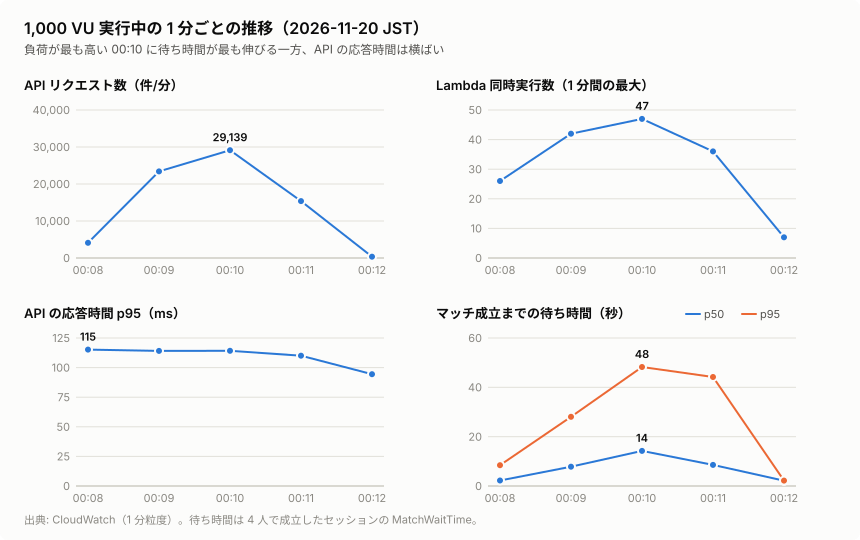
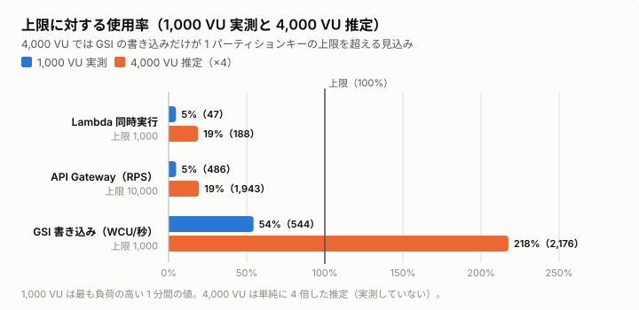

# 負荷テスト結果

**作成日：** 2026-11-20（2026-11-23 にグラフと規模ごとの比較を追加）  
**対象フェーズ：** Phase 6-5（ローカル）／ 6-6（AWS dev）

---

## 1. 要約

- AWS dev（ap-northeast-1）に対し、**1,000 VU × 20 回（チケット 20,000 枚）で全しきい値を合格**した。サーバー側の Errors / Throttles は 0
- これはマッチメイキング API に 1,000 人が同時に並ぶ負荷（同時に約 250 セッション分）。目標の **同時 1,000 セッション（4,000 接続）は実測せず、1,000 VU の実測値から推定**した（§7）
- API の応答時間は規模によらず速いまま（p95 は 40 VU で 160 ms、1,000 VU で 113 ms）。一方で、**マッチ成立までの待ち時間は人数とともに伸びた**（p95 が 3.0 秒 → 41.9 秒、§6）
- 推定の結果、**MatchmakingTickets の GSI がホットキーで上限を超える見込み**。待ち時間の伸びとあわせて、既知の限界として残している（§8）
- 負荷テストの過程で、サーバーの不具合を 1 つ見つけて直した（マッチ確定の書き込みの衝突、§5）

## 2. 実行環境

| 項目 | 内容 |
|------|------|
| 対象 | AWS dev 環境 `raidync-dev-api`（ap-northeast-1） |
| 負荷をかける側 | 自宅の PC 1 台から k6 を実行 |
| スクリプト | `tests/load/load-test-large.js`（AWS dev）、`tests/load/load-test-small.js`（ローカル） |
| テストユーザー | Cognito に `k6run+<連番>@example.com` を 1,000 人作成し使い回す（`scripts/create-load-test-users.sh`）。毎回作ると MAU が増えるため |
| Lambda 同時実行の上限 | 両リージョンとも 1,000（Service Quotas で 10 から引き上げ） |

## 3. シナリオ

1 VU が 1 人のプレイヤーで、次の 1 回を 20 回繰り返す（`per-vu-iterations`）。

1. `POST /match/request` でチケットを作る
2. `GET /match/status/{ticketId}` を 2 秒ごとにポーリングし、`MATCHED` / `TIMEOUT` / `FAILED` のどれかになるまで待つ（締め切りは POST の成功から 70 秒）

- マッチングは `match/status` を契機に動くので、ポーリングが必須
- 4 人組でマッチするので、VU 数は 4 の倍数にする
- 最初の 1 回だけ、VU の番号 × `PERIOD`（既定 0.1 秒）だけ開始をずらす（§5 の PC 側の経路の上限のため）
- `questId` は実行ごとに変え、前回の残りのチケットとマッチしないようにする

## 4. 合否の基準

| しきい値 | 条件 | 捕まえるもの |
|---------|------|-------------|
| `http_req_failed` | rate == 0 | HTTP の失敗 |
| `matchFailed` | rate == 0 | マッチ確定の書き込みが送り直しでも失敗した（`FAILED`） |
| `matchStuck` | rate == 0 | 締め切りまで終わりの状態にならなかった（`MATCHING` で止まる不具合など） |
| `matched` | 記録のみ | 40 VU 以上では、終わり際に 4 人そろわない `TIMEOUT` が必ず出るため |

マッチの正しさは、k6 とは別に DynamoDB を見て確かめる。

```bash
cd server && go run ./cmd/sessions -questID <k6 ログの questId> -matched <MATCHED の数>
```

全セッションの人数の合計が `MATCHED` の数と一致すること、各セッションの人数が 2〜4 人であることを確認する。

## 5. 段階ごとの結果

| 日付 | 環境 | VU × 回数 | 結果 |
|------|------|-----------|------|
| 2026-10-14 | ローカル（LocalStack） | 40 VU × 3 分 | 506 セッション、検証 OK |
| 2026-11-17 | AWS dev | 4 VU | マッチ確定の衝突を発見 → 修正後 matched 100% |
| 2026-11-18 | AWS dev | 40 VU × 20 | 合格（終わり際の TIMEOUT 2 件） |
| 2026-11-19 | AWS dev | 400 VU × 20 | 一斉接続で POST が約 50 件失敗 → ずらしを入れて合格（2,000 セッション） |
| 2026-11-19 | AWS dev | 1,000 VU × 20（PERIOD 0.05） | POST が 8〜121 件失敗（AWS に届いていない） |
| 2026-11-20 | AWS dev | 1,000 VU × 20（PERIOD 0.1） | **全しきい値合格**（4,968 セッション） |

### 見つけた問題

- **サーバーの不具合（修正済み、a7f376a）**: マッチ確定の `MarkMatched` が、同時に走った別の Lambda の `ClaimTickets` と衝突して `TransactionConflictException` になり、チケットが `MATCHING` のまま止まっていた。送り直し（`db.transactWithRetry`）と、まとめて `MATCHED` にする処理、失敗時の `FAILED` を入れた
- **PC 側の経路の上限（回避）**: 新しい接続を 1 秒に 20 本作ると、最初の POST が AWS に届かずにタイムアウトした。上限は同時に開いている数ではなく、新しい接続を作る速さにある。PC のアドレスが CGNAT の範囲（10.45.x.x）にあるため、プロバイダーかルーターの制限と推測している。本番の利用者はそれぞれ別の送信元から 1 本ずつ接続するので、この上限には当たらない
- **k6 の測り方（修正済み）**: 時間で区切ると終わり際に余りが出る、失敗した応答に `response.json()` を呼ぶと記録が消える、締め切りを POST の前から数えていた、など。詳細は `docs/qa-log.md` §15

## 6. 規模ごとの比較

合格した 3 回を、CloudWatch の 1 分粒度のメトリクスで比べた。

| 項目 | 40 VU | 400 VU | 1,000 VU |
|------|------:|-------:|---------:|
| 成立したセッション（4 人） | 200 | 1,999 | 4,968 |
| API リクエスト数（合計） | 1,776 | 21,543 | 72,378 |
| API の応答時間 p50 / p95 / p99 | 38 / 160 / 1,127 ms | 41 / 107 / 169 ms | 52 / 113 / 168 ms |
| Lambda 同時実行（1 分間の最大） | 39 | 34 | 47 |
| GSI 書き込み（最も高い 1 分の平均） | 65 WCU/秒 | 420 WCU/秒 | 544 WCU/秒 |
| マッチ成立までの待ち時間 p50 / p95 / 最大 | 2.2 / 3.0 / 4.1 秒 | 4.3 / 22.5 / 49.9 秒 | 8.3 / 41.9 / 60.5 秒 |
| API の 4XX・5XX ／ Lambda の Errors・Throttles ／ DynamoDB の throttle | すべて 0 | すべて 0 | すべて 0 |

- 応答時間と待ち時間は、各回の時間帯全体を 1 つの期間として集計した値（1 分ごとのパーセンタイルからは全体のパーセンタイルを出せないため）。40 VU の p99 が高いのは、件数が少なくコールドスタートの数件が効いているため
- 待ち時間は、4 人で成立したセッションの `MatchWaitTime`（成立させたポーリングのチケットが発行されてから成立までの時間）
- **Lambda の同時実行は人数に比例しない。** 1 回の処理が数十 ms で終わるので、同時実行数は人数ではなく、1 秒あたりのリクエスト数 × 処理時間で決まる



### 1,000 VU の 1 分ごとの推移



待ち時間が最も伸びたのは、終わり際ではなく**負荷が最も高い 00:10**（p50 14 秒、p95 48 秒）だった。終わり際に相手がそろわない影響（§4 の `matched` を記録だけにした理由）ではなく、同時に待っている人数が多いほど伸びている。その間も API の応答時間 p95 は約 114 ms で変わらないので、遅いのは 1 回の API 処理ではなく、**何回目のポーリングで成立するか**のほう。原因の仮説は §8 に書いた。

## 7. 1,000 VU の実測と 4,000 VU の推定

1,000 VU（questId `load-test-1795100680049`、負荷は 2026-11-20 00:08〜00:11 JST の約 4 分）の実測値。

| 項目 | 1,000 VU（実測） | 4,000 VU（推定） | 上限 | 評価 |
|------|-----------------|-----------------|------|------|
| Lambda 同時実行 | 最大 47 | 約 200 | 1,000 | 余裕あり |
| API Gateway | 約 486 RPS（最大の 1 分 29,139） | 約 1,950 RPS | 10,000（バースト 5,000） | 余裕あり |
| GSI `questId-status-index` 書き込み | 約 544 WCU/秒（最大の 1 分 32,633） | 約 2,200 WCU/秒 | 1 パーティションキー 1,000 | **超える見込み** |
| 本体 `MatchmakingTickets` 書き込み | 約 2,800 WCU/秒（最大の 1 分 170,211） | — | キーが `ticketId` でばらけるので集中しない | — |

- チケット 20,000 枚（MATCHED 19,872、TIMEOUT 128）。`http_req_duration` の最大 1.54 秒
- DynamoDB の `WriteThrottleEvents` は GSI・本体とも 0
- どの値も 1 分の平均。秒単位の山はこれより高い



4,000 VU の推定は、1,000 VU の最も負荷の高い 1 分を単純に 4 倍したもの。§6 のとおり Lambda の同時実行は人数に比例しないので、この推定は多めに見積もっている。GSI の書き込みはチケットの発行と状態の変化ごとに起きるので、人数にほぼ比例すると考えられる

### 4,000 VU を PC から実測しなかった理由

最初のずらしが `4,000 × 0.1 = 400 秒` になり、最初の方の VU は最後の VU が始まる前に 20 回を終えてしまう。同時の人数が 4,000 に届かないので、実行しても 4,000 人分の負荷をかけたことにならない。ずらしの間隔を縮めると、PC 側の経路の上限に当たる。

## 8. 既知の限界と未検証の範囲

### GSI のホットキー（既知の限界）

k6 は全員が同じ `questId` で並ぶため、GSI `questId-status-index` への書き込みが 1 つのパーティションキーに集中する。

- 4,000 VU では約 2,200 WCU/秒と推定され、1 パーティションキーの上限 1,000 WCU/秒の約 2 倍になる
- ソートキー `status` は値が数種類しかないので、split for heat も効きにくい
- GSI が throttle されると本体テーブルの書き込みも throttle され、マッチメイキングが止まる
- 本番でも、全員が同じイベントクエストに並ぶ場面で起こりうる。直し方（パーティションキーの分散など）は宿題

### マッチ成立までの待ち時間の伸び（既知の限界・原因は未検証）

1,000 VU では待ち時間の p95 が 41.9 秒になり、60 秒の締め切りに近づいている（§6）。人数がさらに増えると、4 人そろっているのに締め切りを過ぎる人が出るおそれがある。

原因の仮説は、**全員が同じ数枚のチケットを取り合っている**こと。

- マッチを試みるたびに、GSI から同じクエストの待機中チケットを最大 50 枚取る（`candidateFetchLimit`）。パーティションキーもソートキーも全員同じなので、どのポーリングもほぼ同じ 50 枚を受け取る
- その中から作成の古い順（FIFO）に 3 人を選ぶので、同じ瞬間にポーリングした人たちは**同じ 3 人**を自分のグループに入れようとする
- 楽観ロックで確保できるのは 1 人だけで、残りは失敗して次のポーリング（2 秒後）まで待つ（[ADR-0001](adr/0001-optimistic-lock-matchmaking.md)）。ローカルの Jaeger でも、40 VU で確保の失敗 93 回に対して成立 48 回だった

直し方の候補は、候補の中から選ぶ相手をばらす（古い順の先頭ではなく、ランダムやチケット ID のハッシュで選ぶ）こと。待ち時間の公平さ（古い人から順に）とのトレードオフになる。確かめるには、確保の失敗回数をメトリクスにして、人数との関係を見る

### 未検証

- **一斉接続（バースト）**: メンテナンス明け、イベント開始時、リージョン障害後の再接続では、数千人がほぼ同時に来る。PC 1 台の送信元では作れない負荷で、確かめるには負荷をかける側を複数の送信元に分ける必要がある。本番の対策はクライアントのリトライ（指数バックオフ + ジッター）
- **GameLift の UDP セッション**: 目標の「4,000 接続」は、本来 GameLift 上の UDP 接続のこと。k6 が負荷をかけているのはマッチメイキング API だけで、20 分のゲームセッションを 1,000 本同時に動かす側は測っていない

## 9. 実行方法

```bash
# テストユーザーを作る（冪等。既存のユーザーはパスワードだけ再設定）
./scripts/create-load-test-users.sh 1000

# 実行
k6 run -e VUS=1000 -e API_URL="$(terraform -chdir=terraform/environments/dev output -raw api_invoke_url)" tests/load/load-test-large.js

# マッチの正しさを確かめる
cd server && go run ./cmd/sessions -questID <questId> -matched <MATCHED の数>
```

- 環境変数: `VUS`（4 の倍数、既定 4）、`ITERATIONS`（既定 20）、`PERIOD`（既定 0.1）
- 1,000 VU では k6 のメモリが約 2 GB になる

### グラフの作り直し方

§6・§7 のグラフは、CloudWatch のメトリクスから作っている。取得したデータは `tests/load/results/cloudwatch-2026-11.json` に保存してある。

```bash
# 取得（AWS CLI と cloudwatch:GetMetricData の権限が要る）
python tests/load/results/fetch_cloudwatch.py tests/load/results/cloudwatch-2026-11.json
# SVG を作る（依存なし）
python tests/load/results/plot_charts.py tests/load/results/cloudwatch-2026-11.json docs/images/load-test
```

- **CloudWatch の 1 分粒度のデータは 15 日で消える**（以後は 5 分粒度）。新しく負荷テストをしたら、15 日以内に取得しておく
- 各回の時間帯は `fetch_cloudwatch.py` の `RUNS` に書いてある。API Gateway の 1 分ごとのリクエスト数から特定し、成立したセッション数が §5 の記録と一致することで確かめた。40 VU は 2026-11-18 に 2 回実行しており、後の回（23:30 JST）を使った
