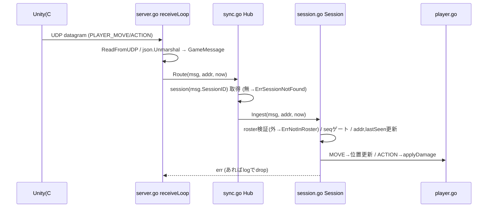
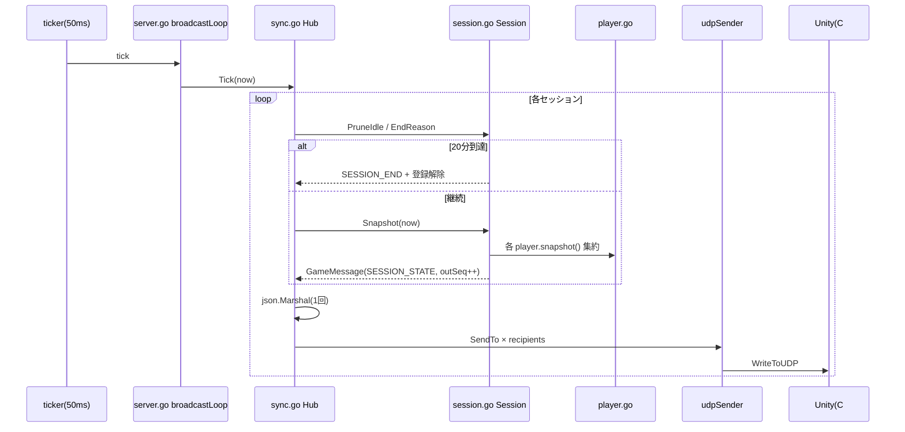

# RAIDYNC 質問ログ

> プロジェクト（設計・実装・インフラ・運用）についての質問と回答の要点を、フェーズを問わず蓄積する学習ログ兼ポートフォリオ素材。
> C#/Unity 背景の視点での疑問が中心。詳細な実装は各ソース・`docs/specification.md` を参照。
> 以下は Phase 0〜2 のぶん。新しい質問は適切なセクションへ追記する。

## 目次
1. [Go プロジェクト構造](#1-go-プロジェクト構造)
2. [マッチメイキングの設計判断](#2-マッチメイキングの設計判断)
3. [DynamoDB](#3-dynamodb)
4. [マッチングロジック](#4-マッチングロジック)
5. [JWT 認証](#5-jwt-認証)
6. [テスト（単体・結合）](#6-テスト単体結合)
7. [意図的な割り切り](#7-意図的な割り切り)
8. [テストの実機確認](#8-テストの実機確認)
9. [Git / SSH 環境構築](#9-git--ssh-環境構築)

---

## 1. Go プロジェクト構造

### Q. Lambda で Go を使うとき、`main.go` を 1 つの Lambda 機能ごとに配置する認識でいい?
A. はい。`cmd/lambda/<機能名>/main.go` という構成で、**1 機能 = 1 `main` パッケージ = 1 ビルド成果物**。`match_request` / `match_status` / `match_cancel` / `match_history` / `authorizer` がそれぞれ独立した Lambda になる。

### Q. `cmd` / `internal` / `pkg` のディレクトリ構成の理由は?
A. Go コミュニティの標準レイアウト。
- **`cmd/`** … 実行可能エントリポイント（`main` パッケージ）。
- **`internal/`** … 非公開実装。**コンパイラがモジュール外からの import を強制的に禁止**する特別なディレクトリ。
- **`pkg/`** … 外部に公開してよい共有型・ユーティリティ（例 `pkg/protocol/types.go`）。

### Q. `internal` 内のファイルは `server` からは参照できるが `RAIDYNC` からは参照できない?
A. その通り。`internal` は「`internal` の親ディレクトリをルートとするツリー内からのみ import 可能」というルール。`server/internal/...` は `server/` 配下からは使えるが、`server/` の外（別モジュール）からは使えない。アクセス修飾子の `internal`（C#）に近いが、**ディレクトリ位置で機械的に決まる**点が違う。

### Q. import が `github.com/raidync/server/*` とローカル内容なのに URL 形式なのはなぜ?
A. `go.mod` の `module` 宣言で決めた**モジュールパス**が import の接頭辞になるため。実際に GitHub へ取りに行くわけではなく、**一意な名前空間**として URL 形式の慣習を使っているだけ。ローカルのコードでも宣言したパスで参照する。

### Q. この接頭子は `go.mod` につき 1 つだけ?
A. はい。`module` 宣言は 1 つの `go.mod` に 1 つ。このリポジトリは `server`（メイン）と `docker/mock-auth` が**別々の `go.mod` を持つマルチモジュール構成**で、それぞれ独自の接頭辞を持つ。

### Q. `go.mod` は C# の `.csproj` に近い?
A. 近い。依存パッケージとビルド対象を定義する点は同じ。ただし `go.mod` は**モジュール単位**（複数パッケージを束ねる）で、`.csproj`（プロジェクト=アセンブリ単位）より粒度が大きい。

### Q. API Gateway の内容が `lambda` ディレクトリ内にあるのは意図的?
A. 意図的。`internal/apigw/` に置いているのは「API Gateway ⇄ Lambda 間の**変換ヘルパー**」（レスポンス整形 `respond.go`、認証情報の取り出し `auth.go`）。API Gateway 本体ではなく、Lambda 側で必要になる薄い接続層。

### Q. API Gateway はローカルに存在しないから自作している認識でいい?
A. おおむね正しい。LocalStack が API Gateway をエミュレートするが、認証情報の受け渡し（Authorizer Context）など**ローカルと AWS で挙動が揃わない部分**を吸収するために薄いヘルパーを自作している。

### Q. 現状実装している各ファイル（パッケージ）の相関関係は?
A. 実装は **2 つの平面**に分かれ、その間を **`pkg/protocol`（共有契約）**が橋渡しする。`protocol` は何にも依存せず全層から依存される中心（C# のドメインモデル/DTO 相当）。

```
                  pkg/protocol（共有契約・依存ゼロの中心）
       REST側: Ticket/Session/ConnectionInfo   RT側: GameMessage/PlayerState
                  ▲                                   ▲
 ── REST平面（マッチメイキング: Lambda/HTTPS）──   ── RT平面（ゲーム: UDP）──
 cmd/lambda/authorizer → internal/auth(Verifier)  cmd/gameserver/main（薄い入口）
 cmd/lambda/match_{request,status,cancel,history}   → internal/gameserver/server（UDP I/O+ループ）
   → internal/apigw（PlayerID/JSON応答）               → internal/game（Hub/Session/player）
   → internal/matchmaking（Matcher/selectGroup）     → internal/gameserver/gamelift（SDK連携）
       → SessionProvider（gamelift_stub）┄┄┄┄┄┄┄┄┄► （Phase3で実GameLiftへ）
   → internal/db（Client）→ DynamoDB
```

- **REST 平面（Phase 2）**: `authorizer` が JWT 検証→`sub` を Authorizer Context へ。業務 Lambda は `apigw.PlayerID()` で読む。`matchmaking.Matcher` が `Store` IF 越しに DynamoDB を操作してチケットを組成。`internal/db` だけが DynamoDB に触れる末端。
- **RT 平面（Phase 3）**: `cmd/gameserver` は配線のみ。`gameserver/server.go` が UDP I/O と 50ms tick、`internal/game` が状態更新とスナップショット生成（送信は `Sender` IF で抽象化し net 依存を隔離）。`gamelift.go` が SDK ライフサイクルを Hub に橋渡し。
- **2 平面の継ぎ目（最重要）**: マッチ結果 `matchmaking.finalize → protocol.Session.PlayerIDs` が、GameLift の `GameProperties["playerIds"]` → `gamelift.go parseSessionConfig` → `game.NewSession(roster)` へ流れる。**`Session.PlayerIDs`（REST）＝ `Session.roster`（RT）**を一致させることで、別プロセス・別プロトコルの 2 平面が論理結合する。現状この継ぎ目は `gamelift_stub`（固定接続先）で、Phase 3 後半に実 GameLift へ差し替え。
- **依存方向の規律**: 全層が内側の `protocol` に依存し `protocol` は何にも依存しない。`db`/`game` は末端。`net` は `gameserver` 層、AWS SDK は `db`/`gamelift` 層に局所化。`Store`/`SessionProvider`/`Sender`/`apigw.PlayerID` の各 IF が簡略版→本番版の無痛差し替えを可能にする（処理フロー視点は §10「Phase 3 各ファイルのシーケンス」を参照）。

---

## 2. マッチメイキングの設計判断

### Q. タイムアウトとポーリングの関係は?
A. API Gateway は 29 秒、Lambda は最大 30 秒で打ち切られる一方、マッチ待機は最大 60 秒必要。そのため**同期で待ち続けず**、チケットを発行して即返し、クライアントが数秒間隔（`PollIntervalSec=2`）で `match_status` をポーリングする**非同期チケット方式**にしている。

### Q. チケットの各要素（questId / partyId / soloAllowed）の意味は?
A. **同一系統のプレイヤーをグルーピングする**ための分類・制約。
- `questId` … 同じクエストを希望する者だけを集める**フィルタ**。
- `partyId` … 既存パーティを**絶対に分割しない**ための束縛キー。
- `soloAllowed` … ソロ希望者を他とまとめないためのフラグ。

### Q. 楽観ロックで status(WAITING→MATCHING) と version(0→1) は同時に更新される?
A. はい、**同一の更新操作（1 トランザクション）内で同時に**変わる。`ConditionExpression` で「現在 status=WAITING かつ version=現在値」を条件にし、満たせば status と version を**まとめて**書き換える。条件が満たせなければ全体が失敗する。

### Q. B,C,D 取り合いシナリオ（複数の matcher が同じ待機者を奪い合う）は解決していない?
A. 解決している。`TransactWriteItems` の **All-or-Nothing** 性質により、先に確保した側だけが成功し、競合した側は `ErrConflict` で**全件ロールバック**される。中途半端に一部だけ MATCHING になることはない。

### Q. DynamoDB への処理は直列なので、後続のマッチングはすべてロールバックされる認識でいい?
A. はい。トランザクションは原子的。条件不一致が 1 件でもあれば、そのトランザクション内の全 Put/Update が取り消され、チケットは WAITING のまま保たれる。次のポーリングで再度マッチングが試みられる。

### Q. マッチング成立処理をクライアントに任せることでインフラ構成が簡略化されている認識でいい?
A. 正しい。専用のワーカーや EventBridge スケジューラを置かず、**クライアントのポーリングが matcher の実行契機**になる。チケットは受動的なデータ、Lambda が能動的なアクター、という役割分担でインフラを軽くしている。

---

## 3. DynamoDB

### Q. PK / SK / GSI / TTL / Global Tables は何を指し、何をしている?
A.
- **PK（パーティションキー）** … レコードを一意に引くための主キー。データの物理的な配置先も決める。
- **SK（ソートキー）** … 同一 PK 内で複数レコードを並べ・範囲検索するためのキー（例 MatchHistory は playerId(PK)+timestamp(SK)）。
- **GSI（グローバルセカンダリインデックス）** … PK 以外の属性で検索するための「別の引き口」。本プロジェクトでは `questId-status-index` / `playerId-status-index`。**結果整合**である点に注意。
- **TTL** … 指定した時刻（epoch 秒）を過ぎたレコードを DynamoDB が自動削除。MatchmakingTickets は 90 秒で消える短命データ。
- **Global Tables** … 複数リージョン間で自動レプリケーションするマルチマスター構成。Players/Sessions/MatchHistory は対象、短命で region-local な MatchmakingTickets は対象外。

---

## 4. マッチングロジック

### Q. A が B,C,D でセッションを作るのは分かるが、B,C,D も同時にセッションを作ろうとしない? E のステータスは既に MATCHING では?
A. 作ろうとしない。`ClaimTickets` でグループ全員のチケットを**一括で WAITING→MATCHING に確定**させた「確保した matcher」だけが、その後セッション生成（finalize）まで責任を持つ。他のチケット（B,C,D）は既に MATCHING なので、それぞれのポーリングでは「成立済み」を受け取るだけで、新たにセッションを作らない（パススルー）。E も確保済みなら同様。

### Q. ③（セッション生成）より先に④を置かないのはなぜ?
A. **チケットの確保（MATCHING 確定）を先に済ませてからセッションを生成する**順序にしている。先にセッションだけ作って確保に失敗すると、**使われない幽霊セッション**が残ってしまう。確保成功を確認してから外部リソース（GameLift セッション）を作ることで、整合性を保ち無駄を防ぐ。

---

## 5. JWT 認証

要点（mock-auth ⇄ authorizer ⇄ 業務 Lambda の流れ）:
- mock-auth が RS256 で署名した JWT を発行し、`/.well-known/jwks.json` で公開鍵（JWKS）を配布。
- API Gateway の **TOKEN 型カスタムオーソライザ**（`authorizer` Lambda）が `Authorization: Bearer <jwt>` を検証。
- 検証成功時、`sub`（=playerId）を **Authorizer Context** に載せて業務 Lambda へ渡す。
- 業務 Lambda は `apigw.PlayerID()` 経由で playerId を取得。
- 検証は署名・発行者(iss)・対象(aud/client_id)・有効期限を確認。`sub` 欠落や改ざんは拒否。

### Q. authorizer Lambda は他の Lambda の API を叩かれたときに使われる? 単独稼働はある?
A. 主語を 1 つ補正すると正確になる。
- **呼ぶのは API Gateway**: 保護ルートにリクエストが来ると、API Gateway が **authorizer → 業務 Lambda の順**で呼ぶ。「業務 Lambda が authorizer を呼ぶ」のではない。authorizer はクライアントから直接叩けず、業務 Lambda とも直接の呼び出し関係を持たない。各保護 API の実行前に必ず通る**共通の関所**（C# の `[Authorize]` 属性/認証ミドルウェア相当。違いは物理的に別 Lambda=別プロセスで動く点）。
- **単独稼働は基本なし**: イベントソースは API Gateway のオーソライザ呼び出しのみ。EventBridge 定期実行・他サービスからの直接 invoke のような独立起動は設計に含めない。
- **毎回起動するわけでもない**: API Gateway は判定結果（トークン→Allow/Deny ポリシー）を **Authorizer result TTL** の間キャッシュする。TOKEN 型なので `Authorization` ヘッダ値がキャッシュキー。同一トークンで TTL 内の再アクセスは authorizer を起動せずキャッシュを使う。例外的な単独起動はコールドスタート初期化やテストの手動 invoke 程度。
- **未実装**: どのルートに attach するか/キャッシュ TTL は Terraform（Phase 1 `api_gateway` モジュール）で定義予定。現状コードは authorizer 自体（JWT 検証＋Allow/Deny ポリシー生成、`deny` は `Resource:"*"` の Deny・principalID=anonymous）のみ。

---

## 6. テスト（単体・結合）

### Q. 単体テストと結合テストは何が違う?
A.
- **単体テスト** … 外部依存なしで**ロジック単体**を検証。fake 実装やメモリ上のダミーで完結し、高速・安定。本プロジェクトでは `auth`(9) と `matchmaking`(16)。
- **結合テスト** … **本物の外部システム（LocalStack の DynamoDB）に接続**して、CRUD や原子的トランザクションが実環境で正しく動くか検証。`//go:build integration` タグ付きの `db`(4)。

### Q. matchmaking の grouping / matcher テストは何を行っている?
A.
- `select_group_test.go`（6 ケース）… `selectGroup` の**パーティ分割禁止 FIFO グルーピング**を検証。パーティが途中で割れない、ソロが混ざらない等。
- `matcher_test.go`（10 ケース）… `TryMatch` の**分岐フロー**を検証。チケット不在→エラー、非 WAITING→パススルー、期限切れ→タイムアウト処理、ソロ、通常成立(4 人)など。fakeStore + 固定時刻で判定。

---

## 7. 意図的な割り切り

スコープ外（仕様 4.8）: Backfill、スキルレーティング(MMR)、クエストカタログ(固定 5 種)、MatchmakingTickets の Global Tables、regionPref、EventBridge。
→ いずれも「**インフラ品質を見せる**」目的に対し本質でないため削ぎ落とした判断。

実装上の割り切り（自覚済みの改善余地）:
- `FindWaitingByPlayer` の冪等チェックは GSI の**結果整合**に依存（連打で稀に二重発行の隙間）。
- GameLift 接続情報・`playerSessionId` はスタブの固定値（Phase 3 で本物に差し替え）。
- Authorizer Context は flat keys（REST カスタムオーソライザの仕様上ネスト不可）。
- ログは `log.Printf` 直書き（Phase 6 で構造化）。

差し替え容易性: `SessionProvider` / `Store` インターフェースと `apigw.PlayerID` により、**簡略版を本番版へ無痛で挿せる構造**にしてある。

---

## 8. テストの実機確認

### Q. testify と testing の違いは?
A. `testing` は Go 標準のテストフレームワーク（`func TestXxx(t *testing.T)`）。`testify` はその上に**読みやすいアサーション**（`require`/`assert`）を足すサードパーティ。`require` は失敗で即中断、`assert` は継続。

### Q. テストの実機確認の方法は?（Windows での詰まり）
A. このマシンは **Windows Application Control (WDAC)** が `%TEMP%` 配下の大きい test バイナリ（crypto/HTTP を含む 12MB 級）を実行ブロックする。回避策:
```powershell
# %TEMP% を避け、プロジェクト配下にビルドしてから実行する
go test -c -o .\auth.test.exe .\internal\auth
.\auth.test.exe "-test.v"          # -test.v は必ずクォート（PowerShell が .v を分割解釈するため）

# 結合テストは integration タグ + LocalStack 起動が前提
docker compose -f docker/docker-compose.yml up -d localstack
bash ./docker/localstack/scripts/localstack-init.sh
go test -c -tags=integration -o .\db.test.exe .\internal\db
.\db.test.exe "-test.v"
```
- 小さい test（`matchmaking` ≒4MB）は `go test ./internal/matchmaking/...` で直接通る。
- 結合テストのテストデータは UUID で毎回ユニークにする（TTL 90 秒で残る前回データが GSI に引っかかるのを防ぐ）。

最終確認状態: 単体 25（auth 9 + matchmaking 16）+ 結合 4 すべて PASS。`go build ./...` / `go vet ./...` は常時通過。

---

## 9. Git / SSH 環境構築

### Q. Phase 0 で Git 管理を始めるのが抜けていた。Phase 0〜2 で漏れがないか精査したい。
A. 精査結果:
- 機械チェック … 未追跡ファイルゼロ、誤除外ゼロ（除外は tarball/exe/個人設定のみ）。
- ロードマップ照合で **Phase 0 の欠落** を発見 → 対応:
  - `.env.example`（0-3）を作成・コミット。
  - `develop` ブランチ（0-4）を作成・push。
  - 空の `.env/` ディレクトリは手動削除へ。
  - GameLift Local のコメントアウトは Phase 3-1 範囲で設計通り（問題なし）。

### Q. クローンは HTTPS でなく SSH で行いたい。汎用的にキーを作るのは問題?
A. 基本は汎用鍵 1 つで問題ない。**唯一の例外**は「同じ `github.com` に複数アカウントを SSH で使い分ける」場合。GitHub は 1 つの公開鍵を 1 アカウントにしか登録できないため、複数併用時は鍵を分けて `~/.ssh/config` のホストエイリアスで振り分ける必要がある。

### Q. キー作成コマンドの解説。
A.
```bash
ssh-keygen -t ed25519 -C "コメント(メール)" -f <出力パス>
```
- `-t ed25519` … 鍵アルゴリズム（現代の推奨）。
- `-C` … 識別ラベル（認証には無関係）。
- `-f` … 出力先。秘密鍵と `.pub`（公開鍵）の 2 つができる。
- パスフレーズは任意（`-N ""` で空固定にして非対話化も可）。
- **トラブル**: PowerShell の `ssh-keygen` は `~` を展開しないことがある → **フルパス**（`$env:USERPROFILE\.ssh\...`）で指定する。

### このマシンの最終 Git/SSH 構成
- リポジトリ: **`maedakai/RAIDYNC`**（SSH）。
- **複数アカウント環境**のため、衝突回避にホストエイリアスを採用:
  - `~/.ssh/config` の `Host github-maedakai` → 鍵 `~/.ssh/Github/maedakai/id_ed25519_raidync`。
  - origin URL = `git@github-maedakai:maedakai/RAIDYNC.git`。
- ブランチ戦略: `main`(デフォルト) / `develop`(開発統合) / `feature/*`。
- コミット作者はローカル設定で `Maeda` / `maeda.kai0314@gmail.com`。
- `.gitignore` で `server/go*.tar.gz`(64MB×2)・`*.exe`・`.env`・`.claude/settings.local.json` 等を除外。

---

## 10. Phase 3：ゲームサーバー / トランスポート

### Q. ゲームサーバーの通信は WebSocket(TCP) と UDP のどちらにすべき? 違いは?
A. **WebSocket は TCP の上に乗ったメッセージプロトコル**なので、選ぶと TCP の性質（到達保証・順序保証・再送）を受け継ぐ。
- **TCP/WebSocket** … 電話型。届くまで再送し順序も守る。ただし 1 パケット欠落で後続が待たされる（**Head-of-Line ブロッキング**）→ 20Hz 位置同期では「カクつき」要因。.NET の `TcpClient` 相当。
- **UDP** … ハガキ型。投げっぱなしで到達・順序保証なし。速いが、順序・欠落・輻輳制御を**自前実装**する必要（Unity Transport / Mirror の KCP が裏でやっていること）。.NET の `UdpClient` 相当。
- 位置同期は「50ms 前の古い座標は次パケットで上書きされる」ため再送の価値が薄く、アクションゲームでは UDP が定番。

**RAIDYNC の判断**: WebSocket も選択肢だったが、最終的に **UDP を採用**。理由は (1) 仕様 (spec-game.md §3.1) が GameLift UDP 7777 で一貫している、(2) アクションゲームの定番であり「なぜ UDP か」を技術面接で説明しやすい、(3) GameLift の UDP フリート前提と素直に噛み合う。トレードオフとして**信頼性レイヤを自前実装**する必要があるが、位置同期では「再送より最新値優先」が正しいため、フル ACK/再送ではなく **シーケンス番号による古い/重複パケットの破棄**だけを実装し、コストを最小化した。

### Q. UDP は順序保証がないのに、どう「古いパケット」を捨てている?
A. 共通エンベロープ (spec §3.4) に仕様外の拡張として `seq`（クライアントが 1 始まりで単調増加採番）を追加。サーバーは **プレイヤー単位で受理済み最大 seq を保持**し、`seq <= lastSeq` のパケットを黙って破棄する（`internal/game/session.go` の Ingest）。これで UDP の並べ替え・重複で古い座標に巻き戻る事故を防ぐ。SESSION_STATE 側もサーバー採番の seq を載せ、クライアントが同様に新しい方だけ採用できる。フル再送が要る将来要件（重要アクションの確実な到達）が出たら、この上に選択的 ACK を足せる設計。

### Q. 自作した信頼性レイヤを詳しく（何を実装し、何をあえて捨てたか）
A. 「信頼性」は実は 4 要素の集合（到達保証・順序保証・重複排除・輻輳制御）。TCP は全部やるが HoL ブロッキングを招く。今回はこのうち **位置同期に必要な「順序の逆転無効化＋重複排除」だけ**を seq ゲートで実装した。

- **前提**: 位置同期は「状態が冪等に上書きされ、古い情報は無価値」。50ms 前の座標は次パケットで完全に上書きされるので再送の価値が薄い。必要なのは「最新が届くこと」であって「全部が順番通り確実に届くこと」ではない（Mirror の unreliable channel と同じ考え）。
- **仕組み**: クライアントが seq を 1 始まりで単調増加採番（MOVE/ACTION 共通ストリーム）。サーバーは `if p.seen && msg.Seq <= p.lastSeq { return nil }` で破棄、通れば `lastSeq` 更新。
  - 並べ替え例: 送信 1,2,3 が到着 1,3,2 → ゲートなしは posC→posB で古い座標へ巻き戻る。ゲートありは 2<=3 で破棄し posA→posC で最新維持。
  - 重複例: seq3 が二重到着 → 2 回目は 3<=3 で破棄。
  - SESSION_STATE もサーバー採番 seq を載せ、クライアント側でも同ロジックで古いスナップショットを捨てられる（対称設計）。
- **あえて捨てたものと理由**: 再送（位置は上書きされる）/欠落補完（補間はクライアント責務）/輻輳制御（20Hz 固定レート）/ACK。
- **弱点と将来拡張**: (1) PLAYER_ACTION も再送なし＝重要イベントがベストエフォート → 冗長送信か選択的 ACK を足す。(2) 再接続で seq=1 に戻ると全部「古い」と誤判定 → 接続セッション ID で lastSeq リセット。(3) uint32 のラップアラウンドは 20Hz で約 6.8 年なので実用上無視。
- 要するに **TCP の信頼性を位置同期に必要な分まで削ぎ落としたコスト最小レイヤ**。フル信頼性が要れば KCP に置換し seq ゲートはそちらに吸収させる。

### 実装メモ（Phase 3 ステップ1〜4 完了）
- `pkg/protocol/game.go` … 共通メッセージ型（GameMessage エンベロープ + 各 payload、`seq` 拡張）。
- `internal/game/{player,session,sync,errors}.go` … セッション状態管理。Session が受信取り込み・seq ゲート・ダメージ適用・SESSION_STATE スナップショット生成・20 分タイムアウト/アイドル離脱を担当。Hub が複数セッションのルーティングと 50ms 周期ブロードキャストを担う。送信は `Sender` インターフェースで注入し net 依存をサーバー層に隔離（既存の matchmaking `Store` と同じ思想）。
- `internal/gameserver/server.go` + `cmd/gameserver/main.go` … 実 UDP ソケットと Hub の配線。main は薄いエントリポイント。
- テスト … session/sync のユニット 13 ケース + 実ループバック UDP の往復統合テスト（PLAYER_MOVE 送信 → SESSION_STATE 受信）。すべて green。
- **残**: ステップ5（GameLift Server SDK for Go 連携）／ステップ6（GameLift Local 接続確認）。GameLift SDK 依存と docker-compose の gamelift サービス有効化が必要。

### Q. 外部依存ゼロのほうがいい? メリット・デメリットと今回の候補は?
A. **「ゼロ」は目的ではなく手段**。今回はたまたま `net` + `encoding/json` で要件を満たせたのでゼロにしただけで、貫くこと自体に価値はない。判断軸は「何を自作して見せる価値があるか / 何を実績あるものに任せるべきか」。

- **外部依存を使うメリット**: 実績・最適化・エッジケース対応済み／開発が速い／機能が豊富。
- **デメリット**: サプライチェーン/脆弱性リスク／バージョン保守の手間／ブラックボックス化／肥大化／保守放棄リスク。
- **自作（ゼロ）のメリット**: 中身を全部説明できる（ポートフォリオ価値）／軽量・ビルド高速／サプライチェーン無関係。**デメリット**: 車輪の再発明／信頼性プロトコル全自作はバグの温床。
- .NET の類推: `Newtonsoft.Json` vs `System.Text.Json`、Mirror に任せる vs 自前 `UdpClient`、と同じトレードオフ。

今回（UDP ゲームサーバー）の外部依存候補:

| 領域 | 候補 | 備考 |
|------|------|------|
| 信頼性レイヤ | `xtaci/kcp-go`(KCP) / `quic-go`(QUIC) / ENet | KCP は **Unity Mirror の KCP Transport** と同系。順序保証+再送+輻輳制御を丸ごと任せられる |
| シリアライズ | Protobuf / FlatBuffers / MessagePack | JSON は 20Hz では冗長。帯域要件が出たらバイナリ化（Protobuf は .NET でも使える） |
| GameLift | `aws/amazon-gamelift-go-sdk` | ステップ5で**必須**。独自プロトコルで標準では代替不可 → 「依存ゼロ」はステップ4まで |
| ログ | `slog`(標準) / `zap` / `zerolog` | 構造化ログ（CloudWatch 連携）が要れば。まず標準 slog で足りる |

**RAIDYNC の線引き**: seq ゲート程度の軽い自作は「UDP 理解の証明」で価値があるので残す。順序保証+再送+輻輳制御のフル信頼性プロトコルを自作するのは過剰 → 必要になれば KCP（seq ゲートは KCP に吸収される）。シリアライズは可読性優先で当面 JSON、本番帯域（4,000 接続×20Hz）が問題化したら Protobuf（`Sender`/メッセージ型を分離済みなので差し替え可能）。GameLift SDK は不可避。「見せたいもの＝インフラ品質」に集中し、それ以外は実績あるものに任せるのが軸。

### Q. エンベロープ（envelope）とは何か?
A. メッセージを「**共通のメタ情報（封筒）**」と「**種別ごとに変わる中身（payload）**」に分ける設計パターン。封筒の比喩: 表面の宛名・差出人・種別は中を開けずに仕分けでき、中の手紙が実際の内容。

今回の `GameMessage` がエンベロープ（spec §3.4 の共通フォーマット）:
- 封筒側 = `type`（種別＝仕分けの鍵）/ `sessionId`（宛先）/ `playerId`（差出人）/ `timestamp` / `seq`（順序制御）
- 中身 = `payload`（type ごとに PlayerMovePayload / PlayerActionPayload 等に変わる）

**旨味**: UDP ソケットは 1 本で 4 種類のメッセージが混在する。封筒で統一すると共通処理が中身を知らずに済む — ルーティング(`Hub.Route`)は sessionId だけ、seq ゲートは seq だけ、ログは type だけを見ればよく、payload の中身から独立する。

**payload が `json.RawMessage` な理由 = 2 段階デコード**: (1) 受信バイト列を GameMessage にデコード（payload は封をしたまま生バイトで保持）→ (2) `type` で分岐 → (3) その時はじめて payload を正しい型へ Unmarshal。`interface{}` だと `map[string]interface{}` になり型安全を失うが、RawMessage なら後から 1 回で正しい型にできる。

.NET 類推: `JsonElement`/`JObject` を保持して種別確定後に `Deserialize<T>()` するのと同じ。type フィールドは **discriminated union の判別子(discriminator)**。C# と Go が同じ封筒形式を共有するので両言語で実装が揃う。

### Q. エンベロープは「クライアントとサーバーロジックをつなぐクラス」という認識でよい?
A. おおむね正しいが 2 点補正。
- **正**: クライアントとサーバーが共有するデータ構造。C# の DTO/POCO 相当。
- **補正1（ロジックは持たない）**: エンベロープは純粋なデータの入れ物。「つなぐ」のはフォーマットの合意であって処理ではない。役割分担は DTO（`GameMessage`/payload）＝データの形、Service（`Session.Ingest`/`Hub`）＝受信→状態更新のロジック。
- **補正2（クラス共有ではなくスキーマ共有）**: クライアント=C#、サーバー=Go と言語が違うので、1 つのクラスを DLL で共有しているのではない。各言語で同じ形のクラス/struct を別々に定義し、共通なのは **JSON フォーマット（契約 / スキーマ）= spec §3.4**。これを契約(contract)ベース/スキーマ駆動設計と呼ぶ。
- 伏線: Protobuf に移行すると 1 つの `.proto` から C#/Go のクラスを自動生成でき「単一定義から両言語が生まれる」状態になる。今は JSON なので両側に手で定義。
- 要約: エンベロープ＝両者が合意した「通信データの契約(DTO)」。つなぐのはロジックでなくフォーマット、共有するのはクラスでなくスキーマ。

### Q. Phase 3 各ファイルのシーケンス（処理の流れ）は?
A. 各ファイルのシーケンス上の役割:

| ファイル | 役割 |
|---|---|
| `cmd/gameserver/main.go` | 入口。設定読込・シグナル待受 |
| `internal/gameserver/server.go` | UDP I/O。受信ループ・送信(udpSender)・tick 駆動 |
| `internal/game/sync.go` (Hub) | ルーティング(Route)・周期処理(Tick)・ブロードキャスト |
| `internal/game/session.go` (Session) | 1 セッションの状態遷移。Ingest/Snapshot/lifecycle |
| `internal/game/player.go` (player) | 1 プレイヤーの状態。snapshot/applyDamage |
| `pkg/protocol/game.go` | 全層が運ぶデータ型（エンベロープ/payload） |
| `internal/game/errors.go` | 異常系の合図（ErrNotInRoster 等） |

**起動フロー**: main.loadConfig → gameserver.New(ListenUDP→NewHub→NewSession→Register) → Serve(go broadcastLoop + receiveLoop)。

**受信フロー**（下り）:


**ブロードキャストフロー**（上り, 50ms 周期）:


**対称性**: 下り Unity→server→Hub.Route→Session.Ingest→player(書く)、上り player(読む)→Session.Snapshot→Hub.broadcast→udpSender→Unity。Hub を境に net 側とロジック側が分離し、`Sender` IF だけが境界をまたぐ。

### Q. 20 分でセッションがタイムアウトするのは GameLift の特性?
A. **GameLift の特性ではない**。ゲーム設計上の制約（モンハン型クエスト 1 回の制限時間）をアプリ側で自前実装したもの。
- 出所: `CLAUDE.md`「最大 20 分」/ `spec-game.md §1.2`。実装は `protocol.MaxSessionMinutes=20` → `session.go` の `endsAt = createdAt + maxSessionMs`、`EndReason` が `now >= endsAt` を判定。
- GameLift 自体は「プレイ時間の上限」を持たない。セッションはゲームサーバープロセスが終了させるまで続く。GameLift が持つのは別種のタイムアウト＝(1) ゲームセッション起動タイムアウト(ACTIVATING→ACTIVE, 設定可能) (2) プレイヤーセッション予約タイムアウト(RESERVED→TIMEDOUT, 接続猶予 数十秒)。いずれも起動・接続まわりでありプレイ時間ではない。
- **セッション終了はアプリ責務**: 終了条件(20分到達/クリア/全員離脱)を満たしたらサーバーが (1) クライアントへ SESSION_END 送信（今の `EndMessage` が担当, 完成済み） (2) GameLift SDK の `ProcessEnding()` 呼び出し→インスタンスを次セッションに再利用（**ステップ5で接続予定**）。`EndReason`/`EndMessage` に切り出したのは ProcessEnding を差し込めるようにするため。
- 整理: 「20分」=アプリ制約。「いつ終わらせるか」=ゲームサーバーの責務。GameLift は終了後のインスタンス再利用を担う。

### 実装メモ（Phase 3 ステップ5：GameLift Server SDK 連携 完了）
- 依存: `github.com/amazon-gamelift/amazon-gamelift-servers-go-server-sdk`（SDK 5.x, 2025-05 公開。pseudo-version）。推移的に gorilla/websocket, go-retry 等を SDK が利用。
- `internal/gameserver/gamelift.go` … `GameLiftBridge` が SDK ライフサイクルを Hub に橋渡し。`Activate`(InitSDKFromEnvironment→ProcessReady) / `onStartGameSession`(roster抽出→NewSession→hub.Register→ActivateGameSession) / `onProcessTerminate`(stop=Spot中断対応) / `onHealthCheck`(true) / `End`(ProcessEnding)。
- **roster 受け渡し**: RAIDYNC は FlexMatch 非使用（自前 Lambda マッチメイキング）なので `model.GameSession.GameProperties`（map[string]string, `questId`/`playerIds`）で受け渡す。MatchmakerData は使わない。`parseSessionConfig` が純関数で抽出しユニットテスト。
- **ローカルファースト維持**: `GAMELIFT_ENABLED=false`（既定）では InitSDK を呼ばず AWS なしで動く。SDK はビルドに含むが実行時呼ばない。`server.go` の `Config.GameLiftEnabled` で固定セッション登録を分岐、`main.go` の `GAMELIFT_ENABLED` で Bridge 起動を分岐。
- テスト方針: SDK 本体はグローバル状態でモックしづらいため、ロジック(parseSessionConfig)を純関数に切り出して検証。SDK 呼び出しは薄いアダプタに隔離。

### Q. GameLift Local と GameLift Anywhere の違いは? なぜ Anywhere を使う?
A. **GameLift Local は SDK 5.x で非推奨**。AWS は **GameLift Anywhere** に置き換えた（旧 GameLift Local は SDK 3.x/4.x 専用の Java エミュレータ）。
- GameLift Local: ローカル Java プロセスで GameLift API をエミュレート。オフライン・無料だが SDK 5.x 非対応で事実上終了。
- GameLift Anywhere: 自前マシン（ローカル PC やオンプレ）を GameLift の「Anywhere フリート」として登録し、実際の GameLift コントロールプレーンと接続して検証する仕組み。**AWS アカウントでのフリート登録が必要＝コストが発生**。
- 影響: CLAUDE.md / spec / docker-compose の「GameLift Local」前提は古い。ステップ6「接続確認」は Anywhere 前提に読み替え。ローカルファースト/月 $200 制約との兼ね合いで、ステップ6は最小限実施 or 保留の判断が必要。

### Q. GameLift Local が廃止された経緯と、Anywhere との実態の違いをもう少し詳しく
A. 「廃止」の中身と、代替の Anywhere が *ローカルだが無料オフラインではない* 点が要点。

- **廃止の正体**: 旧 GameLift Local は `GameLiftLocal.jar`（Java エミュレータ）。手元で起動すると GameLift API を模した HTTP/WebSocket が立ち、AWS アカウントもネットワークも使わず `ProcessReady` / `CreateGameSession` を検証できた。これが **Server SDK 5.x と非互換**。Local は **SDK 3.x / 4.x 専用**として据え置き、5.x ユーザーは Anywhere に誘導される（AWS 公式 doc も Local の項を「SDK 4.x 以前向け」と明記）。
- **なぜ非互換か**: SDK 5.x で接続が **WebSocket ベースに刷新**＋ `authToken` 必須化。旧 Local（古い REST 寄り実装）が追従しておらず、AWS はローカル専用実装の維持をやめ「本番と同じコードパスで動く Anywhere」に一本化した。
- **Anywhere の実態**: 「自分の PC をそのまま GameLift フリート1台として AWS に登録」する方式。ゲームサーバーのバイナリは手元で動くが、`CreateGameSession` 等の制御は **実 AWS の GameLift サービス経由**。

| 観点 | GameLift Local（旧） | GameLift Anywhere（新） |
|------|---------------------|------------------------|
| AWS アカウント | 不要 | **必要** |
| ネットワーク | 完全オフライン可 | AWS 接続必須 |
| 必要リソース | JAR 1個 | カスタムロケーション + Anywhere フリート + compute 登録 |
| 認証 | なし | `get-compute-auth-token` で短命トークンを定期取得 |
| `InitSdk()` 引数 | 不要 | `webSocketUrl` / `hostId` / `fleetId` / `authToken` / `processId` 必須 |
| サーバー動作場所 | ローカル | ローカル PC のまま（compute 登録） |

- **コスト**: Anywhere フリート *自体* のインスタンス課金は無し（自前ハード利用）。ただし AWS アカウント・IAM・API コールは発生し、**完全オフライン/コストゼロではない**。CLAUDE.md の「AWS デプロイ前に Local で確認」前提と docker-compose の gamelift コンテナは実体を失う。
- **実装との接続**: `gamelift.go` の `InitSDKFromEnvironment()` は、Anywhere では上記5パラメータ（`webSocketUrl` 等）を環境変数から読む形になる。managed EC2 フリートへ移行する際は **これらを外すだけ**（AWS が自動注入）でコード差分が最小になる設計。`GAMELIFT_ENABLED=false`=ローカル固定セッション / `true`=Anywhere・managed の切替は妥当。

> 出典: [Server SDK 5.x for Amazon GameLift Servers](https://docs.aws.amazon.com/gameliftservers/latest/developerguide/reference-serversdk.html) / [Set up local testing with Amazon GameLift Servers Anywhere](https://docs.aws.amazon.com/gameliftservers/latest/developerguide/integration-testing.html) / [GameLift Local not available on SDK 5.0.0?（re:Post）](https://repost.aws/questions/QUGtPVWmd9SSmfgdscxMJ9rg/gamelift-local-not-available-on-sdk-5-0-0)

### Q. GameLift Local は UDP ではできない（UDP 非対応）ということ?
A. 違う。**GameLift Local の廃止は UDP と無関係**。コントロールプレーンとデータプレーンを分けて考えるのが肝。

- **コントロールプレーン（GameLift の担当）**: ゲームサーバー ⇄ GameLift 間のライフサイクル（`ProcessReady` / `CreateGameSession` / health check / `ProcessEnding`）。通信は **HTTP/WebSocket（TCP）**で、UDP は使わない。
- **データプレーン（GameLift 非関与）**: Unity クライアント ⇄ ゲームサーバー間の実ゲーム通信（PLAYER_MOVE / SESSION_STATE）。**ここが自作 UDP**。GameLift はクライアントに IP:Port を教えるだけで、以後の UDP パケットは経由しない。
- 従って **Local は UDP を中継/エミュレートする機能をそもそも持たない**。「UDP 非対応で廃止」ではなく、コントロールプレーンの通信が SDK 5.x で WebSocket 化したことに Local が追従していないだけ。
- **帰結**: UDP ゲーム通信のローカル検証は GameLift 無しで完結する（= ループバック UDP 往復テストで実施済み）。GameLift（Local/Anywhere）が要るのは**ライフサイクル制御だけ**。

| 検証対象 | GameLift 要否 | 現状 |
|----------|--------------|------|
| UDP ゲーム通信（移動同期・ブロードキャスト） | 不要 | ✅ ローカル検証済み |
| セッションのライフサイクル（起動/終了/health） | 必要 | ❌ Local 廃止 → Anywhere(AWS) が必要 |

### Q. Anywhere を使えば「本番想定と同じ形」の検証ができる?
A. **アプリ/統合レイヤは本番相当でできる。インフラ/運用レイヤは managed フリートでないと検証できない**、という住み分け。Anywhere は旧 Local より本番に忠実（実コントロールプレーンに接続・SDK コードパス同一）だが managed と完全イコールではない。

**本番と同じ形で検証できる（アプリ/統合）**
- SDK コードパスが managed と同一: `InitSdk → ProcessReady → OnStartGameSession → ActivateGameSession → ProcessEnding`、WebSocket+authToken も同じ。
- **エミュレータでなく実 GameLift コントロールプレーンに接続**（Local は模造品だった）。`CreateGameSession`/`DescribeGameSessions` の挙動が本物。
- queue / matchmaker を managed にそのまま流用可能。
- 今回の `gamelift.go` の `OnStartGameSession`(roster 取り出し→Hub登録) / `OnProcessTerminate`(畳み) の正しさは本番同形で確認可。

**本番と違う（インフラ/運用）— managed フリート必須**

| 項目 | Anywhere | managed（本番） |
|------|----------|----------------|
| `InitSdk()` 引数 | 手動指定 | AWS 自動注入 |
| ビルド配置 | 手動デプロイ | S3 経由で自動 |
| authToken | 自前で定期取得 | AWS 自動管理 |
| Spot 中断 | 自然発生しない | 実発生→`OnProcessTerminate` |
| オートスケール / 容量 | 無し | 自動増減 |
| 実行環境 | 自分の PC | 本番 EC2 種別 |
| ネットワーク | ローカル | Route53 レイテンシルーティング・マルチリージョン |

- 帰結: Anywhere = 統合テストは本番相当。**Spot 中断挙動・スケール・配置・ネットワークの検証は managed フリート（Phase 4 以降）が必須**。RAIDYNC は「インフラ品質」が主題なので、最終的に managed/Spot まで触れて初めてその領域が本番検証できる。

### Q. Anywhere を使うコストは具体的にいくら?
A. **Anywhere 自体はほぼ無料**（無料枠内 $0、超えても dev 検証は月数十円）。**インスタンス時間課金が無い**（自前ハードを使うため）のが肝。高額化するのは後の managed フリート（EC2 課金）であって Anywhere ではない。

**課金体系**

| 課金対象 | 単価 |
|----------|------|
| ゲームセッション配置 | $0.0012 / セッション |
| サーバープロセス接続時間 | $0.000011 / 分 |
| Anywhere フリートの compute（=自分の PC） | $0（課金なし） |
| ゲーム通信のデータ転送（client⇄server 直接・AWS 非経由） | $0 |

- **無料枠（12か月）**: 月 3,000 セッション配置 + 500,000 接続分（全リージョン合算）。

**RAIDYNC dev 検証の試算**
- 20分セッション1回 ≈ $0.0014（配置 $0.0012 + 接続 20分×$0.000011）。
- 開発中サーバー常時起動（8h×20日=9,600分）≈ $0.11、セッション200回でも +$0.24 → 月 ~$0.35、かつ無料枠内で実質 $0。
- 24時間×1か月放置（最悪）= 43,200分×$0.000011 = $0.475 → これでも無料枠 500,000分内。
- → **$200 budget リスクはほぼゼロ。止め忘れても月 $0.5 未満**。

**周辺費用の注意**: CloudWatch にログ/メトリクスを送れば微少課金（送らなければ $0）。`get-compute-auth-token`・IAM は無料。

**本当にコストが出るのは managed フリート（対比）**

| | Anywhere | managed EC2 フリート |
|--|----------|---------------------|
| インスタンス課金 | 無し（自前 PC） | EC2 時間課金（起動中ずっと） |
| 消し忘れリスク | ほぼ無害（月 $0.5） | 高額化しうる |

- CLAUDE.md「フリートは使わない時必ず停止」は **managed フリート向け**の制約で、Anywhere には実質当てはまらない（止め忘れても安い）。
- 帰結: ステップ6で Anywhere を試すのはコスト的に十分許容範囲。要るのは AWS アカウント設定とフリート登録の手間のみ。

> 出典: [Amazon GameLift Anywhere Pricing](https://aws.amazon.com/gamelift/pricing/anywhere-pricing/)

### Q. GameLift Anywhere は「ローカル環境の構築に必要」という認識でいい?
A. 半分正しく半分は補正が必要。「ローカル環境の構成部品/前提」という意味なら**誤り**。「ローカルマシンで GameLift 統合を検証する手段」という意味なら**正しい**。「ローカル」が2義で混ざりやすい。

- **オフラインのローカル環境（Docker/LocalStack スタック）の構成部品か → No**: RAIDYNC のローカル環境 = LocalStack + mock-auth +（UDP サーバーの Go 単体テスト）。**Anywhere 無しで完全に動く**。UDP 通信は GameLift 非依存でローカル検証済み。Anywhere は Docker スタックに含まれない実 AWS リソースで、LocalStack のようなオフライン代替品ではない。
- **ローカルマシン上でテストする仕組みか → Yes**: Anywhere の目的は「自 PC でサーバーを動かしつつ GameLift 統合を反復テスト」。旧 GameLift Local（ローカルテスト用）の後継。ただし **実行=ローカル / 制御プレーン=実 AWS** のハイブリッドで、オフラインでもコストゼロの閉じた環境でもない。

| 問い | 答え |
|------|------|
| ローカル環境（オフライン）の構築に必要か | 不要（無くても動く・構成部品でもない） |
| ローカルマシンで GameLift 統合を検証する手段か | その通り（GameLift Local の後継） |
| オフライン・コストゼロか | 違う（実 AWS 接続・無料枠内だが AWS アカウント必須） |

- 帰結: 今回 Anywhere を作る目的は「ローカル環境を構築するため」ではなく「**ローカルで完成させたゲームサーバーが実 GameLift と正しく会話できるか検証するため**」。位置づけは「ローカル開発の延長にある統合テスト」であって、ローカル環境の土台ではない。

### Q. Anywhere が無くても、現状のローカル環境でゲームに必要なサーバー処理は揃う?
A. 「リアルタイムのゲーム処理（データプレーン）」を指すなら**揃っている**。ただし「ゲームに必要なサーバー処理」を広く取ると、GameLift が担うホスティング制御と、マッチメイキング接続がまだ無い。

**揃っている（実装済み・GameLift 非依存・ローカル検証済み）= データプレーン**
- UDP 受信ループ / seq ゲート（古い・重複破棄）/ 位置・状態同期（PLAYER_MOVE）/ アクション・ダメージ・死亡（PLAYER_ACTION）/ 20Hz ブロードキャスト（SESSION_STATE）/ タイムアウト・アイドル切断 / セッション終了。
- 「受け取って・更新して・配る」ゲームループは完結。

**揃っていない（GameLift = コントロールプレーンの担当）**
- セッション起動指示（OnStartGameSession）/ health check / スケールダウン時の graceful 終了（OnProcessTerminate）/ 配置。
- ローカルモードではこれを **env roster の固定セッションで擬似代替**しているだけで本物のオーケストレーションは無い。

**もう一つの未接続点**
- マッチメイキング（Lambda）とゲームサーバーは現状繋がっていない。Lambda は `gamelift_stub` がダミー接続先を返すだけ、サーバーは env roster で固定起動。「マッチ成立→そのメンバーで実セッション起動」の継ぎ目は GameProperties 経由＝GameLift モードでしか流れない。これを実物で繋ぐのがプランB（Anywhere）と Phase 4。

- まとめ: ゲームの**リアルタイム処理ロジックの作り込みはローカルで完結**。足りないのは「誰が・いつ・どのメンバーでセッションを立て、どう畳むか」のホスティング制御とマッチメイキング接続で、これが GameLift（Anywhere/managed）の領域。
