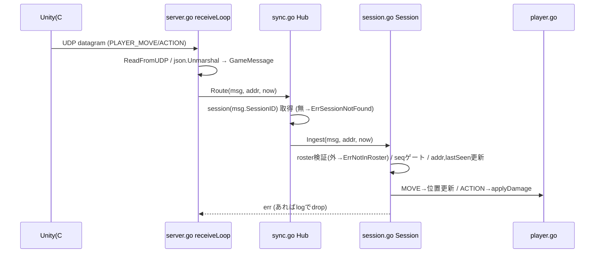
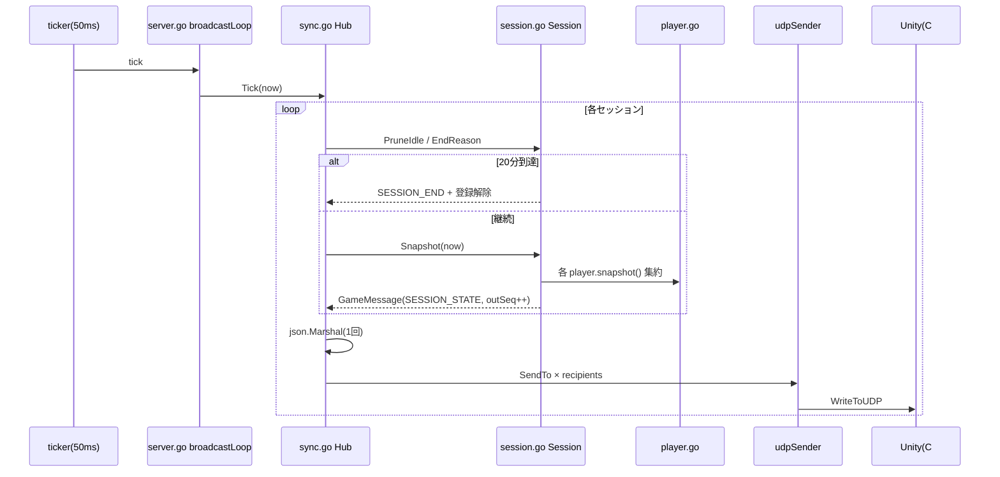

# RAIDYNC 質問ログ

> プロジェクト（設計・実装・インフラ・運用）についての質問と回答の要点を、フェーズを問わず蓄積する学習ログ兼ポートフォリオ素材。
> C#/Unity 背景の視点での疑問が中心。詳細な実装は各ソース・`docs/specification.md` を参照。
> 以下は Phase 0〜2 のぶん。新しい質問は適切なセクションへ追記する。

## 目次
1. [Go プロジェクト構造](#1-go-プロジェクト構造)
2. [マッチメイキングの設計判断](#2-マッチメイキングの設計判断)
3. [DynamoDB](#3-dynamodb)
4. [マッチングロジック](#4-マッチングロジック)
5. [JWT 認証](#5-jwt-認証)
6. [テスト（単体・結合）](#6-テスト単体結合)
7. [意図的な割り切り](#7-意図的な割り切り)
8. [テストの実機確認](#8-テストの実機確認)
9. [Git / SSH 環境構築](#9-git--ssh-環境構築)
10. [Phase 3：ゲームサーバー / トランスポート](#10-phase-3ゲームサーバー--トランスポート)
11. [Phase 4：ローカル E2E ハーネス](#11-phase-4ローカル-e2e-ハーネス)
12. [Phase 4：AWS dev E2E（本番同等環境）](#12-phase-4aws-dev-e2e本番同等環境)
13. [Phase 5：マルチリージョン化](#13-phase-5マルチリージョン化)
14. [IAM とトラブルシュート](#14-iam-とトラブルシュート)

---

## 1. Go プロジェクト構造

### Q. Lambda で Go を使うとき、`main.go` を 1 つの Lambda 機能ごとに配置する認識でいい?
A. はい。`cmd/lambda/<機能名>/main.go` という構成で、**1 機能 = 1 `main` パッケージ = 1 ビルド成果物**。`match_request` / `match_status` / `match_cancel` / `match_history` / `authorizer` がそれぞれ独立した Lambda になる。

### Q. `cmd` / `internal` / `pkg` のディレクトリ構成の理由は?
A. Go コミュニティの標準レイアウト。
- **`cmd/`** … 実行可能エントリポイント（`main` パッケージ）。
- **`internal/`** … 非公開実装。**コンパイラがモジュール外からの import を強制的に禁止**する特別なディレクトリ。
- **`pkg/`** … 外部に公開してよい共有型・ユーティリティ（例 `pkg/protocol/types.go`）。

### Q. `internal` 内のファイルは `server` からは参照できるが `RAIDYNC` からは参照できない?
A. その通り。`internal` は「`internal` の親ディレクトリをルートとするツリー内からのみ import 可能」というルール。`server/internal/...` は `server/` 配下からは使えるが、`server/` の外（別モジュール）からは使えない。アクセス修飾子の `internal`（C#）に近いが、**ディレクトリ位置で機械的に決まる**点が違う。

### Q. import が `github.com/raidync/server/*` とローカル内容なのに URL 形式なのはなぜ?
A. `go.mod` の `module` 宣言で決めた**モジュールパス**が import の接頭辞になるため。実際に GitHub へ取りに行くわけではなく、**一意な名前空間**として URL 形式の慣習を使っているだけ。ローカルのコードでも宣言したパスで参照する。

### Q. この接頭子は `go.mod` につき 1 つだけ?
A. はい。`module` 宣言は 1 つの `go.mod` に 1 つ。このリポジトリは `server`（メイン）と `docker/mock-auth` が**別々の `go.mod` を持つマルチモジュール構成**で、それぞれ独自の接頭辞を持つ。

### Q. `go.mod` は C# の `.csproj` に近い?
A. 近い。依存パッケージとビルド対象を定義する点は同じ。ただし `go.mod` は**モジュール単位**（複数パッケージを束ねる）で、`.csproj`（プロジェクト=アセンブリ単位）より粒度が大きい。

### Q. API Gateway の内容が `lambda` ディレクトリ内にあるのは意図的?
A. 意図的。`internal/apigw/` に置いているのは「API Gateway ⇄ Lambda 間の**変換ヘルパー**」（レスポンス整形 `respond.go`、認証情報の取り出し `auth.go`）。API Gateway 本体ではなく、Lambda 側で必要になる薄い接続層。

### Q. API Gateway はローカルに存在しないから自作している認識でいい?
A. おおむね正しい。LocalStack が API Gateway をエミュレートするが、認証情報の受け渡し（Authorizer Context）など**ローカルと AWS で挙動が揃わない部分**を吸収するために薄いヘルパーを自作している。

### Q. 現状実装している各ファイル（パッケージ）の相関関係は?
A. 実装は **2 つの平面**に分かれ、その間を **`pkg/protocol`（共有契約）**が橋渡しする。`protocol` は何にも依存せず全層から依存される中心（C# のドメインモデル/DTO 相当）。

```
                  pkg/protocol（共有契約・依存ゼロの中心）
       REST側: Ticket/Session/ConnectionInfo   RT側: GameMessage/PlayerState
                  ▲                                   ▲
 ── REST平面（マッチメイキング: Lambda/HTTPS）──   ── RT平面（ゲーム: UDP）──
 cmd/lambda/authorizer → internal/auth(Verifier)  cmd/gameserver/main（薄い入口）
 cmd/lambda/match_{request,status,cancel,history}   → internal/gameserver/server（UDP I/O+ループ）
   → internal/apigw（PlayerID/JSON応答）               → internal/game（Hub/Session/player）
   → internal/matchmaking（Matcher/selectGroup）     → internal/gameserver/gamelift（SDK連携）
       → SessionProvider（gamelift_stub）┄┄┄┄┄┄┄┄┄► （Phase3で実GameLiftへ）
   → internal/db（Client）→ DynamoDB
```

- **REST 平面（Phase 2）**: `authorizer` が JWT 検証→`sub` を Authorizer Context へ。業務 Lambda は `apigw.PlayerID()` で読む。`matchmaking.Matcher` が `Store` IF 越しに DynamoDB を操作してチケットを組成。`internal/db` だけが DynamoDB に触れる末端。
- **RT 平面（Phase 3）**: `cmd/gameserver` は配線のみ。`gameserver/server.go` が UDP I/O と 50ms tick、`internal/game` が状態更新とスナップショット生成（送信は `Sender` IF で抽象化し net 依存を隔離）。`gamelift.go` が SDK ライフサイクルを Hub に橋渡し。
- **2 平面の継ぎ目（最重要）**: マッチ結果 `matchmaking.finalize → protocol.Session.PlayerIDs` が、GameLift の `GameProperties["playerIds"]` → `gamelift.go parseSessionConfig` → `game.NewSession(roster)` へ流れる。**`Session.PlayerIDs`（REST）＝ `Session.roster`（RT）**を一致させることで、別プロセス・別プロトコルの 2 平面が論理結合する。現状この継ぎ目は `gamelift_stub`（固定接続先）で、Phase 3 後半に実 GameLift へ差し替え。
- **依存方向の規律**: 全層が内側の `protocol` に依存し `protocol` は何にも依存しない。`db`/`game` は末端。`net` は `gameserver` 層、AWS SDK は `db`/`gamelift` 層に局所化。`Store`/`SessionProvider`/`Sender`/`apigw.PlayerID` の各 IF が簡略版→本番版の無痛差し替えを可能にする（処理フロー視点は §10「Phase 3 各ファイルのシーケンス」を参照）。

### Q. `server/` ディレクトリの全体を、下層から順に解説すると?
A. Phase 4 完了時点（約 5,200 行 / 12 パッケージ）の構成。上記の 2 平面図に `handlers` と `cmd/localapi`・`cmd/client` が加わった形。

**依存の下層から**
1. **`pkg/protocol`（依存ゼロの正典）** — `types.go`（Ticket/Session/Player/MatchHistoryEntry + API 入出力。`dynamodbav` と `json` の両タグを 1 つの構造体に持たせ、DB 表現と API 表現の乖離を防ぐ）／`game.go`（UDP エンベロープ `GameMessage`。`Seq` は spec 外の自前拡張＝UDP の順序保証欠如への対策、`PlayerSessionID` は G1-full で追加）／`session_id.go`（`NormalizeGameSessionID`：ARN 末尾の `gsess-xxx` 抽出。AWS dev E2E の 403 バグ対策）。
2. **`internal/db`** — DynamoDB に触れる唯一の層。`client.go`（`DYNAMODB_ENDPOINT` の有無で LocalStack/実 AWS を切替）＋テーブル別 4 ファイル。要は `tickets.go`：`ClaimTickets` が **TransactWriteItems + version/status 条件**で WAITING→MATCHING を原子的に取り、条件外れを `ErrConflict` に翻訳する。`status` は DynamoDB 予約語なので全クエリで `#s` プレースホルダ必須。
3. **`internal/auth`** — JWKS 経由の RS256 JWT 検証。`aud`(id token) と `client_id`(access token) を Cognito 流儀で切り分ける。mock-auth と実 Cognito の**両方**に同じコードで通る。
4. **`internal/apigw`** — `respond.go`（JSON/Error 整形）／`auth.go`（Authorizer Context から `sub` 抽出、`X-Player-Id` フォールバック付き）／`endpoint.go`（Phase 5: リージョン固定 URL の導出）。
5. **`internal/matchmaking`** — `matcher.go` が中核。`TryMatch` は status ポーリング契機で呼ばれ、①WAITING 以外は素通し ②期限超過は最低人数で見切り発車→無理なら TIMEOUT ③solo 即成立 ④通常は 4 人狙い、の順に分岐。`selectGroup` はパーティを分割せず FIFO で残席を埋める純関数。`SessionProvider` IF の実装が 3 つ（`gamelift_stub`＝固定 127.0.0.1、`hubSessionProvider`＝ローカル同居 Hub、`gamelift_provider`＝実 GameLift の CreateGameSession+CreatePlayerSessions）。
6. **`internal/game`** — UDP を知らないゲーム状態。`session.go` の `Ingest` が roster 検証→psid 採用→seq ゲート→種別別反映。参加/離脱通知は **Mutex 解放後に走らせる**（`defer` の LIFO を利用）ため、observer がネットワーク I/O をしても受信ホットパスを止めない。`sync.go` の `Hub` が sessionId でルーティングし 50ms tick でブロードキャスト。送信は `Sender` IF で抽象化。
7. **`internal/gameserver`** — `server.go` が UDP ソケット＋2 ループ（受信は 500ms の read deadline で ctx キャンセルに応答）。`gamelift.go` の `GameLiftBridge` が SDK 5.x ライフサイクルを Hub に橋渡しし、`game.PlayerObserver` を実装。Accept/RemovePlayerSession は**バッファ付き channel で 1 本のワーカーに直列化**（順序保証＋ホットパス非ブロック、満杯時は落としてゲーム進行を優先）。
8. **`internal/handlers`** — 5 つの API ハンドラ本体（Phase 4 で `package main` から抽出）。`Handle(ctx, APIGatewayProxyRequest)` 固定シグネチャで、本番 Lambda とローカル `localapi` が**同一実装を共有**する。`session_end.go` だけは server-to-server 経路でプレイヤー JWT を要求しない。
9. **`cmd/lambda/*`（6 関数）** — `authorizer` 以外は依存を組んで `lambda.Start(h.Handle)` するだけの薄い殻。判断が残るのは `match_status/main.go` の `selectSessionProvider`（`GAMELIFT_FLEET_ID` の有無でスタブ/実 GameLift を選ぶ）。
10. **`cmd/gameserver`** — 環境変数を読んで起動するだけ。`GAMELIFT_ENABLED=true` で Bridge を Activate し、セッションはコールバックで動的生成（false なら固定セッション 1 本のローカルモード）。
11. **`cmd/localapi`** — 案 A のローカルハーネス。`adapter.go` が http⇄APIGatewayProxy の純変換、`main.go` の `withAuth` が authorizer Lambda の代役、`gameserver.go` が UDP サーバーを同居させ `hubSessionProvider` でマッチ結果を Hub に注入する（＝`OnStartGameSession` の代役）。
12. **`cmd/client`** — E2E ドライバ。signup→login→match/request→ポーリング→UDP play→session/end→history を 1 本で通す。`-token` で実 Cognito のトークンを注入でき（AWS dev E2E 用）、`playerId` は JWT の sub をデコードして得る（署名検証はサーバー側の責務なのでしない）。

**テストの分布** — ロジック層に集中: `matchmaking`（fakeStore で楽観ロック競合まで再現）37 ケース前後、`game`（session/sync/observer）、`auth`（9 ケース：期限切れ・issuer 違い・署名改竄）、`gamelift_provider`（フェイク SDK で AWS 無し検証）、`session_id`。実 I/O を伴うのは `server_loopback_test.go`（ループバック UDP 往復）と `db/integration_test.go`（`//go:build integration` タグ、LocalStack 必須）の 2 つだけ。

### Q. `pkg/protocol/types.go` の `type TicketStatus string` + 定数群という書き方は何?
A. Go に `enum` キーワードが無いための定石イディオム。「文字列を基底とする**定義型**」＋「その型を持つ定数群」で列挙型を代用する。`TicketStatus` / `SessionStatus` / `MatchResult` の 3 つが同じ形。

**定義型であってエイリアスではない** — `type T string`（`=` なし）は基底型が `string` なだけの**別の型**。`var s string; t.Status = s` はコンパイルエラーになる。`type T = string`（`=` あり）だと `string` そのものになり、この防波堤は効かない。

**`iota`（連番 int）を使わない理由** — この値は DynamoDB に保存され JSON で API を往復するため。

| | int + iota | string |
|---|---|---|
| DynamoDB コンソール | `2` としか見えない | `MATCHED` と読める |
| 定数の並び替え・途中挿入 | 既存データの意味が壊れる | 壊れない |
| GSI キー（`questId-status`） | 判読不能 | そのまま使える |

→ 永続化・外部公開される値は string、プロセス内で閉じる値は `iota`、という使い分け。

**シリアライズは自動** — 基底型が `string` なので `encoding/json` も `dynamodbav` も追加実装なしで文字列として扱う。C# の `[JsonStringEnumConverter]` 相当が不要。

**ただし閉じた enum ではない** — `t.Status = "BOGUS"`（未型付け定数の代入）も `TicketStatus(input)`（明示変換）も通る。守れるのは「変数経由の取り違え」までで、値の網羅性や `switch` の case 漏れはコンパイラが保証しない（`exhaustive` linter の領分）。不正値の検証は実行時に自前で書く前提。

**定数名に型名を前置する理由** — Go の定数は型ではなくパッケージのスコープに属し、`TicketStatus.Waiting` のような修飾ができない（`protocol.StatusWaiting` になる）。そのため名前側に文脈を埋め込む。`Status*` / `Session*` / `Result*` の接頭辞がそれ。

**メソッドを生やせる** — 定義型なので `func (s TicketStatus) IsTerminal() bool` のように振る舞いを付けられる（単なる string 定数群では不可）。現状は必要になっていないため未定義。

---

## 2. マッチメイキングの設計判断

### Q. タイムアウトとポーリングの関係は?
A. API Gateway は 29 秒、Lambda は最大 30 秒で打ち切られる一方、マッチ待機は最大 60 秒必要。そのため**同期で待ち続けず**、チケットを発行して即返し、クライアントが数秒間隔（`PollIntervalSec=2`）で `match_status` をポーリングする**非同期チケット方式**にしている。

### Q. チケットの各要素（questId / partyId / soloAllowed）の意味は?
A. **同一系統のプレイヤーをグルーピングする**ための分類・制約。
- `questId` … 同じクエストを希望する者だけを集める**フィルタ**。
- `partyId` … 既存パーティを**絶対に分割しない**ための束縛キー。
- `soloAllowed` … ソロ希望者を他とまとめないためのフラグ。

### Q. 楽観ロックで status(WAITING→MATCHING) と version(0→1) は同時に更新される?
A. はい、**同一の更新操作（1 トランザクション）内で同時に**変わる。`ConditionExpression` で「現在 status=WAITING かつ version=現在値」を条件にし、満たせば status と version を**まとめて**書き換える。条件が満たせなければ全体が失敗する。

### Q. B,C,D 取り合いシナリオ（複数の matcher が同じ待機者を奪い合う）は解決していない?
A. 解決している。`TransactWriteItems` の **All-or-Nothing** 性質により、先に確保した側だけが成功し、競合した側は `ErrConflict` で**全件ロールバック**される。中途半端に一部だけ MATCHING になることはない。

### Q. DynamoDB への処理は直列なので、後続のマッチングはすべてロールバックされる認識でいい?
A. はい。トランザクションは原子的。条件不一致が 1 件でもあれば、そのトランザクション内の全 Put/Update が取り消され、チケットは WAITING のまま保たれる。次のポーリングで再度マッチングが試みられる。

### Q. マッチング成立処理をクライアントに任せることでインフラ構成が簡略化されている認識でいい?
A. 正しい。専用のワーカーや EventBridge スケジューラを置かず、**クライアントのポーリングが matcher の実行契機**になる。チケットは受動的なデータ、Lambda が能動的なアクター、という役割分担でインフラを軽くしている。

### Q. なぜ「悲観ロック」ではなく「楽観ロック」なのか?
A. 前提が違う。

| | 悲観ロック | 楽観ロック |
|---|-----------|-----------|
| 前提 | 競合は**よく起きる** | 競合は**めったに起きない** |
| やり方 | 先にロックを取ってから作業 | 競合しない前提で進み、**書く瞬間に検証** |
| 競合時 | 待たされる | 失敗を返し、**やり直す** |

マッチメイキングでは大半のポーリングが空振り（4 人揃っていない）で、競合は「ちょうど同時に成立した」稀なケースだけ。低頻度の競合のために毎回ロックを取るコストは割に合わない。そもそも DynamoDB に行ロック（`SELECT ... FOR UPDATE` 相当）が無いので選択の余地もない。

使える排他の道具は**条件付き書き込み**だけ = 「この属性がこうなっていたら書く、違えば書かずに失敗を返す」。比較と書き込みが**不可分**。C# の `Interlocked.CompareExchange`、EF Core の `RowVersion` / `[ConcurrencyCheck]` と同じ仕組み。

### Q. 楽観ロックは Sessions テーブルに掛けるのでは?
A. **違う。ロックは Tickets に掛ける。** 時間軸で見ると理由が分かる。

```
t0  A B C D E が全員 WAITING            ← チケットが 5 枚
    Sessions テーブル … 空。まだ何も無い
t1  Lambda-1 が {A,B,C,D} のチケット 4 枚を
    TransactWriteItems で WAITING → MATCHING に確定   ← ★ 競合はここ
    Lambda-2 は条件不成立で全ロールバック
t2  勝った Lambda-1 だけが GameLift にセッション生成を依頼
    返ってきた接続情報を Sessions に書く              ← 競合相手はもういない
```

争っているのは「**B・C・D という 4 人を自分のグループに入れる権利**」であり、その所有権を表すのがチケットの `status`。セッションを作る時点では勝者が 1 人に絞られているので、Sessions への書き込みに条件付き書き込みは不要。

> **セッションは競争の結果であって、競争の対象ではない。**

| | チケット | セッション |
|---|---------|-----------|
| いつ生まれる | 申請した瞬間 | **4 人揃った後** |
| 生存期間 | 最大 90 秒（TTL） | 最大 20 分 |
| 何を表す | 「待っている」という状態 | 「確定した」という結果 |
| 競合するか | **する**（取り合いの対象） | しない（勝者だけが書く） |

---

## 3. DynamoDB

### Q. PK / SK / GSI / TTL / Global Tables は何を指し、何をしている?
A.
- **PK（パーティションキー）** … レコードを一意に引くための主キー。データの物理的な配置先も決める。
- **SK（ソートキー）** … 同一 PK 内で複数レコードを並べ・範囲検索するためのキー（例 MatchHistory は playerId(PK)+timestamp(SK)）。
- **GSI（グローバルセカンダリインデックス）** … PK 以外の属性で検索するための「別の引き口」。本プロジェクトでは `questId-status-index` / `playerId-status-index`。**結果整合**である点に注意。
- **TTL** … 指定した時刻（epoch 秒）を過ぎたレコードを DynamoDB が自動削除。MatchmakingTickets は 90 秒で消える短命データ。
- **Global Tables** … 複数リージョン間で自動レプリケーションするマルチマスター構成。Players/Sessions/MatchHistory は対象、短命で region-local な MatchmakingTickets は対象外。

### Q. Terraform でテーブル名を固定名（`Players`）にしているのはなぜ? 論理名との違いは?

A. まず 1 テーブルに 3 レイヤーの名前がある点を区別する。

- **Terraform 論理名**（`aws_dynamodb_table.players` の `players`）… state 内だけの識別子。AWS には送られない。
- **実テーブル名**（`name = "Players"`）… AWS 上の実体。SDK が `GetItem(TableName:"Players")` で叩くのはこれ。
- **出力マップのキー**（`table_arns = { players = ... }`）… 下流モジュールへ渡すときのキー。論理名に揃えてあるだけ。

設計上の論点は **実テーブル名の付け方**で、選択肢は 2 つ。

| | A. 固定名 `Players`（採用） | B. プレフィックス `raidync-dev-Players` |
|---|---|---|
| アプリ側コード | 名前をハードコードできる（Go `db.DefaultTables()`） | 環境変数で注入が必要 |
| 1 アカウントに複数環境 | 共存不可（dev と prod が同名を奪い合う） | 共存可 |
| LocalStack との一致 | 一致（localstack-init も `Players`） | ずれる |

**dynamodb だけ固定名**で、lambda / cognito / api_gateway など他モジュールは全て `name_prefix` 方式。一貫していないように見えるが、DynamoDB を固定名にした理由は 3 つ:

1. Go の `internal/db.DefaultTables()` が実名を直書きしている。B にすると「Lambda 環境変数で注入 → Go 側で `os.Getenv` 差し替え」の配線追加が必須になり、本体コードまで巻き込む。
2. LocalStack（`localstack-init.sh`）も同名で作るため、固定名だとローカルで書いた Go がそのまま AWS で動く。
3. 運用が「dev を destroy してから prod」の 1 アカウント 1 環境なので、同名衝突が起きにくい。

**B に切り替えるべき転換点**: dev と prod を同一アカウントに同時常駐させたくなったとき、または Phase 5 の Global Tables を環境別に分けたいとき。その場合は「Terraform を B 化」+「Lambda に `TABLE_*` を渡す」+「Go を `os.Getenv` フォールバック付きに」の 3 点セットが必要。実益（複数環境同居）が出るまでは固定名が妥当。

### Q. `internal/db/client.go` の `DYNAMODB_ENDPOINT` は、AWS 上ではどこから取得する?

A. **取得しない。実 AWS では未設定のままが正解**で、この変数は「LocalStack へ向けるときだけ立てるスイッチ」。空文字のとき `NewClient` の分岐が両方 false になり、以下が全て SDK / ランタイム任せになる。

| 要素 | 空（実 AWS）のときの解決元 |
|---|---|
| エンドポイント | `o.BaseEndpoint` を設定しない → SDK 既定の endpoint resolver が `region` から組み立てる（`https://dynamodb.ap-northeast-1.amazonaws.com`） |
| 認証情報 | static credentials を挿さない → 既定クレデンシャルチェーン。Lambda ではランタイムが実行ロールの一時認証情報を `AWS_ACCESS_KEY_ID` / `AWS_SECRET_ACCESS_KEY` / `AWS_SESSION_TOKEN` に注入する |
| リージョン | `AWS_REGION` は Lambda の**予約環境変数**でランタイムが自動設定（`getenv` の既定値 `ap-northeast-1` はローカル実行時の保険） |

Terraform 側も `terraform/modules/lambda/main.tf` 冒頭コメントの通り、`env` マップに `DYNAMODB_ENDPOINT` も `AWS_REGION` も**意図的に入れていない**。

この設計が Phase 5 のマルチリージョンでそのまま効いている: us-east-1 に同一の zip をデプロイするだけで、ランタイムが `AWS_REGION=us-east-1` を設定 → `NewClient` がそれを読む → us-east-1 のレプリカを叩く。Go 側にリージョン分岐が一切要らない（`terraform/environments/dev/main.tf` の該当コメント参照）。

設定するのはローカルのみ: `.env.example`（`http://localhost:4566`）、`docs/phase4-e2e-runbook.md` の PowerShell 手順、`internal/db/integration_test.go`（未設定なら `t.Setenv` で LocalStack を既定に）。

### Q. SK（ソートキー）は何のためにある? 一意性が確保できれば何でもいい?
A. **SK には役割が 2 つある。**
1. 同じ PK の中でレコードを**区別する**（一意性）
2. 同じ PK の中の**並び順を決める**（ソート・範囲検索）

名前が Sort Key なのは 2 のため。MatchHistory の SK に `sessionId` を置くと 1 は満たすが 2 で破綻する（ランダムな文字列なので並び順が無意味 → 「最近 20 件」を取るのに全件読んでソートが必要 = Scan）。

`timestamp`(Number) を SK にすると SK の並びがそのまま時系列になり:
```
Query(playerId = "abc", ScanIndexForward = false, Limit = 20)
```
で**新しい方から 20 件だけ読んで止まれる**（読み取り 20 件ぶんしか課金されない）。`timestamp BETWEEN 月初 AND 月末` のような範囲指定も可能。

**PK は完全一致しか引けない。SK は範囲指定・前方一致ができる。** これが決定的な違い。sessionId はキーにせず**属性として**持つ。

### Q. MatchmakingTickets の SK に TicketStatus を置いてはいけないのはなぜ?
A. **PK / SK は主キーであり、主キーは変更できない**から。TicketStatus は `WAITING → MATCHING → MATCHED` と遷移するので、SK に置くと状態変更のたびに**レコードを削除して作り直す**ことになり、削除と再作成の間に別の Lambda が割り込める。

これは §2 の楽観ロック（`version` + 条件付き書き込みで「1 チケットを 1 回だけ WAITING→MATCHING に遷移」を保証）を根本から壊す。条件付き `UpdateItem` はキーが不変であることが前提。

**キーには変わらないものを置く。変わるものは属性に置く。**

ただし「status で引きたい」という要求自体は正しく、それに応えるのが **GSI**。GSI のキーは**変化する属性でも構わない**（ベーステーブルの主キーと違い、DynamoDB が裏で維持する射影なので元の属性が変われば自動で張り替わる）。よって status は「ベーステーブルの SK」ではなく「**GSI のキー**」として使う。

| GSI | 用途 |
|-----|------|
| `questId-status` | matcher が「同じクエストで status=WAITING」のチケットを探す |
| `playerId-status` | 同一プレイヤーの二重申請チェック、キャンセル処理 |

### Q. MatchmakingTickets の PK に sessionId を使えない理由は?
A. **時間軸が合わない。** マッチ申請した瞬間、セッションはまだ存在しない（4 人揃ってから GameLift に作らせる）。存在しないものの ID は主キーにできない。PK は申請の応答としてクライアントへ返す `ticketId`。

チケットとセッションは**ライフサイクルが別**（チケット: 申請時に生成、最大 90 秒で TTL 消滅 / セッション: マッチ成立後に生成、最大 20 分）。だからテーブルもキーも分かれる。

### Q. Players テーブルにメールアドレスとパスワードを持つべき?
A. **持たない。** 持った瞬間 Cognito を選んだ意味が消える（ハッシュアルゴリズム選定・ソルト・ストレッチング・漏洩時の責任・リセットフローが全部自前になる）。

| | 持ち主 | 中身 |
|---|--------|------|
| 認証情報 | **Cognito** | メールアドレス、パスワード、MFA 設定 |
| ゲームデータ | **DynamoDB (Players)** | 表示名、ランク、統計、所持装備など |

繋ぐのは ID。Cognito の JWT に含まれる `sub`（ユーザー一意 ID）を `playerId` として DynamoDB を引く。よって Players テーブルにはメールアドレスすら不要。**PII をマネージドサービス側に寄せ、自前テーブルには置かない**という設計。

---

## 4. マッチングロジック

### Q. A が B,C,D でセッションを作るのは分かるが、B,C,D も同時にセッションを作ろうとしない? E のステータスは既に MATCHING では?
A. 作ろうとしない。`ClaimTickets` でグループ全員のチケットを**一括で WAITING→MATCHING に確定**させた「確保した matcher」だけが、その後セッション生成（finalize）まで責任を持つ。他のチケット（B,C,D）は既に MATCHING なので、それぞれのポーリングでは「成立済み」を受け取るだけで、新たにセッションを作らない（パススルー）。E も確保済みなら同様。

### Q. ③（セッション生成）より先に④を置かないのはなぜ?
A. **チケットの確保（MATCHING 確定）を先に済ませてからセッションを生成する**順序にしている。先にセッションだけ作って確保に失敗すると、**使われない幽霊セッション**が残ってしまう。確保成功を確認してから外部リソース（GameLift セッション）を作ることで、整合性を保ち無駄を防ぐ。

### Q. セッションを確立するコードはどこにある?
A. 専用の session-create Lambda は無く、**`GET /match/status` のポーリング契機**で成立させる。
- 起点: `handlers/match_status.go` → `matchmaking.Matcher.TryMatch`（`matchmaking/matcher.go`）
- 成立処理の本体: `Matcher.finalize`。`SessionProvider.CreateGameSession` → Sessions に `PutSession` → グループ全員のチケットを `MarkMatched`（共通接続先＋本人の playerSessionId）
- `SessionProvider` の実装は 2 つ: 本番 `matchmaking/gamelift_provider.go`（GameLift `CreateGameSession` + `CreatePlayerSessions`）、ローカル E2E `cmd/localapi/gameserver.go` の `hubSessionProvider`
- ゲームサーバー側の受け口: `gameserver/gamelift.go` の `onStartGameSession`（roster を Hub に登録して `ActivateGameSession`）

### Q. セッション確立時、ユーザー（チケット）がどういう状態だとエラーになる?
A. 状態の食い違いは大半が**エラーにならない**よう設計されている。
- 自チケットが WAITING 以外 → 現状をそのまま 200 で返す（パススルー）
- Query 後〜確保前に仲間がキャンセル／他 matcher が先に確保 → `ClaimTickets` の条件（`status=WAITING AND version=cur`）が落ちて `ErrConflict` → `nil` 扱いで次のポーリングで再試行
- 60 秒経過で人数不足 → TIMEOUT（競合なら最新状態を返す）

エラーになるのは次のケース。
- **404**: チケットが無い。ticketId 誤り、TTL（90s）で削除済み、発行元と別リージョンにポーリング（アフィニティ崩れ）
- **500（ユーザー起因）**: 同一プレイヤーが WAITING チケットを 2 枚持ち同じグループに入った場合。`match/request` の重複チェック（`FindWaitingByPlayer`→`PutTicket`）は非原子的かつ GSI は結果整合なので、連打で 2 枚できうる。roster に同じ playerId が 2 回入り、psid map が重複を潰して `psid 数が不足` で失敗する
- **500（ユーザー非起因）**: GameLift／DynamoDB の失敗（フリート容量不足、IP 未確定など）

**注意点**: `ClaimTickets` 成功後に `finalize` が失敗すると補償処理が無く、グループ全員のチケットが **MATCHING のまま残る**。以降のポーリングはパススルーで MATCHING を返し続け、TTL 削除後は 404 になる。GameLift 側にセッションが作られていれば孤児になる。

### Q. グループ候補の一人が既に MATCHED だったらどうなる?
A. 「チケット」が MATCHED か「プレイヤー」が MATCHED かで結果が違う。
- **候補チケット自体が MATCHED（GSI の古い読み取り）**: `QueryWaitingByQuest` は GSI（結果整合）なので、確保済みのチケットが WAITING として混ざりうる。`ClaimTickets` はトランザクションで各チケットの `status=WAITING AND version=cur` を条件にするため、1 枚でも落ちれば**全員分がキャンセル**（誰も MATCHING にならない）→ `ErrConflict` → 次のポーリングで再試行。エラーにも二重割り当てにもならない。条件付き書き込みが GSI の結果整合を吸収している。
- **同じプレイヤーの別チケットが MATCHED（二重チケット）**: 条件はチケット単位でプレイヤー単位ではないので、WAITING 側のチケットは普通に確保・成立する。エラーにならず、**1 人が 2 セッションに割り当てられる**。クライアントは片方のチケットしか追わないため、もう片方のセッションには来ない人の席が残り、他の 3 人はその人を待つことになる。根本原因は `match/request` の重複防止が非原子的なこと。

---

## 5. JWT 認証

要点（mock-auth ⇄ authorizer ⇄ 業務 Lambda の流れ）:
- mock-auth が RS256 で署名した JWT を発行し、`/.well-known/jwks.json` で公開鍵（JWKS）を配布。
- API Gateway の **TOKEN 型カスタムオーソライザ**（`authorizer` Lambda）が `Authorization: Bearer <jwt>` を検証。
- 検証成功時、`sub`（=playerId）を **Authorizer Context** に載せて業務 Lambda へ渡す。
- 業務 Lambda は `apigw.PlayerID()` 経由で playerId を取得。
- 検証は署名・発行者(iss)・対象(aud/client_id)・有効期限を確認。`sub` 欠落や改ざんは拒否。

### Q. authorizer Lambda は他の Lambda の API を叩かれたときに使われる? 単独稼働はある?
A. 主語を 1 つ補正すると正確になる。
- **呼ぶのは API Gateway**: 保護ルートにリクエストが来ると、API Gateway が **authorizer → 業務 Lambda の順**で呼ぶ。「業務 Lambda が authorizer を呼ぶ」のではない。authorizer はクライアントから直接叩けず、業務 Lambda とも直接の呼び出し関係を持たない。各保護 API の実行前に必ず通る**共通の関所**（C# の `[Authorize]` 属性/認証ミドルウェア相当。違いは物理的に別 Lambda=別プロセスで動く点）。
- **単独稼働は基本なし**: イベントソースは API Gateway のオーソライザ呼び出しのみ。EventBridge 定期実行・他サービスからの直接 invoke のような独立起動は設計に含めない。
- **毎回起動するわけでもない**: API Gateway は判定結果（トークン→Allow/Deny ポリシー）を **Authorizer result TTL** の間キャッシュする。TOKEN 型なので `Authorization` ヘッダ値がキャッシュキー。同一トークンで TTL 内の再アクセスは authorizer を起動せずキャッシュを使う。例外的な単独起動はコールドスタート初期化やテストの手動 invoke 程度。
- **未実装**: どのルートに attach するか/キャッシュ TTL は Terraform（Phase 1 `api_gateway` モジュール）で定義予定。現状コードは authorizer 自体（JWT 検証＋Allow/Deny ポリシー生成、`deny` は `Resource:"*"` の Deny・principalID=anonymous）のみ。

### Q. テストユーザーは 3 種類ある? mock-auth / Terraform の Cognito テストユーザー / 実ユーザーの違いは?

A. 認証まわりの「ユーザー」は目的の違う 3 層があり、混同しやすい。

| | ① mock-auth のユーザー | ② Terraform の Cognito テストユーザー | ③ 実ユーザー |
|---|---|---|---|
| 用途 | ローカル E2E（①・ロジック検証。**済**） | AWS dev E2E（②・本物のサービス連携検証。未） | 本番の実プレイヤー |
| 認証基盤 | mock-auth（`docker/mock-auth`, :9229） | 実 Cognito（`modules/cognito`） | 実 Cognito |
| 作り方 | クライアントが起動時に signup→login（`cmd/client`）。**インメモリ・使い捨て** | Terraform が `aws_cognito_user` で事前作成 | クライアントから正規 signup |
| メール検証 | 独自実装で省略 | `email_verified=true`+`SUPPRESS` で飛ばす | 検証メールのリンククリックが必要 |
| 生存期間 | プロセス終了で消える | `apply`〜`destroy` | 恒久 |

要点:
- **①で使ったユーザーは AWS に存在しない**（mock-auth のメモリ上だけ）。②は実 Cognito 上に実体が要るので、この Terraform が初めて作る。
- 「E2E は済んだ」は①（ロジック検証）の話。②（Cognito・Lambda・API GW・DynamoDB・GameLift が**本物同士で繋がるか**の配線検証）はこれから。

### Q. ②の E2E は、テストユーザーを作らず「実ユーザー」ではダメ?

A. 技術的には可能。Gmail 等で 4 アドレスを用意し、正規に signup→メール検証→MFA 設定→パスワード管理をやれば実ユーザーでも②は成立する（Cognito から見れば合成テストユーザーと区別はなく、同じ `InitiateAuth` で JWT が出て authorizer が検証できる）。

**それをやらずテストユーザーを合成する理由は「手間削減」＋「再現性」**:
- 4 人要る（1 セッション最大 4 人 = `protocol.MaxPartySize`）。実メール 4 つの用意は非現実的。
- 実ユーザーの正規 signup は**メール検証リンクのクリック**が挟まり、無人 E2E を壊す。`email_verified=true`+`SUPPRESS` はこの手作業を最初から飛ばすための合成。
- パスワードは `random_password` で使い捨て自動生成。実アカウントに E2E 用パスワードを持たせて state/スクリプトに置くのは筋が悪い。
- `apply`/`destroy` で丸ごと作れて消せる。自分の実アカウントを Terraform 管理下に置くと `destroy` で消す事故につながる。IaC 徹底（CLAUDE.md）とも整合。

つまり②が見たいのは「本物のサービスが繋がるか（配線）」なので、認証の入口だけは摩擦をゼロにしたい。実ユーザーの正規 signup フロー自体の検証は目的が別で、スコープを切り離している。

---

## 6. テスト（単体・結合）

### Q. 単体テストと結合テストは何が違う?
A.
- **単体テスト** … 外部依存なしで**ロジック単体**を検証。fake 実装やメモリ上のダミーで完結し、高速・安定。本プロジェクトでは `auth`(9) と `matchmaking`(16)。
- **結合テスト** … **本物の外部システム（LocalStack の DynamoDB）に接続**して、CRUD や原子的トランザクションが実環境で正しく動くか検証。`//go:build integration` タグ付きの `db`(4)。

### Q. matchmaking の grouping / matcher テストは何を行っている?
A.
- `select_group_test.go`（6 ケース）… `selectGroup` の**パーティ分割禁止 FIFO グルーピング**を検証。パーティが途中で割れない、ソロが混ざらない等。
- `matcher_test.go`（10 ケース）… `TryMatch` の**分岐フロー**を検証。チケット不在→エラー、非 WAITING→パススルー、期限切れ→タイムアウト処理、ソロ、通常成立(4 人)など。fakeStore + 固定時刻で判定。

---

## 7. 意図的な割り切り

スコープ外（仕様 4.8）: Backfill、スキルレーティング(MMR)、クエストカタログ(固定 5 種)、MatchmakingTickets の Global Tables、regionPref、EventBridge。
→ いずれも「**インフラ品質を見せる**」目的に対し本質でないため削ぎ落とした判断。

実装上の割り切り（自覚済みの改善余地）:
- `FindWaitingByPlayer` の冪等チェックは GSI の**結果整合**に依存（連打で稀に二重発行の隙間）。
- GameLift 接続情報・`playerSessionId` はスタブの固定値（Phase 3 で本物に差し替え）。
- Authorizer Context は flat keys（REST カスタムオーソライザの仕様上ネスト不可）。
- ログは `log.Printf` 直書き（Phase 6 で構造化）。

差し替え容易性: `SessionProvider` / `Store` インターフェースと `apigw.PlayerID` により、**簡略版を本番版へ無痛で挿せる構造**にしてある。

### Q. IAM ロールの最小権限を「最大まで厳密に」しない理由は?

A. Lambda 実行ロールは **2 本**（`terraform/modules/iam`）— authorizer 用（Logs のみ）と matchmaking 用（DynamoDB + GameLift + Logs）。後者は `match_request` / `match_status` / `match_cancel` / `match_history` / `session_end` の **5 関数で共有**している。

厳密に最小権限を突き詰めれば、5 関数それぞれに専用ロールを作り「その関数が実際に呼ぶアクションだけ」に絞れる。例:
- `session_end` は GameLift の `CreateGameSession` を呼ばない → GameLift 権限は不要。
- `match_history` は `Query` しかしない → `PutItem` / `TransactWriteItems` は不要。

それをやらず 2 分割で止めたのは **粒度の意図的な選択**:

- **分割の主目的は達成済み**。「入口の authorizer を侵害されても DynamoDB/GameLift に到達できない」という attack surface の分離は、authorizer を切り出した時点で実現している。ここが最小権限で一番効く境界。
- **5 分割は管理コストが実益を上回る**。ロール・ポリシー・変数・output が関数の数だけ増え、`lambda` モジュール側の配線も複雑化する。得られる追加の安全性（DynamoDB CRUD 系を触る一群の内側でのさらなる細分化）は、この一群が全て同じ信頼境界にある以上、限界的。
- **アクション単位では既に絞ってある**。`DeleteItem` を外す（TTL 自動削除に委ねる）、GameLift を 2 アクションだけにする等、ロール内のアクションは最小化済み。粗いのは「ロールの本数」だけ。

**さらに分割すべき転換点**: 特定関数だけ機微データ（決済・PII 等）を扱うようになったとき、または監査要件でアクションと関数の 1:1 対応を証明する必要が出たとき。現状のポートフォリオ用途では 2 分割で「最小権限を role で実証する」意図は十分伝わる。

---

## 8. テストの実機確認

### Q. testify と testing の違いは?
A. `testing` は Go 標準のテストフレームワーク（`func TestXxx(t *testing.T)`）。`testify` はその上に**読みやすいアサーション**（`require`/`assert`）を足すサードパーティ。`require` は失敗で即中断、`assert` は継続。

### Q. テストの実機確認の方法は?（Windows での詰まり）
A. このマシンは **Windows Application Control (WDAC)** が `%TEMP%` 配下の大きい test バイナリ（crypto/HTTP を含む 12MB 級）を実行ブロックする。回避策:
```powershell
# %TEMP% を避け、プロジェクト配下にビルドしてから実行する
go test -c -o .\auth.test.exe .\internal\auth
.\auth.test.exe "-test.v"          # -test.v は必ずクォート（PowerShell が .v を分割解釈するため）

# 結合テストは integration タグ + LocalStack 起動が前提
docker compose -f docker/docker-compose.yml up -d localstack
bash ./docker/localstack/scripts/localstack-init.sh
go test -c -tags=integration -o .\db.test.exe .\internal\db
.\db.test.exe "-test.v"
```
- 小さい test（`matchmaking` ≒4MB）は `go test ./internal/matchmaking/...` で直接通る。
- 結合テストのテストデータは UUID で毎回ユニークにする（TTL 90 秒で残る前回データが GSI に引っかかるのを防ぐ）。

最終確認状態: 単体 25（auth 9 + matchmaking 16）+ 結合 4 すべて PASS。`go build ./...` / `go vet ./...` は常時通過。

---

## 9. Git / SSH 環境構築

### Q. Phase 0 で Git 管理を始めるのが抜けていた。Phase 0〜2 で漏れがないか精査したい。
A. 精査結果:
- 機械チェック … 未追跡ファイルゼロ、誤除外ゼロ（除外は tarball/exe/個人設定のみ）。
- ロードマップ照合で **Phase 0 の欠落** を発見 → 対応:
  - `.env.example`（0-3）を作成・コミット。
  - `develop` ブランチ（0-4）を作成・push。
  - 空の `.env/` ディレクトリは手動削除へ。
  - GameLift Local のコメントアウトは Phase 3-1 範囲で設計通り（問題なし）。

### Q. クローンは HTTPS でなく SSH で行いたい。汎用的にキーを作るのは問題?
A. 基本は汎用鍵 1 つで問題ない。**唯一の例外**は「同じ `github.com` に複数アカウントを SSH で使い分ける」場合。GitHub は 1 つの公開鍵を 1 アカウントにしか登録できないため、複数併用時は鍵を分けて `~/.ssh/config` のホストエイリアスで振り分ける必要がある。

### Q. キー作成コマンドの解説。
A.
```bash
ssh-keygen -t ed25519 -C "コメント(メール)" -f <出力パス>
```
- `-t ed25519` … 鍵アルゴリズム（現代の推奨）。
- `-C` … 識別ラベル（認証には無関係）。
- `-f` … 出力先。秘密鍵と `.pub`（公開鍵）の 2 つができる。
- パスフレーズは任意（`-N ""` で空固定にして非対話化も可）。
- **トラブル**: PowerShell の `ssh-keygen` は `~` を展開しないことがある → **フルパス**（`$env:USERPROFILE\.ssh\...`）で指定する。

### このマシンの最終 Git/SSH 構成
- リポジトリ: **`maedakai/RAIDYNC`**（SSH）。
- **複数アカウント環境**のため、衝突回避にホストエイリアスを採用:
  - `~/.ssh/config` の `Host github-maedakai` → 鍵 `~/.ssh/Github/maedakai/id_ed25519_raidync`。
  - origin URL = `git@github-maedakai:maedakai/RAIDYNC.git`。
- ブランチ戦略: `main`(デフォルト) / `develop`(開発統合) / `feature/*`。
- コミット作者はローカル設定で `Maeda` / `maeda.kai0314@gmail.com`。
- `.gitignore` で `server/go*.tar.gz`(64MB×2)・`*.exe`・`.env`・`.claude/settings.local.json` 等を除外。

---

## 10. Phase 3：ゲームサーバー / トランスポート

### Q. ゲームサーバーの通信は WebSocket(TCP) と UDP のどちらにすべき? 違いは?
A. **WebSocket は TCP の上に乗ったメッセージプロトコル**なので、選ぶと TCP の性質（到達保証・順序保証・再送）を受け継ぐ。
- **TCP/WebSocket** … 電話型。届くまで再送し順序も守る。ただし 1 パケット欠落で後続が待たされる（**Head-of-Line ブロッキング**）→ 20Hz 位置同期では「カクつき」要因。.NET の `TcpClient` 相当。
- **UDP** … ハガキ型。投げっぱなしで到達・順序保証なし。速いが、順序・欠落・輻輳制御を**自前実装**する必要（Unity Transport / Mirror の KCP が裏でやっていること）。.NET の `UdpClient` 相当。
- 位置同期は「50ms 前の古い座標は次パケットで上書きされる」ため再送の価値が薄く、アクションゲームでは UDP が定番。

**RAIDYNC の判断**: WebSocket も選択肢だったが、最終的に **UDP を採用**。理由は (1) 仕様 (spec-game.md §3.1) が GameLift UDP 7777 で一貫している、(2) アクションゲームの定番であり「なぜ UDP か」を技術面接で説明しやすい、(3) GameLift の UDP フリート前提と素直に噛み合う。トレードオフとして**信頼性レイヤを自前実装**する必要があるが、位置同期では「再送より最新値優先」が正しいため、フル ACK/再送ではなく **シーケンス番号による古い/重複パケットの破棄**だけを実装し、コストを最小化した。

### Q. UDP は順序保証がないのに、どう「古いパケット」を捨てている?
A. 共通エンベロープ (spec §3.4) に仕様外の拡張として `seq`（クライアントが 1 始まりで単調増加採番）を追加。サーバーは **プレイヤー単位で受理済み最大 seq を保持**し、`seq <= lastSeq` のパケットを黙って破棄する（`internal/game/session.go` の Ingest）。これで UDP の並べ替え・重複で古い座標に巻き戻る事故を防ぐ。SESSION_STATE 側もサーバー採番の seq を載せ、クライアントが同様に新しい方だけ採用できる。フル再送が要る将来要件（重要アクションの確実な到達）が出たら、この上に選択的 ACK を足せる設計。

### Q. 自作した信頼性レイヤを詳しく（何を実装し、何をあえて捨てたか）
A. 「信頼性」は実は 4 要素の集合（到達保証・順序保証・重複排除・輻輳制御）。TCP は全部やるが HoL ブロッキングを招く。今回はこのうち **位置同期に必要な「順序の逆転無効化＋重複排除」だけ**を seq ゲートで実装した。

- **前提**: 位置同期は「状態が冪等に上書きされ、古い情報は無価値」。50ms 前の座標は次パケットで完全に上書きされるので再送の価値が薄い。必要なのは「最新が届くこと」であって「全部が順番通り確実に届くこと」ではない（Mirror の unreliable channel と同じ考え）。
- **仕組み**: クライアントが seq を 1 始まりで単調増加採番（MOVE/ACTION 共通ストリーム）。サーバーは `if p.seen && msg.Seq <= p.lastSeq { return nil }` で破棄、通れば `lastSeq` 更新。
  - 並べ替え例: 送信 1,2,3 が到着 1,3,2 → ゲートなしは posC→posB で古い座標へ巻き戻る。ゲートありは 2<=3 で破棄し posA→posC で最新維持。
  - 重複例: seq3 が二重到着 → 2 回目は 3<=3 で破棄。
  - SESSION_STATE もサーバー採番 seq を載せ、クライアント側でも同ロジックで古いスナップショットを捨てられる（対称設計）。
- **あえて捨てたものと理由**: 再送（位置は上書きされる）/欠落補完（補間はクライアント責務）/輻輳制御（20Hz 固定レート）/ACK。
- **弱点と将来拡張**: (1) PLAYER_ACTION も再送なし＝重要イベントがベストエフォート → 冗長送信か選択的 ACK を足す。(2) 再接続で seq=1 に戻ると全部「古い」と誤判定 → 接続セッション ID で lastSeq リセット。(3) uint32 のラップアラウンドは 20Hz で約 6.8 年なので実用上無視。
- 要するに **TCP の信頼性を位置同期に必要な分まで削ぎ落としたコスト最小レイヤ**。フル信頼性が要れば KCP に置換し seq ゲートはそちらに吸収させる。

### 実装メモ（Phase 3 ステップ1〜4 完了）
- `pkg/protocol/game.go` … 共通メッセージ型（GameMessage エンベロープ + 各 payload、`seq` 拡張）。
- `internal/game/{player,session,sync,errors}.go` … セッション状態管理。Session が受信取り込み・seq ゲート・ダメージ適用・SESSION_STATE スナップショット生成・20 分タイムアウト/アイドル離脱を担当。Hub が複数セッションのルーティングと 50ms 周期ブロードキャストを担う。送信は `Sender` インターフェースで注入し net 依存をサーバー層に隔離（既存の matchmaking `Store` と同じ思想）。
- `internal/gameserver/server.go` + `cmd/gameserver/main.go` … 実 UDP ソケットと Hub の配線。main は薄いエントリポイント。
- テスト … session/sync のユニット 13 ケース + 実ループバック UDP の往復統合テスト（PLAYER_MOVE 送信 → SESSION_STATE 受信）。すべて green。
- **残**: ステップ5（GameLift Server SDK for Go 連携）／ステップ6（GameLift Local 接続確認）。GameLift SDK 依存と docker-compose の gamelift サービス有効化が必要。

### Q. 外部依存ゼロのほうがいい? メリット・デメリットと今回の候補は?
A. **「ゼロ」は目的ではなく手段**。今回はたまたま `net` + `encoding/json` で要件を満たせたのでゼロにしただけで、貫くこと自体に価値はない。判断軸は「何を自作して見せる価値があるか / 何を実績あるものに任せるべきか」。

- **外部依存を使うメリット**: 実績・最適化・エッジケース対応済み／開発が速い／機能が豊富。
- **デメリット**: サプライチェーン/脆弱性リスク／バージョン保守の手間／ブラックボックス化／肥大化／保守放棄リスク。
- **自作（ゼロ）のメリット**: 中身を全部説明できる（ポートフォリオ価値）／軽量・ビルド高速／サプライチェーン無関係。**デメリット**: 車輪の再発明／信頼性プロトコル全自作はバグの温床。
- .NET の類推: `Newtonsoft.Json` vs `System.Text.Json`、Mirror に任せる vs 自前 `UdpClient`、と同じトレードオフ。

今回（UDP ゲームサーバー）の外部依存候補:

| 領域 | 候補 | 備考 |
|------|------|------|
| 信頼性レイヤ | `xtaci/kcp-go`(KCP) / `quic-go`(QUIC) / ENet | KCP は **Unity Mirror の KCP Transport** と同系。順序保証+再送+輻輳制御を丸ごと任せられる |
| シリアライズ | Protobuf / FlatBuffers / MessagePack | JSON は 20Hz では冗長。帯域要件が出たらバイナリ化（Protobuf は .NET でも使える） |
| GameLift | `aws/amazon-gamelift-go-sdk` | ステップ5で**必須**。独自プロトコルで標準では代替不可 → 「依存ゼロ」はステップ4まで |
| ログ | `slog`(標準) / `zap` / `zerolog` | 構造化ログ（CloudWatch 連携）が要れば。まず標準 slog で足りる |

**RAIDYNC の線引き**: seq ゲート程度の軽い自作は「UDP 理解の証明」で価値があるので残す。順序保証+再送+輻輳制御のフル信頼性プロトコルを自作するのは過剰 → 必要になれば KCP（seq ゲートは KCP に吸収される）。シリアライズは可読性優先で当面 JSON、本番帯域（4,000 接続×20Hz）が問題化したら Protobuf（`Sender`/メッセージ型を分離済みなので差し替え可能）。GameLift SDK は不可避。「見せたいもの＝インフラ品質」に集中し、それ以外は実績あるものに任せるのが軸。

### Q. エンベロープ（envelope）とは何か?
A. メッセージを「**共通のメタ情報（封筒）**」と「**種別ごとに変わる中身（payload）**」に分ける設計パターン。封筒の比喩: 表面の宛名・差出人・種別は中を開けずに仕分けでき、中の手紙が実際の内容。

今回の `GameMessage` がエンベロープ（spec §3.4 の共通フォーマット）:
- 封筒側 = `type`（種別＝仕分けの鍵）/ `sessionId`（宛先）/ `playerId`（差出人）/ `timestamp` / `seq`（順序制御）
- 中身 = `payload`（type ごとに PlayerMovePayload / PlayerActionPayload 等に変わる）

**旨味**: UDP ソケットは 1 本で 4 種類のメッセージが混在する。封筒で統一すると共通処理が中身を知らずに済む — ルーティング(`Hub.Route`)は sessionId だけ、seq ゲートは seq だけ、ログは type だけを見ればよく、payload の中身から独立する。

**payload が `json.RawMessage` な理由 = 2 段階デコード**: (1) 受信バイト列を GameMessage にデコード（payload は封をしたまま生バイトで保持）→ (2) `type` で分岐 → (3) その時はじめて payload を正しい型へ Unmarshal。`interface{}` だと `map[string]interface{}` になり型安全を失うが、RawMessage なら後から 1 回で正しい型にできる。

.NET 類推: `JsonElement`/`JObject` を保持して種別確定後に `Deserialize<T>()` するのと同じ。type フィールドは **discriminated union の判別子(discriminator)**。C# と Go が同じ封筒形式を共有するので両言語で実装が揃う。

### Q. エンベロープは「クライアントとサーバーロジックをつなぐクラス」という認識でよい?
A. おおむね正しいが 2 点補正。
- **正**: クライアントとサーバーが共有するデータ構造。C# の DTO/POCO 相当。
- **補正1（ロジックは持たない）**: エンベロープは純粋なデータの入れ物。「つなぐ」のはフォーマットの合意であって処理ではない。役割分担は DTO（`GameMessage`/payload）＝データの形、Service（`Session.Ingest`/`Hub`）＝受信→状態更新のロジック。
- **補正2（クラス共有ではなくスキーマ共有）**: クライアント=C#、サーバー=Go と言語が違うので、1 つのクラスを DLL で共有しているのではない。各言語で同じ形のクラス/struct を別々に定義し、共通なのは **JSON フォーマット（契約 / スキーマ）= spec §3.4**。これを契約(contract)ベース/スキーマ駆動設計と呼ぶ。
- 伏線: Protobuf に移行すると 1 つの `.proto` から C#/Go のクラスを自動生成でき「単一定義から両言語が生まれる」状態になる。今は JSON なので両側に手で定義。
- 要約: エンベロープ＝両者が合意した「通信データの契約(DTO)」。つなぐのはロジックでなくフォーマット、共有するのはクラスでなくスキーマ。

### Q. Phase 3 各ファイルのシーケンス（処理の流れ）は?
A. 各ファイルのシーケンス上の役割:

| ファイル | 役割 |
|---|---|
| `cmd/gameserver/main.go` | 入口。設定読込・シグナル待受 |
| `internal/gameserver/server.go` | UDP I/O。受信ループ・送信(udpSender)・tick 駆動 |
| `internal/game/sync.go` (Hub) | ルーティング(Route)・周期処理(Tick)・ブロードキャスト |
| `internal/game/session.go` (Session) | 1 セッションの状態遷移。Ingest/Snapshot/lifecycle |
| `internal/game/player.go` (player) | 1 プレイヤーの状態。snapshot/applyDamage |
| `pkg/protocol/game.go` | 全層が運ぶデータ型（エンベロープ/payload） |
| `internal/game/errors.go` | 異常系の合図（ErrNotInRoster 等） |

**起動フロー**: main.loadConfig → gameserver.New(ListenUDP→NewHub→NewSession→Register) → Serve(go broadcastLoop + receiveLoop)。

**受信フロー**（下り）:


**ブロードキャストフロー**（上り, 50ms 周期）:


**対称性**: 下り Unity→server→Hub.Route→Session.Ingest→player(書く)、上り player(読む)→Session.Snapshot→Hub.broadcast→udpSender→Unity。Hub を境に net 側とロジック側が分離し、`Sender` IF だけが境界をまたぐ。

### Q. 20 分でセッションがタイムアウトするのは GameLift の特性?
A. **GameLift の特性ではない**。ゲーム設計上の制約（モンハン型クエスト 1 回の制限時間）をアプリ側で自前実装したもの。
- 出所: `CLAUDE.md`「最大 20 分」/ `spec-game.md §1.2`。実装は `protocol.MaxSessionMinutes=20` → `session.go` の `endsAt = createdAt + maxSessionMs`、`EndReason` が `now >= endsAt` を判定。
- GameLift 自体は「プレイ時間の上限」を持たない。セッションはゲームサーバープロセスが終了させるまで続く。GameLift が持つのは別種のタイムアウト＝(1) ゲームセッション起動タイムアウト(ACTIVATING→ACTIVE, 設定可能) (2) プレイヤーセッション予約タイムアウト(RESERVED→TIMEDOUT, 接続猶予 数十秒)。いずれも起動・接続まわりでありプレイ時間ではない。
- **セッション終了はアプリ責務**: 終了条件(20分到達/クリア/全員離脱)を満たしたらサーバーが (1) クライアントへ SESSION_END 送信（今の `EndMessage` が担当, 完成済み） (2) GameLift SDK の `ProcessEnding()` 呼び出し→インスタンスを次セッションに再利用（**ステップ5で接続予定**）。`EndReason`/`EndMessage` に切り出したのは ProcessEnding を差し込めるようにするため。
- 整理: 「20分」=アプリ制約。「いつ終わらせるか」=ゲームサーバーの責務。GameLift は終了後のインスタンス再利用を担う。

### 実装メモ（Phase 3 ステップ5：GameLift Server SDK 連携 完了）
- 依存: `github.com/amazon-gamelift/amazon-gamelift-servers-go-server-sdk`（SDK 5.x, 2025-05 公開。pseudo-version）。推移的に gorilla/websocket, go-retry 等を SDK が利用。
- `internal/gameserver/gamelift.go` … `GameLiftBridge` が SDK ライフサイクルを Hub に橋渡し。`Activate`(InitSDKFromEnvironment→ProcessReady) / `onStartGameSession`(roster抽出→NewSession→hub.Register→ActivateGameSession) / `onProcessTerminate`(stop=Spot中断対応) / `onHealthCheck`(true) / `End`(ProcessEnding)。
- **roster 受け渡し**: RAIDYNC は FlexMatch 非使用（自前 Lambda マッチメイキング）なので `model.GameSession.GameProperties`（map[string]string, `questId`/`playerIds`）で受け渡す。MatchmakerData は使わない。`parseSessionConfig` が純関数で抽出しユニットテスト。
- **ローカルファースト維持**: `GAMELIFT_ENABLED=false`（既定）では InitSDK を呼ばず AWS なしで動く。SDK はビルドに含むが実行時呼ばない。`server.go` の `Config.GameLiftEnabled` で固定セッション登録を分岐、`main.go` の `GAMELIFT_ENABLED` で Bridge 起動を分岐。
- テスト方針: SDK 本体はグローバル状態でモックしづらいため、ロジック(parseSessionConfig)を純関数に切り出して検証。SDK 呼び出しは薄いアダプタに隔離。

### Q. GameLift Local と GameLift Anywhere の違いは? なぜ Anywhere を使う?
A. **GameLift Local は SDK 5.x で非推奨**。AWS は **GameLift Anywhere** に置き換えた（旧 GameLift Local は SDK 3.x/4.x 専用の Java エミュレータ）。
- GameLift Local: ローカル Java プロセスで GameLift API をエミュレート。オフライン・無料だが SDK 5.x 非対応で事実上終了。
- GameLift Anywhere: 自前マシン（ローカル PC やオンプレ）を GameLift の「Anywhere フリート」として登録し、実際の GameLift コントロールプレーンと接続して検証する仕組み。**AWS アカウントでのフリート登録が必要＝コストが発生**。
- 影響: CLAUDE.md / spec / docker-compose の「GameLift Local」前提は古い。ステップ6「接続確認」は Anywhere 前提に読み替え。ローカルファースト/月 $200 制約との兼ね合いで、ステップ6は最小限実施 or 保留の判断が必要。

### Q. GameLift Local が廃止された経緯と、Anywhere との実態の違いをもう少し詳しく
A. 「廃止」の中身と、代替の Anywhere が *ローカルだが無料オフラインではない* 点が要点。

- **廃止の正体**: 旧 GameLift Local は `GameLiftLocal.jar`（Java エミュレータ）。手元で起動すると GameLift API を模した HTTP/WebSocket が立ち、AWS アカウントもネットワークも使わず `ProcessReady` / `CreateGameSession` を検証できた。これが **Server SDK 5.x と非互換**。Local は **SDK 3.x / 4.x 専用**として据え置き、5.x ユーザーは Anywhere に誘導される（AWS 公式 doc も Local の項を「SDK 4.x 以前向け」と明記）。
- **なぜ非互換か**: SDK 5.x で接続が **WebSocket ベースに刷新**＋ `authToken` 必須化。旧 Local（古い REST 寄り実装）が追従しておらず、AWS はローカル専用実装の維持をやめ「本番と同じコードパスで動く Anywhere」に一本化した。
- **Anywhere の実態**: 「自分の PC をそのまま GameLift フリート1台として AWS に登録」する方式。ゲームサーバーのバイナリは手元で動くが、`CreateGameSession` 等の制御は **実 AWS の GameLift サービス経由**。

| 観点 | GameLift Local（旧） | GameLift Anywhere（新） |
|------|---------------------|------------------------|
| AWS アカウント | 不要 | **必要** |
| ネットワーク | 完全オフライン可 | AWS 接続必須 |
| 必要リソース | JAR 1個 | カスタムロケーション + Anywhere フリート + compute 登録 |
| 認証 | なし | `get-compute-auth-token` で短命トークンを定期取得 |
| `InitSdk()` 引数 | 不要 | `webSocketUrl` / `hostId` / `fleetId` / `authToken` / `processId` 必須 |
| サーバー動作場所 | ローカル | ローカル PC のまま（compute 登録） |

- **コスト**: Anywhere フリート *自体* のインスタンス課金は無し（自前ハード利用）。ただし AWS アカウント・IAM・API コールは発生し、**完全オフライン/コストゼロではない**。CLAUDE.md の「AWS デプロイ前に Local で確認」前提と docker-compose の gamelift コンテナは実体を失う。
- **実装との接続**: `gamelift.go` の `InitSDKFromEnvironment()` は、Anywhere では上記5パラメータ（`webSocketUrl` 等）を環境変数から読む形になる。managed EC2 フリートへ移行する際は **これらを外すだけ**（AWS が自動注入）でコード差分が最小になる設計。`GAMELIFT_ENABLED=false`=ローカル固定セッション / `true`=Anywhere・managed の切替は妥当。

> 出典: [Server SDK 5.x for Amazon GameLift Servers](https://docs.aws.amazon.com/gameliftservers/latest/developerguide/reference-serversdk.html) / [Set up local testing with Amazon GameLift Servers Anywhere](https://docs.aws.amazon.com/gameliftservers/latest/developerguide/integration-testing.html) / [GameLift Local not available on SDK 5.0.0?（re:Post）](https://repost.aws/questions/QUGtPVWmd9SSmfgdscxMJ9rg/gamelift-local-not-available-on-sdk-5-0-0)

### Q. GameLift Local は UDP ではできない（UDP 非対応）ということ?
A. 違う。**GameLift Local の廃止は UDP と無関係**。コントロールプレーンとデータプレーンを分けて考えるのが肝。

- **コントロールプレーン（GameLift の担当）**: ゲームサーバー ⇄ GameLift 間のライフサイクル（`ProcessReady` / `CreateGameSession` / health check / `ProcessEnding`）。通信は **HTTP/WebSocket（TCP）**で、UDP は使わない。
- **データプレーン（GameLift 非関与）**: Unity クライアント ⇄ ゲームサーバー間の実ゲーム通信（PLAYER_MOVE / SESSION_STATE）。**ここが自作 UDP**。GameLift はクライアントに IP:Port を教えるだけで、以後の UDP パケットは経由しない。
- 従って **Local は UDP を中継/エミュレートする機能をそもそも持たない**。「UDP 非対応で廃止」ではなく、コントロールプレーンの通信が SDK 5.x で WebSocket 化したことに Local が追従していないだけ。
- **帰結**: UDP ゲーム通信のローカル検証は GameLift 無しで完結する（= ループバック UDP 往復テストで実施済み）。GameLift（Local/Anywhere）が要るのは**ライフサイクル制御だけ**。

| 検証対象 | GameLift 要否 | 現状 |
|----------|--------------|------|
| UDP ゲーム通信（移動同期・ブロードキャスト） | 不要 | ✅ ローカル検証済み |
| セッションのライフサイクル（起動/終了/health） | 必要 | ❌ Local 廃止 → Anywhere(AWS) が必要 |

### Q. Anywhere を使えば「本番想定と同じ形」の検証ができる?
A. **アプリ/統合レイヤは本番相当でできる。インフラ/運用レイヤは managed フリートでないと検証できない**、という住み分け。Anywhere は旧 Local より本番に忠実（実コントロールプレーンに接続・SDK コードパス同一）だが managed と完全イコールではない。

**本番と同じ形で検証できる（アプリ/統合）**
- SDK コードパスが managed と同一: `InitSdk → ProcessReady → OnStartGameSession → ActivateGameSession → ProcessEnding`、WebSocket+authToken も同じ。
- **エミュレータでなく実 GameLift コントロールプレーンに接続**（Local は模造品だった）。`CreateGameSession`/`DescribeGameSessions` の挙動が本物。
- queue / matchmaker を managed にそのまま流用可能。
- 今回の `gamelift.go` の `OnStartGameSession`(roster 取り出し→Hub登録) / `OnProcessTerminate`(畳み) の正しさは本番同形で確認可。

**本番と違う（インフラ/運用）— managed フリート必須**

| 項目 | Anywhere | managed（本番） |
|------|----------|----------------|
| `InitSdk()` 引数 | 手動指定 | AWS 自動注入 |
| ビルド配置 | 手動デプロイ | S3 経由で自動 |
| authToken | 自前で定期取得 | AWS 自動管理 |
| Spot 中断 | 自然発生しない | 実発生→`OnProcessTerminate` |
| オートスケール / 容量 | 無し | 自動増減 |
| 実行環境 | 自分の PC | 本番 EC2 種別 |
| ネットワーク | ローカル | Route53 レイテンシルーティング・マルチリージョン |

- 帰結: Anywhere = 統合テストは本番相当。**Spot 中断挙動・スケール・配置・ネットワークの検証は managed フリート（Phase 4 以降）が必須**。RAIDYNC は「インフラ品質」が主題なので、最終的に managed/Spot まで触れて初めてその領域が本番検証できる。

### Q. Anywhere を使うコストは具体的にいくら?
A. **Anywhere 自体はほぼ無料**（無料枠内 $0、超えても dev 検証は月数十円）。**インスタンス時間課金が無い**（自前ハードを使うため）のが肝。高額化するのは後の managed フリート（EC2 課金）であって Anywhere ではない。

**課金体系**

| 課金対象 | 単価 |
|----------|------|
| ゲームセッション配置 | $0.0012 / セッション |
| サーバープロセス接続時間 | $0.000011 / 分 |
| Anywhere フリートの compute（=自分の PC） | $0（課金なし） |
| ゲーム通信のデータ転送（client⇄server 直接・AWS 非経由） | $0 |

- **無料枠（12か月）**: 月 3,000 セッション配置 + 500,000 接続分（全リージョン合算）。

**RAIDYNC dev 検証の試算**
- 20分セッション1回 ≈ $0.0014（配置 $0.0012 + 接続 20分×$0.000011）。
- 開発中サーバー常時起動（8h×20日=9,600分）≈ $0.11、セッション200回でも +$0.24 → 月 ~$0.35、かつ無料枠内で実質 $0。
- 24時間×1か月放置（最悪）= 43,200分×$0.000011 = $0.475 → これでも無料枠 500,000分内。
- → **$200 budget リスクはほぼゼロ。止め忘れても月 $0.5 未満**。

**周辺費用の注意**: CloudWatch にログ/メトリクスを送れば微少課金（送らなければ $0）。`get-compute-auth-token`・IAM は無料。

**本当にコストが出るのは managed フリート（対比）**

| | Anywhere | managed EC2 フリート |
|--|----------|---------------------|
| インスタンス課金 | 無し（自前 PC） | EC2 時間課金（起動中ずっと） |
| 消し忘れリスク | ほぼ無害（月 $0.5） | 高額化しうる |

- CLAUDE.md「フリートは使わない時必ず停止」は **managed フリート向け**の制約で、Anywhere には実質当てはまらない（止め忘れても安い）。
- 帰結: ステップ6で Anywhere を試すのはコスト的に十分許容範囲。要るのは AWS アカウント設定とフリート登録の手間のみ。

> 出典: [Amazon GameLift Anywhere Pricing](https://aws.amazon.com/gamelift/pricing/anywhere-pricing/)

### Q. GameLift Anywhere は「ローカル環境の構築に必要」という認識でいい?
A. 半分正しく半分は補正が必要。「ローカル環境の構成部品/前提」という意味なら**誤り**。「ローカルマシンで GameLift 統合を検証する手段」という意味なら**正しい**。「ローカル」が2義で混ざりやすい。

- **オフラインのローカル環境（Docker/LocalStack スタック）の構成部品か → No**: RAIDYNC のローカル環境 = LocalStack + mock-auth +（UDP サーバーの Go 単体テスト）。**Anywhere 無しで完全に動く**。UDP 通信は GameLift 非依存でローカル検証済み。Anywhere は Docker スタックに含まれない実 AWS リソースで、LocalStack のようなオフライン代替品ではない。
- **ローカルマシン上でテストする仕組みか → Yes**: Anywhere の目的は「自 PC でサーバーを動かしつつ GameLift 統合を反復テスト」。旧 GameLift Local（ローカルテスト用）の後継。ただし **実行=ローカル / 制御プレーン=実 AWS** のハイブリッドで、オフラインでもコストゼロの閉じた環境でもない。

| 問い | 答え |
|------|------|
| ローカル環境（オフライン）の構築に必要か | 不要（無くても動く・構成部品でもない） |
| ローカルマシンで GameLift 統合を検証する手段か | その通り（GameLift Local の後継） |
| オフライン・コストゼロか | 違う（実 AWS 接続・無料枠内だが AWS アカウント必須） |

- 帰結: 今回 Anywhere を作る目的は「ローカル環境を構築するため」ではなく「**ローカルで完成させたゲームサーバーが実 GameLift と正しく会話できるか検証するため**」。位置づけは「ローカル開発の延長にある統合テスト」であって、ローカル環境の土台ではない。

### Q. Anywhere が無くても、現状のローカル環境でゲームに必要なサーバー処理は揃う?
A. 「リアルタイムのゲーム処理（データプレーン）」を指すなら**揃っている**。ただし「ゲームに必要なサーバー処理」を広く取ると、GameLift が担うホスティング制御と、マッチメイキング接続がまだ無い。

**揃っている（実装済み・GameLift 非依存・ローカル検証済み）= データプレーン**
- UDP 受信ループ / seq ゲート（古い・重複破棄）/ 位置・状態同期（PLAYER_MOVE）/ アクション・ダメージ・死亡（PLAYER_ACTION）/ 20Hz ブロードキャスト（SESSION_STATE）/ タイムアウト・アイドル切断 / セッション終了。
- 「受け取って・更新して・配る」ゲームループは完結。

**揃っていない（GameLift = コントロールプレーンの担当）**
- セッション起動指示（OnStartGameSession）/ health check / スケールダウン時の graceful 終了（OnProcessTerminate）/ 配置。
- ローカルモードではこれを **env roster の固定セッションで擬似代替**しているだけで本物のオーケストレーションは無い。

**もう一つの未接続点**
- マッチメイキング（Lambda）とゲームサーバーは現状繋がっていない。Lambda は `gamelift_stub` がダミー接続先を返すだけ、サーバーは env roster で固定起動。「マッチ成立→そのメンバーで実セッション起動」の継ぎ目は GameProperties 経由＝GameLift モードでしか流れない。これを実物で繋ぐのがプランB（Anywhere）と Phase 4。

- まとめ: ゲームの**リアルタイム処理ロジックの作り込みはローカルで完結**。足りないのは「誰が・いつ・どのメンバーでセッションを立て、どう畳むか」のホスティング制御とマッチメイキング接続で、これが GameLift（Anywhere/managed）の領域。

---

## 11. Phase 4：ローカル E2E ハーネス

### Q. Phase 4 で結局なにをする?
A. これまでローカルで個別に作った部品（認証・マッチメイキング・ゲームサーバー）を **1 本のフローに繋いで E2E で完走を確認する**フェーズ。通すフローは:
```
ログイン → マッチリクエスト → マッチ成立 → ゲーム開始 → 結果保存 → 履歴取得
（mock-auth）  （match API）              （gameserver）           （MatchHistory）
```
ロードマップ項目 4-1（マッチ API を動かす）/ 4-2（client と結合）/ 4-3（結果保存・履歴取得）/ 4-4（手動 E2E 完走）。**部品は揃っているので「繋ぎ方」と「結果保存」だけ新規に決めて作る**のが本質。

### Q. ロードマップは「AWS dev で E2E」だが、ローカルで閉じてよい?
A. 今回は **ローカルファースト方針を優先し、AWS を使わずローカル E2E に閉じる**判断。`mock-auth` + LocalStack（DynamoDB）+ ローカル gameserver で全フローを検証する。理由は (1) これまで Phase 0〜3 を一貫してローカルファーストで進めてきた整合性、(2) AWS コスト・手間の最小化、(3) ロジックはローカルで完成済みで、AWS 反映（Terraform 化）は別トラックとして切り出せるため。実 AWS への反映と GameLift Anywhere 接続検証は後続（Terraform 整備とまとめて）に回す。

### Q. 着手前に見つかった「2 つのギャップ」とは?
A.
- **ギャップ① Lambda ロジックにローカル HTTP で到達する手段が無い**: `localstack-init.sh` は DynamoDB テーブルを作るだけで、Lambda も API Gateway も LocalStack に未デプロイ。さらにハンドラは全て `package main`（デプロイ前提）のため、**そのままでは client から HTTP で叩けない**。→ 解決策はトランスポート方式の選定（下記）。
- **ギャップ② ゲーム結果を DynamoDB に保存する本番パスが無い**: `db.PutMatchResult` は実装済みだが**それを呼ぶコードがどこにも無い**。gameserver は DynamoDB 非依存で、`SESSION_END` 時に履歴を書く経路が存在しない。→ Phase 4 で「結果レポート経路」を新規実装する必要がある（誰が SESSION_END 時に MatchHistory を書くか＝設計判断が残る）。

### Q. ローカル E2E で Lambda ロジックをどう駆動する? 3 案の違いと採用案は?
A. **採用＝案 A（ローカル API バイナリ + CLI client）**。3 案はいずれも「各 Lambda の `handle` を `package main` から `internal/handlers/*` へ抽出してトランスポート非依存にする」のが共通前提。違いは抽出したハンドラを**何経由で叩くか**。

| 観点 | A: localapi+CLI | B: go test E2E | C: LocalStack 実デプロイ |
|------|----------------|----------------|-------------------------|
| 構成 | `cmd/localapi`(net/http) + `cmd/client`(CLI) | `test/e2e`(build tag) で handler を直接呼ぶ | init を拡張し zip+API GW を LocalStack 登録 |
| 本番構成への忠実さ | 高 | 中 | 最高 |
| 動くデモが残る | ◎ | ✕ | ◎ |
| CI 回帰テスト | △ | ◎ | △ |
| 実装量 | 大 | 小 | 特大 |
| 過剰設計リスク | 中 | 低 | 高 |

- **A を選んだ理由**: 転職用ポートフォリオとして「`docker compose up` 後に**実際に動く全フロー CLI デモ**が残る」こと、**本番の API Gateway + Lambda 構成に最も忠実**（ハンドラが実際に `APIGatewayProxyRequest/Response` をやり取りする）であること。`localapi` は API Gateway proxy 統合を再現する薄い層、`client` は将来の Unity クライアント参照実装にもなる。
- **B/C の位置づけ**: B は最軽量・CI 友好だが「動く画面デモ」が残らない。C は最も忠実だが配線が重く、本来 Terraform でやるべき API Gateway 配線を bash で二重化する懸念（過去 feedback「ローカル専用ツールを過剰設計しない」に最も抵触）。

### 実装メモ（Phase 4 ステップ1：ハンドラの importable 抽出 完了）
- `internal/handlers/` を新設し、4 つの proxy ハンドラ本体を移設（`match_request` / `match_status` / `match_cancel` / `match_history`）。各々 `New*(deps)` コンストラクタ + `Handle(ctx, req)`（API Gateway proxy signature）を公開。
- 本番 `cmd/lambda/{match_request,match_status,match_cancel,match_history}/main.go` は、依存を組んで `lambda.Start(h.Handle)` するだけの薄い殻に変更（**挙動は不変**）。これで本番 Lambda と後続の `cmd/localapi` が**同一のハンドラ実装を共有**する。
- `authorizer` は別統合型（TOKEN 型カスタムオーソライザ）のため未変更。`localapi` 側では `internal/auth` の Verifier を**認証ミドルウェアとして直接利用**する方針（authorizer Lambda 本体は再利用しない）。
- 検証: `go build ./...` / `go vet ./...` 通過、ロジック系ユニットテスト（matchmaking / game）回帰なし。
- **残**: ステップ2（`cmd/localapi`）／ギャップ②の結果保存パス設計／ステップ3（`cmd/client`）／E2E 完走確認。

### Q. `cmd/client` が使う `id_token` は JWT とは別もの?
別ものではない。**`id_token` は JWT そのもの**。「JWT」はトークンの**フォーマット**名（`ヘッダー.ペイロード.署名` を Base64URL で繋いだ文字列、署名で改ざん検知できる）、「ID トークン」はその形式で作った**用途**名（OIDC 用語で「誰がログインしたか」を表す）。レイヤーが違うだけ。
- mock-auth の `issueTokens` は 2 種類の JWT を発行する：
  - **id_token**（`token_use:"id"`）… sub / email / aud を含む。「誰か」を表す。
  - **access_token**（`token_use:"access"`）… sub / scope / client_id を含む。「何ができるか」を表す。
  - どちらも RS256 署名の JWT で、違いは**中のクレームだけ**。
- OIDC のセオリーでは API 認可は access_token だが、本プロジェクトの `internal/auth.Verifier` は **`sub`（playerId）が取れればよい**作りのため、sub を持つ id_token でも通る。`cmd/client` は当面 id_token を「sub を運ぶ JWT」として使う。将来 access_token に寄せるなら Verifier 側で `token_use=="access"` を要求する整理になる。

### Q. `POST /session/{sessionId}/end` は「GameLift でゲーム終了しプレイヤーを GameLift から切る処理」?
半分そう、半分違う。このエンドポイントの実体（`session_end.go`）は **アプリ/ビジネス側の終了処理だけ**：①roster 各人へ `MatchHistory` を1件ずつ書く（`PutMatchResult`）／②**自前の** `Sessions` テーブルを `ENDED` に（`EndSession`）。**GameLift の制御プレーンには触れない。**
- 「プレイヤーを GameLift から切る／枠を解放する」のは GameLift Server SDK 5.x の別呼び出し：`RemovePlayerSession(playerSessionId)`（枠解放）→ `ProcessEnding()`（プロセス終了通知）。今回は未実装（GameLift Anywhere 実接続時の範囲）。
- 本番のプロセス終了時は **①結果報告（=今回の /session/end）と ②SDK の RemovePlayerSession→ProcessEnding の両方**を呼ぶ。今回は①だけ。
- ローカルハーネス特有の割り切り：/session/end は DynamoDB しか触らないので、同居 Hub 上のインメモリ `game.Session` はこの呼び出しでは解除されない（Hub 自身の 20分タイムアウト/abandoned で終了）。E2E 確認は DynamoDB の結果保存が見えれば十分なので現状はこれでよい。

### Q. ゲーム終了処理は GameLift 自体が行い、GameLift が session/end と RemovePlayerSession→ProcessEnding を呼ぶ?
逆。**呼ぶのは「GameLift 上で動くあなたのゲームサーバのコード」**。GameLift（プラットフォーム）が勝手にこれらを呼ぶのではない。
- 制御の向き（通常終了）：ゲーム終了を判断するのは**あなたのプロセス** → ①あなたの backend へ `POST /session/end`（結果を DynamoDB へ）／②同インスタンス上の GameLift Agent へ SDK 経由で `RemovePlayerSession`→`ProcessEnding`。GameLift プラットフォームは②を**受けて**プロセス/枠を回収する側で、独自 API の session/end は知らない。
- 例外（逆向き）：Spot 回収・フリート縮退時は GameLift が `OnProcessTerminate` コールバックであなたのプロセスに「もうすぐ落とす」と通知。受けたあなたのコードが急いで片付け（結果保存・ProcessEnding）を**自分で**行う。実行主体は常にあなたのコード。

### Q. サーバーロジックは GameLift 自体ではなく、GameLift 内のインスタンスにデプロイする?
その通り。**「GameLift という箱」ではなく、GameLift が管理する EC2 インスタンス群（フリート）の各インスタンスに配置されて動く。**
- デプロイ階層：`Go ビルド` → **Build**（GameLift に登録した成果物、まだ動かない）→ **Fleet**（この Build を EC2 タイプ/Spot/台数で動かす定義）→ GameLift が **EC2 インスタンス**をプロビジョンし Build を自動配置 → 各インスタンスの **GameLift Agent が実行ファイルをプロセスとして起動**（1 プロセス ≒ 1 ゲームセッション/最大4人）。
- 「GameLift 自体」はマネージドな制御層（オーケストレーター）。あなたは Build を渡すだけで、EC2 の調達/パッチ/スケール/Spot 回収を GameLift が肩代わりする。だから `ProcessEnding()` は「インスタンス上のあなたのプロセス → 同インスタンスの GameLift Agent」へのローカル呼び出しになる。
- Fleet には Build に加えランタイム設定（`runtime_configuration`）を与える：launch path（起動する実行ファイル）/同時起動プロセス数/ServerSdkVersion。Terraform は `aws_gamelift_fleet`。
- フリート種別：**Managed EC2**（本命）／コンテナ（イメージを配る）／**Anywhere**（EC2 の代わりに自前マシン=自 PC を compute として登録）。Phase 4 の Anywhere は「EC2 の役を自 PC が担う」位置づけ。
- 本プロジェクト対応：Build=`cmd/gameserver`（GameLift SDK 連携済み Go バイナリ）／Fleet=Terraform `modules/gamelift`（Spot 主・On-Demand 従）／ローカル代替=今回の同居ハーネス（`localapi` 内で Hub を動かし EC2/Fleet を立てずプロセスだけ再現）。

### 実装メモ（Phase 4 ステップ2〜3：ローカル E2E 完走 完了・2026-06-25）
- **ステップ2 `cmd/localapi`**: API Gateway + 各 Lambda の代役 HTTP サーバ。`internal/handlers` を本番 Lambda と共有し、`adapt`（http↔API Gateway proxy 変換）でマウント。`withAuth` ミドルウェアが Bearer JWT を `internal/auth.Verifier` で検証し sub を Authorizer Context へ注入（authorizer Lambda の代役）。
- **案A 同居**: `cmd/localapi/gameserver.go` の `hubSessionProvider`（`matchmaking.SessionProvider`）が UDP ゲームサーバ（`GameLiftEnabled:true`）の Hub に、マッチ成立時の roster でセッションを動的登録（GameLift `OnStartGameSession` の代役）。
- **ギャップ②解消**: `POST /session/{sessionId}/end`（`handlers.SessionEnd`）が roster 各人へ `MatchHistory` を書き（`PutMatchResult`）、自前 `Sessions` を ENDED に。server-to-server 経路のため `withAuth` の外にマウント。
- **ステップ3 `cmd/client`**: E2E ドライバ。signup（409 許容）/login→match/request（`soloAllowed:true` で即成立）→status ポーリング→UDP play（PLAYER_MOVE×N + PLAYER_ACTION、SESSION_STATE 受信）→session/end→history。roster 照合用 playerId は id_token の sub から取り出す（`subjectFromJWT`）。
- **E2E 完走確認**: `docs/phase4-e2e-runbook.md` の手順で実機完走（`client: E2E completed`）。AppControl ブロックは発生せず。
- **残**: GameLift Anywhere 実接続（自 PC を compute 登録、SDK の AcceptPlayerSession/RemovePlayerSession/ProcessEnding 経路）。これは Phase 4 後半 or 別途。

### Q. ローカル E2E が通っているのに、なぜ GameLift Anywhere 実接続までやる?
ローカルハーネスは GameLift を `hubSessionProvider` で**スタブ化**しており、**GameLift SDK との結線（契約）が一度も動いていない**ため。
- ローカル E2E が保証するのは**自分のアプリのロジック**（マッチング・UDP・結果保存）。GameLift の `InitSDK→ProcessReady→OnStartGameSession(roster)→AcceptPlayerSession→ProcessEnding`・ヘルスチェックは未実行。
- GameLift Anywhere は**自 PC を Anywhere フリートの compute として登録**し、サーバーバイナリはローカルで動かしつつ GameLift 制御プレーンとは本物で通信する方式。これで未検証の SDK 経路を本物で通せる（署名違い・呼び忘れはここでしか出ない）。
- ローカルで実接続する意味＝**EC2 を立てず無料枠で安く・速く**回せる。SDK 経路が Anywhere で通れば、Managed EC2 への移行はほぼ設定だけ（Build アップロード+Fleet 定義）になり、本番デプロイのリスクを先に潰せる。
- 役割分担：**ローカル E2E=ロジック検証／Anywhere 実接続=GameLift SDK 契約検証**。

### Q. AWS dev E2E では何をする?
**Terraform（`terraform/environments/dev`）で実 AWS 上に構築した dev 環境**で、全マネージドサービスを本物にして繋ぎ、本番一歩手前の統合検証を行う。
- 本物に置き換わるもの：認証=実 Cognito（mock-auth→）/API=実 API Gateway+Lambda（localapi→、authorizer・IAM・コールドスタート含む）/DB=実 DynamoDB（LocalStack→、IAM・GSI・TTL・スロットリング）/ゲームサーバ=実 GameLift Managed EC2 フリート（同居 Hub→、サーバ自身も GameLift 起動の EC2 上で動く）/ネットワーク=Route53・SG・実 UDP 到達性/観測=CloudWatch・X-Ray。
- ここでしか出ない問題：**IAM の実効性**（最小権限で本当に動くか）、マネージドサービスの実挙動（結果整合性・スロットル・実 JWT/JWKS・API GW 制限・Lambda 実行環境差）、サーバが GameLift 管理 EC2 上で動く本番同等経路、全サービス間の E2E 結線。
- 段階：ローカルE2E（ロジック）→ Anywhere（SDK 契約・サーバは自PC・無料枠）→ **AWS dev（全サービス実物・統合）** → 負荷テスト(Phase 6) → マルチリージョン/prod。

### Q. 従量課金はどこから発生する?
**実課金が始まるのは AWS dev を `terraform apply` した瞬間**。local=ゼロ、Anywhere≈ゼロ（無料枠・compute は自 PC で EC2 課金なし）、dev から実課金。ただし「従量だけ」ではない点に注意：
- **A. 従量課金（使った分）**: API Gateway（リクエスト数）/Lambda（実行×GB秒）/DynamoDB（PAY_PER_REQUEST=読み書き回数）/Cognito（MAU）/CloudWatch・X-Ray/データ転送。叩かなければほぼ増えない（無料枠あり）。
- **B. 立てているだけで掛かる（固定/時間課金）← 注意**: GameLift Managed EC2 フリート（**プレイヤー0でも ACTIVE な間ずっとインスタンス時間課金**。最大のコスト源）／NAT Gateway（時間課金、概算 ~$0.045/時≈月$30 強、region 依存）／Route53 ホストゾーン（月額固定 概算 $0.50/ゾーン）。※金額は概算・region/時期で変動。
- 直結する制約：CLAUDE.md「**GameLift フリートは使わないとき必ず停止**」「Budgets 月 $200」。運用は **dev は必要時だけ apply→終わったら destroy（特にフリート/NAT）**、ローカル・Anywhere で潰せる検証は先に潰し **dev 滞在を最短化**。Anywhere を挟む価値は「課金が本格化する dev の前に無料で SDK 結線を潰す」点にもある。

### Q. GameLift Anywhere 実接続と AWS dev E2E は両方必要?
**「両方必須」ではない。** カバレッジで見ると必須は **AWS dev E2E だけ**、Anywhere は「必須ではないが強く推奨の中間ゲート」。
- 両者の検証範囲は**入れ子**：`AWS dev E2E ⊇ Anywhere`。Anywhere が見る「GameLift SDK 契約」は Managed EC2（＝dev）でも同じコードが動くので、dev の**部分集合**。カバレッジ上は dev だけで足りる。
- Anywhere の価値＝**同じ SDK 検証を課金前に無料枠で先に潰す**コスト/リスク最適化。GameLift フリートは「立てているだけで時間課金」される最大コスト源なので、そこに入る前に無料で SDK を通す保険は費用対効果が高い。
- いきなり dev（Managed EC2）直行も**カバレッジ的には成立**するが、SDK 契約のデバッグを課金中のフリート上で回すことになる（遅い・高い）。
- 帰結：local-first・$200 Budget 方針なら **Anywhere を挟む**のが整合的。手間最小化優先なら Anywhere スキップも選択肢。

### Q. Anywhere と AWS dev は、どちらも「GameLift のサービス」という立ち位置?
**違う。カテゴリが別。**
- **GameLift Anywhere → GameLift の中の一機能**（フリート種別のひとつ）。**Yes、GameLift のサービス。**
- **AWS dev → GameLift の機能ではなく「環境（environment）」という別軸**。Cognito・API GW・Lambda・DynamoDB・GameLift・Route53… **全部入りの箱**の名前。GameLift はその**一部品**にすぎない。**No、GameLift のサービスではない。**
- .NET 例え：Anywhere=`IHostingProvider` の実装のひとつ（`AnywhereProvider`）／dev=`appsettings.Development.json` の「環境」。レイヤーが違う。
- 2軸で整理：

| | 環境=ローカル寄り | 環境=AWS dev |
|---|---|---|
| フリート種別=Anywhere | ← 今回の「Anywhere 実接続」（自 PC が compute） | 通常やらない |
| フリート種別=Managed EC2 | 不可（EC2 は AWS 上） | ← 「AWS dev E2E」（本番同等） |

### Q. Anywhere と Managed EC2 の違いは「compute を誰が用意するか」だけ?
**違う。それは氷山の一角。** 本質は **Managed EC2=GameLift が compute のライフサイクルを丸ごと管理／Anywhere=GameLift が管理するのは制御プレーン（セッション配置・マッチメイキング・SDK 契約）だけで、compute 周りは全部あなたの責任**。

| 観点 | Managed EC2 | Anywhere |
|------|-------------|----------|
| compute 調達 | GameLift が EC2 自動プロビジョン | 自分で用意・登録（`RegisterCompute`） |
| Build 配布 | zip アップロードで各 EC2 に**自動配置** | **アップロード無し**。バイナリを自分で置いて起動 |
| オートスケール | 需要で**自動増減** | ハードのスケール無し。台数は自分で管理 |
| Spot/コスト | **Spot で約70%減**・時間課金 | 自前ハード（自 PC ≒無料）。GameLift 課金は極小 |
| OS/パッチ/ヘルス | GameLift が管理・不健全機を**自動置換** | 自分で管理。GameLift は unhealthy 判定のみ・ハード置換なし |
| ネットワーク | SG/inbound・TLS 証明書を管理 | 自分で IP・ポート開放・到達性 |
| 可用性 | AZ 分散・冗長を GameLift が担保 | 自 PC が落ちたら終わり |

- **共通は「制御プレーン」だけ**：どちらも SDK ライフサイクルは同一 → Anywhere で通せば Managed EC2 でも通る（＝入れ子の根拠）。
- .NET 例え：Managed EC2=Azure App Service（PaaS 丸投げ）／Anywhere=自前サーバーに自分でデプロイしつつ司令塔だけ GameLift に委任するハイブリッド。

### Q. Anywhere は「ローカルサーバーのため」より「本番想定 GameLift が問題なくデプロイ・機能するかのテスト」のため?
**方向性は正しい**（＝ローカルでゲームを動かすこと自体が目的ではなく、本番で使う GameLift と自サーバーの統合検証が目的）。ただし**「デプロイ」まで含めると不正確**。
- Anywhere が検証するのは **SDK 契約＝制御プレーンとの会話**。**Managed EC2 のデプロイ経路そのものは検証しない**。

| 本番 GameLift の要素 | Anywhere で検証 | 
|---|---|
| SDK ライフサイクル（InitSDK→ProcessReady→OnStartGameSession→AcceptPlayerSession→RemovePlayerSession→ProcessEnding）/ヘルスチェック/マッチ→配置結線 | ✅ できる（本命） |
| Build アップロード＆自動配置 | ❌ できない（自 PC で直接起動、zip 経路なし） |
| Fleet プロビジョニング（EC2 調達）/オートスケール/Spot 回収/OS・AZ 冗長 | ❌ できない（dev の担当） |

- 正確な言い方：**「本番 GameLift が“機能する”か＝Yes（SDK 契約の部分）／“デプロイ”できるか＝それは AWS dev（Managed EC2）で初めて検証」**。
```
Anywhere    : サーバーコード ↔ GameLift SDK契約（デプロイ経路は含まない）
AWS dev E2E : 上記 ＋ Build/Fleet/EC2 デプロイ経路 ＋ 全マネージドサービス統合
```

### Q. ローカルのセッション作成 Lambda が実 GameLift 疎通と違い、playerId でなく playerSessionId で判断が必要＝そのために作る、で合ってる?
**大筋合っているが 2 点補正。** 指摘には**軸の違う2つのギャップ**が混ざっている。両方 Anywhere に要るが担当が別。

| 違い | 内容 | ギャップ |
|---|---|---|
| セッション作成の**経路**が違う | ローカルは `GameLiftStub`（固定接続先）+ `hubSessionProvider` が roster を同居 Hub に直接 Register。実 GameLift は Lambda が `CreateGameSession`→GameLift が配置→サーバの `OnStartGameSession` 発火 | **G2** |
| 識別子の**判断**が違う | roster 判定を `playerId` でやっているが GameLift の受け入れは `playerSessionId` | **G1** |

**補正1**：「セッション作成 Lambda が実疎通と異なる」＝G2、「playerId でなく playerSessionId」＝G1。別の話。今回の G1-min は後者（識別子の配線）が対象、Lambda の実 CreateGameSession 化（G2）は別途。

**補正2**：playerId を playerSessionId に**置き換えるのではない**。**playerSessionId の受け入れ層を“追加”し、対応表で playerId と結ぶ**（両者は役割が違い共存）。
```
playerSessionId … GameLift がコネクション毎に発行する入場チケット
                  → AcceptPlayerSession(psid) で検証 / RemovePlayerSession(psid) で返却（GameLift 契約レイヤ）
playerId        … ゲームドメイン identity。roster 判定・ゲーム状態・履歴保存はこのまま（アプリロジックレイヤ）
対応表 psid→playerId … 2 層を橋渡し（G1 で新設）
```
- 具体：クライアントは接続時に playerSessionId を提示 → サーバが `AcceptPlayerSession(psid)` で GameLift に検証させ、対応表から playerId を確定 → 以降のゲーム処理は従来通り playerId。`session.go` の roster(playerId) 判定は**残し**、その手前に「psid を受理して playerId に解決する段」を**足す**。
- 帰結：**G1=playerSessionId 受け入れ層を足し playerId と繋ぐ／G2=セッション作成を実 GameLift に差替**の二本立て。G1-min は前者をローカル no-op 込みで配線し、実 GameLift 成功確認は G2 と同時に後段。

### Q. なぜ playerId と playerSessionId が 1:1 になる? マッチ→同一セッション接続までの流れは?
**playerSessionId は「そのセッションにおける、その人の座席予約」**だから。1 セッションに 4 人いれば座席予約も 4 つ、各予約はちょうど 1 人に対応 → **同一セッション内で playerId ↔ psid は 1:1**。

**流れ（4人がマッチして同一セッションへ）**:
```
各自 login → playerId = JWT sub（人ごと固有・不変）
各自 match/request → ticket（人ごと）
マッチ成立（4枚を1グループ）→ Lambda finalize:
  (1) CreateGameSession(questId,[p1..p4]) → 【1つ】の gameSessionId ＋ IP:Port  ★全員共通
  (2) CreatePlayerSession(GS, playerId) を人数分 → psid_1..psid_4              ★人ごと=ここで1:1が生まれる
各自 match/status で受取：IP:Port（共通）＋ 本人の psid
全員が同じ IP:Port へ UDP 接続 → 各自 psid を提示 → server.AcceptPlayerSession(psid) で座席確定
```

**1:1 が生まれる場所**: (2) の `CreatePlayerSession` を「1 人 1 回」呼ぶから。1 セッション内に人数分の座席ができ、各 psid はちょうど 1 人分の枠を指す。時間をまたぐと同じ playerId が別セッションで別 psid をもらう＝通時的には 1:多。**「1 セッション内でだけ 1:1」**が正確。

**飛行機の例え**:
| GameLift | 飛行機 | 性質 |
|---|---|---|
| playerId(JWT sub) | パスポート番号 | 人に固有・不変。どの便でも同じ |
| gameSessionId＋IP:Port | 便名＋搭乗ゲート | その便の全員で共通 |
| playerSessionId | 搭乗券＋座席番号 | 1便1人1枚。次の便では別の券 |
| AcceptPlayerSession(psid) | ゲートで搭乗券スキャン | 提示券が本物か検証 |

**ユーザーごと（4人なら4つ）**: playerId／ticket／**playerSessionId(psid)**／match/status で配る psid 部分。
**セッション共通（1つ）**: gameSessionId／**接続先 IP:Port**／questId・roster／サーバープロセス（1セッション=1プロセス）／Sessions レコード。

**なぜ共通 IP:Port だけでは足りず psid が要るか**: 全員が同じ IP:Port に来るので、サーバーは「今 UDP してきた接続が誰で正規参加者か」を判別する手段が必要。playerId 自己申告は詐称可能。GameLift 発行の psid を `AcceptPlayerSession` で検証してこそ「正規に予約された座席の持ち主だけ」を通せる。→ マッチャー側(供給=人数分 psid 配布)とサーバー側(検証=AcceptPlayerSession)が **供給1つ:検証1つ** で対応する必要がある（= per-player psid 実装 [[project_phase4_anywhere_plan]] G1/G2 の接点）。

### Q. goroutine と channel の違いは?（C#/.NET 視点）
混同しやすいが役割は別物。**goroutine = 並行に走る実行の流れ（働く人）**、**channel = goroutine 間でデータを受け渡す型付きパイプ（人と人をつなぐ通信路）**。channel は「実行グループ」ではない。
- **goroutine**: 関数の前に `go` を付けるだけで別の流れで動き出し、呼び出し元はブロックされず次へ進む（C# の `Task.Run(...)` を await しない感覚）。OS スレッド（C# `Thread` ≒ 1MB/本）と違い初期スタック ~2KB で、Go ランタイムが少数の OS スレッド上に大量の goroutine を M:N 多重化する（.NET の `ThreadPool`+`async/await` に思想が近い）。Go はコードを**見た目同期的**に書くだけで I/O ブロック時にランタイムが裏でスレッドを融通するため、`async`/`await` キーワードが存在しない（function coloring が起きない）。
- **channel**: 何本でも独立に作れ、`<-ch` で受信。重要ルール「**`<-ch` はその行を書いた場所を実行している goroutine を待機させる**」。待つ主体は常に goroutine、channel は待たれる対象。
- **`select`**: 複数 channel を**同時に見張り**、最初に動いた 1 本で進む構文（C# の `Task.WhenAny` 相当。単発 `<-ch` が `await task`）。1 goroutine が複数 channel を順に `<-` すると直列待ちになるので、同時待ちは `select`。
- **main goroutine の特例**: `main()` も 1 つの goroutine。**main が return すると走行中の他 goroutine ごとプロセスが即終了**する。だからサーバを `go` で裏に回したら main を別途待機させないと、起動直後に終わってしまう。

### Q. `localapi` の goroutine / channel 構成は?（グレースフルシャットダウン）
`main.go` は **3 系統の goroutine** を、**1 つの context キャンセルを起点に**自律的に畳む構成。
```
main goroutine            … <-shutdownCtx.Done() で待機（OS シグナルの番人）
├ goroutine A: go srv.Serve(ctx)        … UDP 受信ループ（gameserver.go:52）
│   └ goroutine A': go broadcastLoop(ctx)  … 50ms 周期で状態配信（Serve がさらに産む）
└ goroutine B: go func(){ ListenAndServe }()  … HTTP（main.go:101）
```
- **channel の中心は `signal.NotifyContext`**（main.go:56）。内部で OS シグナル用 channel を作り、SIGINT(Ctrl+C)/SIGTERM で `shutdownCtx` をキャンセル。context のキャンセルは内部的に **`Done()` が返す channel を close** することで表現される（C# の `CancellationToken`、`Done()`≒`token.WaitHandle`）。
- **`<-shutdownCtx.Done()`（main.go:108）が待たせるのは main goroutine**、待つ対象は **OS シグナル**（サーバ処理でも他 goroutine でもない）。ここで main を眠らせておくのが、上記「main が終わると全部死ぬ」への対処＝**停止処理を正常に走らせるための門**。
- **HTTP と UDP の停止は連鎖ではなく独立**。同じ `shutdownCtx` キャンセルを各自が受けて別々に止まる：UDP は `Serve(ctx)` が `ctx.Done()` を見て**自律停止**、HTTP は `ctx` を見ないので**main が目覚めてから `srv.Shutdown(timeout)` で明示停止**（処理中リクエストをドレイン）。`ListenAndServe` は正常停止時 `http.ErrServerClosed` を返すので、それだけは正常系として無視する。
- 「1 つの close を、見ている全員が同時に受け取る」= **close をブロードキャストに使う**Go 定番パターン。グレースフルシャットダウンはその典型。

### Q. UDP の `receiveLoop` はなぜ `select` だけで止められない?
**ソケットの read（`ReadFromUDP`）は channel ではないので `select` に混ぜられない**ため。2 つのループで停止検知の作りが違う。
- **broadcastLoop（教科書どおりの select）**: `select { case <-ctx.Done(): return; case <-ticker.C: Tick() }`。channel 2 本（`ctx.Done()` とタイマー `ticker.C`）の**ブロッキング同時待ち**。停止は最大 50ms 以内に検知。
- **receiveLoop（締切ポーリング）**: 先頭の `select` は `default` 付き＝**ノンブロッキング**で「`ctx.Done()` が**もう**閉じてるか」だけ即チェック（C# の `token.IsCancellationRequested` 相当）。本体の `ReadFromUDP` はパケットが来るまでブロックするので、`SetReadDeadline(500ms)` で締切を付け、**最大 500ms ごとに必ずループ先頭へ戻して** `ctx` を再チェックする。タイムアウトエラーは `ne.Timeout()` で握りつぶして `continue`（＝ctx を見直す口実）。締切が無いと受信行で固まり、停止指示に気づけない。
- 一般化：**channel は `select` で待てるが、ソケット read は待てない。だから締切でポーリング周期を作り、その隙間で ctx を覗く**——ネットワークサーバ頻出のパターン。

### Q. `localapi` の実行方法は?
依存（DynamoDB=LocalStack / JWT 発行=mock-auth）が要るので**単体では動かない**。手順の正は `docs/phase4-e2e-runbook.md`。要点:
```powershell
# 1) 依存スタック起動（DynamoDB テーブルは init が自動作成）
cd C:\work\RAIDYNC
docker compose -f docker/docker-compose.yml up -d
# 2) ビルド
cd C:\work\RAIDYNC\server
go build -o ..\bin\localapi.exe .\cmd\localapi
# 3) 環境変数をセットして起動（このターミナルは起動しっぱなし＝<-shutdownCtx.Done() で待機する状態）
cd C:\work\RAIDYNC
$env:DYNAMODB_ENDPOINT="http://localhost:4566"; $env:AWS_REGION="ap-northeast-1"
$env:AWS_ACCESS_KEY_ID="test"; $env:AWS_SECRET_ACCESS_KEY="test"   # LocalStack 用ダミー
$env:AUTH_JWKS_URL="http://localhost:9229/.well-known/jwks.json"
$env:AUTH_ISSUER="http://localhost:9229"; $env:AUTH_CLIENT_ID="raidync-local-client"
.\bin\localapi.exe
```
- 起動成功ログ＝`gameserver(udp) listening on 127.0.0.1:7777` と `listening on :8080`（前述 2 系統の goroutine）。
- 停止は **Ctrl+C**（SIGINT→`signal.NotifyContext`→`shutdownCtx` キャンセル→3 goroutine が自律的に畳まれグレースフル終了）。
- AppControl(WDAC) で `.exe` が弾かれたら `server` ディレクトリから `go run .\cmd\localapi`（同じ環境変数を設定の上）。E2E 完走は別ウィンドウで `client.exe` を実行し `client: E2E completed` を確認。

### Q. GameLift Anywhere Runbook（phase4-anywhere-runbook.md）は AWS の GUI 操作でも行える?
**一部のみ可能。中核ステップは実質 CLI/SDK 専用**で、GUI だけでは完結しない。
- **GUI で代替可**: ①`create-location`（カスタムロケーション）と ②`create-fleet`（Anywhere フリート）は GameLift コンソールの「Create fleet」ウィザードから作成できる。
- **CLI/SDK が必須**: ③`register-compute`（コンソールは実行コマンドを案内表示するだけで GUI 登録フォームは無い。返り値 `GameLiftServiceSdkEndpoint` は API で取得）、④`get-compute-auth-token`（**短命トークン**・起動ごとに取り直し＝GUI 非現実的）、⑥`create-game-session`（コンソールに手動起動ボタン無し）。⑤は自 PC でのプロセス起動で AWS 操作ではない。
- **結論**: フリート/ロケーション作成だけは GUI で一度作って構造把握するのはアリ。ただし Runbook 全体の GUI 置換は不可。狙いは「動いた構成を後で Terraform 化」（IaC 徹底）なので、手作業 GUI より CLI のままの方が移植しやすい。

### Q. psid の「上り」配管とは? G1-full で何を通した?
psid には **下り（配布）** と **上り（提示→検証）** の 2 経路があり、G1-full は空白だった上りを埋めた。

**下り（マッチ API → クライアント）＝ 既に開通済み**:
```
Lambda finalize: CreateGameSession + CreatePlayerSessions で psid 生成
  → ticket.ConnectionInfo.PlayerSessionID に格納（人ごと）
  → GET /match/status で各クライアントへ配布
```
ここに **UDP ゲームサーバは一切登場しない**（psid は REST の制御プレーンだけを通る）。

**上り（クライアント → ゲームサーバ → GameLift）＝ G1-full で開通**:
```
client sendUDP: 受け取った psid を毎パケットの GameMessage.PlayerSessionID に載せて提示
  → server.Ingest: 参加時（最初のパケット）に提示 psid を採用し対応表へ書き戻し
  → OnPlayerJoin(psid) → observer → （実 AWS）AcceptPlayerSession(psid) で座席承認
```

**なぜ一度クライアントに戻すのか**: ①Lambda は短命 HTTP でリアルタイム UDP を中継できない、②ゲーム接続は NAT 内のクライアント発でしか張れない、③マッチ API とゲームサーバは直接会話しない（両者を繋ぐのはクライアントだけ）。飛行機の搭乗券モデルそのもの＝代理店(制御)が券を発行し、本人が持ち歩き、ゲート(データ)で提示・照合。[[Q. なぜ playerId と playerSessionId が 1:1 になる?]] の続き。

**実装（3 ステップ）**: (1) `protocol.GameMessage` に `PlayerSessionID` 追加（毎パケット提示・採用は参加時のみ＝UDP で JOIN 欠落しても後続で再確立）、(2) `cmd/client.sendUDP` が psid を提示、(3) `cmd/localapi` に `loggingObserver` を注入し psid の到達をローカル可視化。**新メッセージ種別は足さず既存の暗黙参加モデルに 1 フィールドで載せた**。

### Q. observer と WithPlayerSessions は何をする? ローカル observer は実 AWS で何?
- **PlayerObserver**: セッションの参加/離脱を外部へ通知する口（C# の interface コールバック/event 相当）。`Session` は宛先を知らず「入った/出た」と叫ぶだけ＝依存性の逆転。実装を差し替えるだけで振る舞いが変わる。
- **WithPlayerSessions**: `playerId→psid` 対応表の初期値注入（関数型オプション）。G1-full で位置づけ格下げ＝**提示 psid が優先、これは fallback**。実フローでは psid がセッション作成後発行で GameProperties に載らないため、対応表は空で始まりクライアント提示で埋まる。
- **ローカル軽量 observer ＝ 実 AWS の `GameLiftBridge` の代役**。同じ `PlayerObserver` の別実装で、ローカルはログ出力（No-op）、本番は `OnPlayerJoin→AcceptPlayerSession(psid)` / `OnPlayerLeave→RemovePlayerSession(psid)` を実 GameLift へ送信。**Session 側コードは同一**、G4 では「ログ実装 → Bridge」に挿し替わるだけ。

### Q. Anywhere で作った G1-full は実 GameLift(Managed EC2)へ移すとき作り直しになる?
**ならない。** Anywhere と Managed EC2 は**フリート種別が違うだけで、ゲームサーバが使う Server SDK 契約（InitSDK→ProcessReady→OnStartGameSession→AcceptPlayerSession→RemovePlayerSession→ProcessEnding）は完全同一**。G1-full が触るのは全部この層なので Anywhere で通れば Managed EC2 でもそのまま動く。違いは compute 提供元・デプロイ方法・SDK 認証情報の入手経路（Anywhere は手で env 設定 / Managed EC2 は GameLift が自動注入、ただし読む側は同じ `InitSDKFromEnvironment`）で、いずれもコード外。唯一分岐する管理側 `CreateGameSession` の Location は G2 の `locationPtr()` で吸収済み。**「1 回書けば Anywhere でも AWS dev でも使える」**投資。

### 実装メモ（Phase 4 G1-full：psid 上り配管 完了・2026-07-13）
`GameMessage.PlayerSessionID` 追加 → `session.Ingest` で提示 psid 採用・書き戻し → `cmd/client` 提示 → `cmd/localapi` に `loggingObserver` 注入。ローカル E2E（LocalStack + mock-auth + localapi + client）で `gameserver: player join ... psid=psess-...` / `player leave ...（同一 psid）` を実パケット往復で確認。psid が「発行→配布→提示→採用→observer 到達」まで一気通貫。残り [[project_phase4_anywhere_plan]]: G4（実 Anywhere で observer→Bridge に替え AcceptPlayerSession 承認）／G3（Terraform 化）／AWS dev E2E。

### Q. G4（Anywhere Runbook）着手に必要な AWS 認証項目は?
「認証が通る」＝ `aws sts get-caller-identity` が成功する状態（CLI が資格情報を解決し IAM プリンシパルを確定）。必要項目は4つ: **アクセスキー ID / シークレットアクセスキー / リージョン（`ap-northeast-1`）/ 出力形式（`json`）**。`aws configure` で `%USERPROFILE%\.aws\` に保存。
- **資格情報の入手**: (A) IAM ユーザーのアクセスキー発行→`aws configure`（個人ポートフォリオはこれで十分・推奨）、(B) IAM Identity Center `aws sso login`（一時資格情報・失効あり・組織向け）。
- **必要な IAM 権限**: `gamelift:` の CreateLocation/CreateFleet/DescribeFleetAttributes/RegisterCompute/GetComputeAuthToken/CreateGameSession/CreatePlayerSessions/DeleteFleet/DeleteLocation ＋ `sts:GetCallerIdentity`。runbook 前提の `gamelift:*` で全カバー。専用 IAM ユーザーにインラインポリシー1本で足りる。
- **重要**: runtime（ステップ5 の gameserver 実行）は IAM 資格情報を**使わない**。SDK 接続は `GAMELIFT_SDK_AUTH_TOKEN`（ステップ4 取得の短命トークン）で行う。IAM 資格情報が要るのは **ステップ1〜4・6 の `aws gamelift ...` を叩く CLI 側だけ**。
- **セキュリティ/コスト**: アクセスキーはリポジトリにコミットしない（`.aws/` はリポジトリ外）。検証後はフリート/ロケーションを削除（月 $200 制約）。

### Q. GameLift を GUI でも操作したい。ログイン主体はルートでいい?
**ダメ。GUI 操作専用の IAM ユーザー（`raidync-admin`）を作る。** CLI 用の `raidync-cli` はコンソールアクセス無しで作ったため GUI ログイン不可。かといってルートで日常 GUI 操作するのは「ルート封印」方針に反する。よって責務分離で 3 層に:
- **ルート**: 封印（請求・アカウント設定などルート専用のみ）。
- **`raidync-admin`**: 人間の GUI 操作用。コンソール+パスワード+**MFA**、**長期キー無し**、AdministratorAccess（人間管理者は広め＋MFA 保護／サービス実行・IaC はロールで最小権限、という設計）。
- **`raidync-cli`**: 自動化/CLI 用。アクセスキーのみ・最小権限スコープ。

**作成は初回だけルートでコンソールログインして GUI で行う**（ユーザー作成に IAM 書き込み権限が要るが `raidync-cli` は IAM 権限を持たず、CLI 作成にはルートキーが要る＝封印方針に反するため）。手順は docs/aws-iam-user-setup.md「GUI 用 IAM ユーザー」節。

### Q. GameLift を呼んだら `SubscriptionRequiredException`（GUI では "Complete your account setup / currently on free plan"）。原因と対処は?
**AWS アカウント自体の本アクティベーション未完了**が原因。IAM 権限やポリシーの問題ではない（`sts:GetCallerIdentity` は通るのに GameLift だけ弾かれる）。GameLift のような従量課金サービスは、アカウントが完全有効化されるまで GUI/CLI どちらからも呼べない。
- **対処（ルートで）**: ①支払い方法（クレカ）登録、②本人確認（電話/SMS・住所）、③サポートプラン選択（**Basic=無料**でOK）、④AWS からのメール依頼に応答（迷惑メール確認）、⑤"free plan" 表示なら**有料（従量課金）プランへ切替**。これらは請求/アカウント設定＝**正当なルート用途**（封印方針に反しない）。
- **待ち**: カード検証で $1 前後の仮押さえ（3〜5 日・認証のみ）、サービス全有効化まで**最大 24 時間**。
- **課金の心配**: 有料プラン切替＝即課金ではない。AWS は従量課金なので未使用なら $0。予算アラート $200/月 も別途。
- **判定**: `aws gamelift list-locations --region ap-northeast-1` が `SubscriptionRequiredException` を返さなくなれば有効化完了→ステップ1（create-location）へ。

### Q. `server/cmd/lambda/*/main.go` はローカルでは使っていないのか
**使っていない（2026-10-27 時点）。** `main.go` が実行されるのは、`scripts/build-lambdas.sh` でビルドして Terraform（`modules/lambda`）で AWS にデプロイした Lambda の中だけ。

| | ローカル | AWS |
|---|---|---|
| 入口 | `cmd/localapi`（net/http） | `cmd/lambda/*/main.go`（`telemetry.StartLambda` → `lambda.Start`） |
| ハンドラ本体 | `internal/handlers` | `internal/handlers`（同じもの） |
| 認証 | `localapi` の `withAuth`（`internal/auth.Verifier` を直接呼ぶ） | `cmd/lambda/authorizer` |
| OTel | `telemetry.Init` | `telemetry.StartLambda` |

- `main.go` は「依存を組み立てて `Handle` を Lambda ランタイムに渡す」だけの薄い殻にしてあり、ロジックは `internal/handlers` に寄せてある。そのため、ローカルで動かしていない部分は配線（環境変数の読み取り・クライアント生成・`selectSessionProvider` など）だけになる。
- `docker-compose.yml` の LocalStack は `SERVICES` に `lambda,apigateway` を含むが、init スクリプトは Lambda を登録しない。LocalStack に実デプロイする案（案 C）は採らず、案 A（`localapi`）を選んだ（§11 の比較表）。
- **代償**: `main.go` の配線ミスや `authorizer` の Lambda としての挙動（TOKEN 型の入出力、`StartLambda` の Flush）は、ローカルでは検出できない。`go build ./...` と `go vet ./...` を通すことと、AWS dev での E2E で確認する。

---

## 12. Phase 4：AWS dev E2E（本番同等環境）

### Q. terraform は本番想定と同等の認識。その上で GameLift Anywhere の Terraform 化は必要?
**本番構成としては不要。** Anywhere は「自 PC を compute にする**開発時の検証手段**」であって本番の部品ではない（本番は Managed EC2 + Spot）。§11 の2軸表で言えば Anywhere は「環境=ローカル寄り」側に属し、「環境=AWS dev × フリート種別=Anywhere」は *通常やらない* セルにあたる。
- **ただしコードを捨てるのは別問題**：G3 の成果であり、Anywhere 疎通をやり直す際の再現性、「検証手段まで IaC 化した」証跡としての価値がある。→ **捨てずに置き場所を直す**のが正解。
- **対応（2026-07-22）**：`environments/dev` から **`environments/anywhere`** へ分離。モジュールも `modules/gamelift` → **`modules/gamelift_anywhere`** にリネーム（ステップ6 で作る Managed EC2 用 `gamelift_ec2` との名前衝突・混同を避けるため）。
- **分離の実益**：①`dev` が「本番同等」を名乗れる（開発専用リソースが混在しない）②`GAMELIFT_FLEET_ID` をどちらのフリートに向けるかの曖昧さが消える（E2E で使うのは Managed EC2 側のみ）③**state 分離**により dev の `apply`/`destroy` サイクルに無関係な検証用フリートを巻き込まない。
- **タイミングの妙**：まだ一度も `apply` しておらず state が空だったため移動コストはゼロ。後からなら `terraform state mv` が必要だった。

### Q. 計画時（spec-architecture.md §2.1）は VPC を作る想定だった。なぜ不採用にした?
**実際の構成に VPC の使い所が無いと判明したため**（2026-07-22 決定）。計画時は VPC CIDR 10.0.0.0/16・パブリック/プライベート各2サブネット・**NAT Gateway を各 AZ に1台**まで設計し、roadmap Phase 1-2 に3日を割り当てていた。
- **なぜ噛み合わなかったか**：計画時の想定は「AWS インフラなら VPC を切るもの」という**一般論ベース**だった。しかし RAIDYNC の実構成は **サーバーレス（Lambda）+ GameLift マネージド**であり、
  - Lambda は DynamoDB・GameLift を**パブリックエンドポイント**で呼ぶ → VPC に入れる必要がない
  - GameLift Managed EC2 は **GameLift 側が管理する VPC** で動く → 自前 VPC には置けない
  - むしろ Lambda を VPC に入れると外部通信に NAT が要り、計画どおり各 AZ 1台＝**2台で月 $60 前後**の時間課金が乗る
- **「IaC カバー率 100%」（overview.md §5）と矛盾しないか**：しない。カバー率100%は *存在する全リソースが Terraform 管理下にある* という意味であり、**不要なリソースを作らないこと**とは別軸。
- **トレードオフの自覚**：VPC/サブネット/SG の設計力を見せる機会は1つ減る。それでも「使わないものを作らない」判断とコスト最適化（CLAUDE.md の $200 制約）を優先した。**この判断過程そのものをアピール材料にする**方針。
- 将来 VPC が要るとしたら：RDS/ElastiCache など VPC 内でしか動かないリソースを足す時、または Lambda から VPC 内リソースへ閉域アクセスする要件が出た時。現状どちらも無い。

### Q. AWS dev E2E に VPC / Route53 は要る?
**最小構成では不要**（意図的にスコープ外）。
- **VPC/NAT 不要**：Lambda は DynamoDB・GameLift を**パブリックエンドポイント**で呼べる。VPC に入れると外部通信に NAT Gateway が要り、**時間課金（概算 ~$30/月）**が発生する。dev の目的（統合検証）に VPC は寄与しないため置かない。
- **Route53 不要**：API Gateway の実行 URL を直叩き、GameLift は IP 直接接続で E2E は成立する。レイテンシールーティングは Phase 5（マルチリージョン）の担当。ホストゾーンは月額固定課金（概算 $0.50/ゾーン）。
- 方針の一貫性：「**立てているだけで課金されるもの**を dev に置かない」。唯一の例外が GameLift Managed EC2 フリート（E2E に必須）で、これは検証後に必ず destroy する。

### Q. Lambda を `for_each` で 6 関数まとめて作ると、1 関数だけ直しても全部再デプロイになる?

**ならない。** `for_each` は 6 個を DRY に *書く* ための記法で、生成されるのは独立した 6 リソース（`aws_lambda_function.this["authorizer"]` …）。`terraform plan` はリソース単位で差分するので、仲間だからといってライフサイクルは連動しない。
- 更新トリガーは各関数の `source_code_hash = data.archive_file.this[each.key].output_base64sha256`（`modules/lambda/main.tf`）。`each.key` ごとに `build/lambda/<関数名>/` の zip ハッシュが**独立**して入る。
- よって「中身が変わった関数（＋その変更を取り込む関数）だけ `~ update`、残りは No changes」。for_each は連動再デプロイの原因ではない。
- 実際に何が再デプロイされるかは **ビルドの決定性**次第（次項）。

### Q. `build-lambdas.sh` が毎回 `rm -rf` して 6 個とも作り直すのは無駄では?

感覚は正しいが、**無駄はローカル数秒に圧縮されていて AWS には波及しない**ので、現状は割に合った割り切り。

- **Go のビルドキャッシュ（`$GOCACHE`）で大半が消える**：`rm -rf` が捨てるのは出力先 `build/lambda/` だけで、コンパイル成果物のキャッシュは別の場所に残る。1 関数だけ直したときに実際に走るのは「変わったパッケージの再コンパイル＋各関数の最終リンク」だけ。フルリビルドではない。Lambda バイナリは小さく体感数秒。
- **AWS 課金・デプロイには一切響かない**：決定的ビルド（`-trimpath` / `-ldflags="-s -w"` / `CGO_ENABLED=0`、Go はデフォルトで時刻を埋めない）なので、触っていない関数はバイト同一 → zip ハッシュ同一 → plan で No changes。アップロードもデプロイも発生しない。無駄なのは手元の CPU 秒だけ。
- **全ビルドが買っているもの**：`rm -rf` + 全ビルドは①stale バイナリが残らない②関数を改名/削除したとき孤児が残らない③結果が毎回同じ、をノーコストで保証する。
- **選択ビルドにしない理由**：「変わった関数だけ」を bash でやると推移的依存（`internal/*` を変えたら import 元も作り直す）の追跡が要る。間違えると *古いバイナリのままデプロイ* ＝再ビルドの無駄より遥かに悪い事故。依存追跡は本来 Go のビルドキャッシュの仕事なので bash で再実装しない。
- **最適化が割に合う転換点**：関数が数十個 / CI のビルド時間が課金直結 の規模。そのときの定石は Makefile のタイムスタンプ依存、CI の `git diff` パス検知、または**コードデプロイを Terraform から分離**（下項）。

### Q. コード更新のたびに `terraform apply` する運用でいい?

dev/検証フェーズはそれでよい（`source_code_hash` があるので apply がコード更新も担う）。ただし本番運用では**インフラ更新（Terraform）とコードデプロイ（CI）を分離**するのが定石。
- 分離する理由：アプリのコード変更のたびに Terraform state を触りたくない／ロールバック・カナリアを Lambda のバージョン/エイリアスでやりたい。
- 分離後の分担：Terraform は関数の「器」だけ作り、中身は CI が `aws lambda update-function-code` やコンテナイメージのタグ更新で差し替える。
- 現状は**ポートフォリオ dev・更新頻度低・再現性優先**なので archive_file 方式が妥当。更新が頻繁になったら CI 分離へ移す段階論。

### Q. API Gateway で REST API(v1) を選んだ理由は? HTTP API(v2) との違いは?

**TOKEN 型カスタムオーソライザとより細かい制御を取るため v1 を選択**（`modules/api_gateway`）。
- **v1(REST) の代償**：リソース階層・メソッド・統合・デプロイを全部明示的に書く必要がある。パスパラメータ（`{ticketId}` 等）も個別リソース。`main.tf` が長いのはこの冗長さゆえ。
- **v2(HTTP) なら**：記述量は大幅に減り単価も安い。ただし v1 ほど細かいオーソライザ制御ができない。
- **書き分け**：リソース階層は動的化しにくいのでベタ書き、メソッド/統合/権限は規則的なので `local.endpoints` + for_each で量産。冗長さの必然性がある所だけ手書き。
- **ポートフォリオ観点**：REST API を正しく手組みできることを見せる意味もある。

### Q. `aws_api_gateway_deployment` の `triggers` はなぜ必要?

**API Gateway は「構成を変えてもデプロイし直さないと古いスナップショットが配信され続ける」罠があるため**（実際にハマりやすい）。
- 対処：`triggers` に authorizer ID・全メソッドの `key:method:authorization`・全統合の `key:uri` を `sha1(jsonencode(...))` で畳み、**構成が変われば必ず再デプロイ**させる。
- `create_before_destroy = true` でデプロイ差し替え時のダウンタイムを避ける。
- 対比：lambda の `for_each` は「連動させない」設計だが、API Gateway のデプロイは全体で 1 スナップショットなので、逆に**全構成を 1 ハッシュに畳んで意図的に連動**させる。
- dev 固有：`authorizer_result_ttl_in_seconds = 0` で検証結果をキャッシュせず挙動を追いやすくしている（§5 の TTL を dev では 0 に）。

### Q. GameLift Build はなぜ「更新」でなく「作り直し」なのか?

**GameLift の Build が不変（immutable）リソースだから**（`modules/gamelift_ec2`）。更新 API が無いので、内容が変わったら置き換えるしかない。
- 仕組み：S3 オブジェクトのキーに `output_md5` を含め（`gameserver-<md5>.zip`）、Build の `version` も `substr(md5,0,12)`。**md5 が変われば S3 キーと Build version が同時に変わり、Build が作り直される**という二重連動。
- パターンの対比：lambda は `source_code_hash` で**更新**、gamelift_build はハッシュで**置換**。「更新できないリソースはハッシュで作り直す」という定石。

### Q. gamelift_ec2 だけ destroy 前提の運用なのはなぜ?

**他モジュール（DynamoDB/Lambda/API GW/Cognito）が実質従量課金なのに対し、Managed EC2 フリートだけが「ACTIVE な間ずっとインスタンス時間課金」される唯一の性質のため**（プレイヤー 0 でも課金）。
- この非対称性が設計全体を規定：`force_destroy=true`（バケット中身ごと 1 コマンド後片付け）、`NoProtection`（Spot 中断・整理を妨げない）、capacity は desired=1 最小、E2E 後は必ず destroy。
- CLAUDE.md の $200 制約／「立てているだけで課金されるものを dev に置かない」方針の唯一の例外で、E2E に必須だから置くが検証後は即畳む。

### Q. フリートの capacity（desired/min/max・オートスケール）を Terraform で管理しないのはなぜ?

**`aws_gamelift_fleet` に該当引数が無く、`UpdateFleetCapacity` API の領分だから**（Terraform の守備範囲外）。
- 作成時は GameLift 既定の desired=1 になる。dev E2E はこれで足りるため追従しない。
- オートスケール（spec §2.2 の min1/max20）は Phase 6 の担当。
- 「IaC 100%」を掲げつつ、API の領分は正直に外す線引き。カバー率100%＝*存在するリソースが管理下にある*であって、*API 操作まで Terraform に押し込む*ことではない。

### Q. 初回 apply が全リソース `AccessDenied`。どう対処した?（デプロイ用 IAM 権限）

`raidync-cli` は Anywhere 検証・読み取り中心で先行作成したユーザーで、フル構成をプロビジョニングする権限が無かった。`AdministratorAccess` は使わず、**使うサービスに絞った最小権限ポリシー**（`terraform/bootstrap/raidync-cli-deploy-policy.json`）を作成してアタッチした。
- 許可: `dynamodb/cognito-idp/apigateway/lambda/gamelift/logs`（フルアクション・Resource `*`）、`s3`（Build バケット限定）、`iam`（`raidync-dev-*` ロール限定＋`PassRole`）、`sts:GetCallerIdentity`。
- **CREATE 権限は plan では検証できない**（plan は作成 API を呼ばない）。事前検証は **IAM Policy Simulator**（`simulate-principal-policy`。副作用なし）を使う。
- Administrator より大幅に狭く「EC2/RDS/課金/他ユーザーに触れない」ことを担保。ポートフォリオ上「デプロイ identity を最小権限設計した」証跡になる。

### Q. awscc とはそもそも何?（classic aws provider との違い）

**`hashicorp/awscc` = AWS Cloud Control provider。classic `hashicorp/aws` とは別物の、もう一つの公式 AWS provider**（HashiCorp と AWS の共同）。同じ AWS リソースを作る手段が 2 系統ある。

| | `aws`(classic) | `awscc`(Cloud Control) |
|---|---|---|
| 中身の作られ方 | **人間が手書き** | **CloudFormation リソーススキーマから自動生成** |
| 呼ぶ API | `CreateBuild` 等サービス固有 API | **Cloud Control API** の汎用 CRUD（`CreateResource`/`GetResource`/`UpdateResource`/`DeleteResource`） |
| 新機能への追従 | 遅い（実装待ち） | **速い**（CFN スキーマ更新に自動追従） |
| 書き心地・成熟度 | 良い / 高い | 悪い / 粗い |

- **今回まさにこのトレードオフを踏んだ**: `server_sdk_version` は比較的新しく classic 未実装、awscc は自動生成ゆえ最初から所持 → Build のみ awscc に切替。
- **書式差は自動生成の副作用**: nested block でなく object 属性（`storage_location = { ... }`）、`tags` は map でなく **CFN 生表現の `[{key,value}]` リスト**（classic なら人間が map に整えている部分が素通しになる）。本プロジェクトは `tags = [for k, v in var.tags : { key = k, value = v }]` で変換。命名も `awscc_` と別名前空間。
- **CloudFormation スタックは作られない**: Cloud Control API は「CFN が内部で使うリソース定義と操作」をスタック抜きで単体実行できるよう外出しした API。CFN コンソールには何も出ず、state は従来どおり Terraform が持つ。**IAM の権限名だけが `cloudformation:*` で顔を出す**（下記 AccessDenied の理由）。
- **IAM は二重に要る**: Cloud Control 権限だけでは不足で、実際に作る裏側のサービス権限（`gamelift:CreateBuild` 等）も併せて必要。
- **混在が正解**: 同一構成で併用・相互参照可（`aws_gamelift_fleet.build_id = awscc_gamelift_build.this.build_id`）。awscc はデータソースが少なく `aws_iam_policy_document` 相当も無いため、**「classic に無い属性が要るリソースだけ awscc」の部分採用**が定石。全面移行はしない。

### Q. awscc を使うと `cloudformation:CreateResource` が AccessDenied になった。なぜ?

**awscc(Cloud Control) provider は内部で CloudFormation の Cloud Control API を経由する**ため。絞り込みポリシーに `cloudformation` の Cloud Control 7 アクション（`CreateResource`/`GetResource`/`UpdateResource`/`DeleteResource`/`ListResources`/`GetResourceRequestStatus`/`CancelResourceRequest`）を足して解決。awscc を 1 つでも使うと必要になる、provider 全般の性質。

### Q. `aws_gamelift_build` の CreateBuild が「AL2023 は SDK 5.0 未満で非対応」で失敗。原因は?

**classic `aws_gamelift_build` は `server_sdk_version` を公開しておらず**（属性は name/operating_system/version/tags/storage_location のみ）、既定 4.0.2 扱いになるため。AL2023 × SDK 5.x（本プロジェクトの Go サーバー SDK 5.3.0）の Build を作れない。
- 対策: **Build のみ `awscc_gamelift_build`** に切替（`server_sdk_version` を持つ）。Fleet は EC2 専用引数のため classic `aws_gamelift_fleet` のまま、`build_id` で参照。
- これで CLAUDE.md の「Anywhere だけが awscc を要する」は不正確と判明。**Managed EC2 の Build も awscc が要る**。
- awscc は `storage_location`/`tags` が nested block でなく object 属性、tags は `{key,value}` のリスト形式で、aws provider と書式が違う点に注意。

### Q. Fleet が `SERVER_PROCESS_INVALID_PATH` で ERROR。原因は?

**Windows で生成したファイルは実行ビットを持たず、`archive_file` がそのまま zip 化するため展開後 `gameserver`/`start.sh` が非実行**になり、GameLift が起動できない。
- 対策: `data "archive_file"` に **`output_file_mode = "0755"`**（全ファイルに実行権限を保証する archive_file の正規機能。install.sh の chmod に依存しなくなる）。
- 前段の installer 失敗（`FLEET_CREATION_FAILED_INSTALLER` exit 1）は install.sh の `set -e`+chmod が部分失敗で全体を落としていたもので、堅牢化（`|| true; exit 0`）で回避済み。
- 失敗の段階順: installer(exit1) → INVALID_PATH → SERVER_PROCESS_CRASHED/SDK_INIT_TIMEOUT、と一段ずつ表面化した。

### Q. Managed EC2 で gameserver が SDK 初期化に失敗（CRASHED/SDK_INIT_TIMEOUT）。コードのバグ?

**バグではない。** GameLift Anywhere で切り分けて実証した:
- Anywhere（Windows, `go run`）で `InitSDK→ProcessReady→OnStartGameSession` 成功 ＝ **コードは正しい**（G4 達成）。
- 同じ **linux/amd64 バイナリを WSL Ubuntu で実行**しても実 GameLift に ProcessReady 成功 ＝ **バイナリも正しい**。
- 同一バイナリが Managed EC2 上でのみ失敗 → 一旦「環境固有（ローカルエージェント接続）」と切り分けた。
- **真の原因は結局 `output_file_mode` だった（2026-08-05 解決）**: 実行ビットを付けた新 Build（output_file_mode=0755）でフリートを作り直したら **一発で ACTIVE・健全**（SERVER_PROCESS エラー皆無、ACTIVE=1/IDLE=1）。旧 Build の非実行ビットが CRASHED/SDK_INIT_TIMEOUT の元凶で、INVALID_PATH と同じパッケージング問題の別症状だった。**「環境固有の謎」ではなくパッケージング**と確定。インスタンスログ取得（TCP22+get-instance-access）は不要になった。
  - 補足: SDK 5+ フリートは `get-instance-access`(SSH) 非対応で `get-compute-access`(SSM) を使う。その一時認証は `ssm:StartSession` のみ許可で `send-command` 不可、かつインスタンスは GameLift アカウント(902107009410)配下＝自 SSM 在庫外。SSM 経由ログ取得は session-manager-plugin 必須で手間。結局 output_file_mode で解決したため不要。

### Q. AWS dev E2E（実 Cognito→実 API GW→実 GameLift）は通った?

**ほぼ完走（2026-08-05）。Phase 4 の核心「実 GameLift での psid 承認」を達成**。
- cmd/client に `-token` を追加（mock-auth を迂回し実 Cognito の id_token を注入）。トークンは `aws cognito-idp initiate-auth --auth-flow USER_PASSWORD_AUTH` で取得（client の ExplicitAuthFlows に USER_PASSWORD_AUTH あり）。
- 通った経路: 実 Cognito 認証（playerId=Cognito sub）→ match/request（API GW→Lambda→DynamoDB）→ マッチ成立で Lambda が実 GameLift に **CreateGameSession + CreatePlayerSessions** → connect=`52.195.186.162:7777` / psid 取得 → UDP 接続 → **SESSION_STATE ×24 受信**（＝サーバーが roster 登録し `AcceptPlayerSession(psid)` を実 GameLift で承認・状態配信）→ プレイ送信。**AcceptPlayerSession の実承認確認が Phase 4 最大の未検証項目で、ここで達成**。
- **残り 1 手だったバグ（修正済み）**: `POST /session/{sessionId}/end` が 403 "Missing Authentication Token"。認証でなくルーティング問題。実 GameLift の `GameSessionId` は `arn:aws:gamelift:...::gamesession/fleet-.../gsess-...` と**スラッシュ入り ARN**で、`/session/{sessionId}/end` のパスに入れると余分セグメントになり API GW がルート不一致→403。ローカルは `sess-xxx`（スラッシュ無し）で顕在化せず。
  - **修正（2026-08-14）**: `NormalizeGameSessionID` を `pkg/protocol` に追加し、ARN 末尾の `gsess-xxx` をショート ID として抽出。Lambda 側（`gamelift_provider.go`: CreatePlayerSessions 後に正規化して返す）とゲームサーバ側（`gamelift.go`: onStartGameSession で Hub 登録前に正規化）の 2 箇所で適用。Hub のルーティングキー（`msg.SessionID` で lookup）・DynamoDB PK・HTTP パス・UDP メッセージの SessionID が一貫してショート ID になり、フリート再作成は不要。

### Q. 失敗フリートの後始末で詰まった点は?（運用ハマり）

- **ERROR フリートがフリート枠(quota)を占有**し、次の Fleet 作成（CreateFleet）がリトライループで進まない（「Still creating」のまま）。古い ERROR フリートを `delete-fleet` すると枠が空いて新フリート作成が成立した。
- **`ACTIVATING` 中のフリートは `delete-fleet` も `update-fleet-capacity` での縮退も効かない**（`InvalidRequestException`）。リトライを使い切って ERROR になるまで（起動から最大 ~60 分）待つしかなく、その間インスタンス課金が続く。監視して ERROR/DELETING 到達で自動削除する運用にした。
- Managed EC2 の 1 サイクル（build→fleet→ERROR）は 5〜15 分と重く、ログも取りにくい。**SDK 契約の検証は Anywhere（手元・フルログ・無料）で先に済ませる**のが正しい順序、という教訓。

### Q. `terraform/` ディレクトリの全体を、構成要素ごとに解説すると?
A. `environments/`（2 つ＝適用単位・state 単位）＋ `modules/`（8 つ＝部品）＋ `bootstrap/`（デプロイ用 IAM ポリシー JSON）。合計 1,905 行。

**environments — 「何を作るか」を決める層**
- **`dev/`**（本番同等）— `main.tf` がモジュールを 9 個呼ぶだけの組み立て図。provider は 3 つ（`aws` プライマリ／`aws.secondary`=us-east-1／`awscc`）。Phase 5 で `lambda` と `api_gateway` を `providers = { aws = aws.secondary }` で**もう一組**インスタンス化し、同じモジュール・同じビルド成果物を使い回してマルチリージョン化している。`variables.tf` の `enable_gamelift`（既定 false）が唯一の時間課金リソースの ON/OFF スイッチ。
- **`anywhere/`**（開発検証専用）— モジュールを 1 つ呼ぶだけの 20 行。dev と **state を分離**することが目的で、dev の apply/destroy サイクルに検証用フリートを巻き込まない。

**modules — 「どう作るか」を閉じ込める層**
| モジュール | 要点 |
|---|---|
| `dynamodb` | Players/Sessions/MatchHistory。`replica_regions` が非空なら Streams(NEW_AND_OLD_IMAGES) を有効化して `dynamic "replica"` で Global Tables 化 |
| `dynamodb_tickets` | MatchmakingTickets を**分離**（楽観ロックが結果整合のマルチライターで壊れるため region-local）。GSI 2 本 + TTL |
| `iam` | Lambda 実行ロールを 2 分割（authorizer=Logs のみ／matchmaking=DynamoDB 5 アクション + GameLift 2 アクション）。GSI 用に `${arn}/index/*` も許可対象に含める |
| `cognito` | mock-auth の置き換え。`random_password` でテストユーザーのパスワードを自動生成（平文をリポジトリに置かない）。`message_action=SUPPRESS` + 永続パスワードで E2E の手数を減らす |
| `lambda` | `for_each` で 6 関数。関数ごとに違うのは role と環境変数だけ。zip 出力先にリージョン名を混ぜてマルチリージョンでの衝突を回避 |
| `api_gateway` | REST v1。リソース階層を明示定義し、メソッド/統合/権限は `local.endpoints` で `for_each`。`session_end` だけ `authorization = NONE` |
| `gamelift_ec2` | S3 バケット + Build(awscc) + Fleet。`output_file_mode="0755"` が Phase 4 のハマりどころの最終解 |
| `gamelift_anywhere` | location + ANYWHERE フリート。awscc 単独 |

**横断する判断**
- **provider の使い分け**: 原則 classic `aws`。`awscc` は「classic に無い属性/リソース」だけ（`gamelift_build.server_sdk_version`、`gamelift_location`、`compute_type=ANYWHERE`）。混在は意図的で、理由が各ファイル冒頭に書いてある。
- **コスト設計がコードに埋まっている**: 従量課金のみのモジュール群と、唯一時間課金の `gamelift_ec2` を `count` で分離。ロググループも Lambda の自動作成に任せず `retention_in_days` を明示。
- **state はローカル**（`.gitignore` で `*.tfstate` 除外、S3 backend 未設定）。個人ポートフォリオで単独作業のため。CI/チーム開発に移すなら S3 + DynamoDB ロックの追加が最初の一手。
- **ビルドは Terraform 外**: `local-exec` を使わず `scripts/*.sh` → `archive_file` の分業。apply 前のビルドが前提条件になる。

---

## 13. Phase 5：マルチリージョン化

### Q. Global Tables の対象テーブルをどう選んだ?

**Players / Sessions / MatchHistory の 3 つのみ。MatchmakingTickets は除外**（spec-architecture.md §2.5 の方針を実装で追認）。

除外の理由は「region-local だから」ではなく**不変条件が壊れるから**:
- マッチメイキングは楽観ロック（`version` 属性 + 条件付き書き込み）で「1 チケットを 1 回だけ `WAITING`→`MATCHING` に遷移させる」ことで成立している。
- Global Tables は**結果整合のマルチライター**（last-writer-wins）。東京とバージニアで同一チケットが同時に確保され得るため、この排他が保証できない。
- よってマッチングは region-local に閉じ、リージョンをまたぐ待機列の統合は行わない。プレイヤーは自分が繋いだリージョン内でのみマッチングされる。

### Q. Terraform で Global Tables を作るとき、セカンダリ用の provider alias は要る?

**不要。** `aws_dynamodb_table` の `replica` ブロックが「レプリカ作成の指示」までを担い、実際のレプリカ生成は AWS 側（DynamoDB サービス）が行う。プライマリリージョンの provider だけで完結する。

- 前提要件として **DynamoDB Streams（`NEW_AND_OLD_IMAGES`）が必須**。本モジュールは `replica_regions` が空でない時だけ Streams を有効化する（単一リージョン構成では無効のまま）。
- `replica_regions`（既定 `[]`）で opt-in にしたため、Phase 4 までの単一リージョン構成を壊さずに拡張できた。空に戻せばレプリカ削除の apply が走る。

### Q. Global Tables の apply が `iam:CreateServiceLinkedRole` 不足で失敗した。なぜ?

**Global Tables はレプリケーション実行のためにサービスリンクロール `AWSServiceRoleForDynamoDBReplication` を必要とする**が、アカウントに未作成で、`raidync-cli` の絞り込みポリシーは IAM を `raidync-dev-*` ロール限定にしていたため `aws-service-role/` 配下が対象外だった。

対策として最小権限を維持したまま 1 Statement を追加（`terraform/bootstrap/raidync-cli-deploy-policy.json`）:
- Resource を**そのロール 1 個の ARN だけ**に限定
- さらに `Condition: iam:AWSServiceName = replication.dynamodb.amazonaws.com` で二重に絞る
- 汎用の `iam:CreateServiceLinkedRole` on `*` は付けない

### Q. 権限を足した後も 1 テーブルだけ `UnrecognizedClientException` で失敗した。原因は?

**サービスリンクロールの伝播ラグ**。3 テーブルのレプリカ作成が並行実行され、ロールが作られた直後のウィンドウに当たった 1 つ（MatchHistory）が「security token invalid」で弾かれた。IAM/STS は結果整合のため、ロール作成直後に別リージョンへ assume すると稀に起こる。**権限設定もコードも正しい**。

- 失敗したリソースは Terraform が **tainted**（作成はしたが完了しなかった印）にする。次の apply で `1 to add, 1 to destroy`＝作り直しになる。安全側の挙動。
- 対処は**再 apply するだけ**。2 回目は伝播済みで成功した。
- 教訓: サービスリンクロールを新規作成する apply は、初回だけ一部が失敗し得る。冪等なので再実行で解消する。

### Q. レプリケーションは実際に機能した? どう検証した?

**双方向とも成功（2026-08-17）**。CLI で実データを流して確認した。

| 方向 | 結果 |
|------|------|
| ap-northeast-1 → us-east-1（put-item→get-item） | **2 秒以内**に到達 |
| us-east-1 → ap-northeast-1（逆方向 put→get） | 約 4 秒で到達 |
| 削除（delete-item）の伝播 | 両リージョンで 0 件を確認 |

- レプリカ状態は `describe-table --query 'Table.Replicas'` で全 3 テーブル `ACTIVE` を確認。MatchmakingTickets は `None`（意図どおりレプリカ無し）。
- Global Tables は**マルチライター**なので、どちらのリージョンに書いても他方へ伝播する（プライマリ/セカンダリの区別はアプリ側の運用上の呼び方であり、DynamoDB 側に主従は無い）。

### Q. Global Tables のコストは?

**固定費は無い。** レプリカテーブルの「存在」自体に時間課金は発生せず、以下の従量課金のみ:
- **rWCU（replicated write capacity unit）**: レプリケーションされる書き込み。通常の書き込みとほぼ同単価が、レプリカ数ぶん加算される。
- **保存量**: 各リージョンで個別に課金（データが 2 か所にあるため実質 2 倍）。
- **クロスリージョンのデータ転送**。

dev は PAY_PER_REQUEST・データ量ほぼ 0 のため、実質無視できる。**GameLift フリートのような「立てているだけで課金」とは性質が異なり、destroy を急ぐ必要はない**。

### Q. Global Tables は「本番 DB のレプリカ」という認識でいい?

**半分正しいが、RDB の読み取りレプリカとは性質が違う。** AWS の用語が "replica" なので誤解しやすい。

| 認識 | 正誤 |
|------|------|
| 別リージョンにデータの複製がある | ⭕ |
| 読み取り専用の写し | ❌ **両リージョンとも書き込み可能** |
| 主（マスター）と従がある | ❌ **対等。DynamoDB 側に主従の概念が無い** |
| バックアップになる | ❌ **削除も伝播するため保険にならない** |
| リージョン障害への備え / レイテンシー改善 | ⭕ |

- **マルチアクティブ（マルチマスター）**: どのリージョンにも書ける。検証で逆方向（us-east-1→ap-northeast-1）の書き込み伝播も確認済み。読み取りレプリカならここで拒否される。SQL Server で言えば Always On の読み取り専用セカンダリではなく**マージレプリケーション**に近い。
- **「プライマリ」は運用上の呼び方**: Terraform で主に見えるのは単に最初にテーブルを作った側というだけ。DynamoDB 内部に主従は無い。
- **バックアップではない**: 東京での削除がバージニアにも伝播することを実測。**オペミスやアプリのバグには無力**で、その用途には PITR / オンデマンドバックアップが別途必要（dev は現在 `point_in_time_recovery = false`）。守れるのは**リージョン単位の障害**であって**データの誤操作**ではない。
- **競合は last writer wins**: 同一項目をほぼ同時に両リージョンで更新すると後勝ちで片方が黙って消える。エラーにも競合検出にもならない。
- **クロスリージョンのトランザクションは不可**: `TransactWriteItems` の原子性は同一リージョン内のみ。レプリケーションは項目ごとに個別・非同期。`ConsistentRead`（強整合読み取り）も同一リージョン内でのみ有効。

**この性質が MatchmakingTickets 除外の直接の理由**。楽観ロックによる「1 チケットを 1 回だけ MATCHING に遷移」は last-writer-wins のマルチマスターでは保証できず、4 テーブル全部をレプリカ化していたら「同じプレイヤーが両リージョンで別セッションにマッチされる」バグを埋め込んでいた。

### Q. Route 53 で「各地域が地理的に近い DynamoDB にアクセスする」という理解でいい?

**結果はその通りだが、経路が違う。Route 53 は DynamoDB を指さない。**

- DynamoDB には自分で管理する DNS レコードが無い（エンドポイントは `dynamodb.<region>.amazonaws.com` で AWS 固定）。**Route 53 のレイテンシールーティングの対象にできない**。
- Route 53 が振り分けるのは **API Gateway のリージョナルエンドポイント**。

```
クライアント → Route53(レイテンシー) → 近い方の API Gateway
                                          → 同リージョンの Lambda
                                          → 同リージョンの DynamoDB レプリカ ← ここは Route53 と無関係
```

**最寄り DynamoDB になるのは「Lambda がそのリージョンにいるから」**。`server/internal/db/client.go` が `AWS_REGION`（Lambda ランタイムが自動設定）を読んで SDK のリージョンにしているため、us-east-1 にデプロイされた Lambda は自動で us-east-1 の DynamoDB を掴む。**Go のコード変更は不要**（Phase 2 の実装がそのまま効く）。

各ステップの役割分担:

| ステップ | 何を解決するか |
|---|---|
| ① Global Tables | データがバージニアにも**存在する** |
| ② us-east-1 に Lambda/API GW | バージニアで**処理できる**。DynamoDB 局所性はここで自動達成 |
| ③ Route 53 | クライアントが近い方へ**自動で繋がる**（入口の選択のみ） |

②の時点で「バージニアの API を直接叩けばバージニアの DB を使う」状態は完成する。

**③ で必要になるもの**: ドメイン、**ACM 証明書 ×2**（リージョナルカスタムドメインは同一リージョンの証明書が必須。CloudFront と違い us-east-1 の証明書を使い回せない）、API GW カスタムドメイン ×2、同一名で region 違いのレイテンシーレコード ×2、ヘルスチェック。

### Q. MatchmakingTickets をリージョンごとに別テーブルにして不都合は無い?

**3 つある。うち 1 つは Route 53 導入時に実害が出る。**

**① 待機プールの分断 — 意図的なトレードオフ（対処不要）**
東京のプレイヤーは東京としかマッチしない。合計 4 人いても各リージョン 3 人/1 人なら 4 人パーティは組めない。
ただし統合すると太平洋横断 RTT（150ms+）を強いられアクションゲームとして成立しない。**プールを分けること自体がマルチリージョン化の目的**。1,000 同時セッション規模なら影響は小さく、`soloAllowed` と 60 秒見切り発車（`MinMatchSize=2`）も実装済み。

**② 「1 プレイヤー 1 チケット」がリージョンをまたいで効かない — 低リスク**
`db/tickets.go` の `FindWaitingByPlayer` は自リージョンのテーブルしか Query しない。同一プレイヤーが両リージョンの API を叩けばチケットを 2 枚持て、2 セッションにマッチされ得る。通常クライアントは 1 エンドポイントしか使わないため実影響は小さいが、**不正クライアントが意図的に両方を叩ける穴**。Phase 6 のセキュリティ強化で扱う価値がある。
（`session_end` は Sessions が Global Tables なのでどちらのリージョンからでも正しく終了処理できる。）

**③ Route 53 導入時にポーリングが 404 で落ちる — 実害あり。要対処**
`handlers/match_status.go` はチケット未発見で **404** を返し、`cmd/client` の `pollMatch` は 404 を受けると即座に打ち切る。

```
match/request → Route53 → 東京にチケット作成
  ↓ 0.5 秒後のポーリング（最大 70 秒・500ms 間隔）
  ↓ DNS TTL 切れ / ヘルスチェック変動でバージニアへ振られる
バージニアに tkt-xxx は無い → 404 → クライアント即エラー終了
```

ポーリングが長いぶん切り替わる窓が何度も存在する。

対処方針（ステップ ③ の作業項目に含める）:

| 案 | 内容 | 評価 |
|----|------|------|
| A. チケット ID にリージョンを埋める（`tkt-apne1-xxx`） | 別リージョン到達時に判別できる | 実装が要る |
| **B. マッチング中はエンドポイントを固定** | match/request の応答にリージョン固有 URL を返し、以降はそれを使う | **推奨。ゲームで一般的なセッションアフィニティ** |
| C. 404 をリトライ扱い | 対症療法。リージョンが戻らないと解決しない | 不十分 |

**Route 53 は「最初の入口を決める」役割に徹し、マッチング開始後はそのリージョンに留まる**設計（案 B）が本筋。

### Q. セッションアフィニティ（案B）では、どの API を同一リージョンに固定する?

**API 単位ではなく「触るテーブルが region-local かどうか」で決まる。** Tickets を触る 3 つが対象。

| API | 触るテーブル | 性質 | 固定 |
|-----|------------|------|------|
| `POST /match/request` | MatchmakingTickets | region-local | **固定される側でなく決める側**（Route 53 がここで行き先を選ぶ） |
| `GET /match/status/{ticketId}` | MatchmakingTickets | region-local | ⭕ 必要 |
| `DELETE /match/cancel/{ticketId}` | MatchmakingTickets | region-local | ⭕ 必要 |
| `GET /player/{playerId}/history` | MatchHistory | Global Tables | ❌ 不要（どこでも同じ答え） |
| `POST /session/{sessionId}/end` | Sessions + MatchHistory | Global Tables | ❌ 不要（どこでも動く） |

**線引きの理由はデータがレプリケーションされているか一点**。Global Tables 側はバージニアに聞いても東京と同じ答えが返るのでどこへ投げてもよい。Tickets は東京のものが東京にしか無いので、行き先を間違えると 404 になる。
→ 先に決めた「どのデータを共有し、どれを分離するか」の設計が、そのまま「どの API を固定すべきか」を決めている。

**実装上の単純化**: API ごとに向き先を出し分けるのは煩雑。Global Tables 側の API はどちらに投げても正しく動くので、**「マッチング〜セッション終了までの一連の流れを、最初に選ばれたリージョンへ全部投げる」で構わない**（固定が必要なのは 3 つだが、実装は全部固定でも害が無い）。

### Q. マルチリージョン構成（Phase 5-2）は実際に動いた? 何を実証した?

**両リージョンで独立稼働することを実 API で確認（2026-08-18）。** 設計上の主張を 4 つとも実機で裏取りした。

構成: `ap-northeast-1` / `us-east-1` に Lambda 6 関数 + REST API を 1 組ずつ（計 100 リソース）。Cognito は東京の 1 プールを共用。GameLift は `enable_gamelift=false` で未作成。

**① 東京発行の Cognito トークンがバージニアの authorizer で通る**
東京の User Pool で `initiate-auth` して得た id_token で、us-east-1 の `POST /match/request` が 200。**Cognito 共用（プールを複製しない）方針が成立**することの実証。JWT 検証は JWKS を引いて署名を見るだけでリージョン親和性が無い、という前提どおり。

**② MatchmakingTickets はリージョンごとに完全分離**
同一プレイヤーが両リージョンに request → **別々の ticketId が 2 枚発行**された。region-local が効いている証拠であり、同時に「1 プレイヤー 1 チケットがリージョンを跨がない」（不都合②）の実証でもある。

**③ 不都合③（Route 53 導入時の 404）を実機で再現**

| 問い合わせ | 結果 |
|-----------|------|
| 東京のチケット → 東京の API | 200 |
| **東京のチケット → バージニアの API** | **404 `ticket not found`** |
| バージニアのチケット → バージニアの API | 200 |

ポーリング中にリージョンが切り替わると確実に落ちる。**セッションアフィニティ（案B）は Route 53 導入前に必須**と確定。

**④ Global Tables 側はどちらの API からでも同一の答え**
東京の MatchHistory に 1 件書き込み → 東京・バージニア両方の `GET /player/{id}/history` が**完全に同一の JSON** を返した。Lambda 経由でも Global Tables が機能し、「history / session_end は固定不要」の裏付けになった。

**副次的な確認**: us-east-1 の Lambda が us-east-1 の DynamoDB を掴んでいる（Go の変更ゼロ）。`internal/db.NewClient` が Lambda ランタイムの `AWS_REGION` を読む実装がそのまま効いた。

### Q. セッションアフィニティ（③-a）はどう実装した? 効果は確認できた?

**`match/request` の応答に「以降のリクエスト先」を含めてクライアントに固定させる方式で実装し、実機で確認（2026-08-18）。**

**解決の優先順位**（`internal/apigw/endpoint.go` の `RegionEndpoint`）:
1. 環境変数 `API_BASE_URL` … Route 53 導入後にリージョン固有カスタムドメインを注入する口
2. リクエストの `requestContext` から導出 … `https://<domainName>/<stage>`

**2 を主経路にした理由は Terraform の循環依存回避**。api_gateway モジュールは lambda の ARN を必要とするため、逆に lambda が API の URL を output 経由で受け取ると循環する。リクエストから読めば依存が要らない。execute-api のドメインは `<api-id>.execute-api.<region>.amazonaws.com` と**元々リージョン固有**なので、カスタムドメイン導入前でも固定先として十分機能する。

**実機確認**:

```
東京       → {"endpoint":"https://0eyv….execute-api.ap-northeast-1.amazonaws.com/dev","region":"ap-northeast-1"}
バージニア → {"endpoint":"https://zpyt….execute-api.us-east-1.amazonaws.com/dev","region":"us-east-1"}
```

| 経路 | 結果 |
|------|------|
| 東京のチケット → 返された endpoint（東京） | **200** |
| 東京のチケット → バージニア（endpoint を無視した場合） | **404**（＝対策前の挙動） |

cmd/client で `-api` にバージニアを渡した実行ログ:
`ticket status=WAITING region=us-east-1 pinned=https://zpyt….us-east-1.amazonaws.com/dev`
→ 応答の endpoint を採用して以降のポーリングを固定していることを確認。

**固定しない API**: `session/end` と `player/history` は Sessions / MatchHistory が Global Tables でどのリージョンからでも同じ結果になるため `cfg.apiURL` のまま（コードにも理由をコメント）。

**ローカルへの影響なし**: localapi は `RequestContext` を埋めないため `RegionEndpoint` は空を返し、クライアントは従来どおり自分の URL を使い続ける。

**検証中の余談（バグではない挙動）**:
- 同一プレイヤーの 2 回目の `match/request` は冪等性により既存 WAITING チケットを返す。先に `soloAllowed=false` で作ったチケットが再利用され、`-solo=true` を付けてもソロマッチしない。
- 60 秒（`MaxWaitSeconds`）経過したチケットは `TIMEOUT` に遷移済みで、`match/cancel` は **409** を返す。どちらも仕様どおり。

### Q. `API_BASE_URL` は AWS ではどこから入る?

A. **現時点の dev では空文字が入る**（＝優先順位 2 のリクエスト導出が動く）。`DYNAMODB_ENDPOINT` と違い環境変数のキー自体は Terraform に存在するが、値を渡していない。

値の流れ:

1. `modules/lambda/main.tf` … `match_request` の env に `API_BASE_URL = var.api_base_url`
2. `modules/lambda/variables.tf` … `default = ""`
3. `environments/dev/main.tf` … `module.lambda`（東京）／`module.lambda_secondary`（us-east-1）**どちらも `api_base_url` を渡していない** → 既定値 `""`

空なので `apigw.RegionEndpoint` は `https://<requestContext.domainName>/<requestContext.stage>` を組み立てる。`domainName` は API Gateway がリクエストごとに埋める値で、カスタムドメイン未使用なら `<api-id>.execute-api.<region>.amazonaws.com` ＝**元々リージョン固有**のため、これで固定先として機能する。

**Terraform から注入しない理由**は循環依存（api_gateway が lambda の ARN を必要とするので、逆向きに URL を output で受け取れない）。

**環境変数が実際に埋まるのは Route 53 + カスタムドメイン導入時**。そのとき各モジュール呼び出しにリージョン固有名を明示する:

```hcl
module "lambda"           { api_base_url = "https://apne1.api.example.com/dev" }
module "lambda_secondary" { api_base_url = "https://use1.api.example.com/dev" }
```

共通名（`api.example.com`）を入れてはいけない。レイテンシールーティングで別リージョンに飛び、固定したはずのアフィニティが壊れる。

### Q. デプロイ用ポリシーが「2048 文字を超えています」で保存できない。どうする?

**インラインポリシーの上限に当たった。カスタマー管理ポリシーへ移行する。**

| 種別 | 上限（非空白文字） | 本ポリシー 2370 文字 |
|------|------------------|--------------------|
| インラインポリシー（ユーザー） | **2,048** | ❌ 322 文字超過 |
| カスタマー管理ポリシー | **6,144** | ⭕ 余裕あり |

- **注意点**: インラインの 2048 は「そのプリンシパルに付いた**全インラインポリシーの合計**」。分割しても回避できない。
- 空白は数えないので、JSON を圧縮しても意味が無い。
- 権限を削って縮めることもできるが、`route53:*` のようなワイルドカードに寄せることになり最小権限の方針に反する。**管理ポリシーへの移行が正解**。

**管理ポリシーの方が本来は適切**でもある:
- バージョン管理される（最大 5 版を保持し、ロールバック可能）
- 複数のユーザー/ロールに再利用できる
- IAM のポリシー一覧に独立して現れ、監査しやすい

インラインは「そのプリンシパル専用で、消えるときに一緒に消えてほしい」場合に使うもので、**デプロイ用の共通ポリシーは管理ポリシー向き**。Phase 4 の時点では 8 サービスで 2048 に収まっていたため気づかなかった。

**移行手順（コンソール）**: IAM → ポリシー → ポリシーを作成 → JSON に `terraform/bootstrap/raidync-cli-deploy-policy.json` を貼付 → 名前を付けて作成 → IAM → ユーザー → raidync-cli → 許可を追加 → ポリシーを直接アタッチ → 作成したポリシーを選択 → **最後に古いインラインポリシーを削除**（両方残すと合計文字数の制限に再び触れる）。

### Q. Route 53 レイテンシールーティング（③-b）はどう組んだ? 効果は測れた?

**独自ドメイン `raidync.com` を Route 53 で取得し、API Gateway リージョナルカスタムドメイン + レイテンシールーティングで構築（2026-08-24）。**

**名前の設計**

| 名前 | 役割 | ルーティング |
|------|------|------------|
| `api.raidync.com` | クライアントの入口 | **レイテンシー**（同名レコードを 2 本置き `set_identifier` で区別） |
| `apne1.api.raidync.com` | 東京固定 | 単純 alias |
| `use1.api.raidync.com` | バージニア固定 | 単純 alias |

**同じカスタムドメイン名を両リージョンに作る**のが AWS のマルチリージョン API パターン。API Gateway 側は同名でもリージョンごとに別のリージョナルエンドポイント（`d-xxxx.execute-api.<region>.amazonaws.com`）を持ち、DNS 側で振り分ける。

**構築の 4 段階**（`terraform/environments/dev/dns.tf`）
1. 証明書を要求（`api_cert` モジュール。REGIONAL は同一リージョンの証明書しか使えないので 2 枚）
2. 検証用 CNAME を作り ISSUED を待つ（**重複排除が必須**。下記）
3. 検証済み証明書でカスタムドメイン作成（`api_domain` モジュール）
4. Route 53 レコード（固定名 → レイテンシー）

2 を挟むためモジュールを 2 つに割っている。検証レコードはホストゾーン（グローバル）側の作業でリージョンモジュール内に閉じない。

**実測（日本から）**

| 名前 | 応答時間 |
|------|---------|
| `api.raidync.com` | **0.13s** |
| `apne1.api.raidync.com` | 0.16s |
| `use1.api.raidync.com` | **0.57s**（約 4 倍） |

共通名が東京固定名とほぼ同速＝最寄りへ正しく振られている。名前解決も `api.raidync.com → 35.78.43.27`（東京の帯）を確認。

**セッションアフィニティとの噛み合わせ（本番同等の経路で確認）**

```
POST https://api.raidync.com/match/request   ← レイテンシーで東京へ
  → {"endpoint":"https://apne1.api.raidync.com","region":"ap-northeast-1"}
GET  https://apne1.api.raidync.com/match/status/{id}  → 200 ⭕
GET  https://use1.api.raidync.com/match/status/{id}   → 404 ❌（endpoint を無視した場合）
```

入口で近いリージョンに振られ、以降は固定名に貼り付く。③-a の仕組みが execute-api URL からカスタムドメインへ問題なく引き継がれた（`API_BASE_URL` にリージョン固定名を注入）。

### Q. ヘルスチェック用の `/health` はなぜ MOCK 統合にした?

Route 53 のヘルスチェックは **2xx/3xx を返す URL** を要求するが、業務 API はすべて認証必須か POST で流用できない（401 は「異常」と判定される）。

**MOCK 統合**は API Gateway がバックエンドを呼ばずに応答を組み立てる方式で、**Lambda を呼ばないため実行課金もコールドスタートも無い**。ヘルスチェックが判定したいのは「API Gateway がそのリージョンで生きているか」なので、Lambda や DynamoDB まで到達する必要はなく、この浅さがむしろ適切（深く探ると DynamoDB の一時的な遅延でリージョン全体を切り離しかねない）。

**注意点**: `/health` を足したら `aws_api_gateway_deployment` の `triggers` にも含めること。含め忘れると再デプロイされずステージに反映されない（ヘルスチェックが 403 を見続ける）。

**ヘルスチェックの監視先はリージョン固定名にする**。共通名 `api.<domain>` を指すと、世界中に散らばる Route 53 のヘルスチェッカーがそれぞれ自分の最寄りへ解決してしまい「特定リージョンの生死」を測れない。

**opt-in にした理由（コスト）**: レイテンシールーティング自体はヘルスチェック無しでも動く。ヘルスチェックが足すのは**自動フェイルオーバー**で、月 $3.00（$0.50/個 + HTTPS オプション $1.00/個 × 2。API Gateway は HTTPS 専用なのでオプション必須）。ホストゾーン $0.50/月 に対して支配的なため `enable_health_checks`（既定 false）で必要時のみ有効化する。`enable_gamelift` と同じ考え方。

### Q. Phase 5-4 の CloudFront + S3 はなぜ作らなかった?

**配信すべき静的アセットが存在しないため。空の CDN を建てても品質の証明にならない。**

当初計画（spec-architecture.md §2.6）では「ゲームクライアント・アップデートファイルの配信」を想定していたが、実態は次のとおり:

| 配信候補 | 実態 |
|---------|------|
| Unity クライアント本体 | **未実装**。本プロジェクトの焦点はインフラ品質でゲームの完成度ではない（CLAUDE.md） |
| ゲームサーバーのバイナリ | GameLift Build として S3 から各インスタンスへ配布される。**CloudFront を通らない経路**で、CDN を挟む余地が無い |
| Web フロント | 存在しない（クライアントはネイティブ、API は REST） |

**「作れるが作らない」判断**。中身が無い CDN で確認できるのは「空の箱が空を返すこと」だけで、
オリジン設定・キャッシュ戦略・無効化運用といった CloudFront の本質的な難所には何も触れない。
ポートフォリオとしても、動いていないものを構成図に足すのは減点要素になり得る。

**VPC を不採用にしたのと同じ判断基準**（docs/qa-log.md §12）。使い所が無いものは作らず、
「検討した上で不要と判断した」ことを記録する方が設計判断として示せる。

**必要になった時の見通し**: オリジンは S3、証明書は **us-east-1 固定**（CloudFront は
リージョナルと違い us-east-1 の証明書しか使えない）。Route 53 / ACM の実装で得た知見が
そのまま使えるので、着手コストは低い。

---

### Q. 「セッション最大 20 分」という要件は、サービス選定にどう効く?
A. **20 分という数字そのものはサービス選定を決めない。** 選定を決めるのは長さではなく「その 20 分間、接続が張りっぱなしで状態を持ち続ける」という**性質**のほう。ここから「UDP が要る → API Gateway も ALB も UDP を通せない → NLB か GameLift」という分岐が出る（§10 の UDP 採用判断につながる）。

20 分という数字が実際に効くのは、アーキテクチャ選定ではなく**可用性設計とコスト計算**:

| 効く箇所 | 内容 |
|---------|------|
| スケールインの猶予 | 進行中セッションを殺せない。縮退完了まで最大 20 分かかる前提で設計する（GameLift のドレイン） |
| Spot 中断との関係 | Spot の中断通知は 2 分前。20 分のセッションには足りない → **On-Demand フォールバックが必要**な根拠 |
| Sessions テーブルの TTL | 終了済みセッションレコードをいつ消すかの基準 |
| 必要インスタンス数 | 1 インスタンスあたりの同時セッション数 × 回転率 で見積る |

### Q. ゲームサーバー基盤に GameLift を選ぶ理由は「管理が最小だから」でいい?
A. **不十分。**「ECS Fargate の方が管理は少ない」で崩れる。本当の決定打は管理コストではなく**スケーリングの軸**。

- ECS / EKS のオートスケーリングは **CPU 使用率やリクエスト数**が基準。
- ゲームサーバーで見るべき指標は「**空きセッションスロット数**」。CPU 30% でも 4/4 人埋まっていれば新規は受けられず、CPU 80% でも空きがあれば受けられる。**CPU とプレイヤー収容能力が相関しない**。

汎用コンテナ基盤を選ぶと、以下 4 つを自前実装する必要が出る:
1. **セッション配置** — 新規マッチをどの空きインスタンスに割り当てるか（GameLift の placement）
2. **ドレイン** — スケールイン時、進行中セッションを殺さず新規受付だけ止めて終了を待つ
3. **Spot 中断ハンドリング** — 2 分前通知を受けてセッションを退避
4. **マッチメイキング** — FlexMatch 相当

「これらを自作するか GameLift に任せるか」という比較にして初めて選定に説得力が出る。

### Q. 認証に Cognito を選ぶ理由は「AWS と連携が取りやすいから」でいい?
A. 弱い。具体的な利点を挙げる:
- **パスワードハッシュの保管責任を自分で負わない**（自前 JWT + DynamoDB だとここを背負う）
- 発行された **JWT を API Gateway / Lambda Authorizer 側で検証できる**（§5 参照）
- **TOTP による MFA が標準で付く**

### Q. このシステムの「サーバー」は 1 種類ではない?
A. 性質の異なる **2 系統**がある。同じ基盤に載せてはいけない。

| | データプレーン | コントロールプレーン |
|---|---|---|
| 中身 | ゲームサーバー本体 | ログイン・マッチ申請・セッション一覧・戦績 |
| プロトコル | UDP | HTTP / REST |
| 状態 | ステートフル、接続張りっぱなし | ステートレス |
| 寿命 | 最大 20 分で消える | 1 リクエスト数十 ms |
| 基盤 | GameLift | API Gateway + Lambda |

分離する理由: ゲームサーバーに REST を生やすと「20 分で死ぬプロセス」に永続 API を同居させることになり、スケール単位も障害の影響範囲も混ざる。逆に Lambda では UDP のゲームループを回せない（実行時間上限があり、状態を持てない）。

この分離を出発点に置くと「Lambda と GameLift の間で誰がセッション情報を持つのか → DynamoDB」「4 人揃うまでの待機状態をどこに置くか → MatchmakingTickets」まで自然に降りられる。

---

### Q. Phase 5 は完了という認識でいい?

**ロードマップ上の 5-1〜5-4 は完了（5-4 は不採用の判断で確定）。ただし 1 点だけ「IaC は書けたが実機検証をしていない」項目が残っていた。**

| # | 項目 | 状況 |
|---|------|------|
| 5-1 | DynamoDB Global Tables | ✅ 双方向レプリケーションを実測 |
| 5-2 | us-east-1 に API 層追加 | ✅ 実 API で 4 点を実証（2026-08-18） |
| 5-3 | Route 53 レイテンシールーティング + セッションアフィニティ | ✅ 東京 0.13s / us-east-1 0.57s を実測 |
| 5-4 | CloudFront + S3 | **不採用**（配信すべき静的アセットが無い） |

**残っていたもの**: セカンダリ（us-east-1）の GameLift フリート。commit `b1ef17a` で両リージョンに配置できるようにしたが、記録されているのは `plan` の確認（`enable_gamelift=true` で 14 add / 2 change）までで、**apply して us-east-1 でマッチ〜ゲームサーバー接続を通した記録が無い**。実際フリートは両リージョンとも 0 のまま。

**判断: Phase 6-6 / 6-7（k6 負荷テスト・オートスケーリング確認）に合流させる。** 理由はフリートの起動回数を減らすため。GameLift フリートはこのプロジェクトで唯一の時間課金リソース（2 基で約 $0.06/時）で、負荷テストではどのみち起動する。ここで単独の E2E のために一度起動し、Phase 6 でもう一度起動するのは、同じ検証に二重に課金することになる。

一般化すると **「時間課金リソースを使う検証は、起動の機会をまとめる」** という運用方針。`enable_gamelift` を両リージョン連動の単一フラグにした（片方だけ残る事故を防ぐ）のと同じ発想で、「起動している時間」を管理単位として扱っている。

したがって Phase 5 は **「IaC 完了・実機検証は Phase 6 に合流」** で締める。

---

## 14. IAM とトラブルシュート

> 「IAM 権限を 1 つ意図的に削って壊し、CloudWatch Logs から自力で原因を特定する」演習の記録。
> 壊した箇所: `modules/iam` の DynamoDB ステートメントから `"${arn}/index/*"` を除去。

### Q. テーブルへの `dynamodb:Query` 権限はあるのに、GSI への Query が `AccessDeniedException` で落ちるのはなぜか

**ARN は階層ではなく、IAM のリソース照合はワイルドカード付きの単純な文字列マッチだから。**

```
arn:aws:dynamodb:ap-northeast-1:<acct>:table/MatchmakingTickets
arn:aws:dynamodb:ap-northeast-1:<acct>:table/MatchmakingTickets/index/playerId-status-index
```

見た目は「テーブルの下に index がある」構造だが、IAM に「配下も自動的に許可」というルールは無い。**GSI は独立した IAM リソース**であり、テーブル ARN は index ARN を含まない。

さらに DynamoDB 側の挙動として、`IndexName` を指定した `Query` は**テーブル ARN ではなく index ARN に対して**認可される。ゆえに「テーブルへの Query 権限はあるのに落ちる」が成立する。

```hcl
# 正: テーブル本体と index の両方を列挙する
resources = concat(
  var.dynamodb_table_arns,
  [for arn in var.dynamodb_table_arns : "${arn}/index/*"],
)
```

`table/MatchmakingTickets*`（末尾ワイルドカード）でも通るが、`MatchmakingTicketsBackup` のような別テーブルにも当たるため使わない。

### Q. 権限エラーなのに、なぜ HTTP 403 ではなく 500 が返るのか

**IAM の文脈が 2 つあり、失敗しているのが「呼び出した人」ではなく「Lambda 自身」だから。**

| | 誰の権限か | 何を判定するか | この事故での結果 |
|---|---|---|---|
| ① API Gateway 層 | **プレイヤー**（JWT の `sub`） | `execute-api:Invoke` してよいか | 成功（authorizer は通る） |
| ② Lambda 実行層 | **Lambda 自身**（実行ロール） | DynamoDB を Query してよいか | **失敗** |

403 は ① の文脈のコード。今回は JWT 検証も authorizer も通っており、落ちているのは ②。クライアントから見れば「サーバー側の都合で失敗した」ので 5xx が正しい。ここで 403 を返すと、クライアントが「ログインし直す」という誤った回復動作をしてしまう。

```go
// handlers/match_request.go
if existing, err := h.db.FindWaitingByPlayer(ctx, playerID); err != nil {
    return apigw.Error(500, "ticket lookup failed"), nil
}
```

**帰結: HTTP ステータスだけでは原因を切り分けられない。ログを見に行くしかない。**

診断手順:

```bash
# Lambda のロググループ名は /aws/lambda/<関数名> で決まる
aws logs tail /aws/lambda/raidync-dev-match_request --since 5m --region ap-northeast-1
```

`AccessDeniedException` のメッセージには「どの Principal が・どの Action を・どの Resource に」拒否されたかが全て入っており、末尾の ARN が `.../index/playerId-status-index` を名指しする。

### Q. この権限漏れはいつ混入し、なぜテストをすり抜けるのか

**混入と発覚のタイミングが大きくズレる。**

混入の典型は「**後から GSI を 1 本追加する**」作業。本来 3 つやるべきところ、2 つしかやらない。

| # | 作業 | 実際 |
|---|---|---|
| 1 | Terraform に `global_secondary_index` を追加 | やる |
| 2 | Go に `IndexName` 付き Query を書く | やる |
| 3 | IAM に index ARN を追加 | **忘れる** |

忘れる理由は 2 つ。

- ポリシーを見ると `dynamodb:Query` が既にあり、**権限が足りているように見える**。追加が必要なのは Action ではなく Resource
- **IAM ファイルは変更されないので PR の diff に現れない**。「変更していないファイルが原因」という最も見つけにくい形になる

他の混入経路: セキュリティ強化で `Resource = "*"` を明示 ARN に絞る作業、モジュールの別環境への使い回し。

すり抜ける理由:

```
ローカル E2E : 通る（LocalStack は IAM を評価しない）
CI 単体テスト: 通る（DynamoDB はモック）
AWS dev      : 実行された経路だけ落ちる
本番         : レアな経路が初めて落ちる
```

**IAM の権限不足は「そのコードパスが実行された瞬間」にしか発覚しない。** 今回壊した `playerId-status-index` は `match_request` の冒頭で使われるため最初の 1 リクエストで落ちるが、`match_cancel` の所有者確認だけが使う GSI なら、キャンセルを試すまで誰も気づかない。カバレッジの低い経路の権限不足は本番まで生き残る。

対策（Phase 6 へつながる）:

1. **AWS dev で実 E2E を回す** — Phase 4 でこれをやった理由がここにある
2. **CloudTrail の `AccessDenied` を監視してアラート** — 発覚を「ユーザーの苦情」ではなく「メトリクス」にする
3. IAM Access Analyzer の policy validation

### Q. `terraform plan` で身に覚えのない destroy 差分（19 個）が出た

**`-var-file=dev.tfvars` の付け忘れ。** 変更履歴とは無関係の、見かけ上の差分。

```hcl
# variables.tf
variable "domain_name" {
  type    = string
  default = ""      # ← 未指定ならこれ
}

# dns.tf:19
dns_enabled = var.domain_name != ""
```

DNS・ACM 証明書・カスタムドメイン一式は `dns_enabled` で `count` ゲートされているため、`domain_name` が空になると全部 destroy 対象になる。

| 実行方法 | `domain_name` | 結果 |
|---|---|---|
| `terraform plan` | `""`（default） | DNS 系 **19 個を destroy** |
| `terraform plan -var-file=dev.tfvars` | `"raidync.com"` | 差分なし |

同時に出る `2 to change` は `match_request`（primary/secondary）の環境変数 `API_BASE_URL`。`apigw.RegionEndpoint()` がここからリージョン固定エンドポイントを読むため、ドメインが消えると値が空になる。**`match_request` だけが対象なのは偶然ではなく、セッションアフィニティ用エンドポイントを返すのがこの関数だけだから**（§13 参照）。

`default = ""` は「ドメイン未取得でも apply できる」ための意図的な設計だが、その柔軟性と引き換えに**付け忘れ事故のリスク**を負っている。回避策は `terraform.tfvars` にリネームして自動読み込みさせるか、`default` を消して必須変数にするか。

### Q. Windows でシェルを変えたら同じコマンドが通らなくなった（Git Bash / PowerShell）

**引数の分解ルールがシェルごとに違う。** この演習中に 2 つ踏んだので記録する。

#### ① Git Bash（MSYS）: `/` 始まりの引数を Windows パスに変換する

```bash
aws logs tail /aws/lambda/raidync-dev-match_request --region ap-northeast-1
# → InvalidParameterException: logGroupName failed to satisfy constraint: [\.\-_/#A-Za-z0-9]+
```

MSYS が `/aws/lambda/...` を Windows パスとみなし、`C:/Program Files/Git/aws/lambda/...` に書き換える。変換後は**スペース**を含むため AWS 側の正規表現に落ちる。ロググループ名自体は正しい。

```bash
# 回避
MSYS_NO_PATHCONV=1 aws logs tail /aws/lambda/raidync-dev-match_request --region ap-northeast-1
```

CloudWatch Logs のロググループ、IAM のパス、S3 のキーなど「`/` 始まりの識別子」全般で起きる。

#### ② PowerShell: `-name=value` の値にあるドットで引数が分断される

```powershell
terraform ... -target=module.iam.aws_iam_role_policy.matchmaking
# → Error: Invalid target "module"
# → Error: Too many command line arguments
```

実測した分解結果:

| 書き方 | 分解結果 |
|---|---|
| `-a=foo.bar` | `[-a=foo]` `[.bar]` ← **割れる** |
| `-a=foo_bar.baz` | `[-a=foo_bar]` `[.baz]` ← 割れる |
| `-a=C:/x/foo.bar` | `[-a=C:/x/foo.bar]` ← 割れない |
| `foo.bar`（先頭に `-` なし） | `[foo.bar]` ← 割れない |

**規則:** トークンが `-` で始まり `=` を含むと、PowerShell は `=` の右側を式として読み始める。bareword の直後の `.` が**メンバーアクセス演算子**と解釈され、そこで引数が切れる。`-var-file=C:/.../dev.tfvars` が無傷なのは、値に `:` と `/` があり「パスらしい」ため bareword 扱いされるから。Git Bash では `.` に特別な意味がないのでそのまま渡る。

回避策（いずれも実測で有効）:

```powershell
terraform ... -target="module.iam.aws_iam_role_policy.matchmaking"   # A. 値だけ引用（推奨）
terraform ... "-target=module.iam.aws_iam_role_policy.matchmaking"   # B. 全体を引用
terraform ... -target module.iam.aws_iam_role_policy.matchmaking     # C. = をやめる
terraform --% apply -target=module.iam...                            # D. stop-parsing トークン
```

**危険性:** 今回は terraform が両方エラーにしたが、壊れた `-target` が単に無視される作りだったら**ターゲット指定なしの全体 apply** が走り得た。`-var-file` 付け忘れと重なれば DNS 19 個が消える。`-target` は必ずドットを含むので、**常に引用符で囲む**のを習慣にする。

### Q. IAM ポリシーの 1 行を消したら diff が 8 行出た。影響範囲をどう読むか

**`for` 式は「ソース 1 行」と「展開後の権限」が一致しない。**

```hcl
[for arn in var.dynamodb_table_arns : "${arn}/index/*"]
# → 4 テーブル × 2 リージョン = 8 本の index ARN を生成
```

変更されるリソースは `aws_iam_role_policy` 1 個（`Plan: 1 to change`）だが、権限としては 8 本が消える。**HCL のソースだけを見て「1 行だから安全」と判断すると事故る。plan の出力こそがレビュー対象。**

副次的な発見として、**元のポリシー自体がやや過剰付与だった**。GSI を持つのは `MatchmakingTickets` のみで、`Players` / `Sessions` / `MatchHistory` には index が無い。存在しないリソースへの権限なので今は無害だが、将来それらに GSI を足した瞬間に意図せず権限が付く。`for` で楽をした代償として「どのテーブルに index 権限が要るか」を人間が考えなくなっている、という構造的な指摘ができる。

---

> ここから下は、上の演習中に**演習とは無関係の実在の欠陥**が見つかったため、その修正記録。
> 欠陥: 全ハンドラが `err` を握り潰しており、500 が起きても CloudWatch に何も残らなかった。

### Q. 500 を返しているのに CloudWatch Logs に何も出ないのはなぜか

**アプリが一度もログを書いていなかったから。** そのうえで、監視の穴が三重になっていた。

| 経路 | 状態 |
|---|---|
| クライアントへの応答 | `{"error":"ticket lookup failed"}` — 原因を含まない（これは正しい） |
| CloudWatch Logs | **空**。`START`/`END`/`REPORT` のみ |
| Lambda の `Errors` メトリクス | **0**。`return apigw.Error(500, ...), nil` は Lambda 的には「成功」 |

唯一反応するのは API Gateway の `5XXError` だが、これは「どこかで 500 が出た」しか教えてくれない。**原因を持っている唯一の場所（`err`）が、コード上で捨てられていた**のが根本。

```go
if existing, err := h.db.FindWaitingByPlayer(ctx, playerID); err != nil {
    return apigw.Error(500, "ticket lookup failed"), nil   // err がここで消える
}
```

`err` を捨てているのは 6 ハンドラすべて。ログ出力が存在したのは `authorizer` の 1 行のみだった。

### Q. エラーログはどこに書くべきか。各ハンドラか、共通関数か

**「規律で守る」のではなく「型で守る」形にした。** `apigw.Error()` のシグネチャに `err` を必須引数として足す。

```go
// 変更前: err を渡す口が無い。だから捨てるしかなかった
func Error(status int, message string) events.APIGatewayProxyResponse

// 変更後: 渡さないとコンパイルが通らない
func Error(ctx context.Context, status int, message string, err error) events.APIGatewayProxyResponse
```

各ハンドラに `log.Printf` を書いて回る案（＝規律）は、次にハンドラを足した人がまた忘れる。**忘れることをコンパイルエラーにする**のがこの変更の狙い。エラーを持たない 4xx では `nil` を明示的に渡すことになり、その `nil` が「ここは意図的にログ不要」というレビュー可能な意思表示になる。

### Q. `requestId` も引数で渡すべきか

**渡すべきではない。`ctx` の中にすでに入っているため。**

```go
reqID := ""
if lc, ok := lambdacontext.FromContext(ctx); ok {
    reqID = lc.AwsRequestID
}
```

引数にすると、24 か所すべてで `lambdacontext` の定型コードを書き、渡し直すことになる。しかも `""` を渡してもコンパイルは通るので、**「型で守る」どころか間違える口を 24 個増やす**。`ctx` はリクエストスコープの値を運ぶ袋であり、中身を取り出すのはそれを使う側（＝`Error()` の中）の仕事。

> C# で言えば、`HttpContext` を渡しておきながら `TraceIdentifier` も別引数で渡すようなもので、片方が嘘をつける状態になる。

### Q. `slog.Error(err.Error())` の何が問題だったか（2 つ）

**① `err == nil` で panic する。** `err.Error()` は nil インターフェースへのメソッド呼び出し。`nil` を渡す箇所が 15 あるため、**`questId` を空にして叩くだけで Lambda がクラッシュ**した。

そしてプロキシ統合の帰結として、**クライアントの入力ミス（400）がサーバー障害（502）に化ける**。元の欠陥より悪化していた。`go build` も `go vet` も通ったが、`internal/handlers` にテストが 1 つも無いため誰も気づけない。

**② `slog` の引数はキーと値のペアで、奇数個だと最後が捨てられる。**

```
現在:  ...,"requestId":"abc-123","!BADKEY":"operation error DynamoDB: Query, AccessDenied..."
正しい: ...,"requestId":"abc-123","err":"operation error DynamoDB: Query, AccessDenied..."
```

`!BADKEY` になると `err` というキーで検索できず、**構造化した目的そのものが失われる**。`err.Error()` ではなく `err` をそのまま渡せば、JSON ハンドラが文字列化する。

なお `msg` にエラー本文を入れるのも避ける。エラーごとに `msg` が変わると `stats count() by msg` のような集計ができない。**`msg` は低カーディナリティの固定文字列、変動値は属性**。

### Q. 4xx にも `err` を渡してよいか

**渡さない。ERROR レベルは「人が起きて対応すべきこと」に限る。**

当初 4 か所で 4xx に `err` を渡していた。

| 場所 | 状況 | 実態 |
|---|---|---|
| 400 invalid request body | `json.Unmarshal` 失敗 | 不正なクライアントが投げれば出る |
| 404 ticket not found | `ErrTicketNotFound` | TTL 90 秒で消えるので**日常的に出る** |
| 409 not cancellable | `db.ErrConflict` | **楽観ロックが設計どおり効いた証拠** |

これらを ERROR にすると、Phase 6 で作る「ERROR が出たらアラート」が四六時中鳴り、やがて誰も見なくなる。そのとき本物の `AccessDeniedException` が埋もれる。**アラート疲れは運用でいちばん多い失敗**。4xx はクライアントの問題であってサーバーの障害ではない。

### Q. `slog.SetDefault` はどこに置くか

**各 `cmd/lambda/*/main.go`。`apigw` パッケージの `init()` には置かない。**

`init()` に置くと、`apigw` を import しただけでそのプロセスのログ形式が変わる。**import した側はコードからその副作用を読み取れない。** Go の慣習は「ライブラリはログを設定しない。設定するのは `main` だけ」。C# でクラスライブラリの静的コンストラクタがアプリの `ILoggerFactory` を上書きしたら事故なのと同じ。

```go
func main() {
    slog.SetDefault(slog.New(slog.NewJSONHandler(os.Stdout, nil)))
    ...
}
```

### Q. `return apigw.Error(500, ...), nil` の `nil` を `err` に変えるべきか

**変えない。** Lambda の `Errors` メトリクスは立つが、代償が大きい。

| | `..., nil`（採用） | `nil, err` |
|---|---|---|
| Lambda `Errors` | 0 | 1 |
| クライアントのコード | **500**（自分で決めた値） | **502 Bad Gateway** |
| クライアントのボディ | `{"error":"ticket lookup failed"}` | `{"message":"Internal server error"}` |

**Lambda プロキシ統合は、関数エラーが返った時点でこちらのレスポンスを捨てる。** ステータスもボディも制御を失ううえ、502 は「ゲートウェイの先が不正」という**嘘**になる（壊れているのは DynamoDB の権限で、ゲートウェイは正常）。

代わりに、アラートは**ログから作る**。① CloudWatch Logs のメトリクスフィルタ（`{ $.level = "ERROR" }`）か、② EMF（決められた形の JSON を出すと自動でメトリクス化される。フィルタ設定も `PutMetricData` も不要）。**どちらも JSON ログが前提**で、これが `slog` を選ぶ実務上の理由。Phase 6 で実装する。

> なお API Gateway → Lambda は**同期**呼び出しなので、エラーを返してもリトライは起きない（非同期なら自動で 2 回リトライされる）。

### Q. 修正は実際に効いたか（AWS dev での検証結果）

IAM を再び壊して同じ経路を踏ませた。**前回は空だった場所に、原因が名指しで出た。**

```json
{"time":"2026-09-02T13:52:55.699699825Z","level":"ERROR","msg":"ticket lookup failed",
 "status":500,"requestId":"8ee19780-36cf-4e82-849c-f480a969f8b3",
 "err":"operation error DynamoDB: Query, ... AccessDeniedException: User: arn:aws:sts::<acct>:assumed-role/raidync-dev-matchmaking/raidync-dev-match_request is not authorized to perform: dynamodb:Query on resource: arn:aws:dynamodb:ap-northeast-1:<acct>:table/MatchmakingTickets/index/playerId-status-index because no identity-based policy allows the dynamodb:Query action"}
```

クライアントが受け取ったのは `{"error":"ticket lookup failed"}` のみで、アカウント ID もロール名も漏れていない。**詳細はログへ、クライアントへは曖昧に**が成立。

CloudWatch Logs Insights でフィールドとして引けることも確認した。

```
fields @timestamp, msg, status, requestId, err | filter level = "ERROR" | sort @timestamp desc
```

4xx（`questId` 空 → 400）では ERROR 行が出ないことも確認済み。

### Q. `-target` を付けた apply の後、何に注意すべきか

**`-target` は「今は触らない」ではなく「後で必ず追いつかせる」という借金。**

デプロイを `-target=module.lambda` に絞った結果、**`module.lambda_secondary`（us-east-1）に古いバイナリが残った**。`terraform plan`（`-target` なし）に `6 to change` として現れて発覚。

マルチリージョン構成で片肺だけ古いコードが動く状態は、本番なら事故のもと。Terraform が毎回 `Resource targeting is in effect` と警告するのはこのため。**`-target` を使ったら、必ず素の `plan` で `No changes` まで戻す。**

---

## 15. Phase 6：監視・アラート

> Phase 6 は 6-2（ERROR ログのアラート化）から着手した。ロードマップ順では 6-1（ダッシュボード）が先だが、
> ダッシュボードに何を並べるかは「何を異常とみなすか」が決まってからのほうが決めやすいため。

### Q. CloudWatch Logs メトリクスフィルタと EMF は何が違う? どちらを採るべきか

**どちらも最終的に作るものは同じ「CloudWatch カスタムメトリクス」。違いは変換ルールをどこに置くか。**

| | メトリクスフィルタ | EMF（Embedded Metric Format） |
|---|---|---|
| 変換ルールの置き場所 | CloudWatch 側（Terraform） | アプリ側（Go のコード） |
| アプリの変更 | **不要**（今の slog JSON にそのまま当たる） | **必要**（`_aws` ブロックを含む専用スキーマを出す） |
| 定義の単位 | **ロググループごと** | コード 1 箇所 |
| 関数追加時 | フィルタを足す作業が発生（**足し忘れると永久に無検知**） | 自動で乗る |
| ディメンション | 付けられるが、付けると「マッチ時のみ publish」になる | アプリの持つ情報から自由に付けられる |
| コスト | カスタムメトリクス $0.30/メトリクス/月（フィルタ定義自体は無料） | 同左（ディメンションの組み合わせ数だけ増える） |

**よくある誤解**: 「ログが JSON だから EMF が要る」は誤り。逆に、メトリクスフィルタのパターン構文は JSON に対応していて `{ $.level = "ERROR" }` がそのまま使える。一方 EMF は「JSON なら何でもよい」のではなく `_aws` ブロックを含む決まったスキーマを要求するので、**現状の slog JSON は EMF ではない**。

**RAIDYNC の判断: EMF を採用**（2026-09-05）。決め手は**人的ミスの排除**。

このプロジェクトは Lambda 6 関数 × 2 リージョン = **12 ロググループ**。メトリクスフィルタはロググループ単位のリソースなので 12 個の定義が要り、関数を増やすたびに Terraform を追随させる必要がある。**足し忘れた関数のエラーは永久に検知されない**——これはアラートの設計として致命的で、「忘れずにアラートが機能すること」という目的そのものを人間の注意力に依存させてしまう。EMF なら `internal/apigw/respond.go` の 1 箇所が全関数を覆う。

**トレードオフ**: 監視の責務がインフラからアプリに移る。EMF の出力を壊さない責任がコード側にあり、壊れても Terraform の plan には出ない。

### Q. EMF で出すメトリクスをどう設計した?

**確定した設計**（2026-09-05）:

| 項目 | 値 |
|---|---|
| Namespace | `RAIDYNC/Handlers` |
| MetricName | `HandlerError` |
| Dimensions | `[["FunctionName"], ["FunctionName", "ErrorKind"]]` |
| 値 | エラー 1 件につき `1`（Unit: `Count`）。CloudWatch 側で `Sum` を取る |

**MetricName は「測る量の種類」の数だけ作る。** CloudWatch のメトリクスは `Namespace + MetricName + Dimensions の組み合わせ` 1 つで 1 メトリクス（課金もアラームもこの単位）。切り分けはディメンションの仕事なので、`MatchRequestError` / `MatchStatusError` … と関数ごとに名前を分けるのは誤り。それをやるとアラームもダッシュボードも関数ごとに手書きになり、EMF を選んだ動機（1 箇所で全関数を覆う）が消える。

**`HandlerError` という冗長な名前を選んだ理由**: namespace と "Handler" が重複するが、グラフの凡例・アラーム画面・SNS 通知本文には**メトリクス名だけが出る**場面が多く、`Error` では何のエラーか読めない。単体で意味が通る名前にする。

**リージョンをディメンションにしない理由**: **CloudWatch メトリクスはリージョナル**。us-east-1 の Lambda が出した EMF は us-east-1 の CloudWatch にしか入らないので、リージョンは所属先として自明で、常に同じ値が入る死んだ次元になる。アラームもリージョナルなため「両リージョン合計」のアラームはそもそも作れず、どのみち同じアラームを 2 セット作る。

**ディメンションセットを 2 段階にした理由**: EMF の `Dimensions` は配列の配列で、**宣言したセットの粒度でしかメトリクスが存在しない**。`[["FunctionName","ErrorKind"]]` だけだと「この関数のエラー合計」というメトリクスが存在しない。そして **CloudWatch アラームは `SEARCH()` 式にアラームを張れない**（`SEARCH` はダッシュボード限定）ため、合算での代用は行き止まりになる。粗いセットを併記して、**粗い方＝アラーム用／細かい方＝原因切り分け用**と役割を分けた。

**コスト**: エラーメッセージは各ハンドラに固有なので `(FunctionName, ErrorKind)` の組み合わせは掛け算にならず、上限は 9 通り。細 9 + 粗 6 = 15 メトリクス/リージョン、2 リージョンで 30 = **月 $9.00 が最悪ケース**。カスタムメトリクスは**データポイントが届いたものだけ課金**されるので、エラーが出ていない期間はほぼ $0。

**避けるべき設計**: `ErrorKind` に `err.Error()` を使うこと。DynamoDB のエラー文字列にはリクエスト ID が混ざるため値が毎回変わり（高カーディナリティ）、メトリクスが際限なく生成されて課金が青天井になる。

### Q. EMF をコードのどこで、どう出すか

**`internal/apigw/respond.go` の `Error` 関数から、既存の `slog.ErrorContext` に混ぜて 1 行で出す。**

| 論点 | 決定 | 理由 |
|---|---|---|
| ログ行を分けるか | **混ぜる**（1 エラー = 1 行） | EMF は未知フィールドを無視するので `time`/`level`/`msg`/`requestId`/`err` と同居できる。行が分かれると値がずれる余地が生まれる |
| 発火条件 | `err != nil && status >= 500` | 現状 `err` を渡す 9 箇所はすべて 500 系だが、それは**偶然の一致**。将来 `Error(ctx, 400, ..., err)` が書かれるとクライアント起因の 400 でアラームが鳴る |
| `ErrorKind` の作り方 | message を機械的に正規化（`"ticket lookup failed"` → `ticket_lookup_failed`） | 引数を増やさないので全 9 箇所に即適用でき、今後の追加でも付け忘れが起きない |
| `FunctionName` の取得元 | 環境変数 `AWS_LAMBDA_FUNCTION_NAME`（Lambda ランタイムが自動設定） | `handlers.go` の `AWS_REGION` と同じ流儀。Terraform で渡す必要がない |
| ローカルで空のとき | 固定値を入れて EMF 行は常に出す | ローカルの stdout は CloudWatch Logs に入らないので**メトリクスは作られない**。実害はログが読みにくい程度で、分岐を増やす価値がない |

**`ErrorKind` を機械変換にしたトレードオフ（承知の上で採用）**: 「人間向けの表示文字列」と「メトリクスの識別子」が同一になる。誰かが `"ticket lookup failed"` を書き直すと**ディメンション値が変わり、CloudWatch 上は別メトリクスになる**。過去データは繋がらず、そのメトリクスに張ったアラームは反応しなくなる。しかも Terraform の plan には何も出ない。

**`FunctionName` を RequestId から取ろうとしてはいけない**: `lambdacontext` の `AwsRequestID` は呼び出しごとのランダム UUID で、関数名の情報を含まない。ディメンションにすれば呼び出しのたびに新しいメトリクスが生成され、コストが青天井になる。

**唯一の落とし穴**: `_aws.Timestamp` は**エポックミリ秒の数値**（`time.Now().UnixMilli()`）。slog が出す `time` は RFC3339 文字列で別物。**忘れてもログは正常に出力され、メトリクスだけが静かに作られない。**

### Q. EMF の実装は実際にメトリクスになった? 何を確認したか

**なった（2026-09-20、AWS dev で実測）。** `aws cloudwatch list-metrics --namespace "RAIDYNC/Handlers"` の結果:

```
HandlerError { FunctionName: raidync-dev-match_request }
HandlerError { FunctionName: raidync-dev-match_request, ErrorKind: ticket_lookup_failed }
```

**1 回のエラーで 2 メトリクスが同時に生成された**ことが、ディメンションセットを 2 段階で宣言した設計（粗い方＝アラーム用／細かい方＝切り分け用）の実証になった。エラーは IAM 破壊演習と同じ手（`modules/iam` から `/index/*` を外す）で起こした。

**「CloudWatch を先に作る」作業は存在しない。** ロググループは `modules/lambda` で作成済み、メトリクスは Terraform のリソースではなく **CloudWatch Logs が EMF を取り込んだ瞬間に生成される**。そのため `cloudwatch:PutMetricData` 権限も不要（変換はサービス側の仕事）。実際 IAM を一切変更せずにメトリクスが出た。

**ただし CLI から読むには `cloudwatch:*` が必要だった。** `raidync-cli-deploy` ポリシーは `logs:*` を持っていたが `cloudwatch:*` が無く、`list-metrics` が AccessDenied。**CloudWatch Logs（`logs:`）と CloudWatch Metrics/Alarms（`cloudwatch:`）は IAM 上は別サービス**である点に注意。Phase 6 でアラーム・ダッシュボード・SNS を作るため、`cloudwatch:*` と `sns:*` をまとめて追加した。

### Q. authorizer を EMF 対応させるとき、何が論点になったか

**「JWT の検証失敗」の大半は異常ではない**ことが論点。期限切れ・署名不正・形式不正はクライアント起因で、サーバーは正しく拒否している＝正常動作。これを `HandlerError` に計上すると**期限切れトークンが届くたびにアラームが鳴る**。

一方、**JWKS の取得失敗や設定ミス**（issuer / client_id 不一致で全リクエストが拒否される）は重大障害。しかし `jwt.Parse` は両者を**同じ `error` にまとめて返す**。

**採用した分類**: `golang-jwt/jwt/v5` のセンチネル（`ErrTokenExpired` / `ErrTokenMalformed` / `ErrTokenSignatureInvalid` / `ErrTokenInvalidIssuer`）に `errors.Is` で一致すればクライアント起因。**一致しない未知のエラーはサーバー起因に倒す**（見逃さない方を優先）。

**責務の分担**:

| パッケージ | 責務 |
|---|---|
| `internal/auth` | **分類**。クライアント起因なら `ErrInvalidToken` を `%w` で巻き込んで返す。サーバー起因は原因だけ包む |
| `internal/apigw` | **出力**。`emitError` が EMF を組み立てる。`Error`（5xx 判定あり）と `JWTError`（authorizer 用）が共有 |
| `cmd/lambda/authorizer` | **判断**。`errors.Is(err, auth.ErrInvalidToken)` が偽のときだけ `apigw.JWTError` を呼ぶ |

**`auth` に監視を持ち込まない理由**: `auth` から `apigw` を import すると依存が逆向きになり、`Verify` が `ctx` を持たないため `slog.ErrorContext(nil, ...)` になる。分岐を authorizer（`ctx` を持つ）に置けば自然に解決する。

**`authorizer` には `slog.SetDefault` も必要**だった（他 5 関数は Phase 5 で移行済み、ここだけ `log.Printf` のまま＝Phase 6 backlog 3）。JSON でなければ EMF は解釈されない。

### Q. 実装中に何が壊れ、何が検知したか

**すべてテストか `go vet` が捕まえた。** EMF は壊れても Terraform の plan に出ないという弱点があるため、この事実自体が「テストを先に書いた」判断の裏付けになる。

| 壊れたもの | 検知したもの |
|---|---|
| `emitError` 切り出し時に発火条件（`err != nil && status >= 500`）が消え、**400 でも EMF が出る**状態になった | `TestErrorEMF`（400 / err==nil のケース） |
| `fmt.Errorf` の戻り値を捨てていた（4 箇所） | `go vet`（result of fmt.Errorf call not used） |
| センチネル導入時にエラーの原因文字列が消えた | 既存の `verifier_test.go` 4 件 |
| ディメンション値に `each.key`（短縮名）を使った | — **レビューでのみ発見**。動くが存在しないメトリクスを監視し、永久に `INSUFFICIENT_DATA` になる |

400 で EMF が出る状態は、**気づかずに本番へ上がればクライアントの不正リクエストでアラームが鳴り続けていた**。

### Q. アラームと SNS はどう構成した? 通知の確認で何が要るか

**`modules/monitoring` を新設し、両リージョンで 2 回インスタンス化**（`providers = { aws = aws.secondary }`）。

| 設定 | 値 | 理由 |
|---|---|---|
| 対象メトリクス | 粗い方（`FunctionName` のみ） | 新しい `ErrorKind` が増えてもアラームを足す必要がない。細かい方に張ると「足し忘れた種別は無検知」になり、EMF を選んだ動機と矛盾する |
| 統計 / 期間 / しきい値 | `Sum` / 300 秒 / 1 件以上 | 正常時の `HandlerError` は 0 件なので 1 件で十分異常。期間を 1 時間にすると**検知が最大 1 時間遅れる**（セッション 20 分 × 3 回分） |
| `treat_missing_data` | `notBreaching` | EMF はエラー時しかデータを出さないため、既定の `missing` だと**一度鳴ると OK に戻らない**。`breaching` なら常時 ALARM |
| アラームの生成 | `for_each = module.lambda.function_names` | 関数を追加したらアラームも自動で増える。真実の情報源を lambda モジュールの output 1 つに寄せる |

**名前の分離は不要だった**。GameLift モジュールを 2 回インスタンス化したときは S3 バケット名・IAM ロール名が**グローバル一意**で分離が必要だったが、`aws_sns_topic` / `aws_cloudwatch_metric_alarm` は**アカウント × リージョン**で一意なので、両リージョンに同名で作れる。

**通知先のメールは tfvars に書かない**。`dev.tfvars` は Git 管理下で Phase 7 に公開するため、環境変数 `TF_VAR_notification_email` で渡す。`default = ""` + `count` で「空なら購読を作らない」ようにし、監視と無関係な apply が止まらないようにした。`sensitive = true` は plan 出力を伏せるだけで、**state には平文で入る**（state は `.gitignore` 済み）。

**購読は人間の確認が要る（二重オプトイン）**。他人のアドレスを勝手に登録できてしまうのを防ぐ仕組み。確認するまで `SubscriptionArn` は文字列 `"PendingConfirmation"` のままで、**アラームが鳴ってもメールは届かず、未達分は保存されないので後から遡っても届かない**。`terraform apply` の成功は通知到達を何も保証しない。

**実際に Gmail の迷惑メールに入っていた**（2026-09-23）。確認リンクを踏んだ後、`SubscriptionArn` が UUID 付きの ARN に変われば有効。**迷惑メール判定は解除しておくこと**——しないと以後のアラートも同じ扱いになり、監視が「届いているのに気づかない」状態になる。

**通知経路の検証は `set-alarm-state` で行う**（エラーを起こす必要がない）:

```bash
aws cloudwatch set-alarm-state --alarm-name "raidync-dev-match_request-errors" \
  --state-value ALARM --state-reason "notification path test" --region ap-northeast-1
```

2026-09-23 に実施し、`alarm_description` が本文に載った状態でメール到達を確認。**6-2 の完了基準（テストアラートの通知確認）を満たした。** `notBreaching` により、次の評価タイミングで自動的に OK へ戻る。

### Q. 負荷テスト（6-6）の合格基準をどう決めたか

**「毎回必ず不合格になる基準」は判定として機能しない**——これを軸に 5 項目を決めた（2026-09-27）。

| 項目 | 基準 | 決めた理由 |
|---|---|---|
| API レイテンシ | API Gateway `Latency` の **p99 < 1,000ms** | 平常時の実測（東京 0.13 秒）の約 8 倍まで許容。**最大値を門にすると 1 件の外れ値で不合格**になるため p99。最初に挙げた 30,000ms は **API Gateway の統合タイムアウト上限 29 秒**により到達不能で、門として機能しなかった |
| エラー率 | `HandlerError` **0 件**（出たら調査対象、テスト自体の不合格にはしない） | `HandlerError` はリトライ後も失敗した 5xx しか計上しないため、一時エラーは混ざらない。正常時 0 件なので 1 件で異常 |
| 詰まり | Lambda `Throttles` / DynamoDB `ThrottledRequests` **0 件** | DynamoDB は `PAY_PER_REQUEST`（自動スケール）なので、出るならスケーリングが追いつかなかった証拠。Lambda は**アカウント同時実行クォータ既定 1,000** に当たる可能性が現実的 |
| TIMEOUT | 投入人数から計算した**期待値ちょうど** | `MinMatchSize = 2` のため、余りが 2〜3 人なら見切り発車で成立し TIMEOUT にならない。**余りが 1 のときだけ 1 件**出る |
| パーティ人数 | 成立セッションが**すべて 4 人** | ↓ |

**CPU 使用率では測れない。** Lambda / API Gateway / DynamoDB はいずれも CPU メトリクスを公開せず、GameLift Managed EC2 のインスタンスは AWS 側アカウントで動くため `CPUUtilization` も見えない。サーバーレス構成では「サーバーの健康状態」ではなく**流量（Invocations / Count）と詰まり（Throttles）と処理時間（Duration / Latency）**で測る。

**パーティ人数を基準に入れた理由（TIMEOUT 数だけでは見えない失敗モード）**: 負荷でマッチングが遅れても、60 秒時点で 2〜3 人集まれば**セッションは成立し TIMEOUT は 0 件**になる。つまり「1,000 セッションのほとんどが 2 人パーティで開始」でも TIMEOUT 基準では合格してしまう。4 人協力プレイのゲームとして明確な失敗なので、**プレイヤーが潤沢な負荷テストでは全セッションが 4 人であるべき**という二値の基準を足した。恣意的なしきい値が要らず、待ち時間の劣化を間接的に検出できる。

**API Gateway の詳細メトリクス（メソッド別）は当面無効のまま**。有効にすると 6 エンドポイント × 5 メトリクス × 2 リージョン ≒ 月 $18。ステージ集計でも p99 の合否判定はでき、**どの関数が遅いかは Lambda `Duration`（関数ごと・無料）で分かる**ため。ただし**メトリクスは遡って生成されない**ので、「異常が出てから有効化」ではテストのやり直しが必要になる。**6-6 の直前に opt-in で有効化し、終了後に戻す**（カスタムメトリクスは時間按分課金なので数時間なら数セント）。GameLift と同じ opt-in パターン。

### Q. EMF の出力を internal/metrics に切り出した理由

**マッチング計装を足す段になって、`matchmaking → apigw` という依存が必要になったため**（2026-09-27）。これは authorizer で `auth → apigw` を却下したのと同じ構図で、`apigw` は「API Gateway プロキシ統合向けヘルパー」なので、その下の層が依存してはならない。

```
internal/metrics     ← 何にも依存しない最下層（EMF の組み立てと slog 出力だけ）
   ↑         ↑
apigw    matchmaking
```

**`slog.ErrorContext` → `slog.Log` に変えた**のは、レベルを引数で受け取る必要があったから。`ErrorContext` はレベル固定の糖衣で、`Log` が本体。エラー系は ERROR、マッチ成立は **INFO** で出す。**マッチ成立を ERROR で出すと、1,000 セッションの負荷テストで ERROR が数千行出て本物の障害が埋もれる**（`level=ERROR` をサーバー異常の印として使う運用が崩れる）。

**共通関数 `emit` の責務**: `Timestamp` の生成・`_aws` 属性の付与・指定レベルでの出力。可変長引数 `attrs ...any` は**キーと値が交互に並んだリスト**なので、添字で取り出さず `append([]any{"_aws", metadata}, attrs...)` でそのまま流す（キー名を `emit` が知っていると汎用にならない）。

**確定した計装**（namespace は `RAIDYNC/Handlers` と分離）:

| メトリクス | 単位 | ディメンション | 出力箇所 |
|---|---|---|---|
| `MatchFormed` + `MatchWaitTime` | Count / Milliseconds | `[["PartySize"], ["QuestID","PartySize"]]` | `matcher.go` の `finalize`（全成立経路の合流点） |
| `MatchTimeout` | Count | `[["QuestID"]]` | `handleExpired` の `TimeoutTicket` **成功後** |

`PartySize = 1`（ソロ）も普通に出す。負荷テストは `soloAllowed=false` で回すので集計を汚さず、逆にローカルで計装の動作確認ができる。待ち時間は `m.nowMs() - self.CreatedAt` で「**最後に到着した本人**の待ち時間」に近い値（他メンバーはより長く待っている）。

### Q. EMF で追加のメトリクスを足すときに踏む落とし穴

**① ディメンション値は文字列でなければならない。** `"PartySize": 4` と数値で出すと CloudWatch はメトリクス候補と解釈し、ディメンションとして機能しない。`strconv.Itoa` で `"4"` にする。`HandlerError` のディメンション（`FunctionName` / `ErrorKind`）は元々文字列だったので、この問題に当たっていなかった。

**② `Dimensions` はディレクティブ単位の設定。** 同じディレクティブに入れたメトリクスは全て同じディメンションセットを共有する。異なるセットを持たせたいなら `CloudWatchMetrics` 配列に複数のディレクティブを入れる（配列である理由がこれ）。RAIDYNC では `MatchFormed` と `MatchWaitTime` を 1 ディレクティブに統一した（「2 人で始まったセッションは待ち時間も長かった」という相関を同じディメンションで見られる）。

**③ ログレベルのフィルタがメトリクスの存在に直結する。** EMF はログに乗って運ばれるため、`slog.SetDefault` に `&slog.HandlerOptions{Level: slog.LevelWarn}` を入れると **INFO の行自体が出力されず、マッチング系メトリクスが静かに消える**（エラー系だけ残る）。ログ量を絞るならレベルではなく出力箇所を減らす。この注意は `internal/metrics` のパッケージコメントに具体的なコード付きで残した。

**実装中に壊れたもの（すべてテストか目視が検知）**:

| 壊れたもの | 症状 | 検知 |
|---|---|---|
| `MatchTimeout` を `TimeoutTicket` の **err != nil ブロック内**に置いた | タイムアウト成功時に出ず、書き込み失敗時に出る（期待値と一致しなくなる） | レビュー |
| `emit` が `attrs` を**添字で値として**取り出した | `"ErrorKind":"err"` のようにキー文字列が値の位置に入る | `TestEmitError` |
| `emit` が `level` 引数を無視し `ErrorContext` 固定 | INFO で出せない | レビュー |
| `msg` にクエスト ID を渡した | `msg` が可変値になり Logs Insights で絞れない | レビュー |

**ローカル E2E での実測（2026-09-27）**: `localapi` + `cmd/client` で `MatchFormed`（`PartySize:"1"`、`MatchWaitTime:269`）と、`-solo=false` で 60 秒待って `MatchTimeout`（**1 件のみ**＝二重カウントなし）を確認。テストは固定値を渡すため、**待ち時間の計算式が機能することはここで初めて確認できた**。

### Q. ダッシュボードに映った「外部からの探索アクセス」とは何か

**人ではなく自動化されたプログラムが、公開エンドポイントを片端から叩いて回る背景ノイズ**（偵察 / スキャン）。2026-09-28、6-1 のダッシュボードを apply した直後に us-east-1 側だけトラフィックが映り、心当たりが無かったため調査した。

**実測（us-east-1、直近 6 時間）**:

| 指標 | 値 |
|---|---|
| `Count` | 1 / 15 / 1（計 17 件） |
| `4XXError` | 1 / 15 / 1 ← **`Count` と完全一致** |
| `5XXError` | 0 |
| `raidync-dev-authorizer` の `Invocations`（24h） | **データなし＝1 度も起動していない** |

**全件 4xx かつ Lambda 未到達**。`/health` は MOCK 統合で 200 を返すので正規の疎通ではなく、`enable_health_checks` も既定の `false` なので Route 53 ヘルスチェッカーでもない。定義の無いパスを叩かれ、**API Gateway がルーティング段階で弾いている**状態で、コードは 1 行も動いていない。

**なぜ us-east-1 に偏るか**: `api.raidync.com` はレイテンシールーティングで両リージョンに振られており、探索元は北米に多いため DNS が us-east-1 を返す。東京も 0 ではなく、24 時間で見ると 2 件あった（ダッシュボードの表示範囲が 3 時間だったので画面から外れていただけ）。

**発見経路として最も可能性が高いのは Certificate Transparency ログ**（確認ではなく推定。断定にはアクセスログが要る）。HTTPS 証明書は公開ログへの記録が必須で、ACM 証明書を発行した時点で `api.raidync.com` / `apne1.*` / `use1.*` が世界中から検索可能になる。CT ログを監視して新規ホスト名を即座に叩くスキャナは多数あり、発行から数分〜数時間で最初のアクセスが来る。ほかに IPv4 全域の総当たり（約 43 億個＝数時間〜数日で舐められる。AWS は `ip-ranges.json` で自社レンジを公開しているのでリージョン単位の狙い撃ちも可能）がある。**「まだ誰にも URL を教えていない」は防御にならない。**

**監視設計への帰結**:

- **`4XXError` にアラームを張ってはいけない**ことが実データで裏付けられた。探索は常時来るので毎日誤報になる。6-2 で `HandlerError`（自前計装・5xx 起因のみ）をアラーム対象に選んだのは結果的に正しかった
- 負荷テストの `Count` / `Latency` の分母にノイズが乗るが、17 件/3 時間は 1,000 VU に対して誤差。`HandlerError` は 5xx 起因なので 4xx は混ざらず、6-6 の合否には影響しない
- **観測の穴**: `modules/api_gateway` に `access_log_settings` が無く、送信元 IP・パス・User-Agent が一切分からない。「4xx だった」以上のことが言えないため、**6-4 の WAF ルールを設計する前にアクセスログを出す**必要がある
- **6-4 の位置づけ**: 実害は現状ゼロ（Lambda 未起動・5xx ゼロ・課金は API Gateway のリクエスト料金 $3.50/100 万件のみ）。一方 WAF は月 $5〜（Web ACL $5 + ルール $1 + リクエスト $0.60/100 万）かかる。**守るためというより Phase 6 の学習項目**であり、ポートフォリオでもそう書く

### Q. ダッシュボード（6-1）はどう設計した?

**負荷テスト（6-6）の合否を 1 画面で判定するためのもの**として作った（2026-10-04、`modules/monitoring_dashboard`）。y=0 の行が**合否そのもの**（「負荷テストの合格基準」の 5 項目に対応）、y=4 以降が**基準を割ったときの原因切り分け**。

| 段 | ウィジェット | 対応する基準 / 役割 |
|---|---|---|
| y=0 | Handler Errors / Lambda Throttles / DynamoDB Throttles（singleValue） | 基準①③。全関数・全テーブル × 両リージョンを `SUM(METRICS())` で 1 つの数字に畳む |
| y=0 | MatchTimeout（singleValue、リージョン別 2 値） | 基準④。SEARCH はリージョンをまたげないので式をリージョンごとに分けた |
| y=4 | MatchFormed（東京 / us-east-1） | 基準⑤。PartySize ごとに線が立つ |
| y=8 | MatchWaitTime（東京 / us-east-1） | ⑤が崩れたときの原因側。p95 と Maximum |
| y=12 | API Latency / Count（東京 / us-east-1） | 基準②。p99 目標 1,000ms を水平線で引く。Count は負荷が掛かっていた時間帯の確認用 |
| y=16 | Lambda Duration p99 / Invocations（全関数、両リージョン 2 本ずつ） | 「Lambda 側が遅いのか」の切り分けと、`--` を 0 件と読む根拠 |

**ダッシュボードは 1 つで両リージョンを並べた。** アラームはリージョンをまたげないので `modules/monitoring` は 2 セット作ったが、ダッシュボードのウィジェットはメトリクスごとに `region` を指定できる。

**設計中に避けた誤り**:

- **パーセンタイルは合算できない。** 関数ごとの `Duration` p99 を `SUM(METRICS())` で畳むと「6 関数の p99 の足し算」という無意味な値になる（`Invocations` の合計は正しいので、同じやり方が使えると思いやすい）。全関数の真の p99 は、**ディメンションを一切指定しない `AWS/Lambda` の集計メトリクス**（コンソールの "Across All Functions"）で取る。母集団は「このアカウント・このリージョンの全 Lambda」なので、**RAIDYNC 以外の関数が増えると意味が静かに変わる**（コメントで明記）。両リージョンとも RAIDYNC の 6 関数しか無いことは `aws lambda list-functions` で確認済み
- **関数別に並べなかった。** 6 関数 × 2 リージョン = 12 本ではダッシュボードで合否が読めない。**ダッシュボードは合否判定用の合計、原因の切り分けはメトリクスコンソールで関数別 `Duration`** という役割分担にした（関数別メトリクスは常に存在する）。「API Gateway の詳細メトリクスを有効にしない代わりに Lambda `Duration` で分かる」という前の判断とはこれで整合する
- **`MAX(SEARCH(..., 'p95'))` は全体の p95 ではない**（PartySize ごとの p95 の最大値）。EMF が PartySize を含まない集計セットを持たないため、これが唯一の手段。負荷テストは `soloAllowed=false` なので PartySize=4 だけになり、実質一致する
- **HCL のコメントは `dashboard_body` の差分にならない。** `jsonencode` の外にあるため、コメントを大量に足しても plan には出ない

### Q. ダッシュボードが正しく機能するかをどう確かめたか

**AWS dev に実データを流し、12 枚すべての描画を確認した**（2026-10-04）。apply 直後は画面がほぼ空で、「空なのか壊れているのか」が区別できなかった。6-1 の完了基準は「主要メトリクスが 1 画面で**確認できる**」なので、空のまま締めると基準を満たさないうえ、6-6 本番で計器の故障に気づく羽目になる。

**手順**（`scripts/call-api.sh`、GameLift フリートは起動せず `GameLiftStub` にフォールバック＝時間課金なし）:

1. player1〜4 が同じクエストに `match/request` → player1 で `match/status` をポーリング → `MATCHED`（PartySize=4）
2. 別クエスト `quest-timeout` に 1 人だけ `match/request` → 60 秒後に `match/status` → `TIMEOUT`
3. 1・2 を `TARGET=secondary`（us-east-1）でも実行

**結果**:

| 確認対象 | 結果 |
|---|---|
| ①②③ のクロスリージョン `SUM(METRICS())` | ✅ 合算される。プローブ（`AWS/ApiGateway Count` を両リージョン分 SUM）が 33 を表示し、CLI で取った**東京 14 + us-east-1 19** と一致 |
| Lambda Duration p99（ディメンション無し） | ✅ 値が出る。パーセンタイルが取れる |
| MatchFormed / MatchWaitTime / MatchTimeout | ✅ 5 枚とも値が出る。SEARCH 式の namespace・ディメンションセットが実データと一致 |
| Handler Errors / DynamoDB Throttles | `--` のまま。**これが正常**（後述） |

**クロスリージョン合算は当初「できない可能性が高い」と見ていたが、誤りだった。** `GetMetricData` API は `MetricDataQuery` に Region を持たないため、数式はリージョン単位でしか評価できないと推論したが、**コンソールのダッシュボードはリージョンをまたぐ数式も評価する**。推論ではなく実測で決着させた。判定には**両リージョンとも非ゼロ**のメトリクスが要る（Lambda Throttles は両方 0 なので、合算されていてもいなくても 0 になり判別できない）。

**`--` の 2 枚が正常な理由**:

- Handler Errors … 実走で 5xx が 1 件も出なかった。エラーが無ければデータポイント自体が生まれない
- DynamoDB Throttles … DynamoDB はスロットル未発生時に **0 を publish しない**ので、平常時は原理的に `--` にしかならない

CloudWatch のメトリクス数式には「系列が 1 本も無い状態から 0 の系列を作る」手段が無い（`FILL` は既存系列の欠損を埋めるもの）ので、`--` と `0` は画面上で区別できない。そこで **Invocations を同じ画面に置いた**。Invocations に値が出ていれば「テストは確かに流れた」と言えるので、`--` を 0 件と読める。出ていなければ判定不能。今回はこの読み分けが実際に機能した。

### Q. 実走の途中で何に詰まったか

**① `match/status` は `POST` ではなく `GET /match/status/{ticketId}` だった。** `call-api.sh` は `POST` 固定で、冒頭の使用例（`match/status '{"ticketId":"..."}'`）も**最初から誤っていた**。存在しないルートに `Authorization` ヘッダ付きで投げると、API Gateway は SigV4 として解釈しようとして `Invalid key=value pair (missing equal-sign) in Authorization header` の 403 を返す。オーソライザーには到達しない（探索アクセスの 4xx と同じ仕組み）。ルートの正は `modules/api_gateway` の `locals.endpoints`。

**② マッチングの判定は `match/status` の中でしか動かない。** `matchmaking.Matcher` を使うのは `match_status` ハンドラだけで（`TryMatch` のコメントに「GET /match/status 契機で呼ばれ」とある）、定期実行のワーカーも DynamoDB Streams のコンシューマも無い。つまり `match/request` を投げただけでは成立も TIMEOUT も起こらず、チケットは TTL で静かに消える。`MatchFormed` / `MatchWaitTime` / `MatchTimeout` もポーリングしなければ永久に出ない。**6-5 / 6-6 の k6 シナリオも request → status のポーリングまで含める必要がある。**

**③ `call-api.sh` に足した切り替え。**

| 変数 | 値 | 設計上の注意 |
|---|---|---|
| `TARGET` | `primary` / `secondary` | **output 名を直接受け取らない。** 受け取ると任意の terraform output を URL 位置に流し込め、`cognito_test_user_password` を渡すと `echo` で画面に出てしまう。`case` で 2 択に絞る |
| `METHOD` | `POST` / `GET` / `DELETE` | ボディは POST のときだけ付ける |
| `AUTH_REGION` | 常に `ap-northeast-1` | 旧名 `REGION` は「API のリージョン」と誤読される。**Cognito は東京の 1 プールを両リージョンで共用**しているので、ここを us-east-1 にすると認証そのものが失敗する |

不正値は**黙ってフォールバックさせずに `exit 1`** する。タイポで東京にフォールバックすると「us-east-1 を叩いたつもりで東京を叩く」事故になり、「us-east-1 のウィジェットが空だ」と悩むことになる。また `match/request` と `match/status` は**同じ `TARGET`** で投げる必要がある（MatchmakingTickets が region-local のため）。正しい接続先はレスポンスの `endpoint` に入っている。

### Q. WAF（6-4）は何を守るために入れるのか? 入れるべきか

**「余計な所からのアクセスを防ぐ」は、この構成では WAF の主目的にならない。** 実測された探索アクセスは全件 4xx・Lambda 未到達で、**存在しないルートは API Gateway がルーティング段階ですでに弾いている**。WAF を入れても「4xx で弾かれていたものが WAF で弾かれる」だけで、守れるものは増えない。

この構成で WAF が本当に守るのは**「正しい入口に対する、多すぎるアクセス」**:

| 機能 | 防ぐもの | RAIDYNC での意味 |
|---|---|---|
| レートベースルール | 1 IP から 5 分あたり N 件超を遮断 | 正しいルートを大量に叩かれると Lambda / DynamoDB が動いて課金され、**アカウントの同時実行上限 1,000 を食い潰して正規プレイヤーが Throttle される**。ロードマップ 6-4 の完了基準（レートリミット動作確認）はこれ |
| マネージドルール | SQLi 等の既知パターン、悪評 IP | 汎用的な防御 |
| 地域ブロック | 国単位の遮断 | グローバル構成なので不向き |

しきい値の設計に要るのは探索者のログではなく**「正規プレイヤー 1 人が 5 分間に何回叩くか」**（ポーリング間隔 `PollIntervalSec = 2` と k6 シナリオから決まる）。そのため「WAF の材料集めとしてアクセスログを先に有効化する」案も、価値は当初の見立てより低いと判断した。

**判断（2026-10-05）: WAF は作らない。問題点は認識として残す。** 実害は現状ゼロで、WAF は月 $5〜の固定費がかかる。以下を既知のリスクとして記録する。

- **大量アクセスへの防御が無い**: 正規ルートへのフラッドは Lambda 同時実行と DynamoDB の課金に直結する。API Gateway のステージ既定スロットリング（アカウントあたり 10,000 rps / バースト 5,000）が唯一の上限
- **`POST /session/{sessionId}/end` は認証なしで Lambda まで到達できる唯一の入口**。ゲームサーバーが呼ぶ server-to-server 経路でプレイヤー JWT を持たないため authorizer を外している。GameLift インスタンスの IP は固定されないので WAF の IP 許可リストでは守りにくく、本来は IAM 認証（SigV4）などで塞ぐべき箇所
- **アクセスログが無い**: 探索アクセスの正体（送信元 IP・パス・User-Agent）は推定のまま


### Q. 負荷テストの結果を Sessions から集めるには、Query と Scan のどちらを使う? FilterExpression で絞れば安くなる?

**Sessions には questId の索引（GSI）が無いため、Scan しか使えない。FilterExpression を付けても読み取りコストは下がらない。**

| 操作 | 動き | C# で例えると |
|---|---|---|
| GetItem / Query | キー（PK または GSI のキー）で該当行だけを直接取りに行く | `dict[key]` |
| Scan | テーブルの全行を端から読む | `foreach` で全件をなめる |

- **FilterExpression は「読んだ後」に間引くだけ**。全行を読む分の課金と時間はかかり、変わるのは返ってくる量だけ（LINQ の `.Where` を何段重ねても、元のコレクションを全部読むのと同じ）。条件を 2 段に分けても、コスト面の意味は無い
- **検証に不要な条件は入れない**。status まで条件に入れると、`ENDED` になったセッションが漏れて「セッション数が足りない」という誤検知につながる。また、Sessions の status は `ACTIVE` で、`MATCHED` は MatchmakingTickets 側の状態
- **ページング**: Scan は 1 回の呼び出しで最大 1MB しか読まない。レスポンスの `LastEvaluatedKey` が空でなければ続きがあり、次の呼び出しでそれを `ExclusiveStartKey` に渡して続きから読む。**フィルタで 0 件になったページでも `LastEvaluatedKey` は返る**ので、「0 件だったから終わり」と判断すると取りこぼす（CLI の `NextToken` は、この仕組みを包んで見せている名前）
- **使い分けの線引き**: テスト後に 1 回だけ実行する検証スクリプトなら、Scan のコストは許容できる。本番 API のホットパスで Scan するのは NG で、その場合は GSI を設計する

### Q. 負荷テスト後のセッション検証スクリプト（`server/cmd/sessions`）はどう作り、どう確かめたか

k6 の `matched` 100% は「各 VU が MATCHED を受け取った」ことしか保証しない。**全体として正しく組めたか**（二重マッチが無いか）は、Sessions を直接読んで確かめる。

- **判定する 3 条件**: ①セッション数 = 人数 ÷ 4、②各 `playerIds` がちょうど 4 人、③プレイヤーの重複なし。③は `map[string]string`（playerId → 最初に見た sessionId）を**全セッションで 1 つ共有**して見る。同一セッション内だけを見ても、楽観ロックが壊れたときの本当の症状（1 人が 2 つのセッションに入る）は捕まらない
- **役割分担**: Scan とページングは `internal/db.ScanByQuest`（DynamoDB に触れるのは db パッケージだけ、という既存の約束どおり）。判定は `cmd/sessions`。接続先は `db.NewClient` の環境変数（`DYNAMODB_ENDPOINT` / `AWS_REGION`）に任せるので、AWS 両リージョンでも同じスクリプトを使える
- **止め方の使い分け**: 検証できない（入力不正、DB 接続失敗）は `log.Fatalf` で即終了。検証結果の NG は全部出してから `os.Exit(1)`。「セッション数が 1 つ多い」と「誰かが重複」が同時に見えれば、同じバグ（二重マッチ）と分かる
- **入力チェック**: 人数が 4 の倍数でなければ止める。`10/4 = 2` の切り捨てで、余った 2 人を見ないまま合格するのを防ぐ
- **実装中のバグ**: ①`flag.Parse()` 忘れで questId が空のまま 0 件 Scan、②ページの Unmarshal 先と集計先を同じ変数にして結果が倍化、③Scan エラー後に続行して nil 参照。①と②は「検証対象は正しいのに検証側が NG を出す」種類で、入力チェックやエラーの戻し方で早く気づけるようにした
- **確かめ方**: 正常系（k6 8 人 → `OK: 2 sessions / 8 players`、終了コード 0）に加え、**わざと壊したデータ**（3 人のセッション、2 セッションにまたがる重複）を LocalStack に直接 put して、3 種類の NG が全部出て終了コード 1 になることを確認した。検証スクリプト自体の検証が要る

### Q. クエスト中（Sessions が ACTIVE）のプレイヤーが、次のマッチを申し込めるのはなぜか? 弾くべきか

**今の実装では申し込める。** match-request の二重申し込み防止は、MatchmakingTickets の `WAITING` チケットを `playerId-status-index` で引くだけ（`handlers/match_request.go`）で、Sessions は見ていない。1 回目のチケットは `MATCHED` になっているので、新しいチケットが普通に作られる。

**判断（2026-10-13）: サーバーでは弾かず、クライアント制御とする。** 弾くには Sessions を playerId で引く GSI（と IAM 権限・Terraform）が要り、ホットパスの読み取りが 1 回増える。トレードオフとして、正規の JWT で API を直接叩く改造クライアントがいると、次のことが起きる。

- 1 人が 2 つのセッションに同時に入る。新しいセッションの残り 3 人は、UDP で来ない 1 人を待つか 3 人で遊ぶことになり、元のセッションも 1 人欠ける
- 使われない枠に GameLift のゲームセッション（＝費用）が割り当てられる

負荷テストでは、この性質のおかげで同じプレイヤーでループを回せる。

### Q. セッションが 20 分に達したら、Sessions テーブルは ENDED になるのか

**ならない。** 20 分に達すると、ゲームサーバー（`game/sync.go` の `Hub.Tick`）は UDP で `SESSION_END`（`timeout`）を送ってメモリから消すだけで、DynamoDB には書かない。Sessions を `ENDED` にし MatchHistory を書くのは `POST /session/{sessionId}/end` だけで、今それを呼んでいるのはテスト用の `cmd/client`（ゲームサーバーの代役）のみ。

| 時点 | ゲームサーバー（メモリ） | Sessions テーブル |
|---|---|---|
| マッチ成立 | セッション登録 | `ACTIVE` で作成 |
| 20 分到達 / 全員離脱 | `SESSION_END` を送って削除 | `ACTIVE` のまま |
| `/session/end` 呼び出し | — | `ENDED` + MatchHistory 書き込み |

**既知の抜け**: 本番でもゲームサーバー自身が `/session/end` を呼ばないかぎり、Sessions は ACTIVE のまま溜まり続け、MatchHistory も書かれない。タイムアウト・全員離脱時にゲームサーバーから結果を報告する経路が要る（Phase 6 の宿題）。

### Q. ループの負荷テストで、成功回数が 4 の倍数にならなかった（2023 回）のはなぜか

**60 秒待った後の見切り発車（`MinMatchSize = 2`）で、3 人のセッションができたため。バグではなく仕様どおり。** 40 人・3 分のループで 506 セッションができ、内訳は 4 人 × 505 と 3 人 × 1（終わり際に余った 3 人が、前のセッションの約 59 秒後に成立）。k6 の `iteration_duration` の `max=1m3s` もこの 3 人の待ち時間。

1 回だけのテストでは全員が同時に申し込むので必ず 4 人ずつ揃い、この仕様は表に出なかった。検証スクリプトの前提（「全セッション 4 人」「成功回数は 4 の倍数」）が仕様と合っていなかったことが、ループにして初めて分かった。

**検証の直し方**: 「セッション数 = 成功回数 ÷ 4」ではなく、**枠の合計（全セッションの参加人数の和）= 成功回数**で比べる。マッチ成功 1 回は必ず 1 枠に対応するので、人数がまちまちでも足し算で比べられ、二重マッチ（1 回の成功で 2 枠）は枠の合計が多くなることで見つかる。

### Q. 60 秒待った後の見切り発車で、1 人のセッションにならないのはなぜか

`handleExpired`（`matchmaking/matcher.go`）は `tryForm(ctx, t, MinMatchSize)` を呼び、`tryForm` は `len(group) < minSize` ならグループを作らない。自分しかいなければ成立せず、**TIMEOUT** になる。

| 60 秒後に待っている人数 | 結果 |
|---|---|
| 自分 + 3 人 | 4 人で成立 |
| 自分 + 1〜2 人 | 2〜3 人で見切り発車 |
| 自分だけ | TIMEOUT |

ソロで遊ぶかはプレイヤーが選ぶもの（`SoloAllowed`）で、マッチングが勝手に決めない、という線引き。そのため、ソロ指定をしない負荷テストで 1 人のセッションが見つかればバグ（`MinMatchSize` の判定か `SoloAllowed` の扱いが壊れている）。検証スクリプトの人数の範囲は、仕様全体で許される 1〜4 ではなく、**このテストで起きるはずの `MinMatchSize`〜`MaxPartySize`（2〜4）**にする。

### Q. ループの負荷テストで、k6 のしきい値 `matched: rate==1` をどう扱うか

**判断（2026-10-14）: `rate==1` のまま残す。** ループの終わり際に 1 人だけ余ると、その人は 60 秒後に TIMEOUT になる（見切り発車は 2 人以上が必要）。マッチングは正しく動いていても k6 は不合格になる。

- `rate>0.99` のように緩めると、本当のバグで 1% 失敗しても見逃す
- そこで厳しいまま残し、不合格になった回は TIMEOUT の数と時刻を見て「終わり際の余り（最大 1 人）か」を人が判断する
- マッチングの全体の正しさは、k6 のしきい値ではなく検証スクリプト（`cmd/sessions`、枠の合計 = 成功回数）が保証する。TIMEOUT はセッションを作らないので、検証スクリプトの結果には影響しない

### Q. X-Ray（6-3）は何をするもので、RAIDYNC に必要か

**X-Ray は「1 リクエストが、どこで何ミリ秒使ったか」を時系列で見せる分散トレーシング。** メトリクス（全体の集計）やログ（各部品の自己申告）では見えない、**1 リクエストの内訳**が見える。RAIDYNC の 1 リクエストは API Gateway → authorizer → Lambda → DynamoDB（複数回）→ GameLift と多段なので、遅延やエラーの原因がどの段かを切り分けるのに効く。

- **効く場面**: 6-6（1,000 人）で p95 が悪化したとき、コールドスタート・DynamoDB の競合・GameLift API のどれが原因か切り分けられる
- **効かない場面**: 「40 人でマッチ成立までの時間が伸びた」はほぼ説明できない。その大半は 2 秒ごとのポーリングの何回目で 4 人揃うかという**呼び出しの間の待ち時間**で、X-Ray は 1 回の呼び出しの中身しか見ない
- **費用**: 無料枠は月 10 万トレース。既定のサンプリング（毎秒 1 件 + 5%）なら、6-6 の約 500 req/s を 30 分回して約 5 万トレースで、無料枠に収まる見込み
- **作業量**: API Gateway・Lambda のトレース有効化と IAM は Terraform だけで済む。DynamoDB の呼び出しを個別に見るには Go コードで SDK を計測する必要がある
- **注意**: Go 用 X-Ray SDK は 2026-02-25 にメンテナンスモード入り、2027-02-25 にサポート終了。新規に入れるなら OpenTelemetry（ADOT）が推奨
- **検証場所**: LocalStack 無料版は X-Ray 非対応なので AWS dev

| 案 | やること | 見えるもの |
|---|---|---|
| A. フル実装 | Terraform + OpenTelemetry | API GW → Lambda → DynamoDB の各呼び出し |
| B. Terraform だけ | API GW・Lambda のトレース有効化 | 各段の時間とコールドスタート。DynamoDB は Lambda 内の 1 塊 |
| C. やらない | 判断理由を記録して見送る | なし |

**判断（2026-10-18）: A（OpenTelemetry でフル実装）を採る。** 見積もりは 3〜4 日（概念 半日〜1 日、コード 1〜2 日、AWS 検証 1 日）で、ロードマップの 1 日を超える。それでも採る理由:

- X-Ray SDK はサポート終了が決まっており、新規に入れる理由が無い。OTel は Datadog・Grafana などでも使える業界標準で、知識が使い回せる
- 送り先を選べるので、ローカルでは Jaeger、AWS では X-Ray に送れる。**ローカルファーストの方針のままトレースを見られ**、AWS へのデプロイ回数を減らせる
- コードはすでに全部 `ctx` を引き回しているので、OTel で一番面倒な Context の受け渡しが済んでいる。DynamoDB の計測は `db.NewClient` に `otelaws` を足すだけで全呼び出しに効く
- 一番読めないのは AWS 側（Collector レイヤーか OTLP 直送か、Lambda 凍結前の flush）。ローカルで先に仕組みを固めてから AWS に出す

### Q. localapi を OTel で計測したのに、Jaeger の Service に出てこなかったのはなぜか

**`otlptracegrpc` は既定で TLS で接続するが、ローカルの Jaeger の `:4317` は平文で待ち受けているため。** 接続の最初（TLS ハンドシェイク）で失敗し、Span は捨てられる。`Init` は送信失敗では失敗しない作りなので、localapi は動き続け、気づきにくい。

- **直し方**: 標準の環境変数 `OTEL_EXPORTER_OTLP_INSECURE=true` をローカルだけで設定する。コードに `WithInsecure()` を書くと AWS でも常に平文になるため、送り先（`OTEL_EXPORTER_OTLP_ENDPOINT`）と同じく外から切り替える
- **確かめ方**: Jaeger 側のログで OTLP の受け口が起動していること、Jaeger の API（`/api/v3/services`）に自分のサービス名が無いことを見て、「作っているが届いていない」と切り分けた

### Q. ローカルのトレース（6-3 ステップ 4）で何が見えたか

40 人ループを短く回した 500 トレースで、**全トレースの親が HTTP の Span 1 つで、DynamoDB の呼び出しがその子にぶら下がる**形になった（`adapter.go` がハンドラーに `r.Context()` を渡し、それが `db.Client` → `otelaws` へ引き継がれるため）。トレースは次の 4 種類に分かれた。

| 件数 | 親 Span | 子 Span | 意味 |
|---|---|---|---|
| 192 | `POST /match/request` | Query, PutItem | 既存 WAITING の確認 → チケット作成 |
| 167 | `GET /match/status/{ticketId}` | GetItem | 既に MATCHED 等で、見るだけ |
| 93 | `GET /match/status/{ticketId}` | GetItem, Query, TransactWriteItems | グループを組んで確保を試み、**楽観ロックの競合で負けた** |
| 48 | `GET /match/status/{ticketId}` | GetItem, Query, TransactWriteItems, PutItem, UpdateItem × 4 | マッチ成立 |

- **競合の多さ**: 成立 48 回に対し、確保の競合負けが 93 回。同じ 4 枚を複数の status ポーリングが同時に確保しにいき、1 つだけが勝つ。メトリクスやログには出ていなかった事実で、トレースで初めて数えられた
- **成立時の内訳**: 合計 418ms のうち、`finalize` で各チケットを MATCHED にする `UpdateItem` が**4 回直列**で約 220ms。LocalStack は 1 呼び出し約 50ms と遅いので、AWS での実際の比率は 6-6 で確かめる

### Q. Jaeger ではどのように確認したのか

1. **計測**: localapi はルートごとに `otelhttp.NewHandler(handler, pattern)` で包む（親 Span、名前はルートのパターン）。DynamoDB / GameLift の SDK 呼び出しは `otelaws.AppendMiddlewares` で子 Span になる。`adapter.go` が `r.Context()` をハンドラーに渡すので親子がつながる。サービス名は `telemetry.Init(ctx, "localapi")` の `localapi`
2. **受け手**: docker-compose の `jaegertracing/jaeger:2.22.0`。`4317` が OTLP gRPC（Exporter の既定の送り先）、`16686` が UI と API
3. **起動**: runbook の環境変数に `OTEL_EXPORTER_OTLP_INSECURE=true` を足して localapi を起動。最初はこれが無く Service に出なかった（前の Q）。`/api/v3/services` に `localapi` があるかで届いたことを確かめる
4. **観察**: 40 人ループの k6 を短く回し、`localapi` のトレース 500 件を、親 Span 名と子 Span の並びで 4 種類に分類（前の Q の表）。成立のトレースはタイムラインで開き、`finalize` の `UpdateItem` × 4 が直列で約 220ms であることを読んだ

- **記録漏れ**: 500 件を数え上げた具体的なコマンドはリポジトリに残っていない。やり直すなら Jaeger の API（`/api/v3/traces`、service=`localapi`）で JSON を取り、Span 名の並びで集計する

### Q. Jaeger で確認したのは何か（何が確かめられ、何が確かめられていないか）

**確かめたのは「localapi の計測が正しく組めているか」と、それを使って見えたアプリの挙動。**

| 確かめたこと | 根拠 |
|---|---|
| Span が送り先に届く | `localapi` が Service に出る（`OTEL_EXPORTER_OTLP_INSECURE=true` が効いている） |
| 親子がつながる | DynamoDB の Span が HTTP の Span の子になる（`r.Context()` → `handlers` → `db.Client` → `otelaws` と context が切れていない） |
| Span 名がルートのパターン | `GET /match/status/{ticketId}` のように ID を含まない名前で集計できる |
| アプリの挙動 | 確保の競合負け 93 回 / 成立 48 回、成立時の `UpdateItem` × 4 が直列で約 220ms |

- **確かめていないこと**: Lambda の経路（`StartLambda`）、API Gateway → authorizer → 本体のつながり、GameLift の Span（ローカルは Stub）、AWS での時間の比率（LocalStack は 1 呼び出し約 50ms と遅い）

### Q. `StartLambda` はもう確認したのか

**していない（2026-10-27 時点）。** 確かめたのは `go build` / `go vet` が通ることだけ。Jaeger で見たのは localapi の `Init` の経路で、`StartLambda` は一度も実行していない。

- **未確認 1: 起動するか**: `otellambda.InstrumentHandler` はハンドラーの形を実行時に検査する。Lambda の中で初めて分かる
- **未確認 2: 送り先が無いと遅くならないか**: AWS には `localhost:4317` の受け手がまだ無い。`WithFlusher` は呼び出しのたびに `ForceFlush` するが、`otlptracegrpc` は既定で送信失敗をリトライするので、毎回の応答がその分待たされる可能性がある。「送信失敗で捨てられ、Lambda 本体は動く」（前の Q）は推測で、検証していない
- **未確認 3: Span が届くか**: authorizer と本体 Lambda の Span が出るか、`ForceFlush` で凍結前に送り切れているか
- **確かめ方の候補**: (a) Lambda Runtime Interface Emulator（RIE）で `bootstrap` をローカル起動し、送り先を Jaeger にする（ローカルファースト）、(b) AWS dev にデプロイし、CloudWatch の Duration とログを見る

### Q. 確保の競合が多いのは問題か。マッチ成立時の UpdateItem × 4 は並列にしてよいか

**競合で増えるのは API の回数ではなく、1 回あたりの無駄な仕事。** ポーリングは競合の有無に関係なく 2 秒ごとに 1 回で、負けた回も Query と TransactWriteItems をやり切ってから失敗する（**失敗したトランザクションも書き込み料金がかかる**）。自分のチケットが勝ったグループに入っていなければ、成立も次のポーリングまで遅れる。

- **構造的な原因**: `selectGroup` は残りの席を `createdAt` の古い順（FIFO）で埋めるため、待っている全員が**同じ古い数枚を奪い合う**。人数が増えるほど競合の割合が上がると考えられ、「人数が増えるとマッチ成立までの時間が伸びる」原因の有力な仮説。6-6 の実測で確かめる

**UpdateItem × 4（`MarkMatched`）を並列にしても、別のセッションに同じチケットを取られるリスクは増えない。** 奪い合いを防ぐのは前段の `ClaimTickets`（WAITING → MATCHING を 4 枚まとめて原子的に、条件は `status = WAITING` かつ `version` 一致）の仕事で、他のマッチングは WAITING しか候補に取らない。`MarkMatched` は確保済み（MATCHING）の自分のチケットに書くだけ。

| 方法 | 往復 | 途中で失敗したとき |
|---|---|---|
| 今（直列） | 5 回（PutSession + MarkMatched × 4） | 一部だけ MATCHED、残りが MATCHING のまま残る |
| 並列 | 実質 1 回分 | 同じく中途半端になりうる |
| 1 トランザクションにまとめる | 1 回 | 全部成功か全部失敗 |

`CreateGameSession`（GameLift）は DynamoDB のトランザクションに入れられないので、確保とセッション作成の間はどの方法でも別になる。

### Q. Lambda から X-Ray へ Span を届けるとき、Collector のレイヤーを挟むのと、OTLP エンドポイントへ直接送るのは何が違うか

**違いは「届ける作業を誰がやるか」。** A は Lambda の中に Collector（拡張機能＝別プロセス）を同居させ、アプリは `localhost:4317` に投げるだけ。B はアプリ自身が `https://xray.<region>.amazonaws.com/v1/traces` に署名付きで送る。

| 観点 | A. Collector のレイヤー | B. OTLP エンドポイントへ直接 |
|---|---|---|
| Go のコード | ほぼ不要（今の `localhost:4317` gRPC のまま。ローカルの Jaeger と同じ形） | 必要。エンドポイントは **HTTP のみ（gRPC 非対応）**で **SigV4 署名**が要る。OTel Go SDK は署名を標準で持たないので自分で足す |
| AWS 側の準備 | レイヤー ARN と Collector 設定、IAM | **CloudWatch Transaction Search の有効化が前提**、IAM |
| データの行き先 | 従来の X-Ray | Span は CloudWatch Logs の `aws/spans` に全件入り、一部が X-Ray のトレースとして索引される |
| 性能 | 別プロセスが動くのでコールドスタートが伸び、メモリも使う | 余分なプロセス無し |
| 費用 | X-Ray 通常料金（月 10 万トレース無料） | Transaction Search の料金（取り込み量と索引の割合）。新規は 3 か月の無料枠 |
| 将来性 | AWS は Collector 無しで送る方向を推しており、旧来の方式になりつつある | AWS が今推している方式 |

- **RAIDYNC での論点**: A は 6-6 で測るレイテンシー（p95）に Collector のコールドスタートが混ざる（計測の仕組みが測りたい数字を悪化させる）。一方 A はローカルと AWS で送り方が揃い、B は Exporter をローカルと AWS で切り替える必要がある

### Q. OTLP の Span とは何か

**Span と OTLP は別の層の言葉。** Span は「1 つの処理の記録」というデータで、OTLP（OpenTelemetry Protocol）はその Span を送り先へ運ぶ通信の約束事。「OTLP の Span」は「OTLP で運ばれる Span」という意味になる。

**Span = 1 つの処理の「名前・開始時刻・終了時刻・結果」の記録。** 主な中身:

| 項目 | 例（RAIDYNC） |
|---|---|
| 名前 | `GET /match/status/{ticketId}`、`DynamoDB.Query` |
| Trace ID | 1 リクエスト全体で共通の ID。同じ ID の Span を集めると 1 本のトレースになる |
| Span ID / 親 Span ID | 親子関係。DynamoDB の Span は HTTP の Span を親に持つ |
| 開始・終了時刻 | ここから所要時間が出る（Jaeger の横棒の長さ） |
| 属性 | テーブル名、HTTP ステータスなどの key-value |
| ステータス | 成功 / エラー |

- **RAIDYNC での作られ方**: `otelhttp.NewHandler`（`localapi/main.go`）が HTTP 1 回ごとに親 Span を作り、`ctx` 経由で親を受け取った `otelaws`（`db/client.go`）が DynamoDB 呼び出しごとに子 Span を作る。ハンドラーのコードで Span を自分で作っている箇所は無い
- **OTLP の役割**: できた Span を `otlptracegrpc` の Exporter がまとめて送る。送り先がローカルの Jaeger でも AWS の X-Ray（Collector 経由）でも同じ形式なので、**コードを変えずに送り先だけ環境変数で切り替えられる**。OTLP には gRPC（`:4317`）と HTTP（`:4318`）の 2 種類の運び方がある
- **C# との対応**: .NET の `System.Diagnostics.Activity` が Span にあたる（`ActivitySource.StartActivity` ≒ `tracer.Start`）。.NET の OpenTelemetry は Activity を Span として OTLP で送る

### Q. Collector とは何か

**Collector（OpenTelemetry Collector）は、アプリと送り先の間に置く「Span の中継所」となる別プログラム。** アプリは Collector に OTLP で投げるだけで、受け取った Collector が加工して、最終的な送り先（X-Ray、Jaeger、Datadog など）の形式に変えて送る。

```
Collector 無し: アプリ ──OTLP──→ 送り先
Collector 有り: アプリ ──OTLP──→ Collector ──(送り先の形式)──→ 送り先
```

中は 3 段の組み合わせで、設定ファイル（YAML）で組む:

| 段 | 役割 | 例 |
|---|---|---|
| Receiver | 受け取る | OTLP の gRPC `:4317` / HTTP `:4318` |
| Processor | 加工する | まとめて送る（batch）、間引く（sampling）、属性の追加・削除 |
| Exporter | 送り出す | AWS X-Ray（SigV4 署名つき）、Jaeger、ファイル |

- **置く理由**: 送り先ごとの事情（署名・形式・リトライ・間引き）を**アプリから追い出せる**。アプリは常に「`localhost:4317` に OTLP で送る」だけで済み、送り先の変更は Collector の設定で済む
- **RAIDYNC のローカル**: Jaeger は自分で OTLP を受け取れるので Collector は挟んでいない（`localapi` → Jaeger に直送）
- **RAIDYNC の AWS（6-3 の論点）**: X-Ray へは SigV4 署名が要る。Lambda レイヤーの Collector（ADOT）を同居させると署名は Collector がやってくれるが、別プロセスなのでコールドスタートとメモリが増える。Collector を使わずにアプリから直接送る案との比較は上の Q を参照
- **似た構成**: ログでいえば、アプリはローカルのエージェント（Fluentd など）に書くだけで、転送先の切り替えはエージェント側の設定で済ませる構成と同じ考え方

### Q. Collector のレイヤー（A）だと Lambda は `localhost:4317` に送る。AWS を動かすときに自分の PC で何か起動しておく必要があるのか

**無い。** `localhost` は「そのプログラムが動いているマシン自身」を指す名前で、指す先は動いている場所で変わる。

| 動いている場所 | `localhost:4317` の先 |
|---|---|
| 自分の PC（localapi） | PC 上の Jaeger（Docker） |
| AWS の Lambda | 同じ Lambda 実行環境の中の Collector（レイヤーとして Lambda と一緒に AWS が起動する） |

AWS の Lambda から開発者の PC の `localhost` には届きようがない。「A ならローカルと揃う」は、**コードが同じ**（どちらも `localhost:4317` に gRPC）で、受け取る相手が場所によって自然に入れ替わる、という意味。

### Q. 現状、X-Ray は何に使っているか

**まだ何にも使っていない（2026-10-27 時点）。** `terraform/` にも `server/` にも X-Ray の設定は無い（API Gateway のトレース有効化、Lambda の `tracing_config`、IAM 権限のどれも無し）。「CloudWatch + X-Ray」は計画で、6-3 がその実装。

| 動かす場所 | トレースの行き先 |
|---|---|
| ローカル（localapi） | Jaeger。今トレースを見られるのはここだけ |
| AWS（Lambda） | どこにも行かない。`localhost:4317` の受け手（Collector）がまだ無く、送信失敗で捨てられる（Lambda 本体は動く） |

X-Ray は「Jaeger の AWS 版」の位置付け。AWS で見たいのは、6-6 の p95 悪化の切り分けと、ローカルでは見えない部分（API Gateway → authorizer → 本体 Lambda のつながり、GameLift `CreateGameSession` の時間。ローカルは Stub なので Jaeger に出ない）。

**判断（2026-10-27）: B（X-Ray の OTLP エンドポイントへ直接送る）を採る。** 6-6 で測る p95 に Collector のコールドスタートを混ぜないためと、AWS が今推している方式で組むため。代わりに、Exporter をローカル（Jaeger・平文 gRPC）と AWS（X-Ray・SigV4 署名付き HTTP）で切り替える実装と、Transaction Search の有効化が必要になる。

### Q. Exporter を呼び出し口で決め打ちする（3 案）と、`telemetry.go` にローカル用と AWS 用の処理が同居する。それでよいのか。環境変数で切り替える（1 案）でも同居するのでは

**同居してよい。むしろ同居させるのが `telemetry` パッケージの役目。** 1 案でも 3 案でも同居は避けられず、違うのは「どちらを使うかを**誰が決めるか**」だけ。

| | 同居 | どちらを使うかを決めるもの |
|---|---|---|
| 1. 環境変数 | する | 実行時の設定（`TRACE_EXPORTER`） |
| 3. 決め打ち | する | 呼び出し口（`Init` か `StartLambda` か） |

- 呼び出し側（`main.go`）が「どこへどう送るか」を知らずに済むよう、違いをこのパッケージに閉じ込めている。同居させず `main.go` 側に書くと、Lambda 6 関数に同じ Exporter 作成のコードが散らばる
- このプロジェクトには前例がある。Lambda の `main.go` の `selectSessionProvider` は、本物の GameLift と `GameLiftStub` を同居させ、環境変数で選んでいる（1 案と同じ形）
- C# でいえば、`Program.cs` で `if (env.IsDevelopment())` によって登録するサービスを変えるのと同じ。開発用と本番用のコードが 1 つのアセンブリに入っているのは普通のこと
- 気になるのは同居そのものより**見通し**。肥大化したら同じパッケージのままファイルを分ける（例: `exporter_local.go` / `exporter_xray.go`）。Go では同じパッケージなら別ファイルでも分け方の制約は無い
- 副作用は、Lambda のバイナリに使わない gRPC Exporter も入ること。サイズの差は小さく、気にする段階ではない

### Q. 環境変数で選ぶ前例（`selectSessionProvider`）があるなら、Exporter も 1 案（環境変数）のほうがきれいではないか

**どちらでも成り立つ。揃えるなら 1 案でよい。** 「同じ問題は同じ形で解く」は読み手にとって大きな利点。

ただし、前例と完全に同じ形ではない点に注意する。

| | `selectSessionProvider` | `TRACE_EXPORTER`（1 案） |
|---|---|---|
| 環境変数の中身 | フリート ID（どのみち必要な値） | 切り替えだけのためのスイッチ |
| 未設定のとき | Stub になり、ログに出る | ローカル用 gRPC になり、AWS では Span が静かに消える |

1 案で進める場合、前例から次の 2 点を受け継ぐ。

- **どちらを選んだかを起動時にログへ出す**（前例の `log.Printf("GameLiftStub を使用…")` と同じ）。渡し忘れても CloudWatch Logs を見れば気づける
- **Terraform の Lambda の環境変数に必ず入れる**（6-d で `GAMELIFT_FLEET_ID` と並べて書く）

**判断（2026-10-27）: 1 案（環境変数）で進める。** 前例との一貫性を優先した。

### Q. X-Ray の OTLP エンドポイントへ送るのに何が要るか（Transaction Search と IAM の調査、2026-10-30）

**前提: Transaction Search の有効化が必須。** 無効のまま送ると 400（`The OTLP API is supported with CloudWatch Logs as a Trace Segment Destination`）。有効化すると Span は CloudWatch Logs の `aws/spans` ロググループに構造化ログとして入り、既定で 1% が無料で索引付けされる。**設定はリージョン単位**なので、Lambda を置く 2 リージョン（ap-northeast-1 / us-east-1）の両方で要る。

API での有効化は 3 段:

1. CloudWatch Logs のリソースポリシー: `xray.amazonaws.com` に `aws/spans` と `/aws/application-signals/data` への `logs:PutLogEvents` を許可（`aws:SourceArn` / `aws:SourceAccount` 条件付き）
2. `UpdateTraceSegmentDestination`（送り先を CloudWatchLogs に）
3. `UpdateIndexingRule`（索引付けの割合）

**Terraform**: classic の `aws` provider には該当リソースが見当たらない。`awscc_xray_transaction_search_config`（CloudFormation `AWS::XRay::TransactionSearchConfig`）が 2 と 3 を担う（`indexing_percentage`）。1 は `aws_cloudwatch_log_resource_policy` で書ける。dev には awscc provider（primary / secondary）が既にある。

**Lambda に要る IAM アクション**: `xray:PutSpans`（「OpenTelemetry の Span を X-Ray にアップロードする」権限、Resource は `*`）。既存の managed policy（`AWSXRayDaemonWriteAccess` など）は旧来の `PutTraceSegments` のみで `PutSpans` を含まないため、インラインで付ける。permission-only の `xray:PutSpansForIndexing` も存在するが要否は資料で確定できず、ステップ 7 の挙動で判断する。

### Q. X-Ray を使うには CloudWatch の Transaction Search を有効にする必要があり、それを Terraform で構築しようとしている、という認識でよいか

**よい。ただし 2 点補足。**

- 必須なのは「**OTLP エンドポイントで送る場合**」。X-Ray そのものは Transaction Search なしでも使える（旧来の X-Ray SDK / デーモンが使う `PutTraceSegments` 経路）。6-3 は B 案（OTLP 直送）を選んだので、その帰結として必須になった
- Transaction Search は CloudWatch の機能（コンソールでは Application Signals の配下）。CloudWatch Logs そのものの設定ではないが、有効にすると Span の保存先が CloudWatch Logs の `aws/spans` になる。そのため「X-Ray がそのロググループに書いてよい」というリソースポリシーも一緒に要る

Terraform にするのは CLAUDE.md の「すべての AWS リソースは Terraform で定義、コンソールでの手動変更は禁止」に従うため。

### Q. 6-c の plan で、触っていないアラーム 12 個に in-place の差分が出たのはなぜか

**改行コードの違い。** monitoring の `alarm_description` はヒアドキュメント（`<<-EOT`）で、ファイルの改行がそのまま説明文に入る。このリポジトリは `core.autocrlf=true` で作業ツリーが CRLF のため、デプロイ済みの説明文は CRLF だった。編集時に `main.tf` を LF で保存したので、見た目は同じでも説明文が変わったと判定された。ファイルを CRLF に戻すと差分は消えた（7 to add, 0 to change）。

あわせて出た「SNS の購読 2 個が destroy」は、plan を実行したシェルに `TF_VAR_notification_email` が無かったため（通知先のメールは tfvars に書かず環境変数で渡す設計）。apply するときは、環境変数を設定したターミナルで plan し直して、destroy が出ないことを確認する。

### Q. 「トレースが 2 本に分かれる」とは、どう分かれるのか

**ID の付け方が 2 系統あり、互いを知らないため。**

| 系統 | 誰が作るか | ID の渡し方 | 見えるもの |
|---|---|---|---|
| X-Ray ネイティブ | API Gateway（トレース有効時）、Lambda 基盤（`tracing_config = Active` 時） | `X-Amzn-Trace-Id` ヘッダー / 環境変数 `_X_AMZN_TRACE_ID` | API Gateway の滞在時間、authorizer の呼び出し、コールドスタート（Init）、Lambda 基盤のオーバーヘッド |
| OTel（自前） | `otellambda` とその下の `otelaws` | W3C `traceparent`（`propagation.TraceContext`） | ハンドラー本体、DynamoDB / GameLift 呼び出し |

`otellambda` は既定で親を探さない（`EventToCarrier` の既定値は空のキャリアを返し、「呼び出しごとに新しいトレースになる」と contrib のコメントに明記）。Lambda 基盤が渡す `_X_AMZN_TRACE_ID` も読まない。そのため、1 回のリクエストが次のように別々のトレースになる。

- X-Ray ネイティブの 1 本: API Gateway → authorizer Lambda / 本体 Lambda（中身は空）
- OTel の 1 本: authorizer のハンドラー
- OTel のもう 1 本: 本体のハンドラー → DynamoDB …

（API Gateway と Lambda のトレースを有効にしない今の状態でも、OTel 側は authorizer と本体で別トレースに分かれる。）

**つなぐ方法の候補**: OTel に X-Ray 形式の propagator と ID 生成器を入れ、`_X_AMZN_TRACE_ID` から親を読むよう `otellambda` を設定する（contrib に Lambda 向けの X-Ray 設定一式がある）。そうすると OTel の Span が Lambda 基盤の Span の子になり、API Gateway からの 1 本にまとまる。

### Q. match_request の API で使っているトレースとは何か

**OpenTelemetry（OTel）の分散トレース。** 1 回のリクエストの処理を Span（開始・終了時刻を持つ区間）の木として記録する。X-Ray SDK は使っていない。

| 層 | どこで | 何の Span |
|---|---|---|
| ルート | `cmd/lambda/match_request/main.go` の `telemetry.StartLambda` → `otellambda.InstrumentHandler` | Lambda 呼び出し 1 回分（`service.name=match_request`） |
| 子 | `db.NewClient` の `otelaws.AppendMiddlewares` | DynamoDB 呼び出し（`FindWaitingByPlayer` の Query、`PutTicket` の PutItem） |

- 親子がつながるのは、ハンドラーが受け取った `ctx` をそのまま `db` に渡しているから（Span は Context に乗って運ばれる）
- Lambda は応答後に凍結されるため、`WithFlusher` で呼び出しのたびに `ForceFlush` して送り切る
- 送り先は `TRACE_EXPORTER` で切り替え: `xray` なら X-Ray の OTLP エンドポイント（HTTP + SigV4 署名）、それ以外は OTLP gRPC（ローカルの Jaeger）
- 伝播形式は W3C `traceparent`。X-Ray ネイティブ（`X-Amzn-Trace-Id`）とは別系統なので、API Gateway や authorizer のトレースとはつながらない（前の Q「トレースが 2 本に分かれる」）

**注意（2026-11-05 時点）**: Terraform の Lambda モジュールにはまだ `TRACE_EXPORTER=xray` が無い。受け側（Transaction Search・`xray:PutSpans`）は 6-c で整ったが、このまま AWS で動かすと gRPC の localhost へ送ろうとして Span は捨てられる。

### Q. API Gateway と authorizer のトレースが、match_request のトレースと別になるのはなぜか

**親になれるのが API Gateway だけなのに、その API Gateway が OTel の ID を渡していないため。**

- **authorizer と match_request は親子ではなく兄弟。** API Gateway がまず authorizer を呼び、許可が出たら別に match_request を呼ぶ。authorizer が match_request を呼ぶわけではないので、authorizer から match_request へ `traceparent` が渡る経路がそもそも無い
- **共通の親の API Gateway は ID を渡せる立場だが、形式が違う。** トレースを有効にした API Gateway は X-Ray 形式の `X-Amzn-Trace-Id` を付け、Lambda 基盤はそれを `_X_AMZN_TRACE_ID` で渡す。こちらの OTel は W3C `traceparent` を前提にしており、`otellambda` も既定では親を探さない（`EventToCarrier` は空を返す）。そのため、どちらの Lambda も呼ばれるたびに新しいトレースのルートになる
- **今の dev では API Gateway のトレース自体が無い。** `api_gateway` モジュールで `xray_tracing_enabled` を設定しておらず、Lambda の `tracing_config` も無い。API Gateway の滞在時間はどのトレースにも出ない

つなぐには、両方の Lambda の OTel が `_X_AMZN_TRACE_ID` を親として読むようにし（X-Ray 形式の propagator と ID 生成器）、API Gateway のトレースを有効にして共通の親を作る必要がある。

### Q. OpenTelemetry（OTel）の基礎

**OTel は「計測データの取り方と運び方」の業界標準。** 仕様・API・SDK・送信プロトコル（OTLP）をまとめて定めており、送り先（Jaeger、X-Ray、Datadog など）を選ばない。扱う信号はトレース・メトリクス・ログの 3 つで、RAIDYNC はトレースだけを使う（メトリクスとログは CloudWatch）。

**用語**

| 用語 | 意味 | RAIDYNC では |
|---|---|---|
| Trace | 1 リクエストの処理全体。TraceID（16 バイト）で識別 | match_request の 1 回の呼び出し |
| Span | 処理の 1 区間。名前・開始/終了時刻・SpanID・親の SpanID・属性・状態を持つ。親子をたどると木になる | Lambda 呼び出し（ルート）、DynamoDB の Query / PutItem（子） |
| Context | 「今どの Span の中にいるか」を運ぶ入れ物 | Go の `context.Context`（`ctx` の引き回し） |
| Propagator | Context をプロセスの外へ運ぶための、ヘッダーへの書き出しと読み取り | `propagation.TraceContext{}`（W3C `traceparent`） |
| Resource | どのサービスが出したかを示す属性 | `service.name=match_request` |
| Exporter | Span を送り先へ送る部品。プロトコルは OTLP（gRPC / HTTP） | gRPC → Jaeger、HTTP + SigV4 → X-Ray |

**API と SDK を分けている理由**: ライブラリは API（`otel.Tracer(...).Start(...)` などのインターフェース）だけに依存し、実体（SDK）はアプリの `main` が 1 回だけ設定する。SDK を設定しなければ API は何もしない実装になるので、ライブラリは計測コードを常に埋めておける。C# の `ILogger` と logging provider の関係に近い。.NET では `ActivitySource` / `Activity` が OTel の API に相当し、`Activity` が Span にあたる。

**データの流れ（`telemetry.newProvider`）**

```
Tracer.Start → Span → SpanProcessor（WithBatcher：まとめて非同期に送る）→ Exporter → Jaeger / X-Ray
                           ↑ TracerProvider が束ねる（otel.SetTracerProvider でグローバル登録）
```

**計測の付け方は 2 通り**: (1) 計測ライブラリを使う（`otellambda` が Lambda 呼び出し、`otelaws` が AWS SDK 呼び出しの Span を自動で作る）。(2) 自分で `tracer.Start(ctx, "name")` と `span.End()` を書く。RAIDYNC は今のところ (1) だけ。

**`traceparent` の中身**: `00-<TraceID 32 桁>-<親 SpanID 16 桁>-<flags>`。受け取った側は同じ TraceID を使い、親 SpanID の下に子 Span をつなげる。X-Ray の `X-Amzn-Trace-Id` は同じ役割を持つ別の形式。

### Q. 現状は、API Gateway と Lambda のトレースをつなぐ ID の形式が互いに対応していない、ということか

**おおむねそう。ただし、つながらない理由は形式の違いだけではなく 3 つ重なっている。**

| # | 理由 | どこを直すか |
|---|---|---|
| 1 | 形式が違う。API Gateway / Lambda 基盤は X-Ray 形式（`X-Amzn-Trace-Id` / `_X_AMZN_TRACE_ID`）、こちらの OTel は W3C `traceparent` しか読み書きしない | OTel に X-Ray 形式の propagator を入れる |
| 2 | 形式が合っていても読みに行かない。`otellambda` は既定で親を探さず、呼び出しごとに新しいトレースを始める | `otellambda` に「`_X_AMZN_TRACE_ID` から親を読む」設定を渡す |
| 3 | 親になる Span がそもそも記録されていない。dev は API Gateway の `xray_tracing_enabled` も Lambda の `tracing_config` も未設定 | Terraform でトレースを有効にする |

1 だけ直しても 2 が残るとつながらない。1 と 2 を直せば OTel の Span は Lambda 基盤のトレースにぶら下がるが、3 が無いと API Gateway の区間は見えない。contrib には 1 と 2 をまとめた Lambda 向けの X-Ray 設定一式がある（どこまで要るかは実装時に確認する）。

### Q. W3C 形式（`traceparent`）は、コードの具体的にどこで決まっているのか

**`server/internal/telemetry/telemetry.go:42` の 1 行だけ。** `otel.SetTextMapPropagator(propagation.TraceContext{})` でグローバルの propagator を W3C Trace Context にしている。計測ライブラリは propagator を自分で持たず、既定でこのグローバルを `otel.GetTextMapPropagator()` で取りに来るため、この 1 行で全体の形式が決まる。

| 使う側 | 向き | 何をするか | 実際の効果 |
|---|---|---|---|
| `otellambda`（Lambda 本体） | 読む（Extract） | イベントから作った carrier を読む | 既定の `EventToCarrier` は空の carrier を返すので、読んでも何も無い → 毎回新しいトレース |
| `otelaws`（DynamoDB / GameLift） | 書く（Inject） | AWS SDK の HTTP リクエストのヘッダーに `traceparent` を付ける（otelaws `aws.go:94`） | AWS 側はこのヘッダーを使わないので、何も起きない |
| `otelhttp`（localapi の各ハンドラー） | 読む（Extract） | 受け取った HTTP リクエストの `traceparent` を読む | k6 は `traceparent` を送らないので、毎回新しいトレース |

**現状、W3C 形式でプロセスをまたいでつながっている箇所は無い。** 親子がつながっているのはプロセス内の `ctx` の引き回し（Lambda → DynamoDB）だけで、こちらは propagator を使わない。X-Ray とつなぐなら、この 1 行に X-Ray 形式の propagator を加える（または置き換える）ことになる。

### Q. トレースをつなぐ理由は何か

**まだ「つなぐ」と決めたわけではない（候補として挙げた段階）。つなぐ場合の理由は次の 3 つ。**

1. **ロードマップの完了基準。** 6-3 の完了基準は「API→Lambda→DynamoDB のトレース確認」（docs/roadmap.md）。今の OTel だけでは Lambda→DynamoDB までしか見えず、API の区間が抜ける
2. **クライアントが待つ時間の内訳が分かる。** クライアントの待ち時間は「API Gateway の滞在 + authorizer + Lambda のコールドスタート + ハンドラー」。OTel が見ているのはハンドラーだけ。6-5 で 8 人→40 人のとき `iteration_duration` の最大が 6.6s→11s に伸びたが、それがハンドラーの中（DynamoDB の競合など）なのか外なのかは、つながったトレースでないと切り分けられない。6-6 の 1,000 接続でも同じ問いが出る
3. **1 リクエストを最後まで追える。** 401 や 5xx が出たとき、authorizer で落ちたのか本体で落ちたのかを同じ TraceID でたどれる。別々だと時刻やリクエスト ID で突き合わせることになる

**つながない選択肢**: API Gateway の区間は CloudWatch のメトリクス（`Latency` − `IntegrationLatency`）でも大まかに分かる。つなぐ手間（propagator・`EventToCarrier` の設定・Terraform のトレース有効化）と、得られる情報を比べて決める。

**判断（2026-11-05）: つなぐ。** 6-3 の完了基準を満たすことと、6-6 で遅延の内訳（ハンドラーの中か外か）を切り分けたいことが決め手。

### Q. propagator を X-Ray 形式に置き換えるのと、W3C と併用するのとで、メリット・デメリットは何か

前提: グローバルの propagator（`telemetry.go:42`）は Lambda と localapi で共通。使う側は `otellambda`（読む）、`otelaws`（AWS SDK のリクエストに書く。AWS 側は使わない）、`otelhttp`（localapi で読む）。Lambda が親を受け取るのは HTTP ヘッダーではなく環境変数 `_X_AMZN_TRACE_ID` なので、`EventToCarrier` でそれを carrier に詰め、propagator がその文字列を解釈する。

| 案 | 書き方 | メリット | デメリット |
|---|---|---|---|
| 置き換え | `xray.Propagator{}` だけ | 1 形式で単純。AWS 側の形式と揃う | localapi も X-Ray 形式になる。今は k6 がどちらも送らないので実害は無いが、将来 Unity クライアントや別サービスが `traceparent` を送ってきても読めない。「ローカルは業界標準、AWS は X-Ray」という OTel を選んだ理由（送り先を選ばない）が薄れる |
| 併用 | `propagation.NewCompositeTextMapPropagator(propagation.TraceContext{}, xray.Propagator{})` | どちらの形式でも読める。環境で分岐しない。将来 W3C の呼び出し元が来ても対応できる | 書くときは両方のヘッダーを付ける（無駄だが軽い）。読むときに両方あると後ろの propagator が勝つ、という順序の決まりを知っておく必要がある。なぜ 2 つあるのかをコメントで残す必要がある |
| （第 3 案）Lambda だけ X-Ray | グローバルは W3C のまま、`StartLambda` で `otellambda.WithPropagator(xray.Propagator{})` を渡す | localapi は一切変わらない。Lambda 固有の事情が `StartLambda` に閉じる | propagator の指定が 2 か所に分かれる。Lambda 内の `otelaws` はグローバル（W3C）を使うので、同じプロセスで形式が混在する（今は実害なし） |

**判断（2026-11-06）: 併用（Composite）。** 並べる順序は今のところ結果に影響しない（Lambda の carrier に入るのは `X-Amzn-Trace-Id` だけ、localapi に届くのは `traceparent` だけで、両方そろう場面が無い）。

### Q. Lambda で親のトレース ID を読む設定（EventToCarrier）はどこに置き、どの部品を使うか

**置き場所は `StartLambda` しかない。** `EventToCarrier` は `otellambda.Option` で、渡し先の `otellambda.InstrumentHandler` を呼ぶのが `StartLambda` だけだから。論点は「どの部品を使うか」になる。

`otellambda/xrayconfig`（v0.72.0）の中身は小さい: `_X_AMZN_TRACE_ID` を `X-Amzn-Trace-Id` として carrier に詰める 3 行の関数、それと propagator（X-Ray のみ）を otellambda に渡す Option、それらに `WithTracerProvider`・`WithFlusher` を足した `WithRecommendedOptions(tp)`。`NewTracerProvider` は Exporter が gRPC・平文固定なので、X-Ray の OTLP エンドポイント（HTTP + SigV4）には使えない。

| 案 | 内容 |
|---|---|
| ① 一式 | `xrayconfig.WithRecommendedOptions(tp)` |
| ② 一部 | `xrayconfig.WithEventToCarrier()` ＋ 既存の `WithFlusher(tp)` |
| ③ 自作 | 3 行の関数を自分で書いて `otellambda.WithEventToCarrier` に渡す |

**判断（2026-11-06）: ①。** 帰結として、otellambda はグローバルの Composite ではなく `xrayconfig` の X-Ray 専用 propagator を使う。グローバルの X-Ray 部分が Lambda で効くのは `otelaws` の書き出し（AWS 側は使わない）だけになる。

**判断（2026-11-07）: グローバルの Composite は W3C（`TraceContext{}`）だけに戻す。** ①を採ると otellambda は `xrayconfig` の X-Ray 専用 propagator を使うため、グローバルに入れた X-Ray 部分は Lambda でも localapi でも何にも効かない（`otelaws` が AWS SDK のヘッダーに書くだけで、AWS 側は使わない）。使われない部品を説明付きで残す理由が弱く、X-Ray 形式の扱いは `StartLambda` に閉じる方が読みやすい。論点 1 の「併用」は、論点 2 の選択によって不要になった。

### Q. API Gateway が `Sampled=0`（記録しない）を付けたリクエストで、OTel の Span はどうなるか

**記録されない（Span は作られるが、記録も送信もされない）。ハンドラー配下の DynamoDB の Span も同じく消える。**

1. Lambda 基盤が `_X_AMZN_TRACE_ID`（例: `Root=1-…;Parent=…;Sampled=0`）を渡す
2. `xrayconfig` の `EventToCarrier` と X-Ray propagator がそれを読み、親の SpanContext にする。`Sampled=1` 以外（`0` や項目なし）は「記録しない」フラグになる（`xray/propagator.go` の `parseTraceFlag`）
3. 既定のサンプラーは `ParentBased(AlwaysSample())`（SDK `provider.go`）。親がプロセスの外から来て記録しない場合は `remoteParentNotSampled: NeverSample()` に当たり、otellambda のルート Span は記録されない
4. 子の Span（`otelaws` の DynamoDB 呼び出し）は「ローカルの親が記録しない」なので、これも記録されない

**変化**: 今まで（親を読まない）は全呼び出しが新しいルートとして `AlwaysSample` で 100% 記録されていた。つないだ後は、記録する割合を **API Gateway の X-Ray サンプリングルール**が決める。既定ルールは「毎秒最初の 1 件 + それ以降の 5%」なので、負荷テスト中はほとんどのトレースが残らない。

**選択肢**

| 案 | 内容 | メリット | デメリット |
|---|---|---|---|
| A. 従う | 既定ルールのまま | 一般的な本番の形。Span の量（= 費用）が抑えられる | 6-6 で遅いリクエストを探しても、そのトレースが残っていないことが多い |
| B. ルールを変える | Terraform（`aws_xray_sampling_rule`）で API Gateway の割合を上げる（例: 負荷テスト中だけ 100%） | つながった 1 本のトレースのまま、全件を見られる。割合を IaC で切り替えられる | Span の量に比例して費用が増える。テスト後に戻すのを忘れない運用が要る |
| C. 親の判断を無視 | OTel のサンプラーを `ParentBased(..., WithRemoteParentNotSampled(AlwaysSample()))` などにする | API Gateway の判断に関係なく Lambda 以降は全件残る | `Sampled=0` のときは API Gateway・Lambda 基盤側の Span が無いので、親が欠けた（つながらない）トレースになる。つなぐ目的と矛盾する |

**未確認（ステップ 7 で見る）**: API Gateway のトレースを有効にする前（Lambda が `PassThrough`）に `_X_AMZN_TRACE_ID` に何が入るか。`Sampled=0` 付きの ID が入るなら、Terraform を当てる前の今の状態でも Span が記録されなくなる。

**判断（2026-11-07）: 普段は A（既定ルールに従う）、負荷テストのときだけ B（サンプリングルールで割合を上げる）。** C は親が欠けたトレースになり、つなぐ目的と矛盾するため採らない。B の切り替え方（Terraform の変数で割合を変えるか、ルールを足し引きするか）は 6-d で決める。サンプリングルールはリージョンごとの設定なので、primary / secondary の両方に要る。

### Q. X-Ray 形式の ID 生成器（`xray.NewIDGenerator()`）は何のために使うつもりだったのか

**自分がルートになるトレースの TraceID を、X-Ray が受け付ける形式にするため。ただし、今回の構成では要らない可能性が高い。**

- X-Ray の旧来の TraceID は「先頭 8 桁（16 進）= 生成時刻の UNIX 秒、残り 24 桁 = 乱数」。OTel の既定は 32 桁すべて乱数（W3C 形式）で、昔の X-Ray は先頭が時刻として不自然な ID を受け付けなかった。生成器はこの差を埋める部品
- 効くのはルートになるときだけ。API Gateway から親を受け取れば TraceID は親のものを引き継ぐ。Lambda でルートになるのは親が無い・読めないときくらい
- 論点として挙げたきっかけは、`xrayconfig.NewTracerProvider` の中で使われていたこと。RAIDYNC の設計上、具体的に困る場面があったわけではない
- AWS は 2023-10 に「X-Ray が W3C 形式の TraceID を受け付けるようになった」と発表している（条件として CloudWatch エージェント / ADOT Collector のバージョンが挙がっている）。RAIDYNC は OTLP エンドポイントへ直送するので、その経路でも受け付けると考えられるが、資料での確認はできていない

**判断（2026-11-09）: 今は入れない。** ステップ 7 で、6-d 適用前（Lambda が PassThrough）に親の無い Span が X-Ray に届くかを確認し、拒否されていたら入れる（次の Q のとおり、6-d 適用後の通常経路ではルートにならない）。

### Q. Lambda で「親が無い・読めない」ためルートになる場面は、実際にあるのか

**6-d（API Gateway のトレース有効化・Lambda の `Active`）を当てた後の通常経路では無い。** `aws-lambda-go` v1.55.1 の `lambda/invoke_loop.go:66-70` は、呼び出しごとに Lambda 基盤の `Lambda-Runtime-Trace-Id` ヘッダーを `_X_AMZN_TRACE_ID` に入れ、`xrayconfig` はそれを読む。

| ケース | ルートになるか |
|---|---|
| API Gateway 経由・6-d 適用後 | ならない（`Sampled=0` でも親の ID は届く） |
| API Gateway 経由・6-d 適用前（PassThrough） | 未確認。`Parent=` が無ければ親として無効になりルートになる（ステップ 7 で確認） |
| API Gateway 以外（`aws lambda invoke`・コンソールのテスト実行） | Terraform が許可している呼び出し元は `apigateway.amazonaws.com` だけなので手作業のときのみ。`Active` なら基盤が親を作るのでならない |
| 1 つの実行環境で同時に複数呼び出しを処理する構成（`AWS_LAMBDA_MAX_CONCURRENCY` > 1） | なる。上のコードは `MaxConcurrency() == 1` のときだけ環境変数をセットする。RAIDYNC は通常の Lambda なので該当しない |
| localapi | 毎回ルートだが送り先は Jaeger なので無関係 |

ID 生成器が効くのは 6-d 適用前と手作業の呼び出しくらいで、本番の経路には無い。「入れない」判断は変わらない。

### Q. 6-d で API Gateway と Lambda のトレースをどう有効にするか

- **API Gateway**: `aws_api_gateway_stage` に `xray_tracing_enabled = true` を足すだけ。ステージの設定なので再デプロイは要らず、IAM も要らない。`aws_lambda_permission`（`execution_arn`）は「API Gateway が Lambda を呼んでよいか」という呼び出しの許可で、トレースとは別物（既に設定済み）。**判断（2026-11-09）: 変数にせず常に `true`。** 普段は既定のサンプリングで量が少なく、切り替える理由が今は無い（Transaction Search と同じ扱い）
- **Lambda の `tracing_config.mode`**: `PassThrough` は上流の ID を中継するだけ、`Active` は Lambda 基盤が自分の区間（コールドスタートの Init、呼び出しのオーバーヘッド）も記録する。**判断（2026-11-09）: `Active`。** 6-3 の目的にコールドスタートなどハンドラー外の時間の確認が入っているため。代わりに Lambda の実行ロールに旧来の `xray:PutTraceSegments` 等の権限が要る（6-d の 4）
- **`TRACE_EXPORTER`**: 6 関数すべてに同じ値が要るので、`locals` の `common_env` に置き、`functions_resolved` で `merge(local.common_env, cfg.env)` する（後ろの関数ごとの値が勝つ）。**判断（2026-11-09）: 変数にせず `"xray"` を直接書く。** Lambda は AWS でしか動かないので値が変わらない。変数にして既定値を空にすると、空文字を落とす `functions_resolved` によって環境変数ごと消え、`validate` は通るのに Span が届かない状態になる（実際に一度そうなりかけ、`plan` で確認して気づける類の誤り）

### Q. 6-c / 6-d の apply が `AccessDenied` で途中まで失敗したのはなぜか

**apply する側（`raidync-cli`）の権限不足。Lambda の実行ロールの権限とは別の話。** `raidync-cli` の権限は `terraform/bootstrap/raidync-cli-deploy-policy.json`（管理ポリシー `raidync-cli-deploy`）で、使うサービスだけに絞っている。

| 失敗したリソース | 足りなかった権限 | 理由 |
|---|---|---|
| `aws_iam_policy.xray` と attachment 2 つ | `iam:CreatePolicy` など | これまで IAM で許可していたのはロール（`role/raidync-dev-*`）だけ。自前の管理ポリシーを作るのは 6-c が初めて |
| `awscc_xray_transaction_search_config` ×2 | `xray:GetTraceSegmentDestination` など | デプロイポリシーに `xray` が無かった |

ステージ・Lambda・ロググループのリソースポリシーは適用済みになり、残りは `Plan: 5 to add`。この間も API は動くが、Lambda の Span 送信は 403 で捨てられる。

**追加した権限（2026-11-09）**: `xray:*`（使うサービスは丸ごと許可する既存の方針に合わせた。6-d の 5 のサンプリングルールもこれで作れる）、`policy/raidync-dev-*` に限定した管理ポリシーの操作、Transaction Search の有効化に要る `application-signals:StartDiscovery`・Application Signals のサービスリンクロール（作成と `GetRole`）・`cloudtrail:CreateServiceLinkedChannel`。根拠は AWS ドキュメント「Enable transaction search」の Prerequisites と、CloudFormation `AWS::XRay::TransactionSearchConfig` の create ハンドラーの必要権限。

**気づけなかった理由**: `plan` は読み取りしかしないので、作成の権限が足りなくても通る。`validate` も同じ。作成系の権限は apply するまで（または IAM Policy Simulator で試すまで）分からない。

### Q. つないだ結果、AWS dev で 1 本のトレースになったか（6-3 ステップ 7）

**なった。** `POST /match/request` を 1 回送り、Logs Insights で `aws/spans` を引いた（2026-11-09）。18 行すべてが同じ TraceID（`6af1dbeb…`）で、親子は次のとおり（ms は所要時間。`LambdaService` などが 2 行ずつ出るのは、処理中の途中経過と完了後の 2 回記録されるため）。

```
raidync-dev-api  POST /match                              1621 ms  ← API Gateway（ルート）
├ raidync-dev-authorizer/LambdaService                     509 ms  ← Lambda 基盤（Active）
│  └ LambdaExecutionEnvironment                             77 ms
│     ├ Init                                               212 ms  ← コールドスタート
│     ├ authorizer（OTel / otellambda）                     2.4 ms
│     └ Overhead                                           0.2 ms
└ awslambda.Invoke                                        1000 ms  ← API Gateway → 本体
   └ raidync-dev-match_request/LambdaService              1062 ms
      └ LambdaExecutionEnvironment                         715 ms
         ├ Init                                            139 ms  ← コールドスタート
         ├ match_request（OTel / otellambda）               634 ms
         │  ├ DynamoDB.Query（otelaws）                     626 ms
         │  └ DynamoDB.PutItem（otelaws）                     7 ms
         └ Overhead                                        0.3 ms
```

- **つながったことの確認**: OTel の Span（`authorizer`・`match_request`）の親が、Lambda 基盤の `LambdaExecutionEnvironment` になっている。`xrayconfig` が `_X_AMZN_TRACE_ID` から親を読めている
- **見えるようになったもの**: API Gateway の全体 1.6 秒のうち、コールドスタート（Init）が authorizer 212 ms・本体 139 ms。ハンドラー内では最初の DynamoDB Query が 626 ms と突出し、次の PutItem は 7 ms。初回の接続確立（TLS など）がハンドラーの中に乗っていると読める（要検証）。OTel だけでは Init と API Gateway の区間は見えなかった
- **`get-trace-summaries` は空だった**: Transaction Search の索引付け（indexing）を 1% にしているため、トレースの一覧（X-Ray のトレース画面）に載るのは一部だけ。Span そのものは `aws/spans` に全部入るので、確認は Logs Insights（Transaction Search の画面）で行う
- **ID 生成器**: 親の無い Span は API Gateway のルートだけで、Lambda の Span はすべて親を持っていた。入れなかった判断で問題なかった

### Q. AWS コンソールでトレースを確認できるか

**できる。`raidync-admin` でログインし、CloudWatch の画面から見る**（`raidync-cli` はコンソールにログインできない）。リージョンは東京（ap-northeast-1）。

| 見たいもの | 場所 |
|---|---|
| 1 本のトレースのウォーターフォール | CloudWatch → 「X-Ray traces」→「Traces」で TraceID を検索。X-Ray 形式の ID は `1-<先頭 8 桁>-<残り 24 桁>`（例: `1-6af1dbeb-0a595cde1e00781b3f48e0b5`） |
| Span を条件で探す | CloudWatch → 「Application Signals」→「Transaction search」。`aws/spans` を画面上で検索する機能 |
| Span の生データ | CloudWatch → 「Logs Insights」でロググループ `aws/spans` を選んで問い合わせる |
| サービス間のつながりの図 | CloudWatch → 「X-Ray traces」→「Trace map」 |

- 索引付けを 1% にしているので、「Traces」の一覧に出てくるのは一部だけ。一覧に無いトレースは、TraceID を直接指定するか Transaction search で探す（**確認結果**: 索引の無いトレースは「Traces」の詳細画面でも開けない。`aws xray batch-get-traces` で `6af1dbeb…` を指定すると、`Traces` も `UnprocessedTraceIds` も空で返った。コンソールの詳細画面は同じ API を使うので、表示されない。Span は `aws/spans` に入っているので、Transaction search と Logs Insights では見られる）
- TraceID の先頭 8 桁は生成時刻の UNIX 秒（`6af1dbeb` = 1794235371 = 2026-11-09 14:42:51 UTC）。API Gateway が X-Ray 形式で作り、Lambda の OTel がそれを引き継いでいる

### Q. 6-6 前にやる「負荷テスト用のサンプリングルール」は何をするのか

**「どのリクエストを記録するか」の割合を、負荷テストのときだけ上げる。** 記録するかどうかは入口の API Gateway が X-Ray のサンプリングルールで決め、`Sampled=1/0` として下流（Lambda 基盤 → OTel）に伝わる。`Sampled=0` なら Lambda も DynamoDB も Span を残さない（論点 3）。

- **既定ルール**: 「毎秒最初の 1 件（reservoir）＋ それ以降の 5%（fixed rate）」。1 リクエストずつ手で送るとほぼ毎回記録されるが、6-6（1,000 セッション）では毎秒数百〜千件規模になり、記録されるのは 5% 強。遅かったリクエストを後から探しても、残っていないことが多い
- **やること**: Terraform の `aws_xray_sampling_rule` で、既定より優先されるルールを足す（`priority` が小さいほど優先、`fixed_rate = 1.0` で全件など）。サンプリングルールはリージョンごとなので primary / secondary の両方に要る。負荷テストが終わったら戻す（論点 3 の B）

**似ているが別物: 索引付け（indexing）**

| 段階 | 決めるもの | 設定 | 影響 |
|---|---|---|---|
| サンプリング | Span を記録するか | X-Ray サンプリングルール（API Gateway が適用） | 記録しなければ `aws/spans` に何も残らない |
| 索引付け | 記録した Span のうち、どれをトレースの一覧・詳細（ウォーターフォール）に載せるか | Transaction Search の `indexing_percentage`（今 1%） | 載らなくても Span は `aws/spans` にあり、Transaction search / Logs Insights で見られる |

費用はどちらも量に比例する（Span は CloudWatch Logs への取り込み量、索引は索引付けした Span の量）。6-6 で決めるのは、テスト中の割合（サンプリングを何%にするか、索引付けも上げるか）と、それをどう切り替えるか（変数で上書きするか、ルールを足し引きするか）。

**判断（2026-11-10）: 負荷テスト中はサンプリングを全件（`fixed_rate = 1.0`）にし、切り替えは Terraform の変数を上書きして行う。** 索引付けの割合は保留。

### Q. 索引付け（indexing）の割合を上げると何が変わるか

**ウォーターフォールで見られるトレースが増える。代わりに 1% を超えた分は X-Ray の料金がかかる。** 索引付けは「`aws/spans` に入った Span のうち、何%を X-Ray のトレースサマリーにするか」（0〜100%）で、1% までは無料。

| | 索引付け 1%（今） | 割合を上げる |
|---|---|---|
| `aws/spans` の Span（Transaction search / Logs Insights） | サンプリングされた分は全件ある | 変わらない |
| X-Ray の Traces 一覧・詳細（ウォーターフォール）、トレースの絞り込み | 100 本に 1 本程度 | 割合に比例して増える |
| 費用 | 追加なし | 1% を超えた分が X-Ray の料金 |

- 索引付けは確率で選ばれるので、10% にしても「この遅かったリクエスト」が選ばれる保証は無い。特定のトレースを必ずウォーターフォールで見たいなら 100% が要る
- 選ばれなくても、Transaction search で所要時間などから Span を探し、同じ TraceID の Span を並べれば中身は分かる（今回の確認と同じやり方）。失うのは見やすさ

### Q. 索引付けを 100% にすると費用はどれくらいか

**普段の dev（手で数本送る程度）ではほぼ 0。費用が出るのは負荷テストのときで、100 万リクエストあたり索引付け約 $11 ＋ サンプリング全件による Span 取り込み約 $11 が目安。**

**実測（2026-11-10、`aws/spans` を Logs Insights で集計）**: コールドスタートの 1 リクエストで 18 レコード、1 レコード平均 約 1 KB。ウォーム時は Init が無くなり 15 前後と見込む（authorizer は `authorizer_result_ttl_in_seconds = 0` なので毎回呼ばれる）。`aws/spans` の保持期間は 30 日。

**単価（要確認。索引付けは第三者の記事の値、取り込みは東京の CloudWatch Logs 標準の値として計算）**

| 項目 | 単価 | 100 万リクエストあたり（15 Span・15 GB） |
|---|---|---|
| Span の取り込み（サンプリングした分すべて） | 約 $0.76 / GB | 約 $11 |
| 索引付け（1% を超えた分） | $0.75 / 100 万 Span | 100% なら約 $11（1% なら $0） |
| 保存（30 日） | 約 $0.033 / GB・月 | 約 $0.5 |

**6-6 の規模感**: 4,000 VU が 2 秒ごとにポーリングすると最大 約 2,000 リクエスト/秒。30 分続けると約 360 万リクエストで、取り込み 約 $40 ＋ 索引付け 100% 約 $40。月 $200 の予算に対して小さくない。GameLift フリートの費用も別に乗る。

- サンプリング全件の取り込み費用は、索引付けとほぼ同じ規模でかかる（索引付けだけの問題ではない）
- 普段のトラフィックはごくわずかなので、索引付けを常時 100% にしても普段の費用はほぼ変わらない。効いてくるのは負荷テストの間だけ

### Q. 費用を抑えるため、負荷テストでも全件サンプリングは実際には使わず「変数で切り替えれば確認できる」状態にとどめてよいか

**よい。** 理由は 3 つ。

1. **6-6 の完了基準にトレースは含まれない。** 6-6 は「レイテンシー・エラー率の計測結果取得」で、k6 と CloudWatch のメトリクスで取れる。6-3 の完了基準（トレース確認）は達成済み
2. **既定の 5% でも遅いリクエストの傾向はつかめる。** 約 2,000 リクエスト/秒で 30 分（約 360 万リクエスト）なら、p99 より遅い上位 1%（約 36,000）の 5% で約 1,800 本の遅いトレースが `aws/spans` に残る。Transaction search で所要時間から探せば、どの区間が遅いか（コールドスタート・DynamoDB・authorizer など）は分かる。全件が要るのは「この 1 本」を必ず追いたいときだけ
3. **費用はほぼかからない。** 索引付け 1% は無料、取り込みは全件の 5% で約 $2（CloudWatch Logs の無料枠 月 5 GB にも一部収まる）

**条件: 切り替えは一度だけ小さく動かして確かめる。** 適用したことの無い設定は、`priority` の誤りで既定ルールが勝つ、条件（サービス名・URL）が当たらない、などで肝心なときに動かないことがある。手順は、変数で全件にして apply → 2 秒以内に 2〜3 本送る（既定なら 2 本目以降はほぼ記録されない状況）→ 全 TraceID が `aws/spans` にあるか確認 → 変数を戻して apply。サンプリングルール自体は無料で、数本分の取り込みは無視できる。

**判断（2026-11-10）**: 6-6 は既定のサンプリング（毎秒 1 件 + 5%）と索引付け 1% で行う。全件サンプリングは Terraform の変数で切り替えられるように用意し、上の手順で動作確認だけ行う。索引付けの割合は 1% のまま変えない。ポートフォリオでは「必要なら変数 1 つで全件に切り替えられ、動作も確認済み。普段は費用を理由に既定のまま運用」と説明できる形にする。

### Q. 全件サンプリングに切り替えるためのルールはどう作ったか

`modules/monitoring` に `aws_xray_sampling_rule`（`raidync-dev-sampling-rule`）を**常に置き**、割合（`fixed_rate`）だけを変数 `sampling_fixed_rate` で変える。dev の root で受け取り、primary・secondary の両方のモジュールに渡す（サンプリングルールはリージョンごとのリソース）。

- **priority 9999**: 既定ルール（10000）より小さい＝優先されるので、割合は常にこのルールで決まる。既定ルールに負けて切り替えが効かない、を防ぐ
- **条件はすべて `"*"`**: API の ID はリージョンごとに違うため、`resource_arn` などで絞ると primary と secondary で別の値が要る。トレースを送るのはこの API だけなので絞る必要が無い
- **`attributes` は付けない**: これも一致条件で、付けるとその属性を持つリクエストにしか当たらない（ドキュメントの例 `Hello = "Tris"` をそのまま残すと、どのリクエストにも当たらない）
- **既定値 0.05・reservoir 1**: 既定ルールと同じ動き。ルールを置いても普段の記録数・費用は変わらない。0.0 にすると「毎秒 1 件のみ」に減ってしまう
- **validation で 0〜1 に制限**: `100`（%のつもり）などの書き間違いを plan で止める

### Q. サンプリングルールを変えると、API Gateway の判定は本当に変わるか（2026-11-10 の検証）

**変わる。ただし反映は遅く、数十分かかる。** `POST /match/request` を 50 本ずつ送り（トークンは 1 回だけ取り、並列で送信）、レスポンスの `X-Amzn-Trace-Id` を aws/spans と照合した。

| 送信時刻 | ルール（fixed_rate / reservoir） | aws/spans にあった本数 |
|---|---|---|
| 22:51 | 0.05 / 1 | 3 本中 3、50 本中 50 |
| 23:00（更新の 1 分後） | 0 / 0 | 50 本中 43 |
| 23:09（更新の 10 分後） | 0 / 0 | 50 本中 16 |
| 23:28（更新の 30 分後） | 0 / 0 | 50 本中 12 |

- 記録されたトレースには、どれも API Gateway の Span（`AWS::ApiGateway::Stage`）があった。判定しているのは入口の API Gateway
- **小さい負荷では 0.05 でも全件が記録される。** 「毎秒 1 件」の枠は API Gateway の判定サーバー 1 台ごとにあり（X-Ray から割り当てを受けるまでは、各サーバーが毎秒 1 件を自分で記録できる＝借用）、リクエストが別々のサーバーに届けばほぼ全件が 1 件目になる、と考えられる（推測）。0.05 と 1.0 の違いが見えるのは、毎秒数百本を超える規模から
- **変更は時間をかけて反映される。** 判定サーバーがそれぞれのタイミングで新しいルールを読み込むためと考えられる。30 分たっても 0 本にはならなかったので、完全に反映されるまでの時間は分からない
- `get-sampling-statistic-summaries` の判定件数（RequestCount）は 0 のままだった。API Gateway の判定はこの統計に出ない（ように見える）ので、効いているかの確認には使えない

**判断（2026-11-10）**: 「API Gateway がルールに従う」ことは確認できたので、ルールは 0.05 / 1 に戻し、1.0 の確認は省略する。全件にしたいときは、**計測を始める 30 分以上前に apply する**。始めの数十分は全件にならず、その間の記録は信用しない。

### Q. 50 本を並列で送ったら 500 が返ったのはなぜか

**Lambda のアカウント同時実行の上限が 10 しかなかったため。** 上限は全関数の合計で、1 回の API 呼び出しでは authorizer と match_request の 2 本が動く。並列 50 本で上限を超え、authorizer が Throttle された（23:28 に Throttles 10 件。500 になった 10 本と一致）。authorizer が呼べないと API Gateway は 500 を返す。

- `aws lambda get-account-settings` の `ConcurrentExecutions` は、ap-northeast-1・us-east-1 とも **10**
- AWS の文書では既定は 1,000 だが、「新しいアカウントは同時実行とメモリの上限が下げられていて、使い方に応じて AWS が自動で引き上げる」とある。このアカウントはまだ引き上げられていない
- **6-6 の前提が崩れる**: これまでの計画（6-6 の見積もり、6-4 の WAF の検討）は上限 1,000 を前提にしていた。10 のままでは 4,000 VU の負荷テストはほぼすべて Throttle され、計測にならない

### Q. 同時実行の上限はどう引き上げるか。費用はかかるか

**手順**（リージョンごとに申請する。東京とバージニア北部の両方が必要）

1. raidync-admin でコンソールにサインインし、Service Quotas を開く（リージョンを選ぶ）
2. 「AWS のサービス」→「AWS Lambda」→「Concurrent executions」（クォータコード `L-B99A9384`）
3. 「アカウントレベルでの引き上げをリクエスト」で新しい値を入れて送信（今の値より大きい値でなければならない）
4. 「リクエスト履歴」で状況を見る。小さい引き上げは自動で承認され、大きいものはサポートの審査に回る（Support から却下・一部承認もありうる。所要時間は文書に書かれていない）

CLI なら `aws service-quotas request-service-quota-increase --service-code lambda --quota-code L-B99A9384 --desired-value 1000 --region <リージョン>`。raidync-cli には servicequotas の権限が無い（参照の `GetServiceQuota` も拒否された）。

**費用は 0。** 上限の引き上げや申請そのものに料金はかからない。Lambda はリクエスト数と実行時間で課金されるので、上限を上げても使わなければ費用は増えない（費用がかかるのは、常に起動しておく Provisioned Concurrency を使う場合だけで、RAIDYNC では使わない）。

**どの値を申請するか**: AWS の通常の既定値 1,000 が目安。6-6 の最大は約 2,000 リクエスト/秒で、1 回の呼び出しで 2 関数が動き、それぞれ数十 ms かかる。同時実行は「1 秒あたりのリクエスト数 × 実行時間」なので、2,000 × (0.05 + 0.05) 秒 ≒ 200 になる。これにコールドスタートで長引く分を見込んでも、1,000 で足りる。

**IaC との関係**: クォータはリソースではなく「アカウントの上限」なので、コンソールでの申請は IaC 違反にはあたらない（Terraform の `aws_servicequotas_service_quota` でも申請はできるが、申請は一度きりで state に持つ意味が薄い）。


### Q. 6-6（AWS での負荷テスト）の規模と範囲をどう決めたか

**判断（2026-11-11）: 人数は段階的に増やし、範囲はマッチ成立までにする。**

- **人数を段階的に増やす**: 目標は文書によって「1,000 接続」（roadmap）と「同時セッション 1,000＝接続 4,000」（CLAUDE.md）に分かれている。いきなり最大の規模で失敗すると、どこが詰まったか切り分けにくい。小さい規模から増やし（例: 100 → 1,000 → 4,000）、段ごとに結果を見てから次に進む
- **範囲はマッチ成立まで**: GameLift のフリートは起動しない（`enable_gamelift = false`）。`match_status` は `GAMELIFT_FLEET_ID` が空なら `GameLiftStub` を使うので、コードを変えずにマッチ成立と Sessions への書き込みまでが動く。測るのは API Gateway・Lambda・DynamoDB の負荷だけで、GameLift の時間課金と容量計算が要らない
- 先送りしていたセカンダリの GameLift の実機確認と 6-7（オートスケーリング）は、6-6 とは別の機会に行う

### Q. Terraform の `test_user_count` でユーザーを作り、`call-api.sh` で回せば、実際に API を叩くことになるか

**なる。ただし `call-api.sh` は負荷テストには使えない。**

- `test_user_count` は Cognito にユーザー（`player1@…` からの連番、共通パスワード）を作るだけで、API は叩かない
- `call-api.sh` は、指定したユーザー（`USER_EMAIL`）でログインし、本物の API Gateway → authorizer → Lambda → DynamoDB に 1 本送る
- `call-api.sh` は 1 回の呼び出しで `terraform output` を 3 回実行し、Cognito にログインしてから 1 本だけ送る。1 本に数秒かかるので、数百〜数千人が 2 秒ごとにポーリングする負荷は作れない

6-6 での役割分担: ユーザーの用意は Terraform（または別の方法）、ログインと並列のポーリングは k6（6-5 の `load-test-small.js` の宛先を AWS にした形）、`call-api.sh` は動作確認で 1 本叩く道具のまま。

### Q. Cognito のテストユーザーは、メールの確認をしないと使えないのではないか

**管理者用の API で作れば、メールを確認しなくてもログインできる。** Cognito はユーザーごとに 2 つの状態を別々に持つ。

| 状態 | 意味 | ログインに必要か |
|---|---|---|
| ユーザーの状態（`UserStatus`: UNCONFIRMED / CONFIRMED など） | アカウントが有効か | 必要（CONFIRMED でないと `InitiateAuth` が失敗する） |
| メールの確認済みフラグ（属性 `email_verified`） | メールアドレスの持ち主だと確かめたか | 不要（パスワードリセットのメール送信などで使われる） |

メールのコードの入力は、UNCONFIRMED を CONFIRMED にする手段の 1 つにすぎない。

- **`SignUp` → `AdminConfirmSignUp`**: コードなしで CONFIRMED にできる。ただし `SignUp` の時点で確認メールが送られる（`auto_verified_attributes = ["email"]` のため）。宛先が存在しない `example.com` でも送信は行われ、1 日の送信上限にも数えられる
- **`AdminCreateUser`（`MessageAction = SUPPRESS`、`email_verified = true`）→ `AdminSetUserPassword`（`Permanent = true`）**: メールを一度も送らずに CONFIRMED のユーザーができる

後者は Terraform の `aws_cognito_user.test` と同じ作り方（`message_action = "SUPPRESS"`、`email_verified = true`、`password` の指定）。`player1@example.com` はメールを受け取っていないのにログインでき、API も叩けている。

### Q. 6-6 の k6（`load-test-large.js`）は `k6 run tests/load/load-test-large.js` だけで実行できるか

**できない。先に AWS の認証情報を環境変数に入れる必要がある。** k6 は `~/.aws/credentials` のプロファイルを読まないため、`setup()` で Cognito の管理者用 API（`AdminCreateUser` など）に SigV4 署名するための `__ENV.AWS_ACCESS_KEY_ID` などが空になり、`sign()` が失敗する。

```bash
# Git Bash
eval "$(aws configure export-credentials --format env)" && k6 run -q --vus 1 --iterations 1 --no-thresholds tests/load/load-test-large.js
```

```powershell
# PowerShell
aws configure export-credentials --format powershell | Invoke-Expression
k6 run -q --vus 1 --iterations 1 --no-thresholds tests/load/load-test-large.js
```

- `aws configure export-credentials` は、AWS CLI が使っている認証情報（raidync-cli）を環境変数を設定する文の形で出す。`eval` / `Invoke-Expression` で実行するので、画面には出ない
- `--vus 1 --iterations 1` はスクリプトの `scenarios` より優先される。付けないと `options` のとおり 1,000 VU で 3 分回る。`setup()` は回数の指定に関係なく最初に 1 回だけ実行される
- `--no-thresholds` は、しきい値の判定を行わない（`setup()` だけを試している段階で `matched` の指標がまだ無いため）

### Q. k6 の `setup()` で作ったテストユーザーは、どう後片付けするか

**`teardown()` で消すことを基本にし、`setup()` の途中で失敗した場合はその場で消す。それでも残ったものは別の掃除スクリプトで一掃する（2026-11-15 決定）。**

- `teardown(data)` は負荷の後に 1 回だけ動き、`setup()` の戻り値を受け取る。`setup()` が `runId` と `tokens` を返し、`teardown()` は `tokens.length` 人分の `${runId}+${i}@example.com` を `AdminDeleteUser` で消す
- 削除の失敗は `throw` せず、ユーザー名をログに出して最後まで続ける（1 人の失敗で残り全員が残るのを防ぐ）。作成側（`setup()`）は失敗したら止める。失敗をどう扱うかは呼び出し側が決め、`callCognito` は署名して送るだけにする
- k6 は **`setup()` が `throw` で終わると `teardown()` を呼ばない**。そのため、途中で失敗したときは `setup()` の中で、それまでに作ったユーザー（作成済みでログインに失敗した人も含む）を消してから改めて `throw` する（案 A）
- ネットワーク断や k6 の強制終了など、それでも残るケースのために、`@example.com` のテストユーザーをまとめて消す掃除スクリプトを用意する（案 C）。Terraform 管理の `player1〜4` は対象から外す
- 退けた案: 失敗時のログに `runId` を出して手で消すだけ（案 B）。数百人規模で途中失敗すると手作業が重い
- 掃除スクリプトの対象の絞り方: メールアドレスの先頭に**負荷テスト用の固定の文字列**を付け、`list-users --filter 'email ^= "<固定の文字列>"'` で選ぶ。`runId`（作成時刻のミリ秒）の前方一致だけだと、「何回目の実行か」を知る必要があるうえ、短い前方一致（`1794` など）は「その時期に作った」という偶然の一致でしか当たらない。固定の文字列なら、テストユーザーであること自体で選べ、Terraform 管理の `player1〜4@example.com` に当たることもない
- Cognito の `--filter` は完全一致（`=`）と前方一致（`^=`）だけで、部分一致はできない。そのため固定の文字列は先頭に置く
- 名前の付け方を変える前に作った 9 人（`1794…@example.com`）は新しい付け方に当てはまらないので、一度だけ別に消す

### Q. Git Bash で AWS CLI の出力をループに渡すと、値がおかしくなるのはなぜか

**Windows の AWS CLI は `--output text` の行末を CRLF（`\r\n`）で出すため。** Bash の `for X in $LIST` は空白・タブ・`\n` で区切るので、`\r` が値の末尾に残る。`--username "xxx@example.com\r"` は Cognito のユーザー名の形式に合わず `InvalidParameterException` になる（`\r` なしなら見つかる。2026-11-15 に確認）。

- 対処: `LIST=$(aws ... --output text | tr -d '\r')` のように、受け取る側で `\r` を消す。パイプ `|` は左の出力を右の入力に渡すので、`aws` の後に `tr` を置く
- 引用符の違い: `'…'` はそのまま、`"…"` は中の `$変数` を展開、`` `…` `` は中身をコマンドとして実行する（`$( )` の古い形）。`` tr -d `\r` `` と書くと `r` というコマンドを実行しようとする
- `--filter` に変数を入れるときは外側を `"`、内側を `\"` にする（`"email ^= \"$PREFIX\""`）
- `.tf` の CRLF（ヒアドキュメントの値が変わり plan に偽の差分）と同じく、Windows 特有の改行の問題

### Q. 6-6 の k6 で、4 人そろっているのにマッチが成立しないことがあるのはなぜか

**`match_status` の競合のバグ。確保（`ClaimTickets`）の後の `MarkMatched` が、負けた側のトランザクションとぶつかって 500 になり、チケットが `MATCHING` のまま止まる（2026-11-15 に AWS dev で発見）。**

- 4 VU がほぼ同時に `match/status` を送ると、複数の Lambda が同時に `TryMatch` を実行する
- Lambda A が `ClaimTickets`（`TransactWriteItems`）で 4 枚を `WAITING → MATCHING` にした直後、Lambda B も同じ 4 枚に `ClaimTickets` を送る。B は条件不一致で最終的に失敗するが、判定中は「トランザクション進行中」になる
- その間に A の `MarkMatched`（普通の `UpdateItem`）が届くと `TransactionConflictException: Transaction is ongoing for the item` で失敗し、A は 500 を返す
- `MarkMatched` は 1 枚ずつ順に処理するので、ぶつかる前の分だけ MATCHED になる（4 人中 1 人だけ成立した回があった）
- 残りは `MATCHING` のまま誰も進めない。`TryMatch` は `WAITING` 以外をそのまま返すだけで、`TIMEOUT` にもしない。クライアントは 70 秒待って諦め、`PutSession` 済みのセッションも宙に浮く
- 楽観ロックは「2 人が同じチケットを確保する」ことは防げている。抜けていたのは「確保した後の書き込み」と「失敗したときに止まった状態を戻す・救う手段」
- ローカル（LocalStack で 1 プロセス）では、ここまで同時に重ならないので出なかった
- ぶつかるのは**書き込み同士**（A の `UpdateItem` と B の `TransactWriteItems`）。`GetItem` や `Query` の読み取りは、トランザクション中の項目でも `TransactionConflictException` にならない。失敗して止まるのは、先に確保して勝った A の方で、負けた B は `ErrConflict` として正常に WAITING を返す
- B が確保済みのチケットを確保しに行くのは、読んだ時点で `WAITING` に見えたから。理由は、(1) A の確保より前に読み終えていた、(2) 読み取りが結果整合で古い値を返した、の 2 つ。`GetTicket` の `GetItem` は `ConsistentRead` を指定しておらず、`QueryWaitingByQuest` は GSI（`questId-status-index`）への Query で、**GSI は強い整合性の読み取りを選べない**
- 4 VU で 3 回中 2 回発生。エラーログは `"msg":"match processing failed","status":500`、`ErrorKind=match_processing_failed`

対応は後回しにし、k6 のスクリプトを先に仕上げる。人数を段階的に増やす前には直す（このままでは `matched: rate==1` が毎回失敗する）。

対応の方針（2026-11-16 決定）:

- **衝突したら自分で送り直す**（最初の 1 回＋送り直し 3 回）。AWS SDK for Go v2（v1.47.1）の自動リトライの対象に `TransactionConflictException` は入っていない（`aws/retry/standard.go` で確認。似た名前の `TransactionInProgressException` は対象だが、冪等性トークンの二重送信の例外で別物）。SDK の設定でリトライ対象に足すとクライアントのすべての操作に効くため、今回の箇所だけで送り直す
- **MATCHED への書き込みを 1 つのトランザクションにまとめる**。今は 1 枚ずつ `UpdateItem` しているため「一部だけ MATCHED」の状態が生まれ、MATCHED を一度見たクライアントはポーリングをやめるので後から取り消せない。`ClaimTickets` と同じく `TransactWriteItems` にすれば、全員 MATCHED か誰もならないかのどちらかになる
- **送り直しても失敗したら、グループ全員を `FAILED`（新しい状態）にする**。まとめて書くので、この時点で MATCHED の人はいない
- 退けた案: 削除（クライアントには 404 にしか見えない）、`TIMEOUT`（「60 秒待っても揃わなかった」と意味が違う）、`WAITING` に戻す（作成済みのセッションと二重になる）
- 実装の分担（2026-11-17）: `MarkMatched` は `db` 側で送り直す（`TransactionConflict` は DynamoDB の都合なので `db` が扱う）。衝突の見分けは `TransactionCanceledException` の `CancellationReasons` に `TransactionConflict` があるか。`ConditionalCheckFailed`（条件に合わない）は送り直しても通らないので、すぐ返す。4 回とも衝突したら新しい `db.ErrTransactionConflict` を返す（既存の `ErrConflict` は「条件に合わなかった」の意味で使われているので分ける）。待つ時間は 50 → 100 → 200ms の指数バックオフ
- `FAILED` は `pkg/protocol` の `TicketStatus` に足す。`finalize` が `errors.Is(err, db.ErrTransactionConflict)` を見たら、グループ全員を `MATCHING → FAILED` にする（新しい `db` の関数）。`match/status` は 200 で `status: FAILED` を返し、クライアント（k6 も）は `FAILED` でポーリングをやめて出し直す
- 宿題にしたもの（2026-11-17）: (1) `FAILED` にしたときの作成済みセッションの片付け（`PutSession` の `ACTIVE` レコードと GameLift のゲームセッション。GameLift の座席は誰も来なければ GameLift が解放する）、(2) `finalize` の途中で Lambda 自身がタイムアウト・クラッシュした場合に `MATCHING` で残るチケットの救済（例: `TryMatch` で `MATCHING` になってから一定時間たったものを `FAILED` にする。`MATCHING` になった時刻の属性が必要）。どちらも「失敗した後に残るものの掃除」なので、まとめて設計する。6-6 で人数を増やすのを止めているのは衝突の方で、こちらではない
- 修正後の確認（2026-11-17、AWS dev、4 VU で 3 分）: `matched` 89.47%（76 回中 68 回）→ **100%（312 回中 312 回）**、`http_req_failed` 0.38%（2 本）→ **0%（658 本中 0 本）**、回せた回数は 76 → 312 回（成立しなかった回が 70 秒待たされなくなったため）。デプロイ後の `match_status` の呼び出し 330 回で ERROR は 0 件
- ただし送り直しはログも指標も出していないため、「衝突して送り直しで解消した」のか「衝突が起きなかった」のかは区別できない（修正前の割合なら 78 ラウンドで 8 回前後は衝突したはず）。人数を増やす段階では、送り直しの回数を見える化する

### Q. 送り直しの回数は、CloudWatch の指標にしないと分からないか

**k6 で利用者から見た影響は分かるので、CloudWatch の指標までは作らない（2026-11-17 決定）。**

| 知りたいこと | k6 で分かるか |
|---|---|
| 送り直しても解消しなかった衝突の数 | 分かる（`FAILED` が返った数。`matched` とは別に数えれば、`TIMEOUT` と分けられる） |
| 送り直しで解消した衝突による遅れ | ある程度分かる（1 回あたり 50〜350ms 待つので、`match/status` の p95・最大値が伸びる） |
| 衝突が何回起き、何回目の送り直しで通ったか | 分からない（解消した衝突は「少し遅い成功」にしか見えない） |

- 負荷テストで確かめたいのは「利用者から見て問題が出るか」で、それは上の 2 行で足りる。3 行目は問題が出たときの原因調べの材料
- 人数を増やして `FAILED` や遅れが出たら、そのときに `transactWithRetry` へ送り直しのログを 1 行足して Logs Insights で数える

### Q. 6-6 の k6（最大 1,000 人）は、どこから実行するか

**自分の PC から実行する（2026-11-18 決定）。** PC は 24 コア・32 スレッド、メモリ約 32 GB（空き約 16 GB）。

| 項目 | 1,000 人での見積もり |
|---|---|
| 送る量 | 1 人が 2 秒ごとにポーリング → 毎秒約 500 リクエスト。k6 には軽い |
| メモリ | 1 VU あたり 5〜10 MB → 5〜10 GB。署名ライブラリ（`signature.js`）を VU ごとに持つ分の幅がある |
| 回線 | 1 リクエスト数 KB。家庭の回線で足りる |

- 退けた案: EC2（東京）は Terraform 化と費用が要る。Grafana Cloud k6 は AWS のキーを外部に渡すことになる。PC で限界に達したら EC2 を考える
- 進め方: 40 人で回している間にタスクマネージャーで k6 のメモリを測り、1 人あたりから 1,000 人の量を見積もってから 400 → 1,000 と進む。限界の目安は CPU の張り付き、メモリ不足、k6 の `dropped_iterations` や遅延の警告

### Q. 6-6 で API Gateway の詳細メトリクス（エンドポイントごと）を有効にするか

**有効にしない（2026-11-18 決定）。** エンドポイントと Lambda が 1 対 1 なので、エンドポイントごとの実行時間・エラー・スロットルは Lambda のメトリクスで分かれて見える。API 全体の件数・遅延・4XX・5XX は標準メトリクス（無料）、1 本の内訳は X-Ray で追える。詳細メトリクスで新しく分かるのは「エンドポイントごとの API Gateway 全体の遅延（authorizer を含む）と 4XX」だけで、6-6 で知りたい「どこが最初に限界に達するか」には要らない。

- 費用の目安: メソッドごとに約 6 メトリクスのカスタムメトリクス（月 $0.30/個、時間割り）。6 エンドポイント × 2 リージョンで約 72 個 → 常時なら月約 $20、テストの数時間だけなら数セント

### Q. 6-6 の負荷テストに、どのくらい費用がかかるか

**1,000 人で 3 分の実行 1 回あたり、Cognito を除いて $1 未満。ただし Cognito の MAU が、実行の仕方次第で大きくなる（2026-11-18 見積もり）。**

| サービス | 量（1 回あたり） | 目安 |
|---|---|---|
| API Gateway（REST） | 約 9 万リクエスト（毎秒約 500 × 180 秒） | 約 $0.4 |
| Lambda | 約 18 万回（authorizer はキャッシュなしで毎回 ＋ 本体） | 約 $0.07（無料枠内の見込み） |
| DynamoDB（オンデマンド） | 読み取り約 9 万単位 | 約 $0.02 |
| CloudWatch Logs | 約 180 MB | 約 $0.15 |
| X-Ray（spans） | 約 8 万 span（毎秒 1 件 + 5%） | 約 $0.06 |

- Cognito（Essentials）は、その月に作成・パスワード変更・サインインなどをしたユーザーを 1 MAU と数える。月 10,000 MAU まで無料（期限なし）、超えると 1 人 $0.015。`AdminDeleteUser` で消しても、その月にサインインしていれば数えられると考えるのが安全（料金ページに削除の扱いの記載がない）
- 毎回ユーザーを作って消す作りだと、1,000 人の実行 1 回で 1,000 MAU。月 8 回程度で無料枠に届き、20 回なら約 $150（月の予算アラート $200 に近い）
- **決定: テストユーザーを使い回す（一度だけ作って残し、k6 は毎回ログインだけする）。** 何回実行しても月 1,000 MAU で済み、毎回 1,000 人を作る約 20 分もなくなる
- 使い回すユーザーは、`scripts/` の作成スクリプトで作る（Terraform の `test_user_count` は使わない）。1,000 人を Terraform に載せると、普段の `terraform plan` のたびに 1 人ずつ状態確認が走って遅くなり、4 に戻すと消えて次のテストで作り直しになるため。テストユーザーはインフラではなくテストデータなので、Terraform の外で作っても IaC の方針に反しない（掃除スクリプトと同じ考え方）。k6 の `setup()` はログインだけにし、`teardown()` と `catch` の削除はやめる
- 作成スクリプトは、すでにいるユーザーの**作成だけ**を飛ばし、パスワードの設定は毎回やり直す。作成後にパスワードの設定で止まった人は仮のパスワード（`FORCE_CHANGE_PASSWORD`）のまま残るが、次の実行で自然に直る。何回実行しても同じ状態にそろう（冪等）。存在の確認は `admin-get-user` の成功・失敗で行う（`if` の条件にしたコマンドは失敗しても `set -e` で止まらない）

### Q. ユーザーを使い回す形にした k6 で、313 回中 1 回だけ MATCHED にならなかったのはなぜか

**マッチの不具合ではなく、時間で区切るテストの終わり方が原因。** `constant-vus` は `duration` を過ぎると新しい iteration を始めないが、VU ごとに iteration の始まりは少しずつずれる。区切りの直前に 1 人だけ次のチケットを出すと、残りの 3 人はもう出さないので、その 1 人は相手がいないまま TIMEOUT になる（2026-11-18 の 4 VU・3 分の実行で確認）。

- 根拠: matched 312 / 313（312 = 4 × 78 で、余りの 1 人だけが外れた）、matchFailed 0（衝突による FAILED ではない）、`iteration_duration max=1m2s`（待ち時間の上限まで待った）、全体 4m03s（3 分後にその 1 回を待った）
- 前回の 312 / 312 は、区切りのタイミングがたまたまそろっただけ。人数を増やすと、ほぼ毎回余りが出る
- **決定: 回数で区切る（`per-vu-iterations`）。** 全員が同じ回数だけ繰り返すので全体のチケット数が 4 の倍数になり、余りが出ない。しきい値は `matched rate==1` のまま厳しく保てる。しきい値をゆるめる案（本物の取りこぼしを見逃す）と、終わり際の TIMEOUT を別に数える案（判定が複雑）は採らない
- 使い回しの効果: setup はログインだけになり数秒以内に終わった（前は 1 人あたり作成・パスワード設定・ログインの 3 回 Cognito を呼んでいた）

### Q. k6 の実行で `-e ITERATIONS` を付けなくてよいのか

**付けなければ既定値の 20 回になる**（`Number(__ENV.ITERATIONS || 20)`）。`VUS` の既定値 4 と同じ考え方で、普段の確認は付けずに実行し、回数を変えたいときだけ `-e ITERATIONS=50` のように渡す。

- 全体の回数は `VUS × ITERATIONS`（4 VU なら 80、40 VU なら 800）。チケット数は VUS が 4 の倍数なら必ず 4 の倍数になるので、回数は何回でもよい
- テストの長さはおおよそ `ITERATIONS × 1 回の時間`。1 回は 4 VU で約 2.2 秒だが、人数が増えてマッチや API が遅くなれば延びる
- `maxDuration: '10m'` を超えると、残りの回数があっても打ち切られる。打ち切りで途中のチケットが余ると matched が 100% にならないので、長く回すときは `ITERATIONS` を減らすか `maxDuration` を延ばす

### Q. 回数で区切ったのに、40 VU では 800 回中 2 回 MATCHED にならなかったのはなぜか

**回数で区切って余りが出ないのは 4 VU のときだけだった。** 4 VU では 1 回のマッチで全員が同時に 1 回進むので、進み具合がそろったまま終わる。40 VU では 4 人組が毎回違う組み合わせでできるため、VU ごとに残りの回数に差が出る。全体のチケット数（800）は 4 の倍数でも、最後には**残りを持つ VU が 4 人より少なく**なり、1 人の VU は同時に 1 枚しかチケットを出せないので、相手がいないまま TIMEOUT を繰り返す（2026-11-18 の 40 VU × 20 回で確認。matchFailed 0、`iteration_duration max=1m1s`、本来 1 分程度のはずが全体 4 分）。

- 終わり際の TIMEOUT は、テストの作りから必ず出る正常な動き。人数を増やしても、区切り方を変えても消えない
- **決定: `matched` のしきい値を外して記録だけにし、不具合そのものにしきい値を置く。** `matchFailed rate==0`（衝突）、新設の「締め切りまで状態が終わらない」指標 `rate==0`（前回の競合バグは MATCHING のまま止まる形だった）、`http_req_failed rate==0`（5xx）
- matched の正しさは `server/cmd/sessions` で、セッションの人数の合計が matched と一致するかで確かめる
- `matched rate>0.99` のようなゆるいしきい値は採らない。1,000 VU で終わり際の TIMEOUT が何件出るか読めないため
- 回数で区切る形（`per-vu-iterations`）はそのまま使う。全体の回数が決まり、結果を比べやすい

### Q. k6 を 1,000 VU で動かすと、PC のメモリは足りるか

**足りる見込み。** 40 VU で k6 のメモリは約 50 MB だった（タスクマネージャーで測定）。1 VU あたり約 1.25 MB として、1,000 VU で約 1.3 GB。k6 本体の分も 1 VU あたりに含めて計算しているので、多めの見積もり。PC の空きメモリは約 16 GB あり、十分に収まる。

### Q. 400 VU で http_req_failed 0.25%・matchStuck 1 件になったのは、サーバーの問題か

**サーバーの問題ではなく、PC から 400 本の接続を同時に作ったことが原因。** 2026-11-18 の 400 VU × 20 回で、失敗した 53 件はすべて最初の `match/request` だった。setup が終わった 95 秒時点で 400 VU が一斉に送り、約 50 件が k6 の既定のタイムアウト（60 秒）ちょうどの 155 秒で `request timeout`、1 件が `connection was forcibly closed` になった。

- AWS 側は API Gateway の 4XX/5XX が 0、Lambda の Errors/Throttles が 0（同時実行は最大 62）、DynamoDB の throttle なし
- チケットは 7,947 枚（= 8,000 − 53）。失敗したリクエストは Lambda まで届いておらず、チケットもできていない
- 2 回目以降は k6 が接続を使い回す（keep-alive）ので、詰まるのは最初の一斉接続だけ
- 経路のどこで止まったかは未確認。PC のアドレスが 10.45.x.x なので、プロバイダーの NAT（CGNAT）やルーターの、新しい接続の数・作る速さの上限に当たったと推測
- matchStuck の 1 件は、サーバーでは MATCHED になっていた（MATCHED 7,944 に対し k6 の matched は 7,943）。ポーリングの応答が最大 24.4 秒かかる間に締め切りを過ぎ、k6 が受け取れなかった。二重マッチではない
- **決定: 各 VU の最初の iteration だけ、VU の番号に応じて開始をずらす。** 本物のプレイヤーも同じ瞬間には押さない。`ramping-vus`（回数での区切りが使えなくなる）や、EC2 から実行する案（PC から実行する方針を変え、費用もかかる）は採らない
- 結果（2026-11-19、間隔 0.05 秒）: 失敗 0 件、http_req_failed・matchFailed・matchStuck すべて 0%。チケット 8,000 枚（MATCHED 7,999、終わり際の TIMEOUT 1）、2,000 セッションで枠の合計 7,999 が一致（3 人の見切り発車が 1 つ）。`http_req_duration` p(95) は 217 ms → 173 ms に下がった

### Q. 1,000 VU で http_req_failed 0.17%（121 件）・matchStuck 18 件になったのは、サーバーの問題か

**サーバー側に不具合の跡はない（2026-11-19、questId load-test-1795087375429）。** API Gateway の 4XX/5XX・Lambda の Errors/Throttles・Lambda ログの ERROR はすべて 0、Lambda の同時実行は最大 38。4,948 セッションで枠の合計が k6 の matched（19,783）と一致し、止まったままのチケットもない（MATCHED 19,783、TIMEOUT 78）。

- 失敗 121 件は、400 VU と同じくすべて最初の `match/request`。ただし開始を 0.05 秒ずつずらしても出た。`dial tcp ... connectex`（接続が作れない）・`forcibly closed`・`request timeout` が混ざり、時刻から逆算すると 300〜580 本目あたりから出始める。**作る速さではなく、同時に開いておける接続の数**に上限がある疑い（未確認）
- matchStuck 18 件は、自分の新しいチケットを作っていない（139 人が 19 枚 = POST 失敗 121 + stuck 18）。`match/request` は同じプレイヤーの WAITING チケットがあればそれを返すので、k6 側でタイムアウトした POST がサーバーには届いてチケットができ、次の回にそれが返された可能性がある。ただし、それでもポーリングすればすぐ終わるはずで、70 秒終わらなかった理由は未確認（k6 が stuck の ticketId を記録していないため）
- k6 の `unique time series` 警告は、ポーリングの URL に ticketId が入り URL ごとに別の指標になるため。人数に比例してメモリが増える
- **次の手順:** ① k6 を失敗しても記録が残る形にする（`response.json()` の前に失敗を確かめる、stuck 時に ticketId と最後の state をログに出す、ポーリングに `name` タグを付ける）② 1,000 VU を再実行し、`PERIOD=0.1` でも試して「速さ」か「数」かを見分ける

### Q. 1,000 VU の再実行で、matchStuck 21 件が出た。stuck のチケットは何だったのか

**古いチケットが返されたのではなく、k6 の締め切りがサーバーの 60 秒より先に来ていた（2026-11-19、questId load-test-1795097165927）。** stuck のログは 21 件すべて `state=WAITING lastStatus=200` で、`age` は 16〜56 秒（70 秒未満）。チケットは iteration が始まったあとに作られていた。PC とサーバーの時計のずれは 1 秒未満と確認済み。

- k6 の締め切り（70 秒）は POST の前から数えている。一方、サーバーの見切り（60 秒）はチケットができてから数える。新しい接続を作るのに時間がかかると（`http_req_duration` には接続時間が入らない）、その分だけ k6 の残り時間が減り、サーバーではまだ WAITING のまま k6 が諦める
- 諦めたチケットは、次の回の POST でそのまま返される（同じプレイヤーの WAITING を使い回すため）。そのため、チケットは 19,971 枚 = POST 成功 19,992 − stuck 21。DynamoDB では、stuck のチケットが後から MATCHED や TIMEOUT になっていた
- サーバーは問題なし: MATCHED 19,815 = k6 の matched、`cmd/sessions` は 4,954 セッションで OK、Lambda の Errors/Throttles は 0
- POST の失敗は 121 件から 8 件に減った（PERIOD は同じ 0.05）。`unique time series` の警告は `name` タグで消えた
- **次の手順:** k6 の締め切りを、サーバーが返す `expiresAt`（作成から 60 秒）を基準に数え直す

### Q. 締め切りを POST の成功後から数えるようにして、1,000 VU はどうなったか

**matchStuck は 0 になった（2026-11-19、questId load-test-1795099627591）。** 締め切りを POST が成功してから 70 秒にしたことで、サーバーの見切り（作成から 60 秒）より必ず 10 秒以上あとになる。PC の時計を使わず k6 の中の時刻どうしで比べるため、`expiresAt` を基準にする案より単純で、時計のずれにも左右されない。

- サーバーは問題なし: チケット 19,978 枚 = POST 成功数（使い回しなし）、MATCHED 19,837 = k6 の matched、`cmd/sessions` は 4,960 セッションで OK、Lambda の Errors/Throttles は 0
- 残る不合格は `http_req_failed` の 22 件（前回 8 件、前々回 121 件）。すべて最初の `match/request` で、時刻から逆算すると開始から 27〜40 秒後、つまり 540〜800 本目あたりの新しい接続で起きている。前々回の「300〜580 本目から」とあわせて、件数は回ごとにばらつく
- **次の手順:** `PERIOD=0.1`（1 秒に 10 本）で実行し、失敗が始まる接続の本数が変わらなければ「同時に開いておける数」、消えるか遅れれば「作る速さ」の上限と判断する

### Q. 6-6 の負荷テスト（k6、4〜1,000 VU）で出た問題を、一からまとめると

**サーバーの不具合は 1 つ（マッチ確定の書き込みの衝突、a7f376a で修正済み）。それ以外は、k6 の測り方の問題と、PC 側の回線の問題だった。** 1,000 VU（questId load-test-1795099627591）で、サーバーの数字は k6 とすべて一致した。

- **k6 の測り方（すべて修正済み）**
  - 時間で区切ると、終わり際にあまった人が TIMEOUT になる → 回数で区切る（`per-vu-iterations`）。ただし 40 VU 以上では VU どうしの進み方がずれ、終わり際に 4 人そろわないので、`matched` は記録だけにして、しきい値は不具合そのもの（`http_req_failed` / `matchFailed` / `matchStuck`）にした
  - 毎回テストユーザーを作ると Cognito の MAU が増える → 一度作って使い回す
  - 失敗した応答に `response.json()` を呼ぶと例外で iteration が何も記録せずに消える → 先にステータスを確かめる
  - `matchStuck` の条件が何度か間違っていた → 「終わりの状態（MATCHED / TIMEOUT / FAILED）にならなかった」で判定
  - ポーリングの URL に ticketId が入り、指標が URL ごとに分かれた → `name` タグで 1 つにまとめる
  - 締め切りを POST の前から数えていたため、接続が遅いとサーバーの見切り（60 秒）より先に k6 が諦めた → POST の成功後から数える
- **PC 側の回線（未解決）**
  - 一斉に接続すると最初の POST がタイムアウトする → 最初の iteration を VU ごとにずらして、400 VU では 0 件になった
  - 1,000 VU では、ずらしても数百本目からの新しい接続で 8〜121 件失敗する。AWS には届いていない。「同時の数」か「作る速さ」かを `PERIOD=0.1` で見分ける

### Q. PERIOD=0.1 で 1,000 VU を実行すると、POST の失敗はどうなったか

**失敗は 0 件で、しきい値はすべて合格（2026-11-20、questId load-test-1795100680049）。** 接続を作る速さを 1 秒 20 本から 10 本に落としただけで、最終的に 1,000 本を同時に開いていても失敗しなかった。そのため、上限は「同時に開いておける数」ではなく「新しい接続を作る速さ」の側にあると判断した（PC から AWS までの経路のどこかで、1 秒 20 本前後が限界。0.05 秒では 3 回中 3 回失敗、0.1 秒では 1 回で 0 件）。

- サーバーは問題なし: チケット 20,000 枚（MATCHED 19,872、TIMEOUT 128）、MATCHED = k6 の matched、`cmd/sessions` は 4,968 セッションで OK、Lambda の Errors/Throttles は 0、同時実行は最大 47
- `http_req_duration` の最大も 24〜31 秒から 1.54 秒に下がった。遅いリクエストも、接続が詰まっていたことが原因だった
- これはマッチメイキング API に 1,000 人が同時に並ぶ負荷（同時に約 250 セッション分）。プロジェクトの目標（同時 1,000 セッション = 4,000 接続）には、まだ 4 倍の開きがある

### Q. 4,000 VU に向けて PERIOD で接続をずらすのは、この PC で動かすための直し方ではないか。本番でも同じように詰まるのではないか

**PC で動かすための直し方で合っている。そして、それで問題ない。ただし「一斉に接続が来る」場面は、まだ測れていない（2026-11-20）。**

- 失敗していたのは、最初の `match/request` が AWS に届かずにタイムアウトしたもの。チケットはできておらず、stuck とは別物（チケット数 = 送信数 − 失敗数、Lambda の Errors/Throttles は 0）
- 上限は PC から AWS までの経路にある（PC のアドレスが 10.45.x.x なので、CGNAT かルーターが 1 つの送信元からの新しい接続を絞っていると推測）。本番の 4,000 人は 4,000 の家庭から 1 本ずつ接続するので、この上限には当たらない
- 負荷テストでは、負荷をかける側をボトルネックにしてはいけない。PERIOD は負荷をかける側の制約を外すためのもので、性能をよく見せるためではない
- **一方、本番でもメンテナンス明け・イベント開始・リージョン障害後の再接続では、数千人がほぼ同時に来る。** そのとき上限になりうるのは AWS 側（API Gateway のスロットリング: リージョンごとに既定 10,000 RPS・バースト 5,000、Lambda の同時実行 1,000、Cognito `InitiateAuth` のクォータ）。1 秒 10 本ずつ増やすテストでは、この場面は試せていない
- 本番の対策はクライアントのリトライ（指数バックオフ + ジッター）。PERIOD のずらしが本番で担っている役割はこれ（Unity クライアントは未実装）
- 4,000 VU を PC から出すテストで確かめられるのは「4,000 人が同時に並んだ状態に耐えるか」まで。「一斉に来たときに耐えるか」を確かめるには、負荷をかける側を複数の送信元に分ける必要がある（EC2 を複数台使うなど。以前「費用がかかるので採らない」とした判断の見直しになる）
- 関連: 4,000 × 0.1 秒 = 400 秒のずらしでは、最初の方の VU が最後の VU が始まる前に 20 回を終えるため、同時 4,000 にならない。executor の選び方を見直す必要がある

### Q. 1,000 VU の結果から 4,000 VU を推定するとき、4 倍では済まないものは何か

**MatchmakingTickets の GSI `questId-status-index` が、4,000 VU では 1 パーティションキーあたりの上限を超える見込み（2026-11-20、1,000 VU の実測値から推定）。** k6 は全員が同じ `questId` で並ぶので、GSI への書き込みが 1 つのパーティションキーに集中する。

- 実測（questId load-test-1795100680049、負荷は 00:08〜00:11 JST の約 4 分。`running (08m38.7s)` は setup のログインを含む）: GSI の `ConsumedWriteCapacityUnits` は最大の 1 分で 32,633 ≈ **544 WCU/秒**。`WriteThrottleEvents` は GSI・本体とも 0
- 4 倍で約 2,200 WCU/秒。1 パーティションキーの上限 1,000 WCU/秒の約 2 倍
- 実際はもっと厳しい: 544 は 1 分平均で、秒単位の山は高い。split for heat はソートキーの範囲で分けるが、ソートキー `status` は値が数種類しかないので効きにくい
- 1 リクエスト最大 8 WCU。`ALL` 射影で項目が数 KB あり、`status`（GSI のソートキー）が変わると GSI では削除 + 追加の 2 回になる
- GSI が throttle されると本体テーブルの書き込みも throttle される。`PutTicket` / `ClaimTickets` / `MarkMatched` が失敗し、マッチメイキングが止まる
- 本体テーブルは最大 170,211/分（約 2,800 WCU/秒）と多いが、キーは `ticketId` でばらけるので集中しない（トランザクションは 2 倍で数えられる）
- 本番でも、全員が同じイベントクエストに並ぶ場面では同じ集中が起こる。k6 だけの問題ではなく設計上の弱点
- 4 倍でほぼ比例するもの: Lambda の同時実行（1,000 VU で最大 47 → 約 200。上限 1,000）
- **決定: 6-6 では直さず、4,000 VU の推定に「既知の限界」として書く。** 直し方（パーティションキーの分散など）は宿題に回す（2026-11-20）
